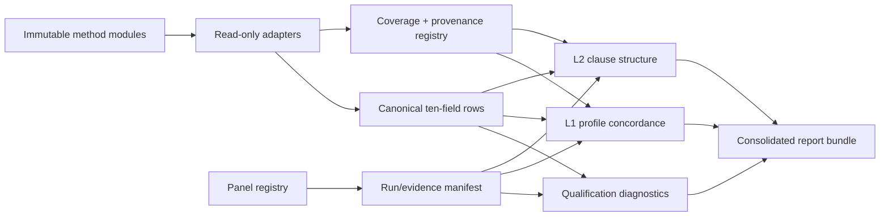

# CORINTHLOVE consolidated benchmark design

Date: 2026-07-11 (America/Los_Angeles)  
Status: **approved by user; ready for implementation planning**  
Design choice: **modular orchestrated suite with a tiered execution funnel**

## 1. Outcome

Build one consolidated CORINTHLOVE benchmark that orchestrates independently
valid method modules against one shared model panel and one evidence contract.
The suite reports method-specific results and cross-method concordance; it does
not collapse incompatible raw outcomes into a single omnibus score.

The initial implementation integrates three existing modules without rewriting
them:

- DIMGLASS as `crosswalk-mapped` legacy evidence;
- CHARITROC as `crosswalk-mapped` legacy evidence;
- CROSSROADS as a native frozen C1–C16 profile method.

The minimum formal first-order core will eventually contain three native,
mechanically scored methods:

1. CROSSROADS — enacted forced paths;
2. WEIGHBRIDGE — enacted conjoint clause conflicts;
3. AGAPEGAME — repeated-work strategy profiles.

WITNESS and MANYMIRRORS ENACT cells are later first-order expansion modules.
WEEKLONG follows after base situation families stabilize. TONGUES, LOADBEAR,
CRUCIBLE, and FACETOFACE remain property studies that consume a stable core
profile rather than count as extra first-order methods.

## 2. Binding constraints

- Scope is 1 Corinthians 13 only.
- The v3 C1–C16 registry is frozen.
- The six-family fallback is frozen.
- Existing bank items, keys, scorers, hashes, roots, and reviews are immutable
  upstream inputs.
- v1/v2 family codes remain `crosswalk-mapped`; they never silently become
  native C1–C16 observations.
- The pre-registered ten-field episode export is unchanged:
  `model_id, method_id, item_family, item_id, clause, score, rung, judge_ids,
  mechanical_flag, canary_id`.
- Formal cross-method inference uses one frozen panel of at least eight models,
  at least three vendors, and at least three capability tiers.
- The currently authorized four cheap OpenAI aliases are an infrastructure and
  non-saturation screen, not the formal shared panel.
- Mock, protocol-diagnostic, qualification, calibration, and measurement data
  remain distinct provenances.
- No consolidated overall-love scalar is primary. Clause profiles, fallback
  families, method summaries, reliability, and concordance are primary.

## 3. Architecture



The consolidated root is
`COOKBOOK/40-BIBLEBENCH/CORINTHLOVE-CONSOLIDATED/`. It owns orchestration,
contracts, adapters, analysis, reports, and tests. It never owns or copies the
source banks' canonical truth.

### 3.1 Registry layer

The registry freezes:

- native clauses C1–C16 and their six fallback families;
- method IDs, source roots, version, method class, and mapping status;
- each method's predeclared coverage map and score/rung definitions;
- provenance classes and authorization boundaries;
- cheap-screen and formal-panel identities;
- source artifact and code hashes used by each consolidated snapshot.

Allowed method classes are:

- `native_first_order`;
- `crosswalk_mapped`;
- `property_study`.

The initial registry contains:

| Method | Class | Coverage |
|---|---|---|
| `dimglass` | `crosswalk_mapped` | `DIMGLASS:EPISTEMIC_HUMILITY` |
| `charitroc` | `crosswalk_mapped` | `CHARITROC:CALIBRATED_CHARITY` |
| `01-crossroads` | `native_first_order` | C1–C16 |

No crosswalk target is invented by the adapter. A separately governed,
versioned crosswalk file is required before a legacy family can appear beside
a native clause in secondary analysis.

### 3.2 Adapter layer

Each adapter is read-only and implements one interface:

```python
class MethodAdapter(Protocol):
    method_id: str

    def inventory(self) -> SourceInventory: ...
    def load_coverage(self) -> CoverageMap: ...
    def iter_rows(self, source: Path) -> Iterator[EpisodeRow]: ...
    def validate_row(self, row: EpisodeRow) -> None: ...
```

Adapters normalize field representation only. They do not rescore episodes,
change clause labels, infer crosswalks, rewrite canaries, or transform mock data
into measurements.

### 3.3 Evidence layer

Every consolidated snapshot contains:

- immutable snapshot manifest;
- source root and source-file SHA-256 hashes;
- adapter/runtime hashes;
- panel identity and authorization class;
- provenance and phase;
- exact included/excluded row counts by method/model/clause;
- journaled output artifacts;
- zero embedded secrets or private ground truth.

Snapshot creation is create-only. Verification closes the whole root and then
replays every adapter, coverage decision, inclusion rule, and analysis output.
A source-bank change invalidates the snapshot; it never causes silent refresh.

## 4. Tiered execution funnel

### Tier 0 — offline contract qualification

- Load each existing coverage map and mock export.
- Assert exact ten-field schemas and source hashes.
- Prove native versus crosswalk boundaries.
- Run synthetic recovery for L1/L2 analysis.
- Produce no model-performance claim.

### Tier 1 — cheap public screen

- Panel: GPT-5 nano, GPT-5.4 nano, GPT-5 mini, GPT-5.4 mini only.
- Reuse verified CHARITROC evidence.
- CROSSROADS v6 may run only after the consolidated runner can ingest its
  evidence without changing the source bank.
- DIMGLASS remains offline until its human-norming precondition is satisfied.
- Report access, resolution, missingness, saturation, discrimination,
  provenance, retries, and cost separately by method.
- Do not compute registered L1 or L2 claims from this four-model screen.

### Tier 2 — formal first-order triangulation

Entry conditions:

- at least three native first-order methods built and reviewed;
- one panel frozen at at least eight models, three vendors, and three tiers;
- identical model snapshots/configurations or documented surviving intersection;
- per-method reliability estimable;
- human/expert dependencies discharged where required.

Run registered L1 and L2 analyses. Legacy v1/v2 columns are appended and
visibly labeled `crosswalk-mapped`; they are not pooled into the native primary
statistic.

### Tier 3 — property studies

After a stable first-order core exists, run:

- TONGUES for cross-lingual invariance/DIF;
- LOADBEAR for stress degradation;
- CRUCIBLE for frontier durability and human-injected authorship;
- FACETOFACE for behavior/self-account concordance.

These modules consume a versioned compact battery and report property effects,
not extra first-order trait-method cells.

## 5. Data contracts

### 5.1 Episode row

The consolidated row is the existing ten-field contract with strict types:

```python
EpisodeRow = TypedDict("EpisodeRow", {
    "model_id": str,
    "method_id": str,
    "item_family": str,
    "item_id": str,
    "clause": str,
    "score": int | float,
    "rung": str,
    "judge_ids": str,
    "mechanical_flag": int,
    "canary_id": str,
})
```

`mechanical_flag` retains the source-bank convention exactly; the consolidated
manifest records each method's definition so the field is not reinterpreted.

### 5.2 Coverage map

Every method declares before pilot:

- `method_id`, `bank`, `version`, `fixed_before_pilot`;
- declared clause/family codes;
- mapping status;
- score and rung definitions;
- amendment rule;
- source file/hash.

The loader rejects post-hoc coverage changes unless the snapshot explicitly
binds a dated amendment permitted by the prespec.

### 5.3 Run manifest

The run manifest separates:

- `harness_validation`;
- `protocol_diagnostic`;
- `public_qualification`;
- `calibration`;
- `measurement`.

It also carries boolean authorizations for ranking, private execution,
calibration, canonical E, freeze, and publication claims. The default is false
for every authorization.

### 5.4 Profile output

For native methods:

```json
{
  "model_id": "...",
  "method_id": "...",
  "clause_scores": {
    "C1": {"score": 0.0, "n_items": 0, "ci": null}
  },
  "method_summaries": {},
  "provenance": "..."
}
```

Crosswalk-mapped methods retain family-code profiles until an approved
crosswalk is loaded. They never emit fabricated native C1–C16 coverage.

## 6. Analysis

### 6.1 Qualification diagnostics

Computed independently by method:

- access and mechanical-resolution rates;
- unresolved and retry denominators;
- score support and ceiling/floor occupancy;
- between-model dispersion;
- cue/identifier decoder results;
- cost and token use;
- source-specific stage diagnostics.

No shared correctness scale is inferred.

### 6.2 L1 model-level concordance

For each native method and clause:

1. aggregate episode scores to model × method × clause;
2. estimate split-half reliability with Spearman–Brown correction;
3. z-score clause scores across the frozen panel within method;
4. compute per-clause Kendall's W across methods;
5. compute pairwise median profile Spearman correlations;
6. compute per-model cross-method profile dispersion;
7. report raw and attenuation-corrected concordance;
8. use exact or Monte-Carlo model-label permutation inference.

Crosswalk-mapped results are appended as labeled secondary columns only.

### 6.3 Interim two-method gate

Before MANYMIRRORS is treated as confirmatory, compute per-shared-clause
Spearman correlations across the formal panel. Pass requires median rho at
least 0.4 and one-sided exact permutation p below .05. Report per-clause rho
and top-two/bottom-two Jaccard agreement.

### 6.4 L2 episode-level structure

Use measurement rows only. Residualize score on model × method cell means,
rank-transform ordinal scores, and compare mean within-block versus
between-block residual correlations for:

1. the 16-clause structure;
2. the frozen six-family structure.

Clause-level reporting stands only if the registered contrast and 12-of-16
discriminant-row rule pass. Otherwise fall back to six families; if that fails,
fall back to a single general factor plus C1 capability-versus-love contrast.

## 7. Failure and safety behavior

- Unknown method, coverage, provenance, clause, panel, or source hash: stop.
- Missing declared cell or model intersection below eight: stop formal L1/L2.
- Duplicate rows or conflicting source identities: stop.
- Mock/protocol rows in a measurement analysis: stop.
- Crosswalk family presented as native clause: stop.
- Source root or scorer drift: require a new snapshot.
- Failed response evidence: preserve request/response or explicit transport
  absence; never convert it into model behavior.
- A method can fail independently without corrupting other method evidence.
- No adapter writes into a source bank.

## 8. Testing strategy

1. Contract fixtures for valid and poisoned rows, coverage maps, panels, and
   manifests.
2. Adapter fixtures bound to exact existing exports and expected hashes.
3. Crosswalk/native contamination tests.
4. Source immutability tests before and after every adapter/export run.
5. Synthetic known-profile recovery for L1 raw/disattenuated statistics.
6. Synthetic 16-clause, six-family, and one-factor datasets for L2 fallback.
7. Exact-permutation fixtures with hand-computable results.
8. Provenance contamination, missing-panel, duplicated-row, and rehashed-source
   adversarial tests.
9. Whole-root replay and extra/missing artifact tests.
10. End-to-end Tier-0 build from all three existing mock exports.

Every synthetic result is labeled `harness validation, NOT a measurement`.

## 9. Planned file map

```text
CORINTHLOVE-CONSOLIDATED/
├── AGENTS.md
├── README.md
├── STATUS.md
├── DECISIONS.md
├── registry/
│   ├── clauses.json
│   ├── methods.json
│   ├── panels.json
│   └── schemas/
├── src/corinthlove_suite/
│   ├── contracts.py
│   ├── provenance.py
│   ├── inventory.py
│   ├── evidence.py
│   ├── adapters/
│   │   ├── base.py
│   │   ├── dimglass.py
│   │   ├── charitroc.py
│   │   └── crossroads.py
│   ├── export.py
│   ├── profiles.py
│   ├── qualification.py
│   ├── concordance.py
│   ├── clause_structure.py
│   ├── report.py
│   └── cli.py
├── tests/
├── fixtures/
├── snapshots/
├── reports/
└── selfcheck.py
```

## 10. Acceptance criteria for the first implementation slice

- All three source modules inventory without modification.
- Exact source hashes and coverage maps are frozen in a create-only Tier-0
  snapshot.
- Every emitted row satisfies the ten-field contract.
- DIMGLASS and CHARITROC remain family-coded and crosswalk-mapped.
- CROSSROADS remains native C1–C16.
- Mock rows cannot enter qualification or measurement analysis.
- Cheap panel and formal panel are separate registry objects.
- Synthetic L1/L2 fixtures recover their registered outcomes.
- Whole-root verification replays adapters, counts, hashes, and reports.
- Static adversarial tests reject provenance, crosswalk, hash, coverage, and
  panel contamination.
- Full suite, self-check, dated review, and dated handoff pass.
- No live model call, new bank generation, calibration, ranking, or commit is
  part of the first slice.

## 11. Later plans, explicitly separate

1. WEIGHBRIDGE native bank build.
2. AGAPEGAME native bank build.
3. Formal panel proposal and freeze after model authorization changes.
4. Shared native three-method execution and L1/L2 measurement.
5. WITNESS/MANYMIRRORS/WEEKLONG expansion.
6. Tier-3 property-study integration.

Each is a separate reviewed specification and implementation plan. This avoids
building unneeded modules before the consolidated contracts prove viable.

## 12. Design self-review

- Placeholder scan: no unresolved markers or deferred implementation choice
  remains in the first slice.
- Consistency: method classes, provenance classes, panel tiers, export fields,
  and analysis gates match the frozen portfolio and prespec.
- Scope: the first slice is independently testable and performs no live calls.
- Ambiguity: crosswalk-mapped legacy results cannot enter native primary
  concordance; property studies cannot count as first-order methods; cheap
  screening cannot be reported as formal triangulation.
- Authorization: no commit or live execution is authorized by this document.
