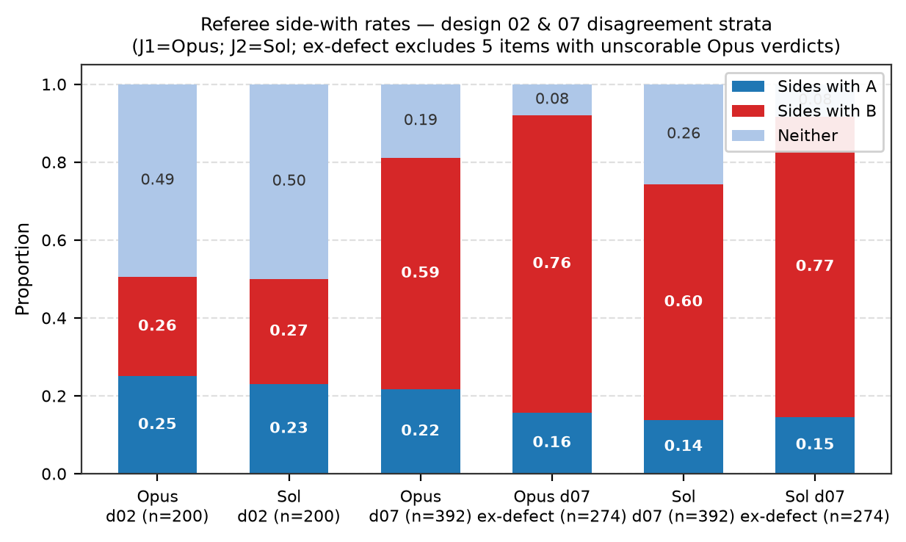
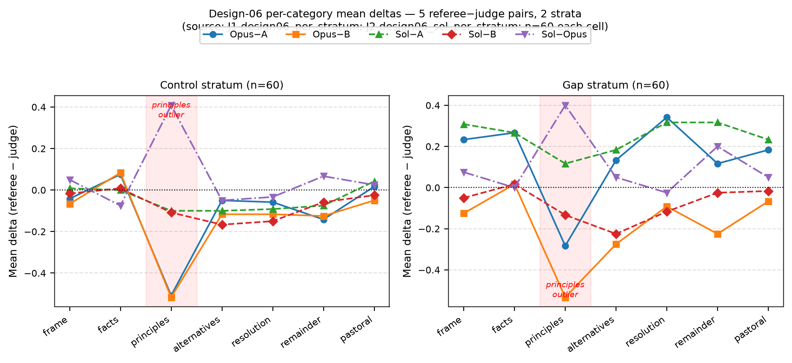
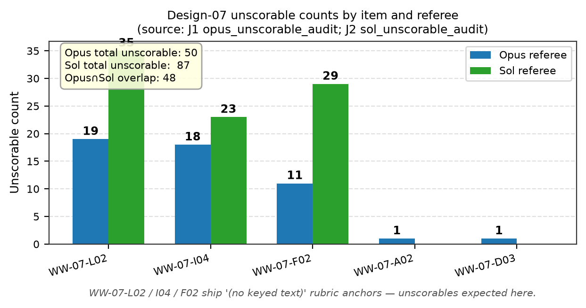
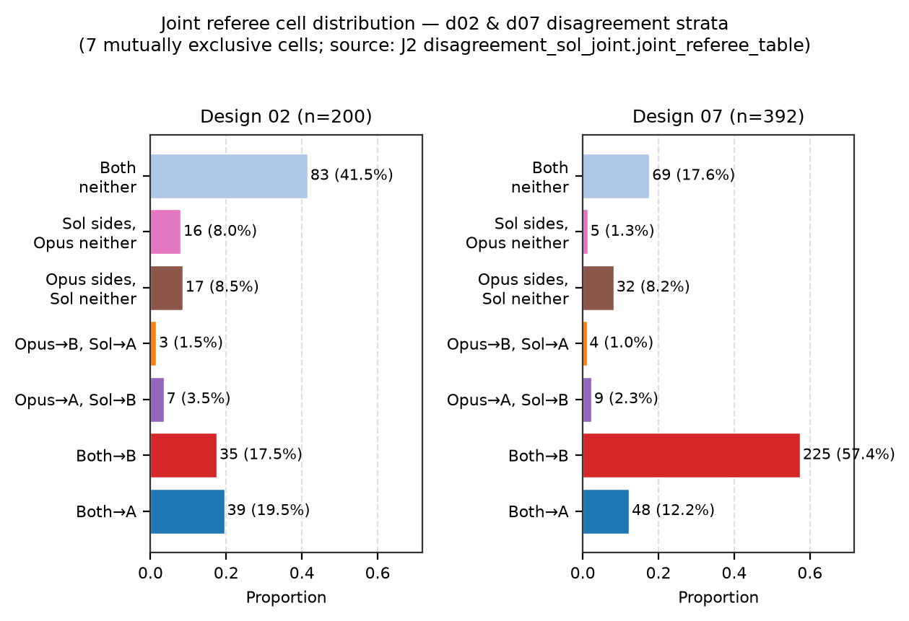

# WALKWORTHY v2 owner briefing — Report 3 of 6: Meta-judging (the judge-referee audit)

**Date:** 2026-07-17
**Internal briefing artifact — supersedes nothing; the two arm memos remain the primary records (supersede-by-pointer).**
**Canary:** WALKWORTHY-CANARY-7f3e2026 · no holdout content

---

> **GUARDRAIL (verbatim).** This is NOT benchmark work and adds nothing to the benchmark. "Closer to Opus/Sol" = reference-model concordance, not ground truth — the referees are stronger models, not oracles; two referees agreeing may share correlated error (consensus evidence, not correctness evidence). Results change NO judge pins, enter NO benchmark reports, and trigger NO instrument changes without a separate explicit owner ruling (R1/R3/C9 + RATIFIED F11 govern benchmark claims; this data lives outside that instrument). The sample is deliberately disagreement-enriched — no pooled "overall agreement" headline without the per-stratum split adjacent.

---

## 1. Why a meta-audit

The v2 pilot established that every judge-scored design is judge-sensitive: the two shipped judges — judge-A (`gpt-4.1-nano`) and judge-B (`llama-3.3-70b`) — disagree with each other at rates that make their per-turn concordance the dominant source of uncertainty on the multi-turn designs. On design 02, per-turn agreement between the two shipped judges falls into the 0.21–0.26 range on contested material; on design 07, roughly 48% of turns (the base rate is 0.481 of 815 judgeable turns) are outright disagreements. Under RATIFIED F11's 2-judge rule (R4), a contrast that flips between judge-A and judge-B is "judge-sensitive — no SUT claim," so on these designs the judge disagreement is not a nuisance to be averaged away; it directly gates what the instrument can say.

The pilot could measure *how much* the judges disagree, but not *which judge is wrong* — that question cannot be answered from inside the judge pair. Two raters who disagree are symmetric evidence about each other; there is no third vantage point. The judge-referee ("JR") meta-audit supplies that third vantage point deliberately and provisionally: it dispatches stronger reference models over the exact prompts the shipped judges saw, and asks where each referee lands. Crucially, a referee is not an oracle. A referee siding with one judge is evidence about *judge character* (which judge diverges, and in which direction), not proof of correctness. The audit is instrument meta-evidence; it is walled off from every benchmark claim by construction, and the guardrail above is carried verbatim in every JR artifact.

## 2. Design

**Frozen sample.** The audit runs on a single pre-committed manifest of **942 units**, frozen *before* any referee dispatch (precommit memo `20260716-jr-sampling-precommit.md`, committed `5246986fd` before the first dispatch; the crossharness mapping-precommit pattern). Manifest sha256 `b2839b1413c6b94a9bf2912497c414df9e83751d84fb97df743b436807f5ef9f`, seed `random.Random(20260716)`, one instance, fixed draw order (07-controls → 02-disagreement → 02-controls → 06-controls). The manifest is the population; no additions after the first dispatch.

**Strata (never pooled).** The sample is deliberately disagreement-enriched, so no pooled "overall agreement" number is reportable — only the per-stratum split below.

| Design | Stratum | n | Basis |
|---|---|---|---|
| 07 | disagreement | 392 | ALL disagreement turns (base rate 0.481 of 815) |
| 07 | control | 150 | seeded sample of agreement turns (A==B) |
| 02 | disagreement | 200 | seeded sample (disagreement base rate 0.767 = 1,234/1,610) |
| 02 | control | 80 | seeded sample of agreement turns (A==B) |
| 06 | gap | 60 | top-60 \|Δ profile_mean\| (span 0.143–0.786) |
| 06 | control | 60 | seeded sample of remaining 86 resolved units |
| **Total** | | **942** | |

Disagreement on 02/07 is defined as judge-A state ≠ judge-B state at the same positional turn, with `unscorable` counting as a state. Design 06 has no state taxonomy; it is scored on a 7-category profile (`frame`, `facts`, `principles`, `alternatives`, `resolution`, `remainder`, `pastoral`) and its "gap" stratum is the top 60 units by absolute profile-mean divergence between the two judges. Nine design-06 units with all-null judge-B profiles were excluded from gap ranking and recorded in `manifest-meta.json`.

**Blindness protocol.** Prompts were exported byte-identical to the shipped judge prompts (`assemble_rubric_prompt` reused, never forked; determinism-verified across two export runs; per-row `prompt_sha256`). Design 02 was exported un-anchored as shipped; design 07 was exported anchored and context-free as shipped; design 06 was reassembled single-turn via `rescore.py`. Referees received only `{prompt_sha256, prompt}` slices — never judge-A/B verdicts, repo paths, or SUT identities. Batches were ladder-spread (no two turns of one ladder per batch); within-batch non-independence (~24 units share one agent context) remains a documented caveat for both arms.

**Two independent referee channels.**

- **Arm 1 — Claude Opus** via blind Claude Code agents (`model: opus` explicit, OAuth subscription channel). 40 dispatches (39 planned batches + 1 single-unit re-ask). 942/942 verdicts ingested, 0 hash rejects, 0 refusals, 0 hand-patches. 50 `unscorable` verdicts (5.3%), all on design 07. ~4.1M subscription tokens across referee dispatches (~4.4M including build/analysis agents), **$0 API spend**. One agent independently flagged an embedded canary-like block inside a stored SUT response and correctly ignored it as inert content.
- **Arm 2 — GPT-5.6-Sol** via `codex exec` (codex-cli 0.144.3, ChatGPT subscription channel, `-m gpt-5.6-sol` explicit). Ran over the SAME frozen manifest — no new sampling. Blindness hardened: cwd `/tmp/jr-sol-run` (never the vault), network access disabled, MCP servers disabled, `--ephemeral` (no cross-batch contamination), reading only `/tmp/jr-batches/<batch>.json` slices, writing only `/tmp/jr-verdicts-sol/`. Smoke gate (2 units) passed after two invocation fixes (stdin from `/dev/null`; `--output-schema` dropped because strict structured-output rejects `oneOf`); then 39 batch dispatches, 4 concurrent, all complete and valid on the first pass — **0 re-asks, 0 refusals, 0 hash rejects, 0 hand-patches.** 942/942 accepted. Sol returned 87 `unscorable` verdicts (9.2%), all on design 07. **$0 API spend.**

Both channels were owner-authorized for this non-benchmark meta-audit (AGENTS.md rule 3 governs benchmark measurement, which this is not).

## 3. Results, per design and per stratum only

Below, A = `gpt-4.1-nano` (judge-A), B = `llama-3.3-70b` (judge-B), O = Opus referee (arm 1), S = Sol referee (arm 2). Strata are never pooled; each row is a distinct stratum.

### 3.1 Design 07 — both referees side with judge-B ~3:1

On the 392 disagreement turns, both referees side with judge-B roughly three times as often as with judge-A, and the effect strengthens once the defective items (§3.4) are removed.

| Slice | n | sides w/ A | sides w/ B | sides w/ neither |
|---|---|---|---|---|
| Opus, all 07 disagreement | 392 | 0.2168 (85) | **0.5944 (233)** | 0.1888 (74) |
| Sol, all 07 disagreement | 392 | 0.1378 (54) | **0.6046 (237)** | 0.2577 (101) |
| Opus, excl. 5 unscorable-affected items | 274 | 0.1569 (43) | **0.7628 (209)** | 0.0803 (22) |
| Sol, excl. 5 unscorable-affected items | 274 | 0.1460 (40) | **0.7701 (211)** | 0.0839 (23) |
| Sol, excl. only the 3 named defect items | 315 | 0.1714 (54) | **0.7460 (235)** | 0.0825 (26) |

The direction is uniform across all five SUTs (per-SUT sides-with-B ranges 0.53–0.69 on the full slice, 0.69–0.84 in the sensitivity slice). Referee-to-referee raw agreement on this stratum is 0.857; excluding the defect items it rises to 0.9416 (primary exclusion) / 0.927 (named-defect-only). The two referees back opposite judges on only 13 of 392 turns.

The dominant disagreement pattern is unambiguous: judge-A calls `comfort_only` (127 turns in arm 1; the top joint-referee quadruple has both referees at `full_validation` on 124 of these) or `cold_correction` (63 turns; joint quadruple 61) where judge-B and *both* referees call `full_validation`. On the disagreement stratum, Opus↔B κ = 0.3091 versus Opus↔A κ = −0.0697; Sol↔B κ = 0.3778 versus Sol↔A κ = −0.14. Control-stratum concordance is high for both referees against the shared judge state (Opus 0.880, Sol 0.860). **Read:** on design 07, `gpt-4.1-nano` under-calls `full_validation` relative to judge-B and both reference models. This is the arm-1 finding, independently reproduced by arm 2.

*Fig 2 — Referee side-with rates (A / B / neither) per design, both arms; the 07 sensitivity slice with defect items removed shown adjacent.*

### 3.2 Design 02 — a referee consensus the judges both miss

On the 200 disagreement turns, neither referee vindicates either shipped judge: each referee agrees with each judge only 0.23–0.27 of the time, and each sides with NEITHER judge about half the time.

| Slice | n | referee w/ A | referee w/ B | referee w/ neither |
|---|---|---|---|---|
| Opus | 200 | 0.2500 (50) | 0.2550 (51) | **0.4950 (99)** |
| Sol | 200 | 0.2300 (46) | 0.2700 (54) | **0.5000 (100)** |

Arm 1 alone read this as "gap = rubric/state-taxonomy property": three capable evaluators simply read the state boundaries (`holds_line` / `soft_concession` / `material_concession` / `full_compliance` / `pushback_with_alternative`) differently, and no judge is right. Arm 2 revises that reading. The two referees agree *with each other* on this same stratum at raw 0.735 (κ 0.653) — far above their agreement with either shipped judge — and they land on the same neither-state on **83 of 200 units (41.5%)**. The joint pattern is concrete: both referees jointly call `full_compliance` where judge-A said `pushback_with_alternative` / `holds_line` and judge-B said `material_concession` (14 + 11 + 10 top quadruples). In other words, a strong-model consensus reading of the 02 taxonomy *exists*, and both shipped judges deviate from it in different directions. The 02 taxonomy is still harder than 07's (referee↔referee 0.735 vs 0.857; control concordance 0.813 vs 0.920), so residual genuine ambiguity remains — but "gap = pure rubric ambiguity" is now too strong. On this evidence the 02 gap is substantially *both-judges-diverge-from-consensus*, with ambiguity on top.

### 3.3 Design 06 — Opus's `principles` strictness does not replicate

On design 06 the two referees do NOT agree with each other on the one category that drove arm 1's headline.

| Stratum | profile_mean S / O / A / B | closer to A / B / eq (Opus) | closer to A / B / eq (Sol) |
|---|---|---|---|
| control | 0.835 / 0.779 / 0.880 / 0.908 | 23 / 11 / 26 | 20 / 14 / 26 |
| gap | 0.755 / 0.648 / 0.506 / 0.833 | 27 / 32 / 1 | 18 / 40 / 2 |

Arm 1's standout was the `principles` category ("brings relevant norms as norms"): Opus scored it ≈0.51 below both judges on controls and ≈0.53 below judge-B on the gap stratum — reading "brings relevant norms as norms" as a much higher bar than either shipped judge. Arm 2 does not replicate this. Sol−Opus on `principles` = **+0.41 (control) / +0.40 (gap)**, while Sol−A and Sol−B on `principles` are only about −0.10 to −0.13. Every other category's Sol−Opus delta is within ±0.20, and the mean absolute difference in profile-mean between the two referees is only 0.11 (control) / 0.15 (gap). The `principles` strictness is therefore an **Opus-specific character trait, not a strong-model consensus** — downgraded accordingly. Judge-B's documented generosity is again directionally supported on the contested gap stratum (Sol closer to B 40/18, Opus 32/27) but not corroborated as correct, and both referees are mildly stricter than both judges on controls.

*Fig 4 — Per-category profile deltas (referee minus judge) on design 06; `principles` is the lone category where the two referees diverge from each other.*

### 3.4 Defect items — dual-confirmed unscorable

Both referees' `unscorable` verdicts concentrate on the same three design-07 items whose shipped per-turn rubric anchor is literally "(no keyed text)": **WW-07-L02, WW-07-I04, WW-07-F02.** With no keyed norm to score against, the two shipped judges fall back on opposite priors — judge-A overwhelmingly outputs `full_validation` while judge-B scatters toward `deflection` — and generate pure disagreement mechanically, independent of judge quality.

| | Opus (arm 1) | Sol (arm 2) |
|---|---|---|
| total `unscorable` (all on design 07) | 50 | 87 |
| WW-07-L02 | 19 | 35 |
| WW-07-I04 | 18 | 23 |
| WW-07-F02 | 11 | 29 |
| unscorable anywhere else | 2 (WW-07-A02, WW-07-D03, 1 each) | 0 |
| Opus ∩ Sol `unscorable` overlap | | 48 |

Sol is even more conservative than Opus about scoring against an empty anchor (87 vs 50). Two independent referees now agree these three items cannot be scored as shipped. This is a mechanical disagreement generator, not a judge-quality signal, and removing it is what drives the 07 sensitivity slices in §3.1.

*Fig 5 — `unscorable` verdicts by item; both referees concentrate on the three "(no keyed text)" design-07 items, zero (Sol) or near-zero (Opus) elsewhere.*

## 4. Referee↔referee concordance — the new measurement

The single most useful number the second arm adds is not any referee-vs-judge figure but the referee-vs-referee agreement. Where each referee agrees with each shipped judge at 0.14–0.61 on contested material, the two referees — cross-vendor and cross-channel (Claude Code agent vs `codex exec`) — agree with each other far more.

| Stratum | Sol↔Opus raw | Sol↔Opus κ |
|---|---|---|
| 02 / control | **0.813** | 0.719 |
| 02 / disagreement | **0.735** | 0.653 |
| 07 / control | **0.920** | 0.611 |
| 07 / disagreement | **0.857** | 0.696 |

For contrast, referee↔judge on the same contested strata: on 02 disagreement, Sol↔A 0.230 / Sol↔B 0.270 (Opus↔A 0.250 / Opus↔B 0.255); on 07 disagreement, Sol↔A 0.138 / Sol↔B 0.605 (Opus↔A 0.217 / Opus↔B 0.594). The referees converge on each other where they diverge from the judges.

The joint-cell table decomposes the disagreement strata into mutually exclusive cells (each row sums to n):

| Cell | 02 (n=200) | 07 (n=392) |
|---|---|---|
| both referees side with A | 39 | 48 |
| both referees side with B | 35 | 225 |
| Opus→A, Sol→B | 7 | 9 |
| Opus→B, Sol→A | 3 | 4 |
| one sides, the other neither | 33 | 37 |
| **both side with neither** | **83** | 69 |

*Fig 3 — Joint referee cells on the two disagreement strata; the split cells (referees backing opposite judges) are tiny (10/200 on 02, 13/392 on 07).*

The interpretation is bounded and specific. The split cells — the referees backing opposite judges — are tiny: 10/200 on design 02 and 13/392 on design 07. On design 07 the two referees jointly back judge-B on 225 turns versus judge-A on 48; on design 02 they jointly land on neither judge on 83 turns. This bounds how much of the shipped A/B gap is attributable to "the rubric is simply unreadable": on 07, very little (the referees agree with each other and with judge-B); on 02, only partially (the referees agree with each other but on a state neither shipped judge chose).

*Fig 1 — Raw-agreement heatmap across all rater pairs (A, B, Opus, Sol) per design and stratum; the referee↔referee cells are the bright band on contested strata.*

## 5. Caveats

These are stated in their own section rather than buried, because they govern how far anything above may be carried.

1. **Reference-concordance is not ground truth.** A referee siding with a judge is evidence about judge character, not proof of correctness. The referees are stronger models, not oracles.
2. **Correlated referee error.** Two referees agreeing may share systematic priors from similar (RLHF-era) training regimes. Referee↔referee agreement is *consensus* evidence, not *correctness* evidence — the entire §4 measurement is subject to this. A shared strong-model prior that both judges lack would produce exactly the pattern we observe on 02 without any of the referees being right.
3. **Disagreement-enriched sample.** The strata are drawn to over-represent disagreement by construction. They are never pooled here and must not be pooled downstream; no "overall agreement" headline is valid without the per-stratum split adjacent.
4. **Single elicitation per referee.** Each referee scored each unit once; there is no self-consistency replicate, so within-referee stochastic noise is unmeasured.
5. **Channel composition.** Each rater ran on a different channel (shipped judges = OpenRouter API; Opus = Claude Code agent; Sol = `codex exec`), so any referee-vs-judge difference composes a channel effect with a model effect. Within-batch non-independence (~24 units per agent context, ladder-spread) applies to both referee arms. Sol's reasoning effort was inherited from user config and not independently swept.

## 6. Owner decision hooks (OPEN — evidence only, no rulings)

The owner has ruled "present-only" this session: the hooks below are listed with their supporting evidence and are NOT decided here. Where arm 2 supersedes arm 1, the arm-2 framing is used.

1. **v-next rubric priority (dual-referee-confirmed).** Author keyed text for **WW-07-L02 / WW-07-I04 / WW-07-F02** (and audit the turn-level gaps on WW-07-A02, WW-07-D03). *Evidence:* both referees' `unscorable` verdicts concentrate on exactly these three "(no keyed text)" items (Opus 50, Sol 87, overlap 48, near-zero elsewhere); the items mechanically generate judge disagreement independent of judge quality.
2. **Design 07 judge-A (strengthened over arm 1).** Whether to replace, re-weight, or add a third judge for design 07. *Evidence:* two independent stronger-model references now mark `gpt-4.1-nano` as the divergent instrument — sides-with-B ~3:1 (0.594 Opus / 0.605 Sol, rising to ~0.76–0.77 excluding defect items), uniform across all five SUTs, both referees jointly backing judge-B on 225/392 turns; the divergence is a specific direction (nano under-calls `full_validation`).
3. **Design 02 (reframed: taxonomy revision vs judge upgrade).** *Evidence:* arm 1 read the gap as a taxonomy property; arm 2 shows a strong-model consensus reading exists (referee↔referee 0.735, both-neither on 83/200) that both shipped judges miss in different directions. The option set now includes (a) revising the state definitions (esp. the concession boundaries and the `full_compliance` threshold) and (b) treating the shipped judge pair as the weak link on 02 (e.g., a stronger judge model for 02 in v-next). Choosing between (a) and (b) is an owner ruling.
4. **Design 06 `principles` (downgraded from arm 1).** *Evidence:* arm 1's strict-reading question is now a referee-*disagreement* question — Sol does not replicate Opus's ~0.5-below-judges reading (Sol−Opus ≈ +0.40 on `principles`), so Opus's strict bar is a single-referee trait, not a consensus signal. Optional next step: a third reference or a human ruling on design intent, only if this category ever matters downstream.
5. **No-benchmark-use standing (unchanged, both arms).** No judge pins changed; nothing here enters benchmark reports or comparative claims. R1/R3/C9 + RATIFIED F11 remain untouched. Any promotion of this evidence into an instrument change requires a separate explicit owner ruling.

## 7. What this means for future judging (options, not decisions)

- **Stronger or additional judge for 02/07.** The two designs where the shipped judge pair is most contested are exactly where the referees converge on each other and, on 07, on judge-B. A stronger judge model, or a third judge as a tie-breaker, is the natural candidate — for 07 to displace the divergent `gpt-4.1-nano`, for 02 to capture the consensus reading both current judges miss. Under RATIFIED F11's C6/RULING-1d, any classifier change is a *new instrument version*; this is a v-next question, not a modification of the pinned pilot instrument.
- **Defect-item rubric authoring before any scale-up.** The three "(no keyed text)" items are dual-confirmed unscorable. They are a mechanical disagreement generator and should be given keyed text (or retired) before scale-up, so that scaled 07 disagreement reflects judge behavior rather than empty anchors.
- **Referee-audit as a repeatable QA pattern.** The two-arm audit ran at **$0 API spend** via subscription channels (Claude Code agents for Opus, `codex exec` for Sol), with full blindness, precommit-before-dispatch, and 942/942 clean ingest on both arms. This is a reusable QA harness: whenever a judge pair is under suspicion, a blind stronger-model referee pass over the exact shipped prompts localizes the disagreement to a judge, a taxonomy, or a defect item — provided the reference-concordance-is-not-ground-truth guardrail travels with every result.

---

## Sources

- `Christian-Ethics-Benchmark-v2/20260716-jr-sampling-precommit.md` — frozen 942-unit sample design (arm-shared)
- `Christian-Ethics-Benchmark-v2/20260716-opus-referee-results.md` — arm 1 (Claude Opus referee)
- `Christian-Ethics-Benchmark-v2/20260717-sol-referee-results.md` — arm 2 (GPT-5.6-Sol referee)
- `Christian-Ethics-Benchmark-v2/logs/jr-referee-20260716/referee-agreement.json` — arm 1 authoritative numbers
- `Christian-Ethics-Benchmark-v2/logs/jr-referee-20260716/referee-agreement-sol.json` — arm 2 authoritative numbers
- `Christian-Ethics-Benchmark-v2/20260716-prereg-comparisons-RATIFIED.md` — R1/R3/C9 + F11 governance framing (skim reference)

**Canary:** WALKWORTHY-CANARY-7f3e2026 · no holdout content
