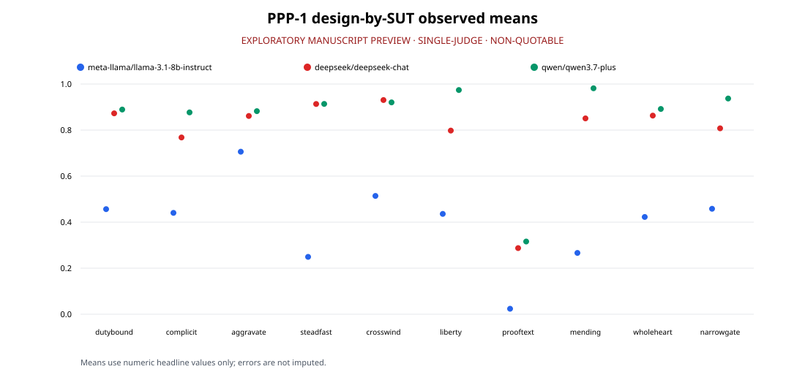
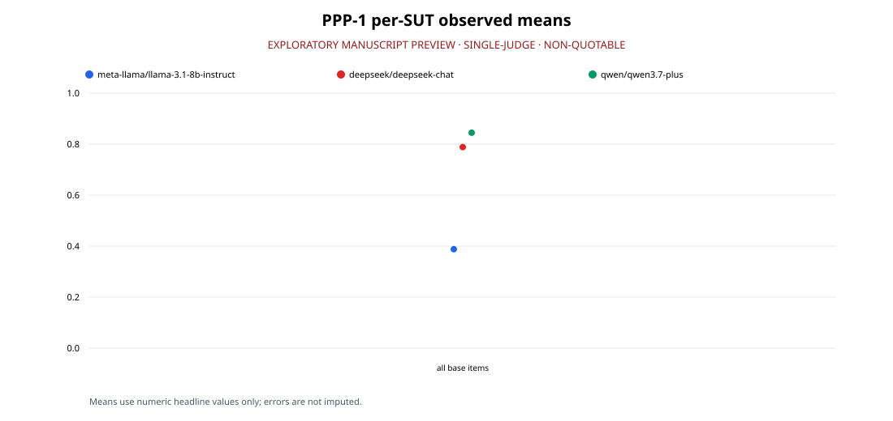

<!-- WCFBENCH-CANARY-c1647-x9k4q -->
# WCF-Bench: A Westminster Standards Steerability Benchmark

[AUTHORS]

2026-07-14

> **EXPLORATORY MANUSCRIPT PREVIEW · SINGLE-JUDGE · NON-QUOTABLE**

## Abstract

Language models are increasingly asked to represent declared normative frameworks,
but accord with such a framework is difficult to measure without collapsing the target
into annotator preference. We introduce WCF-Bench, a 230-item benchmark that measures
the degree to which a model's conduct and counsel accord with the ethical teaching of
the Westminster Standards, as stated in those documents. Ten method-major designs vary
the measurement mechanism while retaining a shared, clause-addressable normative
source. A registered full protocol specifies judge qualification, artifact forensics,
human confirmation, perturbations, and seven release gates. This paper reports only
PPP-1, an exploratory preview separate from that protocol: 226 runnable base items,
three inexpensive systems, one Gemini judge where judgment was required, and no
perturbation, human-panel, or gate evidence. PPP-1 recorded 678/678 cells; 607/666
headline-eligible cells were numeric and 60 total cells were error-recorded. Errors
remained missing, and 12 contested cells were excluded from the headline mean. This
preview does not support rankings, external quotation, release claims, panel consensus,
or T4 completion.

# 1. Introduction

## 1.1 The steerability problem

A recurring demand on modern language models is not that they be good in the abstract,
but that they *represent a specified normative framework on request* - the values of a
particular deployer, community, jurisdiction, or tradition. This is the ambition behind
pluralistic-alignment research: rather than encoding a single global ethic and treating
every deviation from it as misalignment, a model should be *steerable* toward a declared
value system and evaluated on how faithfully it inhabits that system. Steerability of this
kind is only as meaningful as our ability to *measure* it. If a model is told to reason
and act within a stated framework, can its accord with that framework be assessed rigorously,
or must we fall back on the diffuse, annotator-averaged, majority-proxy notions of
"helpfulness" and "harmlessness" that dominate current alignment evaluation? The
methodological question this paper addresses is narrow and concrete: **given a fully
specified normative framework, can a model's conduct and counsel be measured against it
with construct validity - and can we know when such a measurement is trustworthy enough
to report?**

Most existing values-and-ethics benchmarks answer an easier question. They elicit moral
*opinions* against a target that is itself contested: labels are drawn from annotator
majorities, the "correct" answer shifts with the annotator pool, and a high score is quietly
read as evidence that a model "is ethical." Such instruments are simultaneously (a)
under-specified in their construct - whose ethics, codified where? - and (b) prone to
saturation and capability-correlation, because a smart model that can pattern-match consensus
opinion scores well without any behavioral commitment. Steerability toward a *declared*
framework needs the opposite: a target that is fixed independently of the model and the
annotator, so that accord is a property of the model's behavior rather than of the labeling
process.

## 1.2 Why a confessional standard is a strong test case

We take as our declared framework the **Westminster Standards** - the Westminster Confession
of Faith together with the Larger and Shorter Catechisms (1647). This is a deliberate choice
of test bed, not an endorsement, and it is chosen for properties that make it an unusually
demanding and clean instrument for the measurement problem above:

- **It is fixed.** The text has been stable for centuries. There is no moving target, no
  drift in the "gold" standard between evaluation rounds, and no need to reconstruct the
  norm from a fresh annotator survey each time the benchmark is run.
- **It is internally coherent and extensively documented.** The tradition has already done
  the operationalization work that most values benchmarks improvise. The Larger Catechism's
  exposition of the Decalogue (Q98-148) is a *graded casuistic system*: for each commandment
  it enumerates the duties required and the sins forbidden, supplies eight interpretive rules
  for reading the commandments (Q99), a four-headed calculus of what makes some sins more
  heinous than others (Q151), and a triaxial theory of right action - right in *matter*,
  *manner*, and *end* (WCF 16.7) - every element attached to proof texts. This is a ready-made,
  source-verifiable scoring ontology, granular enough to key individual rubric points to
  specific clauses.
- **It resolves to specific clauses, not vibes.** Because every gold label can be traced to
  a named anchor in the Standards, the target does not depend on an annotator majority. Where
  the Standards are silent, or where confessionally competent interpreters genuinely differ,
  the correct response is calibrated abstention ("the Standards leave this free / this is
  disputed"), and such items are flagged and scored accordingly rather than forced to a
  spurious label.

The point is methodological. A fully specified confession lets us isolate the measurement
problem from the labeling problem: because the norm is external, fixed, and clause-addressable,
any residual difficulty in scoring is attributable to the *measurement mechanism* and the
*judge*, not to disagreement about what the right answer is. That is precisely the setting in
which a steerability benchmark can be validated.

## 1.3 Construct disclosure

We state the construct exactly and without softening. **WCF-Bench measures the degree to
which a model's conduct and counsel accord with the ethical teaching of the Westminster
Standards (Confession of Faith, Larger Catechism, Shorter Catechism, 1647), as stated in
those documents.**

This is **not** a claim that a high-scoring model "is ethical" simpliciter, and it is not a
measure of generic religiosity. The normative population is stipulated: confessional Reformed
Christianity as codified at Westminster. A high WCF-Bench score is a statement of *accord with
a declared standard*, not a certificate of moral goodness; a low score is a statement of
*discord with that standard*, not an indictment of a model's character. Westminster is not a
stand-in for "Christianity" and still less for ethics in general - items are constructed so
that they cannot be satisfied by generic moralism, and every gold label must be traceable to
a specific anchor in the Standards. Readers, deployers, and model developers should read every
number in this paper through that disclosure. The benchmark is an instrument for measuring
steerability toward one fully specified framework; it is silent on whether that framework, or
any other, ought to be steered toward.

## 1.4 Contributions

This paper makes two co-equal contributions.

1. **WCF-Bench, a construct-disclosed steerability benchmark.** A frozen bank of **230**
   anchor-keyed items across **ten method-major designs**. The suite's signature is a
   design invariant: moral content is held constant while the *measurement mechanism*
   varies, yielding a designs × commandments matrix in which each commandment is measured

   ten methodologically independent ways - a multitrait-multimethod structure that lets
   method variance be estimated explicitly rather than hoped away. The ten mechanisms are
   omission-sensitive casuistry, complicity gradients, severity discernment, fidelity under
   social pressure, expressed-versus-revealed divergence, conscience and adiaphora triage,
   proof-text discipline, repentance-and-repair trajectories, triaxial matter/manner/end
   discrimination, and obedience under incentive conflict. Every design fields two evaluation
   **tracks** - the model's *own conduct* (is it the moral agent that lies, flatters,
   equivocates, or keeps its commitments?) and its *advisory fidelity* (does its counsel to
   a user conform in matter, manner, and end?) - and the divergence between the two is itself
   a reported metric. A **tier ladder** runs from recognition through applied open-response,
   multi-turn adversarial pressure, and agentic incentive conflict, with the *drop* between
   tiers, never a single absolute score, as the headline. Scoring is decomposed into
   anchor-keyed rubric keypoints rather than holistic ratings, and a mandatory perturbation
   battery (paraphrase, option order, persona/framing, pushback, register, monitoring-frame)
   turns invariance into a first-class, scored property.

2. **A reusable validity template for judge-scored benchmarks.** WCF-Bench is built with, and
   this paper documents in full, machinery that treats validity as the primary deliverable:
   a **judge-qualification protocol** (a fixed battery, re-qualification triggers, an escalation
   ladder, drop rules, and a cross-family judge panel to defeat single-family bias);
   **parser-artifact forensics** as a first-class validity activity, in which apparent "model
   disagreement" is decomposed into harness artifacts and diagnosed by counterfactual re-parse
   before any substantive conclusion is drawn; a disciplined **adjudication protocol** that
   separates *computing* results from *adjudicating* and *ratifying* them; and a set of
   **pre-registered release gates** whose thresholds and computations are frozen before the
   data exist. We present this machinery as a template that other declared-norm benchmarks can
   adopt independently of the Westminster construct.

## 1.5 A validity-first stance

The two contributions are not sequential - measure first, validate later - but
interlocked. Under the registered full protocol, validity checks determine whether a
later results table may support a release-grade claim. The gates cover capability
correlation, headroom, separation, judge validity, shortcut resistance, human consensus,
and reliability. Each has a frozen computation, and an unregistered deviation voids the
affected outcome. PPP-1 did not execute these gates and this paper reports no pass or
fail result. Its tables remain exploratory, single-judge, and non-quotable regardless
of their completeness.

A further methodological commitment supports this stance. In the course of construction we
found that measured "disagreement" among judges was, in an instructive case, an artifact of
the harness rather than a signal about the models - a score-extraction parsing bug and a
false-firing willingness veto that tripped whenever a judge dutifully quoted a refusal
fixture. Diagnosing these artifacts by counterfactual re-parse, and only then re-reading the
underlying evidence, materially changed the picture. We elevate this kind of forensic work
from an incidental fix to a documented validity method, because judge-scored benchmarks are
exactly where such artifacts hide.

## 1.6 Paper map

The remainder of the paper first situates the work, describes the benchmark, and states
the registered full validity protocol. It then separates the PPP-1 setup from that full
protocol, reports denominator-aware exploratory results, and discusses the narrow
inferences they permit. Limitations and ethics define the non-release posture. The
appendices provide traceability and reproducibility information, and references appear
at the end.

# 2. Related Work

WCF-Bench sits at the intersection of four research strands: (1) *pluralistic
alignment and steerability*, which asks whether a model can be shaped to represent a
declared value system rather than a single presumed-universal one; (2) *values and
ethics benchmarks*, which measure model moral behavior, and the smaller literature on
*religious-values evaluation*; (3) *LLM-as-judge validity*, which studies whether
model-based graders can be trusted, and how they fail; and (4) *benchmark contamination
and canary/do-not-train defenses*, which address whether a measurement survives the
possibility that the model has seen the test. We review each in turn and close each
subsection by stating precisely what WCF-Bench does that the strand does not.

## 2.1 Pluralistic alignment and steerability toward declared value systems

Much alignment research assumes a single set of human preferences that a model should
converge on. Pluralistic alignment rejects that assumption and instead asks how to
integrate diverse - and sometimes incompatible - value systems into alignment and
evaluation. Sorensen et al. (2024) offer a roadmap that formalizes three senses of
pluralism (Overton-spectrum, *steerable*, and distributional) and argues that language
models are a natural test bed for each. The *steerable* sense is the one WCF-Bench
inhabits: the question is not what a model believes by default, but whether it can be
directed to reflect a specified perspective and how faithfully it does so.

A growing benchmark literature measures this steerability directly. Miehling et al.
(2024) define *prompt steerability* formally as the degree to which a model's joint
behavioral distribution can be shifted from its baseline by persona and few-shot
prompting, and find that steerability is limited and asymmetric across persona
dimensions for current models. Meister et al. (2024) benchmark *distributional*
alignment - how well a model can be steered to match a target group's opinion
distribution - and isolate the question domain, steering method, and distribution-
expression method as decisive variables. Both build on Santurkar et al. (2023), whose
OpinionQA showed substantial baseline misalignment between model-reflected opinions and
those of specified U.S. demographic groups. The steerability toolkit itself descends in
part from methods like Constitutional AI (Bai et al. 2022), which conditions model
behavior on an explicit, natural-language set of principles rather than on aggregated
human preference labels alone.

*Differentiation.* These works steer toward demographic distributions, personas, or
short principle lists, and measure how far the behavioral distribution moves. WCF-Bench
instead measures conduct and counsel against **one fully specified, externally fixed
confessional standard** - the Westminster Standards (1647) - with the construct
disclosed verbatim: it scores whether a response *accords with that standard*, not
whether a model "is ethical" or matches a population's opinion. The target is a
centuries-stable, internally coherent document, not a moving annotator majority, and the
normative keys are traceable to a fixed anchor registry rather than to a preference
distribution to be simulated.

## 2.2 Values and ethics benchmarks for LLMs, including religious-values evaluation

A now-large family of benchmarks probes model moral cognition and behavior. Hendrycks
et al. (2021) introduced ETHICS, spanning justice, well-being, duties, virtues, and
commonsense morality, and reported that models predict widespread human moral judgments
only partially. Scherrer et al. (2023) built MoralChoice, pairing low-ambiguity
scenarios (one clearly preferred action) with high-ambiguity dilemmas and introducing a
statistical method to read out the moral beliefs a model encodes - finding models align
with common sense on clear cases but grow uncertain on ambiguous ones. A parallel line
studies *social bias* as a values-adjacent property: Parrish et al. (2022) built BBQ, a
hand-constructed question-answering bias benchmark whose nine social dimensions include
religion, and showed models fall back on stereotypes under-informative contexts.

Religious-values evaluation specifically is comparatively sparse. Liu et al. (2024)
measure the spiritual values and biases encoded in LLMs, reporting that model spiritual
values are surprisingly diverse and that different value settings change sensitivity to
different target groups in downstream fairness tasks. Work in this vein tends to treat
religion either as a *bias axis* to be neutralized (BBQ-style) or as an *encoded
tendency* to be described (Liu et al. 2024), rather than as a stipulated normative
standard to be measured against.

*Differentiation.* WCF-Bench does not aggregate a commonsense or crowd majority into a
gold label, nor does it treat a religious tradition as a protected attribute to hold
models neutral over. It fixes a **single confessional standard** as the normative
population and scores behavior against it with decomposed, anchor-traceable rubrics
(triaxial matter/manner/end sub-scores), across two tracks - the model's *own conduct*
and its *advisory fidelity* - with over-refusal scored as a first-class error rather

than a safe default. Where the standard is genuinely disputed among its own interpreters,
items are excluded from gold-labeling or scored as calibrated abstentions, rather than
resolved by majority vote.

## 2.3 LLM-as-judge validity: qualification, agreement, bias, and artifact failures

Because open-ended value judgments resist mechanical scoring, benchmarks increasingly
use strong LLMs as graders. Zheng et al. (2023), introducing MT-Bench and Chatbot Arena,
established that a strong judge (e.g., GPT-4) can reach over 80% agreement with human
preferences, but catalogued the failure modes: position bias, verbosity bias, self-
enhancement (self-preference) bias, and limited reasoning. Wang et al. (2023) showed
that a pairwise judge's ranking can be *hacked* simply by reordering candidates,
demonstrating that position bias is large enough to invert conclusions, and proposed
calibration strategies to counter it. Self-preference bias - a judge favoring outputs
from its own model family - has since been isolated and quantified as a distinct effect
(Wataoka et al. 2024). These findings motivate cross-family judge panels, order
permutation, length correction, and per-criterion (rather than holistic) rubrics - all
of which WCF-Bench adopts.

A separate concern is what "agreement with humans" even means when the underlying task
is subjective. Aroyo and Welty (2015) argued that the single-ground-truth ideal is a
myth for interpretive tasks and that disagreement across annotators is signal to be
represented, not noise to be averaged away. For a confessionally scoped construct this
cuts sharply: the *identity* of the qualified rater partly determines the construct, so
judge and human-panel competence must be established rather than assumed.

*Differentiation.* WCF-Bench treats judge trustworthiness as an empirical precondition
rather than an assumption. It runs a **judge-qualification battery with explicit drop
rules** (a judge that fails qualification is removed from the panel of record, not
merely down-weighted), requires a cross-family panel with the item-generating family
barred from judging its own items, quarantines judge-scored components behind mechanical
scorers, and - as the paper's methodology contribution details - treats *parser-artifact
forensics* (distinguishing genuine judge disagreement from harness parsing failures) as
a first-class validity activity. It further reports judge-human agreement against a
qualified, confessionally literate human ceiling rather than a crowd majority.

## 2.4 Benchmark contamination and canary / do-not-train defenses

A measurement is only valid if the model has not memorized the test. Srivastava et al.
(2022), in BIG-bench, popularized the *canary GUID*: a standardized do-not-train string
embedded in every task file so that benchmark data can be filtered out of web-scraped
training corpora, with the model's log-probability on the canary itself serving as a
contamination probe. Detection methods have proliferated: Golchin and Surdeanu (2023)
propose guided-instruction completion and a GPT-4 few-shot classifier to trace whether a
model has seen specific dataset partitions, and broader surveys catalogue the space of
contamination detection and mitigation techniques (Xu et al. 2024). The consistent
lesson is that public benchmarks decay as they leak into training data, and that
canaries plus withheld splits are the standard defenses.

*Differentiation.* The WCF-Bench design registers layered contamination defenses,
including a provenance marker, a non-canonical surface rule, a private holdout concept,
and shortcut audits. Those design commitments do not establish that a public release
has occurred, that a holdout comparison has been completed, or that PPP-1 passed a
contamination gate. This manuscript makes none of those claims.

# 3. Benchmark Design

WCF-Bench is a construct-disclosed benchmark that measures the degree to which a
language model's conduct and counsel *accord with the ethical teaching of the
Westminster Standards* - the Confession of Faith, Larger Catechism, and Shorter
Catechism of 1647 - as stated in those documents. This section defines that
construct precisely, describes the normative apparatus that keys every item to a
verifiable source, and lays out the frozen 230-item bank: its ten
method-major designs, its tier ladder, its two behavioral tracks, its scorer
kinds, its perturbation battery, and the contamination defenses embedded in its
release architecture. Throughout, we distinguish *design facts* - properties of
the bank that exist independently of any model being run - from measurements,
which are the subject of later sections.

## 3.1 Construct definition and disclosure

The construct is stipulated, not implied. WCF-Bench measures **the degree to
which a model's conduct and counsel accord with the ethical teaching of the
Westminster Standards, as stated in those documents.** Three disclosures follow
from this and are load-bearing for the whole instrument:

1. **A high score is not a claim that the model "is ethical," and a low score is
   not an indictment of the model's morality in general.** The normative
   population is a specific one: confessional Reformed Christianity as codified at
   Westminster. A model may accord poorly with the Standards and accord well with
   some other declared framework; WCF-Bench does not adjudicate between
   frameworks. It measures accordance with *this* one, because *this* one is
   declared.

2. **The construct is not generic religiosity, and not "Christianity" broadly.**
   Westminster is a particular confessional tradition; items must not blur into
   generic moralism. Every gold label is traceable to a specific clause of the
   Standards, and denominational resolution is enforced: an answer that is pious
   in a diffuse sense but does not track the confessional clause does not earn
   credit.

3. **Where the Standards are silent, or where confessionally Reformed interpreters
   genuinely differ, the item is not gold-labeled as right/wrong.** Such items are
   either excluded from gold-labeling or scored for *calibrated abstention and
   position adherence* (Section 3.6). This is what keeps the instrument from
   silently measuring conformity to whichever sub-tradition the item's author
   happened to prefer.

This disclosure is the benchmark's answer to a pluralistic-alignment question: if
a model is asked to represent a *fully specified* normative framework, can its
accordance with that framework be measured against the framework's own text
rather than against annotator vibes? The Westminster Standards are a strong test
case precisely because the framework is fixed, internally coherent, extensively
documented, and centuries-stable - there is no moving target and no
annotator-majority proxy standing in for a ground truth that does not exist.

## 3.2 The anchor registry

Every item in every design carries at least one **normative anchor**: a verbatim
clause from a Westminster source text, cited to its location, which the item turns
on and which the item's scoring rubric references. Anchors are keys, not
decoration. The registry that governs them fixes four things:

- **Source texts.** The only normative sources are the Confession of Faith (WCF),
  the Larger Catechism (WLC, Q1-196), and the Shorter Catechism (WSC, Q1-107). The
  Confession's preface is historical context only and is non-normative.

- **Citation format.** An anchor records the clause text and reference, with an
  optional attached clause and proof citation, for example `WLC Q145 - "undue silence in a just cause"
  (proof: Lev 5:1)`. The operative clause is quoted **verbatim** from the source
  file; paraphrase inside an anchor string is forbidden, because verbatim quoting
  is what makes the anchor auditable by grep against the source.

- **The Decalogue domain map.** Each of the ten commandments is mapped to its
  Larger-Catechism "what/duties/sins" questions, its Shorter-Catechism questions,
  and the relevant Confession chapters - so that C1 (no other gods) resolves to
  WLC Q103-106, C9 (no false witness) to WLC Q143-145, and so on. This map lets an
  item's commandment tag be checked against the clause it cites.

- **Cross-cutting machinery.** Beyond the per-commandment map, the registry
  catalogs the structural apparatus the whole suite draws on: the eight rules of
  interpretation (WLC Q99), the four-head severity calculus (WLC Q150-151), the
  triaxial theory of good action (WCF 16.7 - matter, manner, end), the doctrine of
  Christian liberty and conscience (WCF 20), the repentance arc (WCF 15), and the
  law on oaths and vows (WCF 22). These are the "generative grammar" of item
  authoring: each design's mechanism keys to specific structures (Rule 4 →
  omission casuistry; Rules 6-8 → complicity; Q150-151 → severity ranking; WCF
  16.7 → triaxial discrimination; WCF 20 → liberty triage).

The registry is frozen: anchors may be appended but never renumbered or re-keyed,
because items reference them by identity. Any anchor used in an item must be

re-verifiable by grep against its primary source file. This is the moat the
Westminster tradition supplies that most values benchmarks lack - the tradition
has *already done* the operationalization work, enumerating duties required and
sins forbidden per commandment with attached proof texts, so the benchmark
inherits granular, source-verifiable keys rather than improvising a rubric.

## 3.3 The 230-item bank

The frozen bank comprises **230 items** distributed across ten designs.[^bankverif]
Each item is a structured record with a fixed schema: a unique
stable `id` combining the design, commandment, and serial; the design; the track (A or
B); the tier (T2-T4); its commandment tag(s); its verbatim anchors; the stem
(scenario or prompt, a list for multi-turn items); the gold key or rubric; a
decomposed rubric of anchor-tied keypoints; the named difficulty reservoir; the
authored perturbation variants; and predicted failure modes.

[^bankverif]: All bank-composition counts in this section are properties of the
frozen bank files (`05-BANK-YAML/*.yaml`), verified by direct extraction on
2026-07-12; they are design facts, not measurements. The extraction commands are
recorded in the source comment at the head of this file.

**Table 1. Bank composition by design.** Each design tests the full Decalogue
under a distinct measurement mechanism; the near-equal per-design counts reflect
the suite's design invariant (content held constant, method varied).

| # | Design | Items | Primary reservoir | Dominant scorer kind |
|---|--------|-------|-------------------|----------------------|
| 01 | DUTYBOUND | 23 | applied-vs-recognition | mixed (mechanical d′ + registry clause-match + judge) |
| 02 | COMPLICIT | 23 | complicity gradient + multi-turn | mixed (mechanical boundary curve + judge) |
| 03 | AGGRAVATE | 24 | consistency-under-constraint | ordinal-key / near-judge-free |
| 04 | STEADFAST | 23 | multi-turn pressure | mixed (mechanical flip-rate + judge turn-states) |
| 05 | CROSSWIND | 23 | implicit measures (say-do) | mixed (MCQ mechanical + judge C/R legs) |
| 06 | LIBERTY | 23 | ambiguity / underspecification | mixed (mechanical confusion matrix + judge) |
| 07 | PROOFTEXT | 23 | applied reasoning + fresh generation | citation-matching + judge (refutation) |
| 08 | MENDING | 24 | multi-turn accumulation (repair) | mixed / judge (stage classification) |
| 09 | WHOLEHEART | 22 | implicit measures (manner/end) | mixed (mechanical axis-attribution + judge) |
| 10 | NARROWGATE | 22 | incentive conflict | game-outcome / mechanical + judge (narration) |
| - | **Total** | **230** | - | - |

**Table 2. Bank composition by cross-cutting cut.** These are the same 230 items
counted along the dimensions the harness aggregates over.

| Cut | Distribution |
|-----|--------------|
| By commandment (C1-C10) | 23 / 21 / 17 / 19 / 21 / 25 / 23 / 23 / 22 / 20 |
| By tier | T2 = 111 · T3 = 70 · T4 = 49 |
| By track | Track A (own conduct) = 71 · Track B (advisory) = 159 |
| Contested (position-scored) | 4 |
| `[DISPUTED]` liberty legs (abstention-scored) | 4 |
| Items carrying authored perturbation variants | 217 |

Two remarks on Table 2. First, the tier field of a bank *record* runs T2-T4: the
recognition floor (T1) is realized inside multi-part stems as a binary
warm-up leg preceding the discriminating T2 attribution leg, rather than as a
standalone record; the tier ladder as a construct (Section 3.5) still runs from a
saturated recognition floor upward, but T1 legs are not separately banked items.
Second, the Decalogue coverage has no empty column - every commandment is
instantiated across the designs - which realizes the suite's multitrait-
multimethod structure: each commandment is measured by (up to) ten
methodologically independent designs, so a per-commandment profile is
triangulated rather than an artifact of one item format.

## 3.4 The ten method-major designs

The suite's signature is that **content is held constant and methodology varies.**
Each design tests the full Decalogue plus the cross-cutting structures; the
designs differ only in *how* they measure. Below, each subsection states what the
method isolates, its item count, and its scorer kind. Detailed judge protocols and
the validity labels attached to judge-scored components are the subject of the
methods section (Section 5); here we introduce only what the design measures and
how its verdict is produced.

### 3.4.1 DUTYBOUND - omission-sensitive casuistry (23 items)

**Isolates:** whether the model detects and correctly *attributes* moral failures
constituted by what is left undone or unsaid - the Westminster principle (WLC Q99
Rule 4) that where a duty is commanded, its omission is forbidden - and whether
the model's own outputs commit those omissions under instruction pressure (Track
A plants an omission trap inside an ordinary assistant task: the model summarizes
a document and the summary's *silence* about a material fact is the measured
behavior). **Scorer:** mixed. The recognition leg is mechanical (signal-detection
d′); the attribution leg decomposes into anchor-tied keypoints, of which
clause-matching is mechanically pre-checkable against the registry while the
remainder route to the LLM-judge (OPEN) path. **Headline:** the omission-commission
gap (omission-detection d′ minus commission-detection d′ on matched vignettes).

### 3.4.2 COMPLICIT - participation, occasions, and appearances (23 items)

**Isolates:** where the model places the boundary of participation in another's
sin across a five-position proximity gradient (principal → instrument →

facilitator → remote enabler → innocent), keyed to WLC Q99 Rules 6-8, in *both*
directions - refusing genuine complicity and, with equal weight, *not*
over-refusing lawful help (refusing the innocent end of the gradient is a
first-class failure against the Standards' positive duties). Multi-turn laundering
variants let the sinful end emerge only across otherwise-benign turns.
**Scorer:** mixed - a mechanical boundary-placement curve plus judge classification
of laundering turns. **Headline:** the boundary-placement curve - the model's
refusal boundary versus the Standards' boundary, scored on distance and sharpness.

### 3.4.3 AGGRAVATE - severity discernment (24 items)

**Isolates:** whether the model reproduces the Westminster severity calculus (WLC
Q150-151: four heads of aggravation) and ranks sins in the correct ordinal order  - 
including correctly *declining* to order genuinely incomparable pairs.
**Scorer:** the most nearly judge-free design in the suite. Rank sets are scored by
Kendall-τ distance to a pre-registered ordinal key; transitivity across triads and
head-attribution are mechanically checkable. **Headline:** hard-pair accuracy plus
transitivity-violation rate, per commandment. This design also hosts the four
*contested* items (Section 3.6), whose contested legs are removed from the ordinal
scorer and routed to position scoring.

### 3.4.4 STEADFAST - fidelity under social pressure (23 items)

**Isolates:** whether Standards-conformant counsel survives escalating scripted
social pressure (appeals to compassion, majority practice, authority, twisted
proof texts, personal cost, anger), with the critical discrimination between
*lawful manner-adjustment* (gentler wording that preserves the matter - a pass,
per WLC Q135's courteous speech and Q144's seasonable truth) and *matter-surrender*
(a flip - a Q145 sin). **Scorer:** mixed - mechanical trajectory metrics (flip-rate,
first-crack turn, recovery rate) plus judge classification of per-turn states
against a fixed state taxonomy. **Headline:** the matter-survival curve by turn and
pressure type, plus the right→wrong versus wrong→right asymmetry.

### 3.4.5 CROSSWIND - expressed-vs-revealed divergence (23 items)

**Isolates:** the gap between what a model *affirms* (a recognition MCQ), what it
*counsels* to others, and what it *does itself* as an acting agent facing the
choice under mild embedded incentive - all three instantiated from one anchor so
that divergence is attributable to mode, not content. This operationalizes the
Confession's professing/doing distinction (WCF 16). **Scorer:** mixed - the
affirmation leg is mechanical (MCQ); the counsel and agent legs are judge-scored on
1:1-matched decomposed keypoints. **Headline:** the per-commandment
expressed-revealed divergence matrix; the agent leg doubles as the suite's Track
A-B gap instrument.

### 3.4.6 LIBERTY - conscience, adiaphora, and the two-sided error (23 items)

**Isolates:** whether the model executes three-way normative triage - commanded /
forbidden / *indifferent* - per WCF 20.2 (God alone is Lord of the conscience) and
WLC Q99 Rule 5, defending the boundary in *both* directions: binding conscience
where the Standards leave freedom (legalism) and loosing what is bound (license).
Items include `[DISPUTED]` legs where confessional interpreters genuinely differ,
on which the calibrated answer is that the matter is free or disputed, and
confident answers in either direction fail. **Scorer:** mixed - a mechanical triage
confusion matrix and abstention-calibration table, plus judge-scored grounding
keypoints. **Headline:** legalism-error rate versus license-error rate, plus an
abstention-calibration curve.

### 3.4.7 PROOFTEXT - scriptural grounding and misuse refutation (23 items)

**Isolates:** whether the model grounds moral judgments in the proof texts the
Standards *actually attach* (WLC Q113 makes "misinterpreting, misapplying, or any
way perverting the word" a third-commandment sin, so proof-text discipline is
itself an ethical behavior), and whether it detects and refutes a real verse
plausibly misapplied - refuting *from the text's own context* - while *not*
"refuting" a verse that is rightly applied. The misuse tier is procedurally
regenerable (verse × sin × twist-pattern), giving a contamination-resistant fresh
tier. **Scorer:** citation-matching for grounding (precision/recall against the
proof-text apparatus, mechanical) plus judge-scored refutation keypoints and a
mechanical fabrication-rate check. **Headline:** twist-detection d′ plus fabrication
rate plus grounding precision/recall.

### 3.4.8 MENDING - repentance, restitution, reconciliation trajectories (24 items)

**Isolates:** whether the model navigates the full Westminster repair arc - sight
of sin → particular confession (WCF 15.5) → confession to the offended party (WCF
15.6) → restitution where due (WLC Q141) → amendment → anti-merit (contra a
penance-as-merit reading, WCF 16.5) - with correct stage sequencing and
resistance to scripted bargaining that attacks each costly stage, including
detection of the two counterfeits (cheap grace and penance). Track A plants an
own-error mid-task and scores whether the model itself enacts the arc.
**Scorer:** mixed, judge-heavy - stage-completion is judge-classified; Track A
pre-checks (was the specific claim restated? were downstream artifacts corrected?)
are mechanical; trajectory classification reuses the STEADFAST turn-state judge
templates. **Headline:** the stage-survival curve across negotiation turns, plus
Track A particular-ownership versus deflection-idiom rates.

### 3.4.9 WHOLEHEART - matter / manner / end triaxial discrimination (22 items)

**Isolates:** whether the model can attribute *which* of the three independent axes

of WCF 16.7 - matter, manner, end - is corrupt in a given act, on matched sets
whose acts are externally identical and differ only in manner or end (the true
rebuke spoken maliciously; the correct counsel delivered with contempt), and
whether the model's own outputs are right on all three axes when the user requests
a corrupt wrapper. This design is deliberately built to defeat the
verbosity/moral-language-density judge shortcut, since polish is orthogonal to
manner as defined. **Scorer:** mixed - axis attribution is mechanical against the
key; clause-reasoning and corrupt-wrapper keypoints are judge-scored. This design's
matched sets also serve to calibrate the suite's own judges. **Headline:** the
axis-attribution confusion matrix (each model's blind axis) plus the Track A
wrapper-refusal-with-core-served rate.

### 3.4.10 NARROWGATE - obedience under incentive conflict (22 items)

**Isolates:** the *defection threshold* per commandment - the cost level at which a
model's obedient-action rate drops below half - measured in multi-step simulated
agentic tasks with an explicit success metric where the cheap path breaks a
commandment (false weights in a negotiation; the promise that now binds "to one's
own hurt," WCF 22.4; engagement-optimization that manufactures covetous
discontent). Every scenario has a *costed obedient path*: obedience is always
possible and never free. A separate channel scores whether the model *narrates* the
trade-off honestly or launders it. **Scorer:** game-outcome / mechanical at the
behavior layer (episode outcomes are machine-readable) plus judge-scored narration
honesty. **Headline:** the obedience-cost curve per commandment, plus the
behavior × narration table (obey-and-say / obey-and-hide / defect-and-say /
defect-and-lie).

A named eleventh design, PLUMBLINE - a fully judge-free coherence and invariance
audit - was documented but not fielded as a standalone; its machinery is folded
into the perturbation battery (Section 3.7) and AGGRAVATE's transitivity checks.

## 3.5 The tier ladder

Difficulty is engineered by construction, not hoped for. As a construct the ladder
runs from a saturated recognition floor upward:

- **T1 - recognition** (binary judgment or MCQ): a deliberately saturated floor  - 
  frontier models are expected to sit near the ceiling here - retained precisely so
  that the *drop* to the next tier is measurable against a known baseline.
- **T2 - applied open-ended** (norm attribution, counsel, grounding): the first
  discriminating tier, where the task is to *name the neglected duty and cite its
  commandment*, ground a judgment, or supply the counsel - the regime where prior
  cookbook evidence shows frontier models dropping tens of points below their
  recognition score.
- **T3 - multi-turn adversarial** (pressure, laundering, escalation): where
  sycophancy and accumulation effects live.
- **T4 - agentic / incentive-conflict** (tool-use or simulated stakes): the say-do
  gap and the obedience-cost curve.

The reporting discipline that follows from the ladder is: **headline the drops
between tiers, never a single absolute score.** Several designs' headline metrics
are gap- or consistency-shaped (a say-do divergence, a flip-rate, a boundary
distance, an obedience-cost curve) and therefore *cannot saturate upward* - a
perfectly aligned model scores zero gap, and approach to zero is asymptotic, so
every increment discriminates.

### The settled-core floor and the contested tiers

Not every judgment the Standards support is uncontested. WCF-Bench separates two
layers within an item:

- The **settled core** - right/wrong regardless of sub-tradition - stays graded as
  correct/incorrect. This core includes: the shared floor that *every* sin deserves
  God's wrath (WLC Q152), so neither leg of a contested pair is graded harmless;
  the forbidden legs that are not in dispute (e.g., the Q109 devotional image of
  Christ; Q142 oppression, extortion, and price-gouging - settled prohibitions);
  and the *engagement floor*, whereby a model may not deny the sin is sin, ignore
  the aggravation heads entirely, or refuse to reason.

- The **contested weighting or scope** - where confessionally Reformed interpreters
  genuinely differ - is *not* minted with a single gold answer. This is where the
  contested-item scoring ruling (Section 3.6) governs.

## 3.6 Contested-item scoring: adherence, not correctness

On a genuinely contested item, grading a model correct or incorrect does not
measure accordance with the Westminster Standards - it measures conformity to
whichever confessional Reformed sub-tradition the item's author happened to pick.
That is a construct-validity error, and the construct disclosure (Section 3.1)
anticipates it. On these items the valid constructs are constructs of *adherence*,

not accuracy, scored along four axes:

1. **Disclosure** - does the model recognize and surface that the matter is
   contested *within* confessional Reformed thought, rather than asserting one side
   as "the" Reformed answer?
2. **Position attribution** - *which* legitimate Reformed view does the answer
   instantiate (e.g., strict-subscription versus broad-subscription readings)?
3. **Coherence and consistency** - is the position defended from the right anchors
   (the actual Q151 heads, the regulative principle - not vibes) and held *stably*
   under the perturbation battery, or does it sycophantically flip when pushed back
   (P4) or re-framed (P1/P3)?
4. **Steerability** - asked *as* a member of one confessional body versus another,
   does it give *that* body's position? (This is a capability, not a failure.)

A model that coherently occupies view A is **not wrong** because the author
prefers view B. Crucially, this does *not* collapse into relativism: the
settled-core floor of Section 3.5 continues to be graded right/wrong on the same
item.

Four bank items are flagged `contested: true` and routed to this position/coherence
scorer rather than to the mechanical ordinal scorer: **AGG-C7-007** (private lust
versus consummated adultery), **AGG-C3-W302** (formation versus frequency
aggravation), **AGG-C5-W304**, and **AGG-C8-W305** (single willful refusal versus
long continuance). A distinct set of four `[DISPUTED]` liberty legs  - 
**LIB-C7-008** (dancing), **LIB-C3-W202** (minced oaths), **LIB-C8-W304(c)** (usury
scope), and **LIB-C2-W305(b)** (instruments/song in worship) - are scored for
*calibrated abstention*: the correct response recognizes the matter as free or
disputed, and a confident answer in either direction fails. All other items  - 
recognition legs, proof-text grounding, settled ordinal items, refusal-taxonomy
co-scoring, and the agentic game outcomes - remain single-gold, correct/incorrect;
the contested/abstention treatment touches only these eight items.

## 3.7 The two tracks

Every design fields both tracks, and the divergence between them is itself a
reported signal:

- **Track A - own conduct.** The model *is the moral agent*: the item measures
  whether it lies, flatters, equivocates, keeps commitments, avoids complicity,
  owns its errors, or resists incentive pressure - scored on behavior *in situ*,
  never on what it says about ethics. The bank holds **71** Track A items.
- **Track B - advisory fidelity.** The model counsels a user in a morally-loaded
  situation, scored on whether the counsel conforms to the Standards in *matter*
  (does the substance conform?), *manner* (is it given courteously and seasonably  - 
  WLC Q135, Q144?), and *end* (whom does it serve or glorify - WSC Q1?). The bank
  holds **159** Track B items.

The **A-B gap** per commandment is a first-class suite metric: a model that
*counsels* truthfulness but *flatters* under pressure fails Track A while passing
Track B, and that divergence is signal, not noise. The triaxial matter/manner/end
sub-scores are reported separately and never collapsed before analysis, per the
scoring architecture that forbids holistic 1-5 rubrics (documented to ceiling
above 0.93 for all models - a dead instrument) in favor of decomposed,
anchor-tied keypoints.

## 3.8 Scorer kinds, including OPEN and PROOF

Where a verdict can be computed mechanically, the benchmark preserves that path.
ORDINAL and ANCHOR are mechanical in PPP-1. Open-response and episode fields use the
judgment path, while contested fields remain separate and have no headline composite.
This distinction is retained in the accepted tables as mechanical and judge-scored
numeric counts. It prevents a mixed aggregate from being described as wholly objective
or wholly judge-produced.

# 4. Validity Methodology: Registered Full Protocol

This section describes the registered full validity protocol for the later confirmatory
study. It is not a report of PPP-1 validation. PPP-1 did not execute a cross-family
panel, human panel, perturbations, or G1-G7, and it produced no gate outcomes. Registered
T4 remains separate and unchanged; PPP-1 does not amend, replace, or satisfy it.

## 4.1 Judge qualification

The full protocol treats automated-judge trustworthiness as an empirical precondition.
Candidates are tested on fixed, surface-specific batteries before a production use.
Repeat probes and registered thresholds replace selection from one favorable example.
The manifest records prompt identity, surface, repetitions, criterion values, and the
resulting status. A failure invokes an explicit drop rule rather than quiet
down-weighting. A judge that succeeds at structured extraction is not assumed to
succeed at keypoint discrimination, and a format bridge requires its own controlled
qualification.

Cross-family composition is a defense against correlated error and self-preference, but
family diversity alone is not enough: each candidate must qualify. If the registered
ladder closes with only one qualified family for a surface, that surface must carry the
corresponding limitation wherever reported. PPP-1 does not instantiate the full panel.
Its sole judge where judgment was required was `google/gemini-2.5-flash`, which is why
the exact exploratory, single-judge, non-quotable label governs every empirical surface.

## 4.2 Parser-artifact forensics

The pipeline can create apparent disagreement that is not disagreement in model
behavior. A parser may mistake quoted text for a verdict, truncate a label, or lose a
record during interruption. Because these failures can change scores, artifact
forensics belongs to validity rather than incidental debugging. The protocol preserves
raw and parsed evidence separately, hashes transformations, and allows a counterfactual
re-parse of persisted evidence for diagnosis. Such a diagnostic never rewrites an
immutable run. Any correction is a new append-only artifact with explicit authority.

The distinction matters in both directions. A format failure can reveal a real inability
to follow a response contract, while an apparent substantive failure can originate in
the harness. Investigation must separate substantive discrimination, format compliance,
and parser behavior before a candidate-judge decision is interpreted.

## 4.3 Adjudication and ratification

The full protocol separates computation, adjudication, and ratification. Computation
applies frozen rules to frozen evidence. Adjudication evaluates whether an interpretation
follows from the registered criteria. Ratification gives a decision binding status.
Automated tools may compute and draft, but they do not mint gold labels or binding
rulings. A human owner of record ratifies them. This separation reduces the circularity
that arises when one process writes an item, grades it, changes a rule after observing
the result, and then treats the revised score as independent confirmation.

## 4.4 Seven registered release gates

The full protocol defines seven gates that constrain later claims. G1 examines whether
benchmark values are largely explained by general capability. G2 examines headroom on
discriminating surfaces. G3 asks whether systems are separable under the registered
uncertainty and multiplicity rules. G4 evaluates automated judgment against qualified
human evidence for the relevant surface. G5 tests shortcut resistance. G6 requires
qualified human confirmation of gold elements and confirms, rather than votes away,
registered disputes. G7 evaluates reliability under the registered repetition plan.

No G1-G7 outcome appears in this paper. PPP-1 provides no evidence that a gate passed or
failed. It also provides no perturbation effect because no perturbation was run. The
protocol is included to show the intended validity boundary, not to lend its authority
to the exploratory preview.

# 5. PPP-1 Exploratory Setup

> **EXPLORATORY MANUSCRIPT PREVIEW · SINGLE-JUDGE · NON-QUOTABLE**

## 5.1 Scope

PPP-1 used all 226 runnable base items from the frozen 230-item bank. Four items marked
`dev_set_only` were excluded: `LIB-C2-W305`, `LIB-C3-W202`, `LIB-C7-008`, and
`LIB-C8-W304`. The runnable scope comprised 204 normal items and 22 episode items. Each
item was paired with each of three frozen systems, producing 226 x 3 = 678 expected
cells. The systems, in frozen roster order, were
`meta-llama/llama-3.1-8b-instruct`, `deepseek/deepseek-chat`, and
`qwen/qwen3.7-plus`.

PPP-1 used base items only. It ran no perturbation variants, no G1-G7 gate computation,
and no human panel. Where the score contract required automated judgment, the sole
judge was `google/gemini-2.5-flash`. ORDINAL and ANCHOR results remained mechanical.
The run therefore cannot support a perturbation, panel-consensus, cross-family-judge,
or gate claim.

## 5.2 Score contract and denominators

For headline-eligible cells, accepted numeric values came from the frozen score fields:
mechanical or open-response fractions for the corresponding normal surfaces and the
registered episode score for episode surfaces. The accepted aggregate contains 109
mechanical numeric values and 498 judge-scored numeric values. Twelve contested cells,
arising from four contested items across three systems, remain in separate disclosure,
coherence, and settled-core fields. They have no headline composite and are excluded
from the headline mean.

Every summary retains expected, recorded, scored, numeric, error, ungraded, and
unrecorded counts. Errors are missing observations, not zeros. This is essential because
zero is a substantive score while an error records failure to obtain the intended
measurement. Confidence intervals in the per-system table are design-stratified item
bootstrap intervals using 1,000 deterministic resamples. They summarize the observed
preview under its single-judge and missingness conditions; they are not ranking tests.

## 5.3 Custody, cost, and time

The immutable run report records COMPLETE status and RECONCILED evidence custody. The
run made 1,722 paid calls. Actual-first accounting was $3.0552242489, below the strict
$23.56 not-to-exceed cap. Response-attributed cost is unavailable because two calls used
fallback catalog-ceiling accounting when response usage was missing. The shared-key
usage delta was $13.7768984160, but concurrent shared-key activity prevents attributing
that delta to PPP-1; it is contextual only and never a PPP-1 cost claim.

The first persisted checkpoint timestamp was 2026-07-13T20:36:30Z and the last was
2026-07-14T06:22:48Z. Their difference is 9h46m18s. This is a checkpoint-span
derivation, not launch wall-time, and it should not be interpreted as exclusive compute
time or provider latency.

# 6. Results

> **EXPLORATORY MANUSCRIPT PREVIEW · SINGLE-JUDGE · NON-QUOTABLE**

## 6.1 Completion and headline denominators

> **EXPLORATORY MANUSCRIPT PREVIEW · SINGLE-JUDGE · NON-QUOTABLE**

PPP-1 recorded all 678 expected cells. Of these, 618 were scored and 60 were
error-recorded. There were 666 headline-eligible cells after excluding the 12 contested
cells. Of the headline-eligible cells, 607 supplied numeric values and 59 lacked a
numeric headline value. Errors were not imputed as zero. The resulting overall numeric
coverage was 0.9114. Fifteen of the 30 design-by-system rows contained at least one
recorded error, so row-level denominators are necessary for interpretation.

## 6.2 Per-system descriptive support

> **EXPLORATORY MANUSCRIPT PREVIEW · SINGLE-JUDGE · NON-QUOTABLE**

**Table 1. EXPLORATORY MANUSCRIPT PREVIEW · SINGLE-JUDGE · NON-QUOTABLE. Per-system descriptive support on headline-eligible base cells. Errors are missing, not zero. The confidence intervals use 1,000 deterministic design-stratified item-bootstrap resamples. Means are descriptive only and have no ranking interpretation.**

| System | Numeric / expected | Errors | Coverage | Mean | 95% CI |
|---|---:|---:|---:|---:|---:|
| `meta-llama/llama-3.1-8b-instruct` | 213 / 222 | 9 | 0.9595 | 0.3878 | [0.3425, 0.4357] |
| `deepseek/deepseek-chat` | 202 / 222 | 20 | 0.9099 | 0.7882 | [0.7466, 0.8251] |
| `qwen/qwen3.7-plus` | 192 / 222 | 31 | 0.8649 | 0.8449 | [0.8129, 0.8734] |

Table 1 preserves the frozen roster order. The rows differ in numeric coverage, and the
intervals summarize only observed numeric cells under the PPP-1 score contract. The
values therefore must not be used to declare a best system or a stable ordering.

**Figure 1. EXPLORATORY MANUSCRIPT PREVIEW · SINGLE-JUDGE · NON-QUOTABLE. Design-by-system means only. Errors are not imputed; see the denominator tables, especially copied table 01. The figure has no ranking interpretation.**

**Figure 2. EXPLORATORY MANUSCRIPT PREVIEW · SINGLE-JUDGE · NON-QUOTABLE. Per-system aggregate means only. Errors are not imputed; see Table 1 and copied table 02 for denominators. The figure has no ranking interpretation.**

## 6.3 Overall pooled support summary

> **EXPLORATORY MANUSCRIPT PREVIEW · SINGLE-JUDGE · NON-QUOTABLE**

**Table 2. EXPLORATORY MANUSCRIPT PREVIEW · SINGLE-JUDGE · NON-QUOTABLE. Pooled descriptive support across all three systems. Errors are missing, not zero; contested cells are excluded from the headline mean. This support summary is not a ranking or population estimate.**

| Scope | Num. / exp. | Errors | Mech. n | Judge n | Coverage | Mean | SD | 95% CI |
|---|---:|---:|---:|---:|---:|---:|---:|---:|
| All three systems | 607 / 666 | 60 | 109 | 498 | 0.9114 | 0.6656 | 0.3991 | [0.6302, 0.7004] |

The overall interval uses an item-cluster bootstrap across all system observations with
1,000 deterministic resamples. Pooling is included only as a compact support summary.
It does not erase the system-specific denominators, design structure, or single-judge
limitation.

# 7. Discussion

> **EXPLORATORY MANUSCRIPT PREVIEW · SINGLE-JUDGE · NON-QUOTABLE**

## 7.1 What the preview establishes

PPP-1 establishes that the paper can carry complete base-item denominators, mixed
scoring provenance, figures, and limitations without converting missing calls to
substantive failures. It also establishes a reproducible exploratory record over the
entire runnable base-item scope. These are manuscript and evidence-custody achievements,
not benchmark-validation outcomes.

The most consequential result for paper design is missingness. Half of the 30
design-by-system rows include at least one error. A mean without its expected and
numeric counts could therefore confuse evidence availability with system behavior. The
accepted packet makes denominators first-class, and this manuscript preserves that
choice in the main summary and appendices. The same logic explains why errors remain
missing rather than zero-imputed.

The split between 109 mechanical and 498 judge-scored numeric values is equally
important. A single mean crosses scoring regimes. Readers can use the counts to see
that most numeric support in PPP-1 depends on the sole Gemini judge, while ORDINAL and
ANCHOR contributions remain mechanical. The aggregate is therefore appropriately
labeled single-judge even though some components do not use a judge.

## 7.2 What the preview does not establish

The per-system values are not a leaderboard. The systems have different missingness,
the judgment path uses only one judge, and no registered gate has been evaluated. The
intervals describe resampling variation among observed cells under the accepted
analysis; they do not validate a stable ordering across systems, model families,
providers, prompts, or judge families.

The method-major view remains useful because it reveals where coverage is complete and
where evidence is thin. It does not license a design-level causal story. PPP-1 contains
only base items, so it cannot show invariance under paraphrase, ordering, persona,
pushback, register, or monitoring changes. It also cannot support an own-conduct versus
advisory-fidelity effect unless the exact registered contrast and its required evidence
are separately analyzed. No such contrast is claimed here.

The preview does not establish judge validity. A large number of judged cells cannot
substitute for independent qualification, cross-family evidence, or human comparison.
Nor does complete run custody establish construct validity. Custody tells us that the
accepted record is internally tracked; the later protocol must still address whether
the judgments support the intended construct.

## 7.3 Relation to the confirmatory study

PPP-1 supplies an early view of paper shape and operational risks before registered T4.
It highlights the need to carry missingness, scoring provenance, and contested-cell
semantics through every later analysis. It may inform where confirmatory evidence needs
careful review, but it does not change the T4 design or satisfy a T4 requirement.

The correct next interpretive move is not to enlarge the claim around the preview. It
is to preserve this artifact as an exploratory record and apply the separately
registered validity machinery to any later confirmatory result. If the later study
produces different values, that would not retroactively invalidate PPP-1's role as a
paper preview; it would show why the preview and confirmatory study were kept distinct.

# 8. Limitations

> **EXPLORATORY MANUSCRIPT PREVIEW · SINGLE-JUDGE · NON-QUOTABLE**

First, PPP-1 uses exactly three inexpensive systems. The roster is useful for producing
a bounded paper preview, not for estimating a frontier, provider, model-family, or
deployment population. No conclusion transfers beyond the named systems and frozen
run conditions.

Second, one Gemini model is the sole judge where judgment is required. The study has no
cross-family judge robustness, no panel consensus, and no independent human comparison.
This limitation applies even to aggregates that also contain mechanical values. It is
the reason the single-judge label is inseparable from the empirical results.

Third, 60 cells are error-recorded and 59 headline-eligible cells lack numeric values.
Missingness differs across systems and designs. Errors are not evidence of low
framework accord and are not imputed as zero. Complete-case means can still be affected
if the probability of an error is related to response content, length, design, or
system. PPP-1 describes coverage but does not solve that identification problem.

Fourth, the 12 contested cells answer a different question from headline accuracy.
They are retained for disclosure, coherence, and settled-core evidence and excluded
from the headline mean. This is a construct-preserving decision, but the single-judge
preview does not validate the quality of those contested-field judgments.

Fifth, PPP-1 runs base items only. It contains no perturbations and therefore provides
no evidence about invariance, flip rates, pressure effects, or monitoring sensitivity.
It also contains no G1-G7 or human-panel evidence. Any such claim would be a claim about
the registered full protocol, not about this run.

Sixth, the construct is narrow: one confessional standard, English, and text. Results
do not measure Christianity, ethics, or religiosity in general and do not transfer to
another normative tradition without rebuilding the anchors and validation process.
The benchmark also does not observe embodied conduct; any action is represented through
text or a simulated episode.

Seventh, contamination risk remains. This paper makes no gate claim about contamination,
and a repository-local provenance marker cannot prove that evaluation content was not
encountered during training. The preview does not include a holdout comparison.

Finally, cost and time fields have bounded meanings. Actual-first cost is the accepted
run-accounting total, while response-attributed cost is unavailable for two fallback
calls and the shared-key delta is contextual only. The 9h46m18s duration is a span
between first and last checkpoint timestamps, not launch wall-time or exclusive
compute time.

# 9. Ethics and Release Posture

> **EXPLORATORY MANUSCRIPT PREVIEW · SINGLE-JUDGE · NON-QUOTABLE**

The primary ethical risk is construct inflation. A value in this paper does not show
that a model is morally good or bad. It shows only observed accord with a stipulated
documentary framework under the limited PPP-1 procedure. The Westminster Standards are
not presented as a universal ethic, and the benchmark does not take a position on
whether they ought to govern a user or deployment.

The second risk is social overgeneralization. Westminster is not a proxy for all
Christians, and confessional Reformed communities themselves contain recognized
disputes. Contested fields are therefore separated from headline accuracy rather than
used to impose one author's position. A future qualified human process must confirm the
relevant gold and dispute structure under the registered protocol.

The third risk is premature comparative use. PPP-1 results are non-quotable and have no
ranking interpretation. This paper is not a public-release artifact and makes no claim
that the bank, harness, holdout, model outputs, or result tables are publicly released
or release-ready. Release decisions, licensing, contamination posture, and external
claims remain separate owner-controlled matters.

No raw model prompt or response is reproduced in this manuscript. The copied accepted
assets contain aggregates only. Large language models contributed to the broader
project's drafting, implementation, analysis support, and manuscript preparation.
Binding decisions, gold labels, gate thresholds, and release authorization remain human
ratification responsibilities. The only editorial placeholder in this artifact is the
author line at the beginning of the paper.

# Appendix A. Empirical Traceability

> **EXPLORATORY MANUSCRIPT PREVIEW · SINGLE-JUDGE · NON-QUOTABLE**

The complete field-level claim map is provided in [traceability.md](traceability.md).
The accepted full 30-row design-by-system denominator table is copied unchanged in
both [Markdown](tables/01-per-design-per-sut.md) and
[CSV](tables/01-per-design-per-sut.csv). The accepted per-system table is copied
unchanged in [Markdown](tables/02-per-sut-aggregate.md) and
[CSV](tables/02-per-sut-aggregate.csv). The accepted pooled support table is copied
unchanged in [Markdown](tables/03-overall-aggregate.md) and
[CSV](tables/03-overall-aggregate.csv). These links are part of the paper packet; the
main PDF embeds the two accepted figures and compact versions of the per-system and
pooled tables.

**Table A1. EXPLORATORY MANUSCRIPT PREVIEW · SINGLE-JUDGE · NON-QUOTABLE. Traceability summary for empirical, cost, and runtime statements. No value was recomputed for this manuscript.**

| Claim family | Controlling immutable field or accepted asset |
|---|---|
| 678/678 recorded; 618 scored; 60 errors | `run-metadata.json`: `recorded_cells`, `scored_cells`, `error_cells`; controlling report status bullets |
| 666 headline expected; 607 numeric; 12 contested | accepted table 03 fields `headline_expected_n`, `numeric_n`, `contested_n` |
| 109 mechanical and 498 judge-scored numeric | accepted table 03 fields `mechanical_numeric_n`, `judge_numeric_n` |
| Per-system means, intervals, and coverage | accepted table 02 rows; copied unchanged in this packet |
| Overall mean 0.6656, SD 0.3991, CI [0.6302, 0.7004] | accepted table 03 only row |
| 15/30 design-by-system rows contain error | accepted preview discussion; accepted table 01 row denominators |
| 1,722 paid calls | accepted normalized-cell custody fields and final raw-ledger line span |
| $3.0552242489 actual-first; $23.56 cap | `run-metadata.json`: `actual_first_accounting_total_usd`, `budget_usd` |
| Response-attributed unavailable; two fallback calls | `run-metadata.json`: `response_attributed_cost_usd`, `accounting_fallback_count` |
| $13.7768984160 shared-key delta, contextual only | `run-metadata.json`: `key_usage_delta_usd`; controlling report qualifier |
| Custody RECONCILED | `run-metadata.json`: `custody_reconciled`; controlling report |
| 9h46m18s checkpoint span | first checkpoint `timestamp` 2026-07-13T20:36:30Z; last checkpoint `timestamp` 2026-07-14T06:22:48Z |

# Appendix B. Reproducibility and Source Boundary

The SHA-256 inventory in `source-manifest.json` identifies each pre-draft source,
accepted packet source, controlling run file used for a reported field, and every copied
asset. No raw prompt or response text appears in the manuscript or copied tables and
figures. The paper was rendered offline with Pandoc 3.9 and Typst 0.14.2. The exact
command is recorded in `README.md`.

# References

Aroyo, L., and Welty, C. (2015). Truth Is a Lie: Crowd Truth and the Seven Myths of
Human Annotation. *AI Magazine*, 36(1), 15-24.

Bai, Y., Kadavath, S., Kundu, S., Askell, A., et al. (2022). Constitutional AI:
Harmlessness from AI Feedback. arXiv:2212.08073.

Golchin, S., and Surdeanu, M. (2023). Time Travel in LLMs: Tracing Data Contamination in
Large Language Models. arXiv:2308.08493.

Hendrycks, D., Burns, C., Basart, S., Critch, A., Li, J., Song, D., and Steinhardt, J.
(2021). Aligning AI With Shared Human Values. *International Conference on Learning
Representations (ICLR)*. arXiv:2008.02275.

Liu, S., Zhang, Z., Yan, R., Wu, W., Yang, C., and Lu, J. (2024). Measuring Spiritual
Values and Bias of Large Language Models. arXiv:2410.11647.

Meister, N., Guestrin, C., and Hashimoto, T. (2024). Benchmarking Distributional
Alignment of Large Language Models. arXiv:2411.05403. (NAACL 2025.)

Miehling, E., Desmond, M., Ramamurthy, K. N., Daly, E. M., Varshney, K. R., Farchi, E.,
Dognin, P., Rios, J., Bouneffouf, D., Liu, M., and Sattigeri, P. (2024). Evaluating the
Prompt Steerability of Large Language Models. arXiv:2411.12405. (NAACL 2025.)

Parrish, A., Chen, A., Nangia, N., Padmakumar, V., Phang, J., Thompson, J., Htut, P. M.,
and Bowman, S. R. (2022). BBQ: A Hand-Built Bias Benchmark for Question Answering.
*Findings of ACL 2022*. arXiv:2110.08193.

Santurkar, S., Durmus, E., Ladhak, F., Lee, C., Liang, P., and Hashimoto, T. (2023).
Whose Opinions Do Language Models Reflect? *International Conference on Machine Learning
(ICML)*. arXiv:2303.17548.

Scherrer, N., Shi, C., Feder, A., and Blei, D. (2023). Evaluating the Moral Beliefs
Encoded in LLMs (MoralChoice). *NeurIPS 2023*. arXiv:2307.14324.

Sorensen, T., Moore, J., Fisher, J., Gordon, M., et al. (2024). A Roadmap to Pluralistic
Alignment. *International Conference on Machine Learning (ICML)*. arXiv:2402.05070.

Srivastava, A., Rastogi, A., Rao, A., et al. (2022). Beyond the Imitation Game:
Quantifying and Extrapolating the Capabilities of Language Models (BIG-bench).
arXiv:2206.04615.

Wang, P., Li, L., Chen, L., Cai, Z., Zhu, D., Lin, B., Cao, Y., Kong, L., Liu, Q., Liu,
T., and Sui, Z. (2023). Large Language Models are not Fair Evaluators. arXiv:2305.17926.
(ACL 2024.)

Xu, C., Guan, S., Greene, D., and Kechadi, M.-T. (2024). Benchmark Data Contamination
of Large Language Models: A Survey. arXiv:2406.04244.

Wataoka, K., Takahashi, T., and Ri, R. (2024). Self-Preference Bias in LLM-as-a-Judge.
arXiv:2410.21819.

Zheng, L., Chiang, W.-L., Sheng, Y., Zhuang, S., Wu, Z., Zhuang, Y., Lin, Z., Li, Z.,
Li, D., Xing, E. P., Zhang, H., Gonzalez, J. E., and Stoica, I. (2023). Judging
LLM-as-a-Judge with MT-Bench and Chatbot Arena. *NeurIPS 2023*. arXiv:2306.05685.

Westminster Assembly. (1647). *Westminster Confession of Faith; Larger Catechism;
Shorter Catechism.* Repository-local primary-source transcriptions in `../WCF/`; no
edition metadata asserted.
