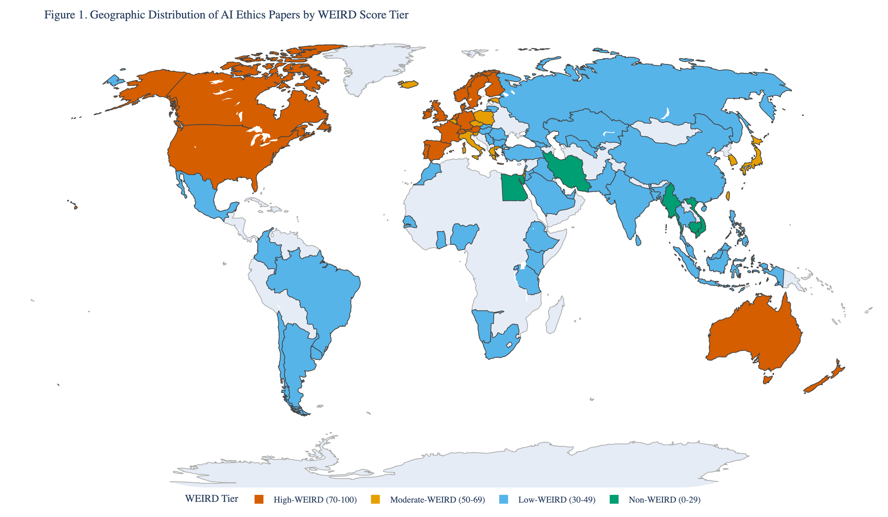

# 1. Introduction

## 1.1 Whose Values?

When a large language model is aligned with "human values," whose values does it learn? The question is not rhetorical. In the reinforcement learning from human feedback (RLHF) pipeline that now governs the behavior of the most widely deployed AI systems, a team of human labelers ranks model outputs according to criteria such as helpfulness, harmlessness, and honesty (Ouyang et al. 2022). These rankings are compressed into a reward model, and the language model is fine-tuned to maximize that reward. Constitutional AI extends this pattern by replacing per-sample human feedback with a set of explicit normative principles that the model uses to critique and revise its own outputs (Bai et al. 2022). In both cases, a specific set of moral intuitions---about what counts as helpful, what constitutes harm, and which values deserve deference---is baked into the system at training time. The pipeline is elegant, scalable, and almost entirely silent about the cultural provenance of the values it encodes.

Consider what this silence obscures. A Confucian ethicist would insist that moral reasoning begins not with individual rights or aggregate welfare but with the cultivation of *ren* (仁)---humaneness realized through the practice of reciprocal obligations within the five cardinal relationships (Wong 2020). An Ubuntu-oriented philosopher might argue that value alignment is not a problem about individual preferences at all, contending instead that personhood is constituted through communal bonds: *umuntu ngumuntu ngabantu*, a person is a person through other persons (Mhlambi 2020). A scholar of Islamic ethics would ask whether the system preserves the *maqasid al-shariah*---the higher objectives of protecting religion (*din*), life (*nafs*), intellect (*aql*), lineage (*nasl*), and wealth (*mal*)---that organize moral reasoning across a billion-person legal tradition. An Indigenous data sovereignty advocate would question whether the very act of encoding values into a centrally controlled model violates the CARE Principles of collective benefit, authority to control, responsibility, and ethics that govern Indigenous knowledge systems (Carroll et al. 2020). A practitioner of *buen vivir* would find the optimization framing itself incoherent, since well-being in the Andean cosmovision is not a quantity to be maximized but a state of harmony among humans, community, and the natural world.

These vignettes are necessarily compressed; the full philosophical depth of each tradition is developed in Section 1.4.

None of these moral vocabularies appears in the RLHF pipeline. None is represented among the labeler populations that shaped the reward models behind ChatGPT, Claude, or Gemini. The constitutional principles that Anthropic's models use to self-correct are drawn from sources including the Universal Declaration of Human Rights, Apple's Terms of Service, and other predominantly Western documents (Bai et al. 2022)---sources that, whatever their merits, represent one cultural tradition's attempt to articulate universal norms. The alignment enterprise proceeds as though the values it encodes are universal---or at least universally acceptable---when in fact they are drawn from a remarkably narrow cultural bandwidth.

The paradox is sharp: the field most urgently concerned with ensuring that AI serves *all* of humanity has not yet reckoned with the possibility that its normative foundations serve only a fraction of it. Across the 2,329 papers we analyze in this study, only 161 (6.9%) engage any non-Western normative framework at even a minimal detection threshold---and precision-adjusted estimates (see Section 3) suggest that genuine philosophical engagement is present in approximately 95 papers (4.1%). Indigenous relational ethics appears in 49 papers (adj. ~33), Confucian ethics in 38 (adj. ~14), Islamic ethics in 23 (adj. ~23), Ubuntu in 23 (adj. ~13), Buddhist ethics in 22 (adj. ~7), Dharmic ethics in 18 (adj. ~4), and Buen Vivir in 8 (adj. ~1). The remaining 93.1% of the literature operates within---or defaults to---the Western philosophical canon.

This paper argues that the problem is not merely one of scholarly representation. It is a **triple bind**: WEIRD scholarship produces the normative vocabulary of AI ethics; that vocabulary shapes the evaluation instruments (benchmarks) used to measure whether alignment has been achieved; and models optimized against those benchmarks internalize a monocultural default that they reproduce as though it were universal. The three layers---scholarship, evaluation infrastructure, and model behavior---are not independently biased; they are interdependently biased, each inheriting and reinforcing the monoculture of the layer that precedes it. The cycle operates without intention or coordination; it requires only that each stage draw on the outputs of the previous stage, which it inevitably does. This paper provides the first integrated empirical diagnosis of all three layers and their interaction.

## 1.2 Stakes and Consequences

**Figure 1.** Geographic distribution of 2,329 AI ethics papers by author affiliation, color-coded by WEIRD score tier. The dominance of High-WEIRD countries (North America, Western Europe, Australia) is visually striking; large portions of Africa, Central Asia, and Latin America remain unrepresented.

The stakes of this question extend well beyond academic taxonomy. AI systems aligned through RLHF and constitutional methods are not merely technical artifacts; they are normative infrastructures that encode particular conceptions of the good and export them at planetary scale. When the European Union's AI Act establishes risk categories grounded in Western liberal principles of individual autonomy and non-discrimination, and when that regulatory framework is adopted as a template by governments across Africa, Southeast Asia, and Latin America, the values embedded in the underlying research base travel with it (Jobin et al. 2019). When a foundation model trained on English-language preference data is deployed as a customer service agent in Jakarta, a health advisor in Lagos, or a legal assistant in Lima, its normative commitments---implicit in every refusal, every hedged response, every framing of a moral dilemma---shape moral discourse in communities whose own ethical traditions were absent from the training process.

This process is not unidirectional; countries such as Brazil, Nigeria, and India actively negotiate, modify, and in some cases reject Western regulatory models. But the gravitational pull of frameworks backed by economic power shapes the normative defaults.

Russell (2019) formalized the alignment problem as one of cooperative inverse reinforcement learning: the machine must infer human preferences from observed behavior while maintaining uncertainty about those preferences. But this formulation presupposes that the relevant preference distribution has been adequately sampled. Gabriel (2020) sharpened the point by distinguishing six possible alignment targets---instructions, expressed intentions, revealed preferences, informed preferences, objective interests, and moral values---and argued that the choice among them is itself a normative decision that cannot be delegated to engineering. If the research community that generates the conceptual foundations for alignment is culturally homogeneous, then the entire apparatus of preference elicitation, reward modeling, and principle selection inherits that homogeneity. The alignment problem becomes, in effect, a monoculture problem.

The empirical evidence for cultural variation in moral judgment is unambiguous. Awad et al. (2018) collected 40 million moral decisions from 2.3 million participants across 233 countries and territories through the Moral Machine experiment, revealing three distinct moral clusters---a Western cluster prioritizing individual rights, an Eastern cluster emphasizing respect for authority and the elderly, and a Southern cluster with weaker preferences for inaction---that map onto deep cultural and institutional differences. If moral intuitions vary this dramatically across populations, then an alignment pipeline that samples from only one cluster is not aligning AI with human values; it is aligning AI with *some* human values while rendering others invisible.

The consequences of this invisibility are not hypothetical. Sambasivan et al. (2021) documented how algorithmic fairness frameworks designed around U.S. racial categories fail to capture caste-based discrimination in India, where social hierarchy operates along axes---caste, religion, linguistic community---that are invisible to the dominant technical vocabulary. Klingefjord et al. (2024) argued that existing approaches to value elicitation in AI alignment suffer from a fundamental conceptual gap: they lack a clear account of what human values *are*, treating them interchangeably as preferences, norms, or moral principles without attending to the philosophical distinctions among these categories---distinctions that vary profoundly across cultural traditions. When the conceptual foundations are underspecified, the cultural assumptions embedded in those foundations become harder, not easier, to detect.

The governance export problem compounds the research skew. The UNESCO Recommendation on the Ethics of AI, the OECD AI Principles, and the EU AI Act have each been adopted or referenced as regulatory templates by dozens of countries. These instruments draw their normative content from the same Western-dominated research base that we document here. A country in the Global South that adopts the EU AI Act's risk framework is not merely importing a regulatory architecture; it is importing the implicit assumption that individual autonomy, privacy, and non-discrimination are the primary ethical values at stake in AI deployment---an assumption that may be reasonable within the liberal democratic tradition but that competes with, and potentially displaces, local normative commitments to communal welfare, relational harmony, or divine command.

## 1.3 The WEIRD Problem in AI Ethics

The parallel to experimental psychology is instructive and, we argue, structurally exact. In their landmark study, Henrich, Heine, and Norenzayan (2010) demonstrated that 96% of participants in published behavioral science research came from Western, Educated, Industrialized, Rich, and Democratic (WEIRD) societies, which represent only 12% of the world's population. They showed that WEIRD populations are statistical outliers on measures ranging from visual perception to cooperation norms to moral reasoning, yet the discipline had built its models of "human" cognition almost entirely from this unrepresentative sample.

More than fifteen years later, AI ethics faces an analogous problem. Jobin et al. (2019) surveyed 84 AI ethics guidelines and found convergence around five principles---transparency, justice, non-maleficence, responsibility, and privacy---but noted that the vast majority of issuing organizations were located in North America and Europe. Floridi et al. (2018) proposed the AI4People framework, which synthesized these principles into an overarching ethical architecture, yet the framework's intellectual genealogy is rooted almost entirely in Western bioethics and liberal political philosophy. Sorensen et al. (2024) outlined a roadmap for pluralistic alignment that would incorporate diverse value systems, but the field has yet to produce a systematic empirical account of how severe the cultural skew actually is.

Our analysis provides that account. Across 2,329 AI ethics papers published between 2010 and 2026, we find a mean WEIRD score of 64.5 on a 0--100 composite index, with 59.7% of papers scoring in the High-WEIRD range. Fully 60.1% of papers originate from institutions in North America and Western Europe. North America alone is overrepresented by a factor of 8.4 relative to its share of the global population. Sub-Saharan Africa, home to over a billion people and some of the world's richest moral philosophical traditions, accounts for 1.1% of the corpus. The WEIRD problem is not a metaphor borrowed from psychology; it is a measured property of the AI ethics literature itself. We note that our operationalization adapts the WEIRD construct from a participant-level diagnostic in psychology to a paper-level measure of institutional context---a related but not identical application, as we detail in Section 2.

The temporal dynamics are revealing. Non-Western framework engagement has grown from 3.7% of papers in 2019 to 8.2% in 2026, and the number of active publishing regions has expanded from seven to eleven. But this growth has not altered the fundamental structure of the field. The mean WEIRD score has declined by approximately 1.2 points per year over the same period, and the overwhelming majority of non-Western engagement takes the form of single-framework case studies that supplement rather than challenge the dominant Western analytical paradigm. Growth, in other words, can coexist with structural marginality.

## 1.4 Non-Western Normative Traditions

Despite growing recognition that AI ethics must engage non-Western normative traditions, the field's engagement remains fragmentary. Individual case studies have documented the relevance of Ubuntu philosophy to African AI governance (Mhlambi 2020), Confucian role ethics to East Asian algorithmic design (Wong 2020), Islamic ethics to technology regulation in Muslim-majority contexts, and Indigenous data sovereignty principles to algorithmic governance in Oceania (Carroll et al. 2020). These contributions are essential, but they remain isolated: each addresses a single tradition in a specific context, and none provides the bird's-eye view necessary to assess the field's overall cultural composition.

### 1.4.1 The WEIRD Critique and Cross-Cultural Psychology

Henrich, Heine, and Norenzayan (2010) transformed the behavioral sciences with a deceptively simple observation: 96% of participants in published psychology studies came from Western, Educated, Industrialized, Rich, and Democratic societies, which represent approximately 12% of the world's population. The problem was not merely one of sampling convenience. Across domains ranging from visual perception to spatial reasoning to moral judgment, WEIRD populations frequently occupied the tail of the global distribution rather than its center. The findings that generations of psychologists had assumed to be species-typical turned out, in many cases, to be species-unusual.

The implications for moral psychology were particularly profound. Markus and Kitayama (1991) had already demonstrated that the "independent self"---the autonomous, bounded individual who is the protagonist of Western moral philosophy---is a culturally specific construction. In East Asian, South Asian, and many African and Latin American societies, self-construal is fundamentally interdependent: persons are constituted through their relationships, obligations, and social roles. This distinction between independent and interdependent selves is not merely a difference in emphasis; it reflects divergent ontologies of moral agency that structure how people reason about rights, duties, harm, and fairness. This distinction between independent and interdependent selves is not merely a difference in emphasis; it reflects divergent ontologies of moral agency that structure how people reason about rights, duties, harm, and fairness.

Subsequent frameworks further elaborated the dimensionality of cultural variation. Gelfand et al. (2011) demonstrated across 33 nations that cultures vary systematically in "tightness" (strong social norms with low tolerance for deviance) versus "looseness" (weak norms with high tolerance), and that this dimension is predicted by ecological and historical threat exposure. Tight cultures---including Pakistan, India, and Malaysia---develop strong norm enforcement to coordinate collective responses to resource scarcity, territorial conflict, and disease. Loose cultures---including the Netherlands, New Zealand, and the United States---afford greater individual latitude. This dimension has direct implications for AI governance: what counts as appropriate behavioral constraint on an AI system is likely to vary systematically along the tight-loose axis.

Schwartz (2012) proposed ten basic human values organized along two orthogonal dimensions---openness to change versus conservation, and self-enhancement versus self-transcendence---and demonstrated both cross-cultural universality in value structure and substantial cross-cultural variation in value priority. Inglehart and Welzel (2005) mapped this variation at the societal level, plotting nations along dimensions of traditional versus secular-rational values and survival versus self-expression values, finding that cultural heritage clusters (Protestant European, Confucian, Islamic, etc.) predict value orientations more strongly than economic development alone. Both frameworks demonstrate that while societies recognize similar value categories, they weight them differently---a finding with direct implications for any alignment approach that must aggregate across populations.

Shweder's (1997) "Big Three" ethics provided a direct bridge between cultural psychology and moral philosophy. Shweder argued that moral reasoning worldwide draws on three distinct ethics---autonomy (individual rights and justice), community (duty, hierarchy, and role-based obligation), and divinity (purity, sanctity, and the sacred order)---but that Western moral psychology had operationalized almost exclusively the ethic of autonomy. Haidt and Graham extended this insight into Moral Foundations Theory, identifying five (later six) foundations---care/harm, fairness/cheating, loyalty/betrayal, authority/subversion, and sanctity/degradation---and demonstrating that the relative weight assigned to these foundations varies both within and across cultures. Atari et al. (2023) pushed this agenda further, developing the Moral Foundations Questionnaire 2 and testing it across 19 countries to map the "nomological network" of morality beyond WEIRD samples, finding that the structure of moral cognition itself---not merely its content---varies across cultural contexts.

The largest empirical demonstration of cross-cultural moral variation in an AI-relevant domain remains Awad et al.'s (2018) Moral Machine experiment. By collecting 40 million moral decisions from participants across 233 countries and territories, Awad and colleagues identified three geographically coherent moral clusters: a Western cluster (North America, Western Europe) that prioritized individual autonomy and sparing the young; an Eastern cluster (East Asia, parts of South Asia) that showed stronger preferences for respecting elders and social status; and a Southern cluster (Latin America, parts of the Middle East and Africa) with intermediate preferences and stronger emphasis on sparing women. These clusters correlated with cultural variables (individualism-collectivism), institutional variables (rule of law, economic inequality), and religious heritage. The moral intuitions that Western ethicists might treat as self-evident---that younger lives should be prioritized over older ones, that social status should be irrelevant to life-or-death decisions---are, empirically, culturally contingent.

The WEIRD critique has catalyzed a reform movement in psychology, with calls for mandatory cross-cultural replication, diversification of participant pools, and theoretical frameworks that treat cultural variation as signal rather than noise (Rad et al. 2018; Apicella et al. 2020). We argue that a parallel critique is warranted---and overdue---in AI ethics. But the stakes are different. Psychology's WEIRD problem is primarily epistemological: do these empirical findings generalize? AI ethics' WEIRD problem is primarily normative: should these values be imposed on populations that do not share them?

### 1.4.2 The AI Ethics Landscape

The past decade has witnessed an extraordinary proliferation of AI ethics principles, guidelines, and frameworks. Jobin, Ienca, and Vayena (2019) mapped 84 such documents and identified a global convergence around five ethical principles: transparency, justice and fairness, non-maleficence, responsibility, and privacy. This convergence was taken by some as evidence of an emerging consensus. But Jobin et al. also documented substantial divergence in how these principles were interpreted, why they were deemed important, and what implementation mechanisms were proposed. The convergence, in other words, was at the level of vocabulary rather than substance. This shared vocabulary, while insufficient on its own, has created a discursive space within which more substantive disagreements---including the cross-cultural disagreements this paper documents---can be articulated.

Floridi et al. (2018), synthesizing the work of the AI4People initiative, proposed a framework organized around the four principles of biomedical ethics---beneficence, non-maleficence, autonomy, and justice---augmented with a fifth principle, explicability, intended to capture the distinctive opacity of machine learning systems. The framework was influential, not least because it made the analogy to medical ethics explicit. Yet the analogy also revealed a structural limitation. As Mittelstadt (2019) argued in a systematic critique, the apparent convergence of AI ethics around principles of medical ethics masked four critical disanalogies. Unlike medicine, AI development lacks common aims and fiduciary duties: there is no equivalent of the patient whose interests are granted primacy. It lacks a professional history and established norms. It lacks proven methods to translate principles into practice. And it lacks robust legal and professional accountability mechanisms. Without these institutional supports, principles function as "aspirational wallpaper"---they describe ideals without creating obligations.

Fjeld et al. (2020), in the Berkman Klein Center's Principled Artificial Intelligence project, extended the mapping effort to 36 prominent documents and identified eight thematic clusters: privacy, accountability, safety and security, transparency and explainability, fairness and non-discrimination, human control of technology, professional responsibility, and promotion of human values. The breadth of this taxonomy underscored both the scope of normative concern and the absence of prioritization: when everything is a principle, nothing is an effective constraint.

The institutional geography of AI ethics production compounded the cultural limitation. Schiff et al. (2021) documented that guidelines were overwhelmingly produced by actors in North America and Western Europe, with private companies and government agencies accounting for nearly half of all documents. Hagerty and Rubinov (2019), comparing national AI strategies, found that non-Western normative concepts were almost entirely absent from the global policy discourse. The convergence that Jobin et al. observed was, as our analysis in Section 3 will confirm, in part a convergence of authorship: similar institutions, in similar countries, staffed by similarly trained researchers, arrived at similar conclusions. This convergence is also a convergence of epistemic power: the institutional infrastructure of guideline production---the research universities, funding agencies, and policy think tanks that generate and disseminate AI ethics frameworks---is concentrated in the same regions that dominate AI development itself, creating a self-reinforcing cycle in which the values of the most powerful actors are mistaken for universal norms.

UNESCO's (2021) Recommendation on the Ethics of Artificial Intelligence represented an attempt to broaden this foundation, achieving adoption by 193 member states and incorporating language around cultural diversity, environmental sustainability, and proportionality. Yet the recommendation remained at a level of abstraction that accommodated divergent interpretations, and its non-binding status limited its governance force. Whittlestone et al. (2019) had already identified a more fundamental problem: even where principles are broadly agreed upon, they generate tensions in practice---transparency can conflict with privacy, fairness with efficiency, individual autonomy with collective welfare---and the resolution of these tensions is inherently value-laden. Without explicit engagement with whose values are doing the resolving, principle-based frameworks reproduce the normative commitments of their authors.

A second wave of critique sharpened these concerns. Bender et al. (2021) drew attention to the environmental and social costs of large language models and to the exclusionary dynamics of training data that overrepresents English-language, Western-origin text. Madaio et al. (2020) documented through organizational fieldwork the gap between AI ethics principles and practitioner behavior, finding that checklists and guidelines had minimal impact on development decisions without institutional incentives and accountability structures. Morley et al. (2020) charted the emerging transition from principle enumeration to operationalization---from "what" to "how"---signaling that a second generation of AI ethics work is moving beyond principlist convergence toward implementation and institutional design. Bietti (2020) sharpened this critique, arguing that the proliferation of ethics guidelines by technology companies constitutes "ethics washing"---a strategic deployment of ethical language to forestall regulation while maintaining extractive business practices. The emerging consensus, in other words, was not a consensus at all---it was an echo chamber. Principles converge because they reflect the same Western liberal tradition; without enforcement mechanisms, cultural specificity, or meaningful voice for affected communities, they risk legitimating the very power asymmetries they purport to address.

### 1.4.3 Values Alignment: The Cultural Pipeline

The values alignment problem---how to ensure AI systems act in accordance with human values---has been treated primarily as a technical challenge. Yet every technical choice in the alignment pipeline encodes cultural assumptions about what values are, whose values matter, and how values should be elicited and aggregated. We trace cultural entry points through the pipeline to show that there is no culturally neutral position from which to align.

The alignment decisions that shape the behavior of the most widely deployed AI systems are made by a handful of U.S.-based corporations---OpenAI, Anthropic, Google DeepMind, Meta---whose internal processes for selecting annotator pools, constitutional principles, and evaluation criteria remain largely opaque.

Gabriel (2020) provided the most systematic philosophical treatment of the normative alignment problem, distinguishing among several possible targets: aligning AI with human instructions, with expressed intentions, with revealed preferences, with ideal preferences, with interests, or with values. Each target carries different cultural freight. Instructions presuppose a conception of the user as an autonomous agent whose directives should be followed---a premise that sits uneasily with relational ontologies in which individual directives may conflict with communal obligations. Revealed preferences assume that behavior reliably signals values, but behavioral norms are culturally constructed: what counts as a "revealed preference" in a society organized around filial piety differs fundamentally from one organized around individual liberty. Even the most philosophically sophisticated target---alignment with values---requires answering the question of whose values, elicited through whose methods, aggregated by whose rules. Gabriel acknowledged this challenge, proposing fair procedural mechanisms for value selection, but the cultural specificity of what counts as a "fair procedure" itself went largely unexamined.

The technical foundations of modern alignment inherit these ambiguities. Russell (2019) formalized cooperative inverse reinforcement learning, in which an AI agent infers human values from observed behavior and defers to human judgment under uncertainty. The framework is elegant, but its core assumption---that values are inferrable from behavioral observation---privileges cultures in which values are expressed through individual action rather than communal practice, ritual, or institutional structure. Whose behavior is observed, in what context, and interpreted through what cultural lens determines which values are inferred.

Christiano et al. (2017) introduced deep reinforcement learning from human preferences, in which a reward model is trained on pairwise comparisons provided by human evaluators. The agent then optimizes for predicted human approval. The method was designed for robotics tasks (Atari games, simulated locomotion), where the "correct" behavior is relatively unambiguous. But when applied to language---where "helpful," "harmless," and "honest" are culturally contested categories---the reward model becomes a cultural artifact. It encodes the preferences of whoever provided the comparisons.

Ouyang et al. (2022) operationalized this approach at scale with InstructGPT, training GPT-3 to follow human instructions using RLHF. The training pipeline relied on a small team of contractors who wrote demonstration data and a pool of approximately 40 labelers who ranked model outputs, collectively defining what "helpful" and "appropriate" behavior meant for a model deployed to millions of users worldwide. The demographic composition of these groups---their nationalities, languages, educational backgrounds, moral commitments---was not reported. Their judgments became the normative foundation of the model, yet the cultural provenance of those judgments remained invisible.

Bai et al. (2022) proposed Constitutional AI as an alternative that replaces human feedback with AI feedback guided by a set of explicit principles---a "constitution." The method offers transparency advantages: the principles are written and inspectable, unlike the implicit preferences of an annotator pool. But the principles themselves must come from somewhere. In the original implementation, they were authored by Anthropic researchers and drew primarily on sources including the Universal Declaration of Human Rights, Apple's Terms of Service, and other predominantly Western documents. The constitutional approach makes the value source legible, but it does not make it culturally representative. A constitution authored by researchers trained in Western liberal traditions, drawing on documents produced by Western institutions, embeds those traditions in the model's behavioral constraints.

The alignment toolkit has since expanded beyond RLHF to include Reinforcement Learning from AI Feedback (RLAIF) and Direct Preference Optimization (DPO; Rafailov et al. 2023), which bypasses the reward model entirely. Yet these innovations do not resolve the cultural question: DPO still optimizes against preference data that reflects the cultural assumptions of its annotators. The labor of alignment is itself globally stratified: annotators who provide human feedback are disproportionately drawn from Kenya, the Philippines, and India, creating a form of epistemic outsourcing in which the moral intuitions of low-wage workers in the Global South are extracted to calibrate systems serving primarily wealthy-country users (Perrigo 2023).

Durmus et al. (2024) provided the most direct empirical measurement of cultural bias in aligned models. Using survey questions from the Pew Global Attitudes Survey and the World Values Survey administered to a Constitutional AI model, they found that model responses were systematically more similar to opinions from the United States and Western Europe than to those from other regions. When prompted to adopt a particular country's perspective, the model shifted its responses---but often toward cultural stereotypes rather than genuine representation. When survey questions were translated into a target language, the model's responses did not necessarily become more similar to opinions from speakers of that language. The cultural bias, in other words, was not a surface-level artifact of language but a deep structural property of the training and alignment process.

The cultural narrowness of these foundations has not gone unnoticed. Klingefjord, Lowe, and Edelman (2024) asked directly: "What are human values, and how do we align AI to them?" Their survey of value frameworks used in alignment research found that the dominant taxonomies---Schwartz values, Moral Foundations Theory, utilitarian welfare functions---are predominantly Western in origin. They proposed Moral Graph Elicitation as an alternative, using language models to interview participants about their values in context-specific situations. The approach is promising, but their pilot sample of 500 Americans does not yet address the cross-cultural dimension.

Sorensen et al. (2024) advanced the most explicit framework for pluralistic alignment, formalizing three forms of pluralism: Overton pluralism (presenting a spectrum of reasonable responses), steerable pluralism (allowing the model to be directed toward particular perspectives), and distributional pluralism (calibrating model outputs to match the value distribution of a given population). Critically, they provided empirical evidence that standard alignment procedures---RLHF in particular---actually *reduce* distributional pluralism. Models become less representative of the diversity of human opinion after alignment, not more. The very process designed to make models safe and helpful, by optimizing for the preferences of a particular annotator pool, narrows the range of values the model can express.

Bakker et al. (2022) explored a related but distinct approach: using language models to find agreement among humans with diverse preferences. They fine-tuned a 70-billion-parameter model to generate consensus statements that maximized approval across groups with divergent moral and political views. The results were encouraging---model-generated consensus statements were preferred over both prompted baselines and the best human-generated opinions. But the study also revealed a sensitivity that is directly relevant to cross-cultural alignment: when consensus statements were silently constructed from only a subset of group members, excluded members were significantly more likely to dissent. Representation in the generation process matters; its absence is detectable in the output.

Kirk et al. (2024), through the PRISM project, demonstrated the most ambitious attempt to date to ground alignment in participatory, representative, and individualized feedback. By recruiting diverse evaluators and soliciting feedback that reflects individual rather than averaged preferences, PRISM represents a step toward alignment processes that take cultural pluralism seriously as a design requirement rather than an afterthought.

The cumulative lesson of this literature is that every entry point in the alignment pipeline---training data, annotator pool, reward model, constitutional principles, evaluation benchmarks---is culturally situated. The paper adopts the position that there is no "view from nowhere" (Nagel 1986) from which to align, while acknowledging that proceduralist traditions (Kantian, contractualist) argue otherwise; our empirical findings in Sections 3--6 bear on this debate. When these entry points are designed by WEIRD researchers, staffed by WEIRD annotators, evaluated against WEIRD benchmarks, and deployed according to WEIRD governance frameworks, the resulting alignment is WEIRD alignment---not human alignment. The question is not whether cultural values enter the pipeline, but whether their entry is acknowledged, examined, and democratized. Our empirical analysis of 2,329 AI ethics papers, 218 benchmarks, and 10 models provides a comprehensive measure of how far the field remains from that goal.

## 1.5 The Gap: Three Dimensions

The gap this paper addresses has three dimensions that correspond to the three studies we report.

**First, at the level of scholarship**, there is no validated instrument for quantifying WEIRD bias at the paper level in AI ethics, analogous to the participant-level diagnostics used in psychology. Existing analyses have noted the geographic concentration of AI ethics guideline production (Jobin et al. 2019) or the cultural contingency of specific concepts like fairness (Sambasivan et al. 2021), but none has operationalized the WEIRD construct as a continuous measure applicable across an entire research corpus. Nor is there a systematic taxonomy of non-Western normative engagement in AI ethics scholarship, which means that even scholars who recognize the problem cannot measure its magnitude or track its evolution over time.

**Second, at the level of evaluation infrastructure**, no study has systematically assessed whether the benchmarks used to measure cross-cultural values alignment are themselves culturally representative. If the instruments designed to detect cultural bias in AI systems are themselves culturally biased---measuring only the moral constructs that originate within the WEIRD tradition---then the entire evaluation enterprise is circular. Alignment is measured against instruments that define alignment in Western terms, and systems that score well on these instruments are certified as aligned without any assessment of their engagement with the moral vocabularies of the global majority.

**Third, at the level of model behavior**, no study has systematically administered non-Western values benchmarks to RLHF-aligned models to test whether they reproduce, in their actual outputs, the WEIRD bias documented in the scholarship and evaluation layers. Individual studies have measured cultural proximity (Durmus et al. 2024), value survey responses (Klingefjord et al. 2024), or specific moral intuitions (Awad et al. 2018 via Moral Machine), but none has administered a battery of tradition-specific instruments designed to test whether models can reason *within*---not merely describe---non-Western normative frameworks.

Without empirical evidence at all three levels, claims about the field's cultural composition remain impressionistic, and the interaction among the three layers---the self-reinforcing cycle we call the triple bind---remains invisible.

## 1.6 Research Questions

This study addresses seven research questions organized across three studies and an integrative synthesis. Each question maps to a specific study, and together they move from description (what the landscape looks like) through evaluation (whether the instruments are adequate) to behavioral audit (what the models actually do):

### Study 1: Corpus Analysis (Scholarship)

**RQ1 (Regional Clusters).** Do distinct regional clusters of AI values alignment approaches emerge from the literature, and how do they map onto WEIRD/non-WEIRD, Global North/South, and East/West divisions? If Awad et al. (2018) found three moral clusters in public moral intuitions, do analogous clusters appear in the academic literature that is supposed to inform alignment?

**RQ2 (Framework Associations).** Which normative ethical frameworks---both Western and non-Western---are most associated with which regional and cultural contexts? The assumption that specific traditions are confined to their regions of origin may not hold; Confucian ethics, for instance, may be studied more by Western scholars than by researchers based in East Asia.

**RQ3 (Author Geography).** To what extent does author institutional geography predict the normative framework orientation of AI ethics research? If geography is a strong predictor, then the geographic concentration documented under RQ1 directly constrains the normative diversity of the field.

**RQ4 (Positionality).** What is the positionality distribution of cross-cultural AI ethics research---who studies which traditions, and from where? This question addresses epistemic authority: whether non-Western frameworks are being developed *by* or merely *about* the communities they describe.

### Study 2: Benchmark Meta-Evaluation (Evaluation Infrastructure)

**RQ5 (Coverage Gaps).** What are the critical gaps in the global coverage of AI values alignment benchmarks, and what do they reveal about epistemic power asymmetries in the evaluation infrastructure? The identification of specific lacunae---traditions with near-zero benchmark representation, entire moral vocabularies with no operational measure---is a prerequisite for targeted intervention.

### Study 3: LLM Self-Administration Trials (Model Behavior)

**RQ6 (Model Behavior).** Do RLHF-aligned language models reproduce, and in what ways intensify, the WEIRD bias documented in the scholarly base and evaluation infrastructure? If models can describe non-Western traditions accurately but cannot reason *within* them, the alignment enterprise has achieved cultural literacy without cultural competence.

### Integration

**RQ7 (Triple Bind).** How do the three layers---scholarship, evaluation, and model behavior---interact and compound, and does this interaction constitute a self-reinforcing cycle?

**Table A.** Research question-to-study mapping.

| RQ | Study | Section |
|----|-------|---------|
| RQ1 (Regional Clusters) | Study 1: Corpus | Section 3 |
| RQ2 (Framework Associations) | Study 1: Corpus | Section 3 |
| RQ3 (Author Geography) | Study 1: Corpus | Section 3 |
| RQ4 (Positionality) | Study 1: Corpus | Section 3 |
| RQ5 (Coverage Gaps) | Study 2: Benchmarks | Section 4 |
| RQ6 (Model Behavior) | Study 3: Trials | Section 5 |
| RQ7 (Triple Bind) | Synthesis | Section 6 |

## 1.7 Contributions

This paper makes six contributions to the literature on AI ethics and values alignment:

1. **Empirical corpus analysis at scale (Study 1).** We present a systematic cross-cultural analysis of normative framework engagement across 2,329 AI ethics papers, spanning 10 world regions and 34 scoring dimensions. The corpus covers the period 2010--2026 and includes journal articles, conference proceedings, preprints, and policy documents. Author geography was resolved for 98.6% of papers, and each received a composite WEIRD score (0--100). This is, to our knowledge, among the largest such analyses conducted.

2. **WEIRD operationalization for AI ethics (Study 1).** We adapt Henrich et al.'s (2010) WEIRD construct to the AI ethics domain, creating a five-dimensional composite score (0--100) that quantifies the degree to which each paper's research context reflects Western, Educated, Industrialized, Rich, and Democratic conditions. This instrument enables systematic measurement of a bias that has previously been discussed only in qualitative terms.

3. **Non-Western framework taxonomy (Study 1).** We develop and validate scoring instruments for seven non-Western normative frameworks---Confucian, Ubuntu, Islamic ethics, Buddhist, Dharmic, Indigenous relational, and Buen Vivir---using keyword taxonomies designed in consultation with tradition-specific experts on the 12-member interdisciplinary council. These instruments yield 0--100 engagement scores with validated precision and recall characteristics (Table 2, Section 2).

4. **Benchmark meta-evaluation (Study 2).** We systematically evaluate 218 cross-cultural values alignment benchmarks against a 96-feature taxonomy spanning psychometric quality, cultural scope, non-Western coverage, and epistemic provenance. We demonstrate that zero benchmarks report measurement invariance---the psychometric prerequisite for valid cross-cultural comparison---and that only 3 of 44 mapped non-Western moral concepts (6.8%) have any operational benchmark measure, with five entire traditions having zero measured concepts.

5. **Model behavior audit (Study 3).** We self-administer 10 benchmark instruments (380 items) covering seven non-Western ethical traditions to 10 large language models from 3 providers (Anthropic, OpenAI, Google), documenting a systematic knowledge-about versus value-expression gap (92.5%), a 100% Western-default resolution rate in value conflict scenarios, and an individualizing-to-binding moral foundations ratio of 3.75 from pre-rounded foundation summaries (3.82 from raw item-level computation) that is 2.7 times more extreme than the most liberal documented human population. Multi-model replication reveals [N_RLHF] RLHF-induced value conflicts and an effective independent sample of approximately [N_eff] models after provenance adjustment.

6. **Triple bind synthesis.** We demonstrate that the three layers---scholarship, evaluation infrastructure, and model behavior---are not independently WEIRD but interdependently WEIRD, each inheriting and reinforcing the monoculture of the layer that precedes it. The nominal scale of the evidence base (thousands of papers, hundreds of benchmarks, billions of parameters) masks an effective normative diversity closer to double digits. This is the first integrated empirical diagnosis of the self-reinforcing cycle that sustains monocultural alignment.

We write from a U.S. institutional context using English-language bibliometric methods and acknowledge the limitations this imposes, detailed in Section 2.

## 1.8 Roadmap

The remainder of this paper is organized as follows. **Section 2** describes our methodology, including the three-study design, data sources, the WEIRD scoring instrument, non-Western framework scoring, benchmark taxonomy, trial protocols, analytical methods, and the 12-member expert council that guided our anti-essentialization practices. **Section 3** presents Study 1 results: the cultural composition of the AI ethics corpus, regional clustering and WEIRD distribution, framework-region associations via correspondence analysis, positionality analysis, and critical coverage gaps. **Section 4** presents Study 2 results: the benchmark meta-evaluation, including cluster analysis, psychometric assessment, concept coverage mapping, and the measurement invariance finding. **Section 5** presents Study 3 results: the LLM self-administration trials, including cultural distance profiling, moral foundations analysis, the knowledge-expression gap, value conflict resolution patterns, RLHF conflict taxonomy, and cross-model replication. **Section 6** synthesizes the three studies into the triple bind diagnosis, demonstrating how the three layers interact, compound, and sustain one another. **Section 7** discusses implications for alignment architecture, governance export, evaluation reform, and epistemic justice. **Section 8** concludes with recommendations for coordinated intervention at all three levels.
