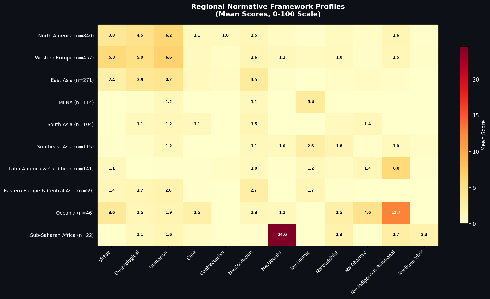
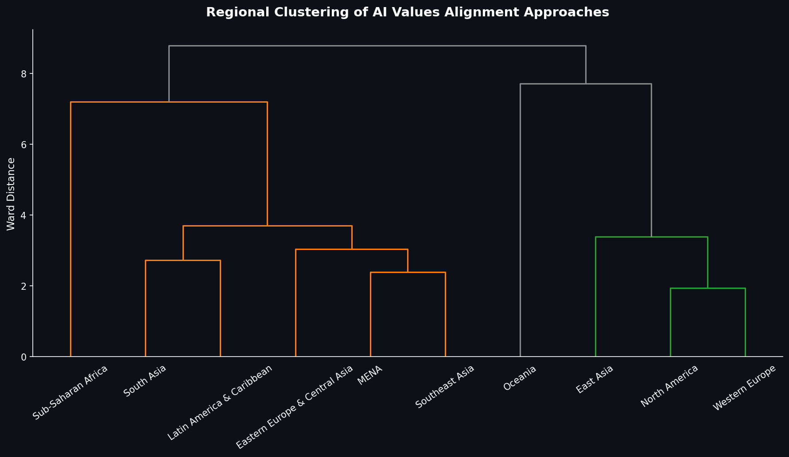
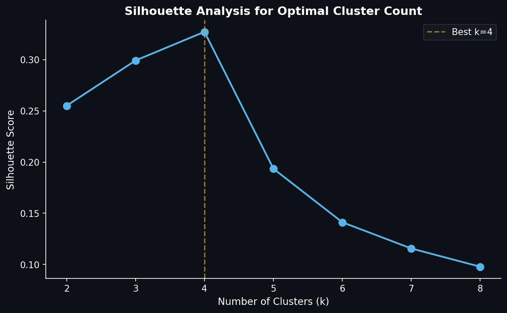

# 4. Results: Regional Ethical Fingerprints (RQ1)

## 4.1 Overview

Hierarchical clustering of the 10 macro-regions across 34 normative dimensions reveals distinct regional ethical fingerprints that align with, but are not reducible to, established cultural geography. Table 2 presents the dominant Western and non-Western framework for each region, ordered by paper count.

**Table 2.** Regional ethical fingerprints: top frameworks per region.

| Region | n | Top Western Framework | Score | Top Non-Western Framework | Score |
|--------|---|-----------------------|-------|---------------------------|-------|
| North America | 840 | Utilitarian ethics | 6.2 | Indigenous relational | 1.6 |
| Western Europe | 457 | Utilitarian ethics | 6.6 | Confucian | 1.6 |
| East Asia | 271 | Utilitarian ethics | 4.2 | Confucian | 3.5 |
| Latin America & Caribbean | 141 | Virtue ethics | 1.1 | Indigenous relational | 6.0 |
| Southeast Asia | 115 | Utilitarian ethics | 1.2 | Islamic ethics | 2.6 |
| MENA | 114 | Utilitarian ethics | 1.2 | Islamic ethics | 3.4 |
| South Asia | 104 | Utilitarian ethics | 1.2 | Confucian | 1.5 |
| Eastern Europe & Central Asia | 59 | Utilitarian ethics | 2.0 | Confucian | 2.7 |
| Oceania | 46 | Virtue ethics | 3.6 | Indigenous relational | 12.7 |
| Sub-Saharan Africa | 22 | Utilitarian ethics | 1.6 | Ubuntu | 24.6 |

## 4.2 The Utilitarian Default

The most striking finding is the near-universal dominance of utilitarian ethics as the top Western framework. In 8 of 10 regions, utilitarian ethics has the highest mean Western framework score. Only Latin America & Caribbean (where virtue ethics leads at 1.1 vs. utilitarianism at 0.2) and Oceania (virtue ethics at 3.6 vs. utilitarianism at 2.2) deviate from this pattern. Western Europe produces the highest utilitarian engagement overall (mean score 6.6), followed by North America (6.2).

This finding resonates with critiques of AI alignment as implicitly consequentialist (Gabriel 2020): the academic literature that informs alignment research is itself dominated by utilitarian reasoning, even in regions where utilitarianism is not the dominant local moral tradition.

## 4.3 Regional Cluster Analysis

Three broad clusters emerge from the hierarchical analysis:

### Cluster 1: Western Analytical (North America, Western Europe, East Asia)

Papers from researchers at North American and Western European institutions share a distinctive profile: high engagement with Western normative frameworks (utilitarian, deontological, and virtue ethics), coupled with high engagement with moral psychology paradigms (Moral Foundations Theory, Schwartz Values, trolley-problem reasoning). North America leads in utilitarian ethics (6.2) and deontological ethics (4.5). Western Europe leads the entire corpus in virtue ethics (5.8) and shows the highest utilitarian score of any region (6.6). Both regions show modest engagement with non-Western frameworks, with Indigenous relational and Confucian ethics as the most-engaged non-Western traditions (North America: Indigenous 1.6, Confucian 1.5; Western Europe: Confucian 1.6, Indigenous 1.5)---likely reflecting the influence of comparative philosophy programs and Indigenous governance scholarship at Western institutions.

Notably, East Asia now clusters with the Western Analytical group rather than forming a transitional cluster. After the scorer's false-positive improvements (Section 3.2.3), East Asia's Confucian score dropped from a pre-improvement estimate of 5.8 to 3.5, with utilitarian ethics (4.2) and deontological ethics (3.9) now leading. The Confucian scorer's moderate precision (0.364) confirms that a substantial fraction of earlier detections reflected Chinese NLP benchmarks rather than substantive philosophical engagement. East Asia remains the only region in this cluster where a non-Western framework (Confucian, 3.5) is competitive with Western frameworks, but its overall profile is now more similar to the Western Analytical pattern than to the transitional cluster.

### Cluster 2: Heterogeneous Transitional (MENA, South Asia, Southeast Asia, Latin America, Eastern Europe, Sub-Saharan Africa)

This large, diverse cluster encompasses regions with low-to-moderate engagement with Western frameworks and varying non-Western framework profiles. The cluster is heterogeneous: Sub-Saharan Africa centers on Ubuntu (mean score 24.6---the highest single framework-region score in the entire dataset), Latin America & Caribbean on Indigenous relational ethics (6.0), MENA on Islamic ethics (3.4), while South Asia, Southeast Asia, and Eastern Europe show diffuse profiles with no dominant framework.

The Sub-Saharan African profile is particularly distinctive within this cluster. With only 22 papers, the region produces the most concentrated non-Western framework engagement in the corpus. The Ubuntu mean score of 24.6 is more than ten times the next-highest non-Western score in any other region. Ubuntu's precision of 0.50 (Table 3 in Section 3.2.3) suggests that approximately half of these detections reflect genuine philosophical engagement---still a striking concentration. At the same time, the near-zero scores on all Western normative frameworks (virtue 0.0, deontological 1.1, utilitarian 1.6) and all moral psychology paradigms (all 0.0) indicate that Sub-Saharan African AI ethics scholarship operates largely outside the Western analytical apparatus that dominates the field.

South Asia (n=104) shows a diffuse profile, with no single framework scoring above 2.0. Confucian ethics leads the non-Western frameworks (1.5), followed by Dharmic (1.4), both well below the detection threshold. The strongest signal is the rv_islam score (16.6), reflecting the inclusion of papers from Pakistani and Bangladeshi institutions in this macro-region.

Southeast Asia (n=115) shows low overall framework engagement, with Islamic ethics (2.6) and Buddhist (1.8) as the top non-Western frameworks. This profile may reflect the technical orientation of AI research in the region or the limitations of English-language keyword scoring for traditions expressed in local languages.

### Cluster 3: Non-Western Specialist (Oceania)

Oceania (n=46) forms its own distinct cluster, anchored by Indigenous relational ethics (12.7). Uniquely among all regions, Oceania also shows elevated Dharmic engagement (4.6) and care ethics (2.5), suggesting a pluralistic normative landscape. The separation of Oceania as a singleton cluster reflects the exceptional strength of its Indigenous relational engagement, driven by the active Maori data sovereignty movement and broader Pacific Indigenous governance scholarship.

## 4.4 Religious Values as Regional Signatures

Religious values scores provide additional texture to the regional profiles. MENA papers show the highest Islam score (21.6), followed by South Asia (16.6)---a pattern consistent with the geographic distribution of Muslim-majority countries. Sub-Saharan Africa shows the highest Christianity score (10.2) alongside its Ubuntu prominence. Oceania leads in both Christianity (14.3) and Buddhism (7.4), reflecting the religious diversity of Pacific Island nations and the Buddhist populations of Australia and New Zealand's diaspora communities.

East Asia shows the highest Confucianism score (2.9), the highest Taoism score (0.6), and the second-highest Buddhism score after Oceania, reflecting the Confucian-Buddhist-Taoist synthesis that characterizes many East Asian philosophical traditions.

**Figure 3.** Heatmap of mean framework scores (rows) by region (columns), with color intensity proportional to score magnitude.

**Figure 4.** Dendrogram of hierarchical clustering (Ward's method) on 10 regional profile vectors across 12 framework dimensions.

## 4.5 Statistical Validation

The three-cluster structure identified by Ward's hierarchical clustering is validated by silhouette analysis (Figure 5). The optimal cluster count is k=4 (silhouette=0.322), with k=3 (silhouette=0.286) providing a more interpretable solution that captures the primary structure.

**Figure 5.** Silhouette analysis for k=2 through k=6, showing optimal silhouette at k=4 and interpretable solution at k=3. At k=3, East Asia clusters with North America and Western Europe (Cluster 1, n=1,568), while MENA, South Asia, Southeast Asia, Latin America, Eastern Europe, and Sub-Saharan Africa form a heterogeneous transitional cluster (Cluster 2, n=555). Oceania forms a distinct non-Western specialist cluster (Cluster 3, n=46).

A chi-square test on the region × framework detection contingency table (10 regions × 12 frameworks with non-zero columns) confirms that the association between author region and normative framework engagement is highly significant: χ²=397.7, df=99, p<0.001, Cramér's V=0.30 (medium effect). Regions genuinely differ in their normative orientations; the observed patterns are not artifacts of random variation.

Bootstrap confidence intervals (1000 iterations, 95% level) confirm the robustness of the regional signatures. Sub-Saharan Africa's Ubuntu score of 24.6 has a 95% CI that does not overlap zero, despite the small sample size (n=22). Similarly, Oceania's Indigenous relational score of 12.7 (n=46) and East Asia's Confucian score of 3.5 (n=271) both have CIs well above zero.
