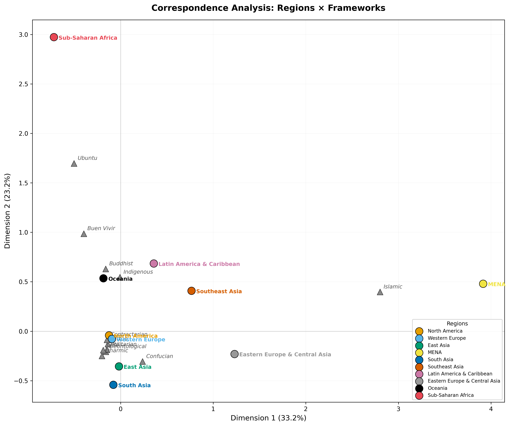
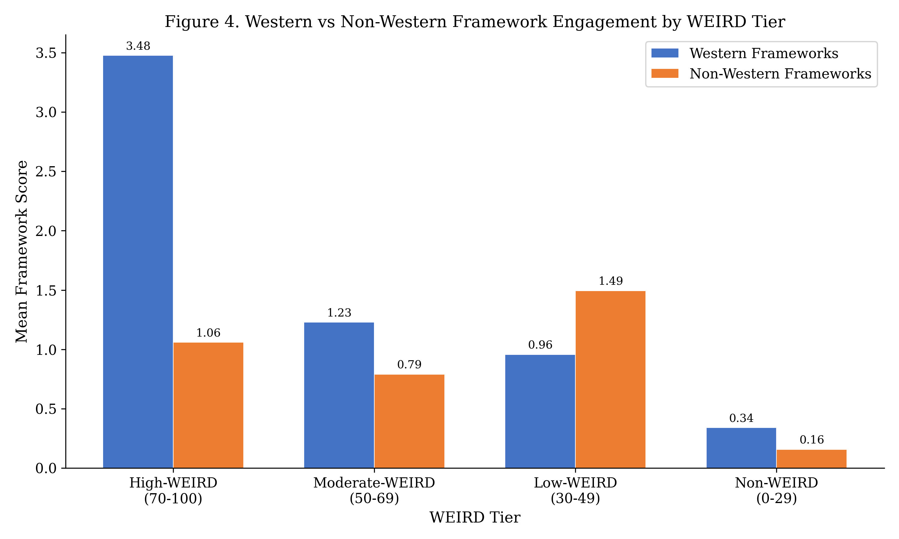

# 5. Results: Western and Non-Western Framework Associations (RQ2)

## 5.1 East/West Comparison

The East/West comparison (Table 3) reveals a fundamental asymmetry in how normative frameworks are deployed across the two hemispheres of AI ethics scholarship.

**Table 3.** Top frameworks by East/West grouping.

| Grouping | n | Top 3 Frameworks (mean score) |
|----------|---|-------------------------------|
| East (E. Asia + S. Asia + SE Asia) | 490 | Utilitarian (2.9), Confucian (2.5), Deontological (2.5) |
| West (N. America + W. Europe + Oceania) | 1,343 | Utilitarian (6.2), Deontological (4.6), Virtue (4.5) |

**Figure 6.** Correspondence analysis biplot of region-by-framework associations. Proximity between a region point and a framework point indicates statistical association.

Papers from researchers at Western institutions engage normative frameworks at roughly double the intensity of papers from Eastern institutions. The mean utilitarian score in the West (6.2) is more than twice the East (2.9); deontological ethics shows a similar ratio (4.6 vs. 2.5). This asymmetry likely reflects both the Western origins of these analytical categories and the more technical orientation of much AI research produced in East Asia.

Critically, the Confucian framework---the top non-Western framework in the East (2.5, tied with deontological ethics)---does not appear in the West's top three. After the scorer's false-positive improvements, utilitarian ethics now leads in the East, with Confucian engagement more modestly positioned. This underscores that even in East Asia, Western frameworks dominate.

## 5.2 Framework Dominance Patterns

### 5.2.1 Western Frameworks

Among the five Western normative frameworks, utilitarian ethics dominates globally (corpus-wide mean approximately 4.9 across all papers with nonzero scores), followed by deontological ethics (approximately 3.8) and virtue ethics (approximately 3.5). Care ethics (mean 0.9) and contractarian ethics (mean 0.7) trail substantially.

The utilitarian dominance is not universal, however. In Latin America & Caribbean, virtue ethics (1.7) exceeds utilitarianism (0.2) by an order of magnitude---a unique regional exception. In Oceania, virtue ethics (4.3) also surpasses utilitarianism (2.2), a pattern that may reflect the influence of Aristotelian care-oriented approaches in Indigenous-facing scholarship.

Care ethics, despite its theoretical relevance to communal and relational moral traditions, scores low across all regions. The highest care ethics score is in Oceania (3.0), followed by North America (1.1) and South Asia (1.1). This suggests that the "care turn" in Western feminist ethics (Gilligan 1982; Held 2006) has not yet substantively influenced AI ethics scholarship, even in regions where relational moral frameworks are prominent.

### 5.2.2 Non-Western Frameworks

The seven non-Western frameworks show dramatically different engagement levels (Table 4).

**Table 4.** Non-Western framework detection summary. Raw counts reflect post-improvement scorer (Section 3.2.3). Precision-adjusted estimates multiply raw counts by framework-specific precision from the post-improvement gold standard validation (Table 3).

| Framework | Raw Detected (>= 50) | % of Corpus | Precision-Adj. Est. | Mean Score (all papers) | Top Region | Top Region Score |
|-----------|---------------------|-------------|---------------------|------------------------|------------|-----------------|
| Indigenous relational | 49 | 2.1% | ~33 | 1.8 | Oceania | 12.7 |
| Confucian | 38 | 1.6% | ~14 | 1.6 | East Asia | 3.5 |
| Islamic ethics | 23 | 1.0% | ~23 | 0.8 | MENA | 3.4 |
| Ubuntu | 23 | 1.0% | ~13 | 0.9 | Sub-Saharan Africa | 24.6 |
| Buddhist | 22 | 0.9% | ~7 | 0.9 | Oceania | 2.5 |
| Dharmic | 18 | 0.8% | ~4 | 0.7 | Oceania | 4.6 |
| Buen vivir | 8 | 0.3% | ~1 | 0.2 | Sub-Saharan Africa | 2.3 |

Indigenous relational ethics is the most-detected non-Western framework (49 raw detections, 2.1%; precision-adjusted estimate: ~33 papers), driven by the active Maori data sovereignty movement and broader Indigenous AI governance scholarship. Confucian ethics ranks second in raw detections (38 papers, 1.6%), with a precision-adjusted estimate of ~14 papers genuinely engaging Confucian normative content---many remaining detections reflect Chinese NLP benchmarks rather than philosophical engagement. The top-region mean score for Confucian ethics (East Asia, 3.5) reflects the scorer's improved false-positive filtering. Islamic ethics (23 raw, adj. ~23) achieves perfect precision after FP filtering, reflecting the specificity of its keywords to ethical and legal reasoning. Ubuntu (23 raw, adj. ~13) has a smaller but growing literature.

The three least-detected frameworks---Buddhist (22 raw, adj. ~7), Dharmic (18 raw, adj. ~4), and Buen vivir (8 raw, adj. ~1)---represent critical coverage gaps. Together, their precision-adjusted estimates total approximately 12 papers of genuine engagement, despite representing ethical traditions that inform the moral reasoning of billions of people.

### 5.2.3 Multi-Framework Papers

Only 14 papers (0.6% of the corpus) engage two or more non-Western frameworks at the detection threshold. The most notable is Varshney (2024), which scored 100 on Dharmic ethics and was also detected for Ubuntu, Indigenous relational, and Buen vivir frameworks---a rare example of genuinely pluralistic cross-traditional engagement. Mokoena (2024) scored 100 on Ubuntu and was also detected for Indigenous relational ethics, illustrating the conceptual overlap between African communalism and broader Indigenous relational ontologies.

Given that individual framework precision ranges from 0.167 to 1.000 (Table 3), some multi-framework detections may reflect false positives on one or more frameworks; the true number of genuinely multi-framework papers is likely lower than 14. The rarity of multi-framework papers suggests that non-Western ethical engagement in AI ethics remains siloed: researchers tend to draw on a single tradition rather than engaging in the kind of cross-traditional dialogue that pluralistic alignment would require.

## 5.3 Framework Associations by WEIRD Tier

The WEIRD tier analysis reveals how normative framework engagement varies with the degree to which research contexts are characterized by WEIRD conditions (Table 5).

**Table 5.** Mean framework scores by WEIRD tier.

| Tier | n | Mean Western | Mean Non-Western | W:NW Ratio |
|------|---|--------------|------------------|------------|
| High-WEIRD (70--100) | 1,296 | 3.5 | 1.0 | 3.6:1 |
| Moderate-WEIRD (50--69) | 379 | 1.2 | 0.7 | 1.7:1 |
| Low-WEIRD (30--49) | 590 | 1.0 | 1.3 | 0.8:1 |
| Non-WEIRD (0--29) | 50 | 0.3 | 0.1 | 3.4:1 |

The key transition occurs between Moderate-WEIRD and Low-WEIRD. In the High-WEIRD tier, Western framework engagement exceeds non-Western by 3.6:1; in the Moderate-WEIRD tier, the ratio narrows to 1.7:1. In the Low-WEIRD tier, the ratio inverts to 0.8:1---non-Western engagement slightly exceeds Western. This crossover point suggests that WEIRD conditions are not merely correlated with Western framework dominance but may structurally enable it, possibly through access to Western philosophical training, English-language publication norms, and the analytical vocabulary of Western ethics.

The Non-WEIRD tier (n=50) is notable for its low scores on both Western and non-Western frameworks. This may reflect the technical orientation of many papers from institutions in low-income, non-democratic contexts, where AI research focuses on applications (e.g., agricultural AI, health informatics) rather than normative analysis.

Within the Non-WEIRD tier, the highest score is rv_islam (23.0), reflecting the concentration of Islamic-majority countries among low-WEIRD-scoring nations. No other framework---Western or non-Western---scores above 2.0 in this tier.

**Figure 7.** Mean Western (blue) and non-Western (orange) framework scores across four WEIRD tiers, illustrating the crossover at the Low-WEIRD tier and the collapse of both scores in the Non-WEIRD tier.
