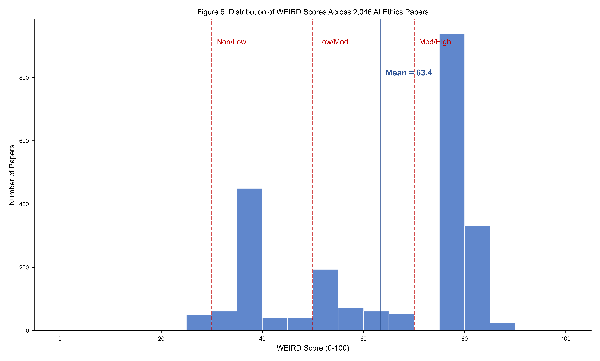
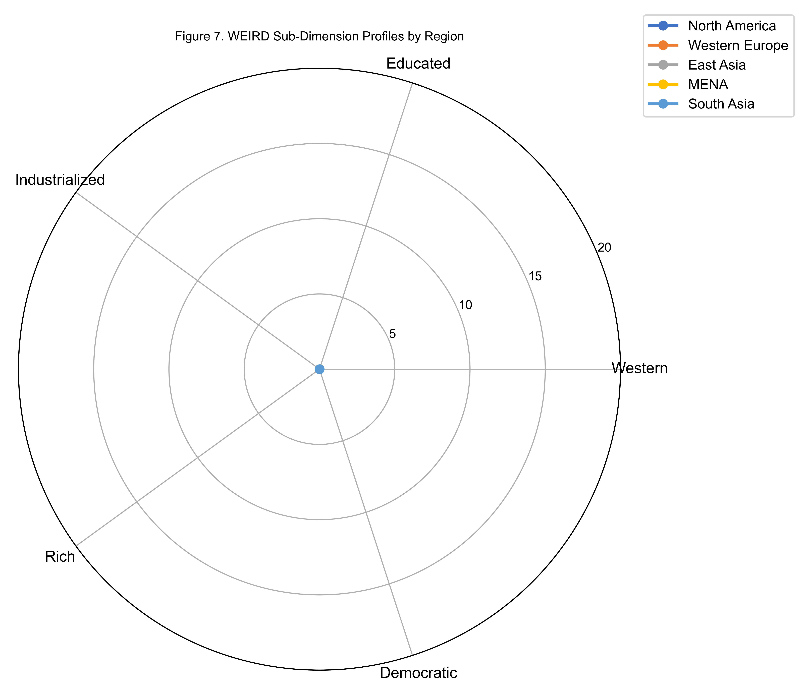

# 6. Results: Author Geography and Positionality (RQ3--RQ4)

## 6.1 Author Geographic Distribution

The geographic distribution of author institutional affiliations reveals a pronounced concentration in the Global North (Table 6).

**Table 6.** Author geography: Global North/South distribution.

| Classification | n | % |
|---------------|---|---|
| Global North | 1,363 | 66.6% |
| Ambiguous | 329 | 16.1% |
| Global South | 325 | 15.9% |
| Unknown | 29 | 1.4% |

Two-thirds of all AI ethics papers in the corpus originate from Global North institutions. The Global South contributes only 15.9% (325 papers), despite representing approximately 85% of the world's population. The "Ambiguous" category (16.1%) captures papers from East Asian and Eastern European institutions that do not map cleanly onto the North/South binary---a meaningful analytical category in its own right, as these regions often combine high industrialization with non-Western philosophical traditions.

## 6.2 The WEIRD Distribution

The WEIRD score distribution across the corpus (Figure 8) reveals the depth of the bias.

**Table 7.** WEIRD tier distribution.

| Tier | Count | % |
|------|-------|---|
| High-WEIRD (70--100) | 1,221 | 59.7% |
| Moderate-WEIRD (50--69) | 255 | 12.5% |
| Low-WEIRD (30--49) | 520 | 25.4% |
| Non-WEIRD (0--29) | 50 | 2.4% |

Nearly 60% of papers fall in the High-WEIRD tier. The mean WEIRD score of 64.5 places the corpus firmly in WEIRD territory. The sub-dimension means reveal which WEIRD characteristics are most pronounced:

**Table 8.** WEIRD sub-dimension means (each scored 0--20).

| Dimension | Mean |
|-----------|------|
| Western (W) | 15.6 |
| Educated (E) | 10.2 |
| Industrialized (I) | 13.4 |
| Rich (R) | 13.1 |
| Democratic (D) | 12.2 |

The "Western" sub-dimension scores highest (15.6/20), confirming that the geographic concentration of AI ethics research in Western institutions is the strongest driver of the WEIRD bias. The "Educated" sub-dimension scores lowest (10.2/20), reflecting the relatively broad educational contexts represented in the corpus beyond elite university populations.

## 6.3 Framework Orientation by Geography

Author geography strongly predicts normative framework orientation. Table 9 presents the mean framework scores for Global North, Global South, and Ambiguous classifications.

**Table 9.** Mean framework scores by Global North/South.

| Framework Group | Global North (n=1,363) | Ambiguous (n=329) | Global South (n=325) |
|----------------|------------------------|--------------------|-----------------------|
| Mean Western (5 frameworks) | 3.5 | 1.7 | 0.5 |
| Mean Non-Western (7 frameworks) | 0.9 | 1.1 | 1.0 |
| Moral psychology (8 dimensions) | 0.9 | 0.6 | 0.0 |

Three patterns stand out:

First, the Global North's dominance in Western framework engagement is striking: a mean score of 3.5 versus 0.5 for the Global South---a 7:1 ratio. This does not mean that researchers at Global South institutions are unaware of Western ethics; rather, it suggests that their papers are less likely to frame arguments using canonical Western ethical terminology.

Second, non-Western framework engagement is nearly equal across all three groups (North 0.9, Ambiguous 1.1, South 1.0). This counterintuitive finding suggests that non-Western ethical engagement in AI research is as much a project of Western-based scholars (engaging comparatively with other traditions) as it is of scholars in the Global South.

Kruskal-Wallis tests confirm that 5 of 12 framework dimensions differ significantly by North/South classification after BH-FDR correction. Mann-Whitney U tests comparing High-WEIRD (n=1,221) versus Non-WEIRD (n=50) papers show that virtue ethics is the most WEIRD-differential framework (d=+0.26, p=0.02), while Islamic jurisprudence is the only framework with a (non-significant) negative effect size (d=-0.09), suggesting modestly higher engagement in non-WEIRD papers. Effect sizes are uniformly small (|d|<0.3), indicating that the WEIRD gap manifests more as a systematic tendency across many dimensions than as a dramatic difference on any single framework.

Third, moral psychology paradigms---Moral Foundations Theory, Schwartz Values, trolley problems---are almost exclusively a Global North phenomenon. The mean moral psychology score for the Global South is 0.0 across all eight dimensions. This reflects the WEIRD origins of these paradigms: they were developed and validated on WEIRD populations, and their application to AI ethics remains concentrated in the institutional contexts where they originated.

## 6.4 The "Who Studies Whom" Problem

The near-parity of non-Western framework engagement between Global North (0.9) and Global South (1.0) raises a critical question about positionality: when Western-based researchers engage Ubuntu, Confucian, or Indigenous frameworks, are they conducting research *with* or *about* communities from these traditions?

At the individual paper level, several patterns are visible. The highest-scoring Ubuntu papers include work by both African-based scholars (Gwagwa et al. 2022, based at institutions in Zimbabwe and South Africa; Mokoena 2024, University of South Africa) and Western-based scholars analyzing African AI ethics from external positions. The highest-scoring Confucian papers similarly include both East Asian scholars (Qian 2023, So 2024) and Western philosophers of East Asian thought (Angle 2021, Hou 2023).

The Indigenous relational ethics scores tell a more encouraging story: many of the highest-scoring papers are authored by Indigenous scholars or in close collaboration with Indigenous communities (Carroll et al. 2020; Keegan 2024; Brown 2024; Mahuta-Rau and colleagues). The CARE Principles framework was itself developed by an Indigenous-led consortium, suggesting that at least in this domain, knowledge production is more closely aligned with knowledge sovereignty.

## 6.5 Regional Sub-Dimension Analysis

Disaggregating the WEIRD score by region reveals which sub-dimensions drive the WEIRD classification in each context (Figure 9).

North America and Western Europe score highest on all five sub-dimensions, but particularly on W (Western) and R (Rich). East Asia scores high on I (Industrialized) and R (Rich) but lower on W (Western) and D (Democratic), placing many papers in the Moderate-WEIRD or Low-WEIRD tiers despite coming from highly developed economies. MENA scores lowest on D (Democratic), which is a primary driver of its lower overall WEIRD scores. Sub-Saharan Africa and South Asia score low on I (Industrialized) and R (Rich), reflecting the economic development dimension of the WEIRD construct.

**Figure 8.** Histogram of WEIRD scores (0--100) across the corpus, with vertical dashed lines at tier boundaries (30, 50, 70). The right-skewed distribution peaks in the 70--80 range.

**Figure 9.** Radar chart of mean WEIRD sub-dimension scores (W, E, I, R, D) for the five largest regions, illustrating the distinctive WEIRD profile of each region.
