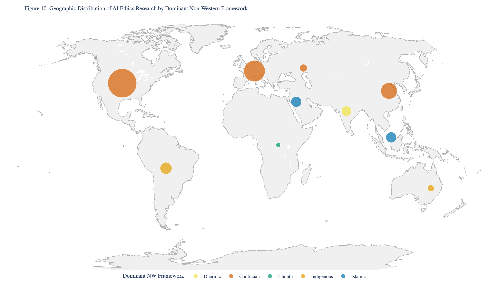

# 7. Results: Coverage Gaps and Epistemic Power Dynamics (RQ5)

## 7.1 Geographic Gaps

The most consequential coverage gaps are geographic. Table 10 ranks the regions by their share of the corpus relative to their share of the world population.

**Table 10.** Regional representation index (corpus share / population share).

| Region | Corpus % | Approx. World Pop. % | Representation Index |
|--------|----------|----------------------|---------------------|
| North America | 39.5% | 4.7% | 8.4x over |
| Western Europe | 20.6% | 5.4% | 3.8x over |
| Oceania | 1.9% | 0.5% | 3.8x over |
| East Asia | 12.7% | 20.9% | 0.6x under |
| Eastern Europe & Central Asia | 2.9% | 5.6% | 0.5x under |
| MENA | 5.5% | 7.6% | 0.7x under |
| Southeast Asia | 5.0% | 8.6% | 0.6x under |
| South Asia | 5.0% | 25.4% | 0.2x under |
| Latin America & Caribbean | 4.4% | 8.3% | 0.5x under |
| Sub-Saharan Africa | 1.1% | 14.7% | 0.07x under |

North America is overrepresented by a factor of 8.4: it contributes 39.5% of AI ethics papers while comprising 4.7% of the world's population. Sub-Saharan Africa is underrepresented by a factor of 14: it produces 1.1% of papers while comprising 14.7% of the global population. South Asia (5.0% of papers, 25.4% of population) is underrepresented by a factor of 5.

These gaps are not merely quantitative. They carry normative consequences. The 22 papers from Sub-Saharan African institutions are the *only* papers that substantively engage Ubuntu philosophy (Ubuntu detection rate: 27.3%). The 90 papers from Latin America & Caribbean are among the few that engage Indigenous relational ethics from a Latin American context (detection rate: 8.9%) or reference *buen vivir* at all. When these regions are underrepresented, specific normative traditions are effectively silenced in the global AI ethics conversation.

## 7.2 Framework Gaps

### 7.2.1 Near-Zero Frameworks

Three non-Western frameworks have critically low representation:

**Buen vivir / Sumak Kawsay (8 raw detections; precision-adjusted estimate: ~1 paper).** Despite its constitutional recognition in Ecuador and Bolivia and its radical challenge to the growth-oriented technological paradigm, *buen vivir* is almost entirely absent from the AI ethics literature. The precision-adjusted estimate of approximately one paper of genuine engagement underscores the severity of this gap. None of the 8 detected papers are from Latin American institutions (the framework was detected in papers from other regions discussing *buen vivir* comparatively). This represents a failure to engage one of the most developed non-Western alternatives to liberal techno-optimism.

**Dharmic ethics (18 raw detections; precision-adjusted estimate: ~4 papers).** The ethical traditions of Hinduism---*dharma*, *karma*, *ahimsa*---inform the moral reasoning of over 1 billion people, yet the precision-adjusted estimate suggests fewer than 5 papers in the corpus substantively engage these frameworks in the context of AI. South Asia, where these traditions originate, shows a Dharmic mean score of only 1.4. Varshney's (2024) "Decolonial AI Alignment" remains one of very few papers to propose a Dharmic framework for AI governance at a conceptual level.

**Buddhist ethics (22 raw detections; precision-adjusted estimate: ~4 papers).** Buddhist moral philosophy, with its emphasis on suffering reduction (*dukkha*), compassion (*karuna*), and interdependence (*pratityasamutpada*), has obvious relevance to AI systems that affect well-being at scale. Yet the precision-adjusted estimate suggests only ~4 papers engage Buddhist ethics substantively, and the tradition's strongest presence is not in predominantly Buddhist countries (Southeast Asia shows a Buddhist detection rate of just 1.0%) but in Oceania (2.6%) and Sub-Saharan Africa (4.5%), suggesting comparative rather than endogenous engagement.

These precision-adjusted estimates underscore the severity of the coverage gaps: genuine philosophical engagement with these traditions in AI ethics is even rarer than raw keyword detection suggests.

### 7.2.2 The Care Ethics Gap

Among Western frameworks, care ethics (mean 0.9 across the corpus) is strikingly underrepresented relative to its theoretical relevance. Care ethics' emphasis on relational responsibility, contextual judgment, and the moral significance of dependency shares deep structural affinities with Ubuntu communalism, Confucian role ethics, and Indigenous relational ontologies. Yet the care ethics detection rate exceeds 1.0% in only three regions (Oceania 2.6%, North America 0.9%, South Asia 1.0%). The "care turn" in Western ethics has not translated into a "care turn" in AI ethics, even as calls for relational approaches to AI governance grow louder.

### 7.2.3 Moral Psychology Paradigm Gaps

Moral psychology engagement is concentrated almost entirely in the Global North. The Moral Foundations Theory (MFT) detection rate is 4.3% in North America and Western Europe but 0.0% in South Asia, Southeast Asia, Latin America, MENA, and Sub-Saharan Africa. This pattern replicates the WEIRD problem in moral psychology itself: paradigms developed and validated on Western populations are deployed to study AI ethics only in Western contexts, while non-Western moral psychology frameworks remain unintegrated.

## 7.3 Temporal Trends

Year-by-year analysis (Table 11) reveals modest progress alongside persistent structural gaps.

**Table 11.** Temporal trends in non-Western framework engagement and WEIRD scores.

| Year | Papers | Regions Represented | Mean WEIRD | NW Papers | NW % |
|------|--------|--------------------:|------------|-----------|------|
| 2018 | 23 | 7 | 70.1 | 2 | 8.7% |
| 2019 | 27 | 8 | 63.6 | 1 | 3.7% |
| 2020 | 57 | 8 | 64.7 | 4 | 7.0% |
| 2021 | 64 | 9 | 64.7 | 6 | 9.4% |
| 2022 | 108 | 10 | 65.5 | 8 | 7.4% |
| 2023 | 227 | 11 | 62.8 | 9 | 4.0% |
| 2024 | 629 | 11 | 64.6 | 39 | 6.2% |
| 2025 | 1,088 | 11 | 62.3 | 84 | 7.7% |
| 2026 | 85 | 11 | 60.5 | 7 | 8.2% |

Non-Western framework engagement has grown from 3.7% (2019) to 8.2% (2026, partial year), more than doubling. Regional diversity has expanded from 7 regions (2018) to 11 (2023 onward). The mean WEIRD score has decreased modestly from 70.1 (2018) to 60.5 (2026), suggesting slow diversification of the author pool.

However, these trends must be interpreted with caution. The absolute number of non-Western framework papers remains small: even in 2025, the largest year, only 84 of 1,088 papers (7.7%) engage any non-Western framework. The WEIRD score decline from 70.1 to 60.5 over eight years amounts to approximately 1.2 points per year---at this rate, the corpus would not reach a mean WEIRD score of 50 (the "balanced" threshold) until roughly 2035.

## 7.4 Epistemic Power Dynamics

The coverage gaps documented above are not random lacunae; they reflect structural power dynamics in global knowledge production. Several mechanisms perpetuate the WEIRD bias in AI ethics:

**Publication infrastructure.** The major venues for AI ethics scholarship---ACL, AAAI, NeurIPS, FAccT, AIES---are Anglophone, peer-reviewed by predominantly Western editorial boards, and structured around Western academic norms (literature review, hypothesis testing, statistical validation) that may not accommodate other modes of ethical reasoning.

**Citation networks.** Non-Western ethical frameworks enter the global AI ethics conversation primarily through papers published in English by scholars at Western institutions or by scholars at non-Western institutions writing for Western audiences. This creates a citation bottleneck: Ubuntu philosophy is cited primarily through Mhlambi (2020) and Gwagwa et al. (2022); Confucian AI ethics through Angle (2021) and Wong (2020). The depth of each tradition's internal scholarship remains invisible to the international corpus.

**Funding flows.** AI ethics research funding is concentrated in North America and Western Europe (government agencies like NSF, EPSRC; philanthropies like Open Philanthropy, MacArthur; corporate labs at Google, Microsoft, Meta). Researchers in the Global South face structural barriers to accessing these funding streams.

**The "diversity as addition" trap.** When calls for cross-cultural AI ethics are answered by adding a chapter on Ubuntu or a section on Confucian ethics to an otherwise Western framework, the result is tokenistic inclusion rather than genuine pluralism. The non-Western tradition is positioned as a supplement to, rather than an alternative to, the dominant framework.

**Figure 10.** Geographic distribution of AI ethics research by region: bubble size proportional to paper count, color indicates the dominant non-Western framework. The concentration of research in North America and Western Europe is visually striking, while the diversity of dominant frameworks across smaller regions illustrates the fragmented nature of non-Western engagement.
