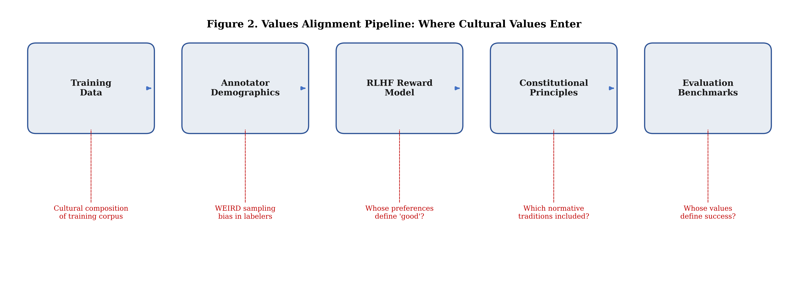

# 1. Introduction

## 1.1 Whose Values?

When a large language model is aligned with "human values," whose values does it learn? The question is not rhetorical. In the reinforcement learning from human feedback (RLHF) pipeline that now governs the behavior of the most widely deployed AI systems, a team of human labelers ranks model outputs according to criteria such as helpfulness, harmlessness, and honesty (Ouyang et al. 2022). These rankings are compressed into a reward model, and the language model is fine-tuned to maximize that reward. Constitutional AI extends this pattern by replacing per-sample human feedback with a set of explicit normative principles that the model uses to critique and revise its own outputs (Bai et al. 2022). In both cases, a specific set of moral intuitions---about what counts as helpful, what constitutes harm, and which values deserve deference---is baked into the system at training time. The pipeline is elegant, scalable, and almost entirely silent about the cultural provenance of the values it encodes.

Consider what this silence obscures. A Confucian ethicist would insist that moral reasoning begins not with individual rights or aggregate welfare but with the cultivation of *ren* (仁)---humaneness realized through the practice of reciprocal obligations within the five cardinal relationships (Wong 2020). An Ubuntu-oriented philosopher might argue that value alignment is not a problem about individual preferences at all, contending instead that personhood is constituted through communal bonds: *umuntu ngumuntu ngabantu*, a person is a person through other persons (Mhlambi 2020). A scholar of Islamic ethics would ask whether the system preserves the *maqasid al-shariah*---the higher objectives of protecting religion (*din*), life (*nafs*), intellect (*aql*), lineage (*nasl*), and wealth (*mal*)---that organize moral reasoning across a billion-person legal tradition. An Indigenous data sovereignty advocate would question whether the very act of encoding values into a centrally controlled model violates the CARE Principles of collective benefit, authority to control, responsibility, and ethics that govern Indigenous knowledge systems (Carroll et al. 2020). A practitioner of *buen vivir* would find the optimization framing itself incoherent, since well-being in the Andean cosmovision is not a quantity to be maximized but a state of harmony among humans, community, and the natural world.

These vignettes are necessarily compressed; the full philosophical depth of each tradition is developed in Section 2.4.

None of these moral vocabularies appears in the RLHF pipeline. None is represented among the labeler populations that shaped the reward models behind ChatGPT, Claude, or Gemini. The constitutional principles that Anthropic's models use to self-correct are drawn from sources including the Universal Declaration of Human Rights, Apple's Terms of Service, and other predominantly Western documents (Bai et al. 2022)---sources that, whatever their merits, represent one cultural tradition's attempt to articulate universal norms. The alignment enterprise proceeds as though the values it encodes are universal---or at least universally acceptable---when in fact they are drawn from a remarkably narrow cultural bandwidth.

The paradox is sharp: the field most urgently concerned with ensuring that AI serves *all* of humanity has not yet reckoned with the possibility that its normative foundations serve only a fraction of it. Across the 2,329 papers we analyze in this study, only 161 (6.9%) engage any non-Western normative framework at even a minimal detection threshold---and precision-adjusted estimates (see Section 3.2.3) suggest that genuine philosophical engagement is present in approximately 95 papers (4.1%). Indigenous relational ethics appears in 49 papers (adj. ~33), Confucian ethics in 38 (adj. ~14), Islamic ethics in 23 (adj. ~23), Ubuntu in 23 (adj. ~13), Buddhist ethics in 22 (adj. ~7), Dharmic ethics in 18 (adj. ~4), and Buen Vivir in 8 (adj. ~1). The remaining 93.1% of the literature operates within---or defaults to---the Western philosophical canon. This paper asks how this skew arose, what it means for the alignment enterprise, and what it would take to change it.

## 1.2 Stakes and Consequences

**Figure 1.** Geographic distribution of 2,329 AI ethics papers by author affiliation, color-coded by WEIRD score tier. The dominance of High-WEIRD countries (North America, Western Europe, Australia) is visually striking; large portions of Africa, Central Asia, and Latin America remain unrepresented.

The stakes of this question extend well beyond academic taxonomy. AI systems aligned through RLHF and constitutional methods are not merely technical artifacts; they are normative infrastructures that encode particular conceptions of the good and export them at planetary scale. When the European Union's AI Act establishes risk categories grounded in Western liberal principles of individual autonomy and non-discrimination, and when that regulatory framework is adopted as a template by governments across Africa, Southeast Asia, and Latin America, the values embedded in the underlying research base travel with it (Jobin et al. 2019). When a foundation model trained on English-language preference data is deployed as a customer service agent in Jakarta, a health advisor in Lagos, or a legal assistant in Lima, its normative commitments---implicit in every refusal, every hedged response, every framing of a moral dilemma---shape moral discourse in communities whose own ethical traditions were absent from the training process.

This process is not unidirectional; countries such as Brazil, Nigeria, and India actively negotiate, modify, and in some cases reject Western regulatory models. But the gravitational pull of frameworks backed by economic power shapes the normative defaults.

Russell (2019) formalized the alignment problem as one of cooperative inverse reinforcement learning: the machine must infer human preferences from observed behavior while maintaining uncertainty about those preferences. But this formulation presupposes that the relevant preference distribution has been adequately sampled. Gabriel (2020) sharpened the point by distinguishing six possible alignment targets---instructions, expressed intentions, revealed preferences, informed preferences, objective interests, and moral values---and argued that the choice among them is itself a normative decision that cannot be delegated to engineering. If the research community that generates the conceptual foundations for alignment is culturally homogeneous, then the entire apparatus of preference elicitation, reward modeling, and principle selection inherits that homogeneity. The alignment problem becomes, in effect, a monoculture problem.

The empirical evidence for cultural variation in moral judgment is unambiguous. Awad et al. (2018) collected 40 million moral decisions from 2.3 million participants across 233 countries and territories through the Moral Machine experiment, revealing three distinct moral clusters---a Western cluster prioritizing individual rights, an Eastern cluster emphasizing respect for authority and the elderly, and a Southern cluster with weaker preferences for inaction---that map onto deep cultural and institutional differences. If moral intuitions vary this dramatically across populations, then an alignment pipeline that samples from only one cluster is not aligning AI with human values; it is aligning AI with *some* human values while rendering others invisible.

The consequences of this invisibility are not hypothetical. Sambasivan et al. (2021) documented how algorithmic fairness frameworks designed around U.S. racial categories fail to capture caste-based discrimination in India, where social hierarchy operates along axes---caste, religion, linguistic community---that are invisible to the dominant technical vocabulary. Klingefjord et al. (2024) argued that existing approaches to value elicitation in AI alignment suffer from a fundamental conceptual gap: they lack a clear account of what human values *are*, treating them interchangeably as preferences, norms, or moral principles without attending to the philosophical distinctions among these categories---distinctions that vary profoundly across cultural traditions. When the conceptual foundations are underspecified, the cultural assumptions embedded in those foundations become harder, not easier, to detect.

The governance export problem compounds the research skew. The UNESCO Recommendation on the Ethics of AI, the OECD AI Principles, and the EU AI Act have each been adopted or referenced as regulatory templates by dozens of countries. These instruments draw their normative content from the same Western-dominated research base that we document here. A country in the Global South that adopts the EU AI Act's risk framework is not merely importing a regulatory architecture; it is importing the implicit assumption that individual autonomy, privacy, and non-discrimination are the primary ethical values at stake in AI deployment---an assumption that may be reasonable within the liberal democratic tradition but that competes with, and potentially displaces, local normative commitments to communal welfare, relational harmony, or divine command.

## 1.3 The WEIRD Problem in AI Ethics

The parallel to experimental psychology is instructive and, we argue, structurally exact. In their landmark study, Henrich, Heine, and Norenzayan (2010) demonstrated that 96% of participants in published behavioral science research came from Western, Educated, Industrialized, Rich, and Democratic (WEIRD) societies, which represent only 12% of the world's population. They showed that WEIRD populations are statistical outliers on measures ranging from visual perception to cooperation norms to moral reasoning, yet the discipline had built its models of "human" cognition almost entirely from this unrepresentative sample.

More than fifteen years later, AI ethics faces an analogous problem. Jobin et al. (2019) surveyed 84 AI ethics guidelines and found convergence around five principles---transparency, justice, non-maleficence, responsibility, and privacy---but noted that the vast majority of issuing organizations were located in North America and Europe. Floridi et al. (2018) proposed the AI4People framework, which synthesized these principles into an overarching ethical architecture, yet the framework's intellectual genealogy is rooted almost entirely in Western bioethics and liberal political philosophy. Sorensen et al. (2024) outlined a roadmap for pluralistic alignment that would incorporate diverse value systems, but the field has yet to produce a systematic empirical account of how severe the cultural skew actually is.

Our analysis provides that account. Across 2,329 AI ethics papers published between 2010 and 2026, we find a mean WEIRD score of 63.4 on a 0--100 composite index, with 56.0% of papers scoring in the High-WEIRD range. Fully 60.1% of papers originate from institutions in North America and Western Europe. North America alone is overrepresented by a factor of 8.4 relative to its share of the global population. Sub-Saharan Africa, home to over a billion people and some of the world's richest moral philosophical traditions, accounts for 1.1% of the corpus. The WEIRD problem is not a metaphor borrowed from psychology; it is a measured property of the AI ethics literature itself. We note that our operationalization adapts the WEIRD construct from a participant-level diagnostic in psychology to a paper-level measure of institutional context---a related but not identical application, as we detail in Section 3.

The temporal dynamics are revealing. Non-Western framework engagement has grown from 3.7% of papers in 2019 to 8.2% in 2026, and the number of active publishing regions has expanded from seven to eleven. But this growth has not altered the fundamental structure of the field. The mean WEIRD score has declined by approximately 1.2 points per year over the same period, and the overwhelming majority of non-Western engagement takes the form of single-framework case studies that supplement rather than challenge the dominant Western analytical paradigm. Growth, in other words, can coexist with structural marginality.

## 1.4 The Gap

Despite growing recognition that AI ethics must engage non-Western normative traditions, no study has systematically measured the cultural distribution of normative frameworks across a large corpus of AI ethics scholarship. Individual case studies have documented the relevance of Ubuntu philosophy to African AI governance (Mhlambi 2020), Confucian role ethics to East Asian algorithmic design (Wong 2020), Islamic ethics to technology regulation in Muslim-majority contexts, and Indigenous data sovereignty principles to algorithmic governance in Oceania (Carroll et al. 2020). These contributions are essential, but they remain isolated: each addresses a single tradition in a specific context, and none provides the bird's-eye view necessary to assess the field's overall cultural composition.

The gap has three dimensions. First, there is no validated instrument for quantifying WEIRD bias at the paper level in AI ethics, analogous to the participant-level diagnostics used in psychology. Existing analyses have noted the geographic concentration of AI ethics guideline production (Jobin et al. 2019) or the cultural contingency of specific concepts like fairness (Sambasivan et al. 2021), but none has operationalized the WEIRD construct as a continuous measure applicable across an entire research corpus. Second, there is no systematic taxonomy of non-Western normative engagement in AI ethics scholarship, which means that even scholars who recognize the problem cannot measure its magnitude or track its evolution over time. Third, and most critically, there is no empirical baseline against which to evaluate whether recent growth in non-Western engagement represents genuine diversification or merely token inclusion within a structurally unchanged landscape. Without such a baseline, claims about the field's progress toward pluralism remain aspirational rather than empirical.

## 1.5 Research Questions

This study addresses five research questions designed to map the cultural topography of AI ethics scholarship. Together, they move from description (what the landscape looks like) through explanation (what predicts normative orientation) to evaluation (where the critical absences lie):

**RQ1 (Regional Clusters).** Do distinct regional clusters of AI values alignment approaches emerge from the literature, and how do they map onto WEIRD/non-WEIRD, Global North/South, and East/West divisions? If Awad et al. (2018) found three moral clusters in public moral intuitions, do analogous clusters appear in the academic literature that is supposed to inform alignment?

**RQ2 (Framework Associations).** Which normative ethical frameworks---both Western and non-Western---are most associated with which regional and cultural contexts? The assumption that specific traditions are confined to their regions of origin may not hold; Confucian ethics, for instance, may be studied more by Western scholars than by researchers based in East Asia.

**RQ3 (Author Geography).** To what extent does author institutional geography predict the normative framework orientation of AI ethics research? If geography is a strong predictor, then the geographic concentration documented under RQ1 directly constrains the normative diversity of the field.

**RQ4 (Positionality).** What is the positionality distribution of cross-cultural AI ethics research---who studies which traditions, and from where? This question addresses epistemic authority: whether non-Western frameworks are being developed *by* or merely *about* the communities they describe.

**RQ5 (Coverage Gaps).** What are the critical gaps in the global coverage of AI values alignment research, and what do they reveal about epistemic power asymmetries in the field? The identification of specific lacunae---traditions with near-zero representation, regions with no indigenous AI ethics scholarship---is a prerequisite for targeted intervention.

## 1.6 Contributions

This paper makes four contributions to the literature on AI ethics and values alignment:

1. **Empirical scale.** We present a systematic cross-cultural analysis of normative framework engagement across 2,329 AI ethics papers, spanning 10 world regions and 34 scoring dimensions. This is, to our knowledge, among the largest such analyses conducted. The corpus covers the period 2010--2026 and includes journal articles, conference proceedings, preprints, and policy documents.

2. **WEIRD operationalization for AI ethics.** We adapt Henrich et al.'s (2010) WEIRD construct to the AI ethics domain, creating a five-dimensional composite score (0--100) that quantifies the degree to which each paper's research context reflects Western, Educated, Industrialized, Rich, and Democratic conditions. This instrument enables systematic measurement of a bias that has previously been discussed only in qualitative terms.

3. **Non-Western framework taxonomy.** We develop and validate scoring instruments for seven non-Western normative frameworks---Confucian, Ubuntu, Islamic ethics, Buddhist, Dharmic, Indigenous relational, and Buen Vivir---using keyword taxonomies designed in consultation with tradition-specific experts. These instruments yield 0--100 engagement scores that capture gradations of framework engagement rather than forcing binary classification.

4. **Coverage gap identification.** We identify specific geographic and philosophical lacunae---Sub-Saharan Africa accounts for only 1.1% of the corpus, Buen Vivir appears in just 8 papers (adj. ~1), and Dharmic ethics in 18 (adj. ~4)---and provide actionable recommendations for researchers, funders, and policymakers seeking to broaden the cultural foundations of AI governance. These gaps are not merely absences in a bibliographic database; they represent normative traditions with billions of adherents whose moral reasoning about AI has no empirical presence in the literature that shapes alignment practice.

We write from a U.S. institutional context using English-language bibliometric methods and acknowledge the limitations this imposes, detailed in Section 2.5.

## 1.7 Roadmap

The remainder of this paper is organized as follows. Section 2 reviews the WEIRD critique in psychology and its relevance to AI ethics, surveys the seven non-Western normative traditions examined in this study, and positions our work relative to existing cross-cultural AI ethics scholarship. Section 3 describes our methodology, including data sources, the WEIRD scoring instrument, non-Western framework scoring, analytical methods, and the twelve-member expert council that guided our anti-essentialization practices. Sections 4 through 7 present results organized by research question: regional clustering and WEIRD distribution (Section 4), framework-region associations via correspondence analysis (Section 5), positionality analysis (Section 6), and critical coverage gaps (Section 7). Section 8 discusses implications for AI alignment pipelines, governance export, and epistemic justice. Section 9 concludes with recommendations for the research community.

# 2. Literature Review

This paper sits at the intersection of three research traditions that have, until recently, developed in relative isolation. Cross-cultural psychology has spent decades documenting how human cognition, morality, and social behavior vary across populations. AI ethics has produced a proliferating canon of principles, guidelines, and governance frameworks. And values alignment research has developed increasingly sophisticated techniques for steering AI systems toward human preferences. We review each tradition in turn, tracing a common thread: the cultural situatedness of ostensibly universal claims.

## 2.1 The WEIRD Critique and Cross-Cultural Psychology

Henrich, Heine, and Norenzayan (2010) transformed the behavioral sciences with a deceptively simple observation: 96% of participants in published psychology studies came from Western, Educated, Industrialized, Rich, and Democratic societies, which represent approximately 12% of the world's population. The problem was not merely one of sampling convenience. Across domains ranging from visual perception to spatial reasoning to moral judgment, WEIRD populations frequently occupied the tail of the global distribution rather than its center. The findings that generations of psychologists had assumed to be species-typical turned out, in many cases, to be species-unusual.

The implications for moral psychology were particularly profound. Markus and Kitayama (1991) had already demonstrated that the "independent self"---the autonomous, bounded individual who is the protagonist of Western moral philosophy---is a culturally specific construction. In East Asian, South Asian, and many African and Latin American societies, self-construal is fundamentally interdependent: persons are constituted through their relationships, obligations, and social roles. This distinction between independent and interdependent selves is not merely a difference in emphasis; it reflects divergent ontologies of moral agency that structure how people reason about rights, duties, harm, and fairness.

Subsequent frameworks further elaborated the dimensionality of cultural variation. Gelfand et al. (2011) demonstrated across 33 nations that cultures vary systematically in "tightness" (strong social norms with low tolerance for deviance) versus "looseness" (weak norms with high tolerance), and that this dimension is predicted by ecological and historical threat exposure. Tight cultures---including Pakistan, India, and Malaysia---develop strong norm enforcement to coordinate collective responses to resource scarcity, territorial conflict, and disease. Loose cultures---including the Netherlands, New Zealand, and the United States---afford greater individual latitude. This dimension has direct implications for AI governance: what counts as appropriate behavioral constraint on an AI system is likely to vary systematically along the tight-loose axis.

Schwartz (2012) proposed ten basic human values organized along two orthogonal dimensions---openness to change versus conservation, and self-enhancement versus self-transcendence---and demonstrated both cross-cultural universality in value structure and substantial cross-cultural variation in value priority. Inglehart and Welzel (2005) mapped this variation at the societal level, plotting nations along dimensions of traditional versus secular-rational values and survival versus self-expression values, finding that cultural heritage clusters (Protestant European, Confucian, Islamic, etc.) predict value orientations more strongly than economic development alone. Both frameworks demonstrate that while societies recognize similar value categories, they weight them differently---a finding with direct implications for any alignment approach that must aggregate across populations.

Shweder's (1997) "Big Three" ethics provided a direct bridge between cultural psychology and moral philosophy. Shweder argued that moral reasoning worldwide draws on three distinct ethics---autonomy (individual rights and justice), community (duty, hierarchy, and role-based obligation), and divinity (purity, sanctity, and the sacred order)---but that Western moral psychology had operationalized almost exclusively the ethic of autonomy. Haidt and Graham extended this insight into Moral Foundations Theory, identifying five (later six) foundations---care/harm, fairness/cheating, loyalty/betrayal, authority/subversion, and sanctity/degradation---and demonstrating that the relative weight assigned to these foundations varies both within and across cultures. Atari et al. (2023) pushed this agenda further, developing the Moral Foundations Questionnaire 2 and testing it across 19 countries to map the "nomological network" of morality beyond WEIRD samples, finding that the structure of moral cognition itself---not merely its content---varies across cultural contexts.

The largest empirical demonstration of cross-cultural moral variation in an AI-relevant domain remains Awad et al.'s (2018) Moral Machine experiment. By collecting 40 million moral decisions from participants across 233 countries and territories, Awad and colleagues identified three geographically coherent moral clusters: a Western cluster (North America, Western Europe) that prioritized individual autonomy and sparing the young; an Eastern cluster (East Asia, parts of South Asia) that showed stronger preferences for respecting elders and social status; and a Southern cluster (Latin America, parts of the Middle East and Africa) with intermediate preferences and stronger emphasis on sparing women. These clusters correlated with cultural variables (individualism-collectivism), institutional variables (rule of law, economic inequality), and religious heritage. The moral intuitions that Western ethicists might treat as self-evident---that younger lives should be prioritized over older ones, that social status should be irrelevant to life-or-death decisions---are, empirically, culturally contingent.

The WEIRD critique has catalyzed a reform movement in psychology, with calls for mandatory cross-cultural replication, diversification of participant pools, and theoretical frameworks that treat cultural variation as signal rather than noise (Rad et al. 2018; Apicella et al. 2020). We argue that a parallel critique is warranted---and overdue---in AI ethics. But the stakes are different. Psychology's WEIRD problem is primarily epistemological: do these empirical findings generalize? AI ethics' WEIRD problem is primarily normative: should these values be imposed on populations that do not share them?

## 2.2 The AI Ethics Landscape

The past decade has witnessed an extraordinary proliferation of AI ethics principles, guidelines, and frameworks. Jobin, Ienca, and Vayena (2019) mapped 84 such documents and identified a global convergence around five ethical principles: transparency, justice and fairness, non-maleficence, responsibility, and privacy. This convergence was taken by some as evidence of an emerging consensus. But Jobin et al. also documented substantial divergence in how these principles were interpreted, why they were deemed important, and what implementation mechanisms were proposed. The convergence, in other words, was at the level of vocabulary rather than substance. This shared vocabulary, while insufficient on its own, has created a discursive space within which more substantive disagreements---including the cross-cultural disagreements this paper documents---can be articulated.

Floridi et al. (2018), synthesizing the work of the AI4People initiative, proposed a framework organized around the four principles of biomedical ethics---beneficence, non-maleficence, autonomy, and justice---augmented with a fifth principle, explicability, intended to capture the distinctive opacity of machine learning systems. The framework was influential, not least because it made the analogy to medical ethics explicit. Yet the analogy also revealed a structural limitation. As Mittelstadt (2019) argued in a systematic critique, the apparent convergence of AI ethics around principles of medical ethics masked four critical disanalogies. Unlike medicine, AI development lacks common aims and fiduciary duties: there is no equivalent of the patient whose interests are granted primacy. It lacks a professional history and established norms: there is no Hippocratic oath, no licensing body, no mechanism for peer sanction. It lacks proven methods to translate principles into practice: there are no clinical trials for algorithmic systems. And it lacks robust legal and professional accountability mechanisms: no practitioner faces loss of licensure for deploying a biased model. Without these institutional supports, principles function as "aspirational wallpaper"---they describe ideals without creating obligations.

Fjeld et al. (2020), in the Berkman Klein Center's Principled Artificial Intelligence project, extended the mapping effort to 36 prominent documents and identified eight thematic clusters: privacy, accountability, safety and security, transparency and explainability, fairness and non-discrimination, human control of technology, professional responsibility, and promotion of human values. The breadth of this taxonomy underscored both the scope of normative concern and the absence of prioritization: when everything is a principle, nothing is an effective constraint.

The institutional geography of AI ethics production compounded the cultural limitation. Schiff et al. (2021) documented that guidelines were overwhelmingly produced by actors in North America and Western Europe, with private companies and government agencies accounting for nearly half of all documents. Hagerty and Rubinov (2019), comparing national AI strategies, found that non-Western normative concepts were almost entirely absent from the global policy discourse. The convergence that Jobin et al. observed was, as our analysis in Section 4 will confirm, in part a convergence of authorship: similar institutions, in similar countries, staffed by similarly trained researchers, arrived at similar conclusions. This convergence is also a convergence of epistemic power: the institutional infrastructure of guideline production---the research universities, funding agencies, and policy think tanks that generate and disseminate AI ethics frameworks---is concentrated in the same regions that dominate AI development itself, creating a self-reinforcing cycle in which the values of the most powerful actors are mistaken for universal norms.

UNESCO's (2021) Recommendation on the Ethics of Artificial Intelligence represented an attempt to broaden this foundation, achieving adoption by 193 member states and incorporating language around cultural diversity, environmental sustainability, and proportionality. Yet the recommendation remained at a level of abstraction that accommodated divergent interpretations, and its non-binding status limited its governance force. Whittlestone et al. (2019) had already identified a more fundamental problem: even where principles are broadly agreed upon, they generate tensions in practice---transparency can conflict with privacy, fairness with efficiency, individual autonomy with collective welfare---and the resolution of these tensions is inherently value-laden. Without explicit engagement with whose values are doing the resolving, principle-based frameworks reproduce the normative commitments of their authors.

A second wave of critique sharpened these concerns. Bender et al. (2021) drew attention to the environmental and social costs of large language models and to the exclusionary dynamics of training data that overrepresents English-language, Western-origin text. Madaio et al. (2020) documented through organizational fieldwork the gap between AI ethics principles and practitioner behavior, finding that checklists and guidelines had minimal impact on development decisions without institutional incentives and accountability structures. Morley et al. (2020) charted the emerging transition from principle enumeration to operationalization---from "what" to "how"---signaling that a second generation of AI ethics work is moving beyond principlist convergence toward implementation and institutional design. Bietti (2020) sharpened this critique, arguing that the proliferation of ethics guidelines by technology companies constitutes "ethics washing"---a strategic deployment of ethical language to forestall regulation while maintaining extractive business practices. The emerging consensus, in other words, was not a consensus at all---it was an echo chamber. Principles converge because they reflect the same Western liberal tradition; without enforcement mechanisms, cultural specificity, or meaningful voice for affected communities, they risk legitimating the very power asymmetries they purport to address.

## 2.3 Values Alignment: The Cultural Pipeline

The values alignment problem---how to ensure AI systems act in accordance with human values---has been treated primarily as a technical challenge. Yet every technical choice in the alignment pipeline encodes cultural assumptions about what values are, whose values matter, and how values should be elicited and aggregated. We trace cultural entry points through the pipeline to show that there is no culturally neutral position from which to align.

**Figure 2.** Values alignment pipeline: cultural values enter at every stage, from the composition of training corpora to the normative assumptions embedded in evaluation benchmarks. Red annotations mark the cultural entry points analyzed in this section.

The alignment decisions that shape the behavior of the most widely deployed AI systems are made by a handful of U.S.-based corporations---OpenAI, Anthropic, Google DeepMind, Meta---whose internal processes for selecting annotator pools, constitutional principles, and evaluation criteria remain largely opaque.

Gabriel (2020) provided the most systematic philosophical treatment of the normative alignment problem, distinguishing among several possible targets: aligning AI with human instructions, with expressed intentions, with revealed preferences, with ideal preferences, with interests, or with values. Each target carries different cultural freight. Instructions presuppose a conception of the user as an autonomous agent whose directives should be followed---a premise that sits uneasily with relational ontologies in which individual directives may conflict with communal obligations. Revealed preferences assume that behavior reliably signals values, but behavioral norms are culturally constructed: what counts as a "revealed preference" in a society organized around filial piety differs fundamentally from one organized around individual liberty. Even the most philosophically sophisticated target---alignment with values---requires answering the question of whose values, elicited through whose methods, aggregated by whose rules. Gabriel acknowledged this challenge, proposing fair procedural mechanisms for value selection, but the cultural specificity of what counts as a "fair procedure" itself went largely unexamined.

The technical foundations of modern alignment inherit these ambiguities. Russell (2019) formalized cooperative inverse reinforcement learning, in which an AI agent infers human values from observed behavior and defers to human judgment under uncertainty. The framework is elegant, but its core assumption---that values are inferrable from behavioral observation---privileges cultures in which values are expressed through individual action rather than communal practice, ritual, or institutional structure. Whose behavior is observed, in what context, and interpreted through what cultural lens determines which values are inferred.

Christiano et al. (2017) introduced deep reinforcement learning from human preferences, in which a reward model is trained on pairwise comparisons provided by human evaluators. The agent then optimizes for predicted human approval. The method was designed for robotics tasks (Atari games, simulated locomotion), where the "correct" behavior is relatively unambiguous. But when applied to language---where "helpful," "harmless," and "honest" are culturally contested categories---the reward model becomes a cultural artifact. It encodes the preferences of whoever provided the comparisons.

Ouyang et al. (2022) operationalized this approach at scale with InstructGPT, training GPT-3 to follow human instructions using reinforcement learning from human feedback (RLHF). The training pipeline relied on a small team of contractors who wrote demonstration data and a pool of approximately 40 labelers who ranked model outputs, collectively defining what "helpful" and "appropriate" behavior meant for a model that would be deployed to millions of users worldwide. The demographic composition of these groups---their nationalities, languages, educational backgrounds, moral commitments---was not reported in the paper. Their judgments became, in effect, the normative foundation of the model, yet the cultural provenance of those judgments remained invisible.

Bai et al. (2022) proposed Constitutional AI as an alternative that replaces human feedback with AI feedback guided by a set of explicit principles---a "constitution." The method offers transparency advantages: the principles are written and inspectable, unlike the implicit preferences of an annotator pool. But the principles themselves must come from somewhere. In the original implementation, they were authored by Anthropic researchers and drew primarily on sources including the Universal Declaration of Human Rights, Apple's Terms of Service, and other predominantly Western documents. The constitutional approach makes the value source legible, but it does not make it culturally representative. A constitution authored by researchers trained in Western liberal traditions, drawing on documents produced by Western institutions, embeds those traditions in the model's behavioral constraints.

The alignment toolkit has since expanded beyond RLHF to include Reinforcement Learning from AI Feedback (RLAIF) and Direct Preference Optimization (DPO; Rafailov et al. 2023), which bypasses the reward model entirely. Yet these innovations do not resolve the cultural question: DPO still optimizes against preference data that reflects the cultural assumptions of its annotators.

The labor of alignment is itself globally stratified: annotators who provide human feedback are disproportionately drawn from Kenya, the Philippines, and India, creating a form of epistemic outsourcing in which the moral intuitions of low-wage workers in the Global South are extracted to calibrate systems serving primarily wealthy-country users (Perrigo 2023).

The cultural narrowness of these foundations has not gone unnoticed. Klingefjord, Lowe, and Edelman (2024) asked directly: "What are human values, and how do we align AI to them?" Their survey of value frameworks used in alignment research found that the dominant taxonomies---Schwartz values, Moral Foundations Theory, utilitarian welfare functions---are predominantly Western in origin. They proposed Moral Graph Elicitation as an alternative, using language models to interview participants about their values in context-specific situations. The approach is promising, but their pilot sample of 500 Americans does not yet address the cross-cultural dimension.

Sorensen et al. (2024) advanced the most explicit framework for pluralistic alignment, formalizing three forms of pluralism: Overton pluralism (presenting a spectrum of reasonable responses), steerable pluralism (allowing the model to be directed toward particular perspectives), and distributional pluralism (calibrating model outputs to match the value distribution of a given population). Critically, they provided empirical evidence that standard alignment procedures---RLHF in particular---actually *reduce* distributional pluralism. Models become less representative of the diversity of human opinion after alignment, not more. The very process designed to make models safe and helpful, by optimizing for the preferences of a particular annotator pool, narrows the range of values the model can express.

Bakker et al. (2022) explored a related but distinct approach: using language models to find agreement among humans with diverse preferences. They fine-tuned a 70-billion-parameter model to generate consensus statements that maximized approval across groups with divergent moral and political views. The results were encouraging---model-generated consensus statements were preferred over both prompted baselines and the best human-generated opinions. But the study also revealed a sensitivity that is directly relevant to cross-cultural alignment: when consensus statements were silently constructed from only a subset of group members, excluded members were significantly more likely to dissent. Representation in the generation process matters; its absence is detectable in the output.

Durmus et al. (2024) provided the most direct empirical measurement of cultural bias in aligned models. Using survey questions from the Pew Global Attitudes Survey and the World Values Survey administered to a Constitutional AI model, they found that model responses were systematically more similar to opinions from the United States and Western Europe than to those from other regions. When prompted to adopt a particular country's perspective, the model shifted its responses---but often toward cultural stereotypes rather than genuine representation. When survey questions were translated into a target language, the model's responses did not necessarily become more similar to opinions from speakers of that language. The cultural bias, in other words, was not a surface-level artifact of language but a deep structural property of the training and alignment process.

Kirk et al. (2024), through the PRISM project, demonstrated the most ambitious attempt to date to ground alignment in participatory, representative, and individualized feedback. By recruiting diverse evaluators and soliciting feedback that reflects individual rather than averaged preferences, PRISM represents a step toward alignment processes that take cultural pluralism seriously as a design requirement rather than an afterthought.

The cumulative lesson of this literature is that every entry point in the alignment pipeline---training data, annotator pool, reward model, constitutional principles, evaluation benchmarks---is culturally situated. The paper adopts the position that there is no "view from nowhere" (Nagel 1986) from which to align, while acknowledging that proceduralist traditions (Kantian, contractualist) argue otherwise; our empirical findings in Sections 4--7 bear on this debate. When these entry points are designed by WEIRD researchers, staffed by WEIRD annotators, evaluated against WEIRD benchmarks, and deployed according to WEIRD governance frameworks, the resulting alignment is WEIRD alignment---not human alignment. The question is not whether cultural values enter the pipeline, but whether their entry is acknowledged, examined, and democratized. Our empirical analysis of 2,329 AI ethics papers provides one measure of how far the field remains from that goal.

## 2.4 Non-Western Normative Frameworks

The seven non-Western normative traditions examined in this study are approached as internally diverse intellectual traditions, not as bounded or monolithic cultural entities. Internal variation within each tradition---between historical schools, regional adaptations, and contemporary reformulations---frequently exceeds between-tradition variation on dimensions such as the role of community, the nature of moral agency, and the relationship between human beings and the natural world. We survey these traditions not as fixed cultural properties attributable to particular populations, but as living intellectual traditions that scholars have brought to bear on the ethics of artificial intelligence. To treat them otherwise would replicate the essentializing move that the WEIRD critique itself identifies as a failure of cross-cultural research.

All seven traditions have substantial scholarly literatures in non-English languages that our methodology cannot access; the counts reported below should be understood as lower bounds on genuine scholarly engagement, not as measures of a tradition's intellectual vitality or relevance to AI governance.

The traditions are presented in descending order of corpus representation (from 49 papers for Indigenous relational ethics to 8 for Buen Vivir). This ordering is a pragmatic convenience that reflects the structure of our data, not a ranking of philosophical significance; any sequence would impose an arbitrary hierarchy.

### 2.4.1 Confucianism and East Asian Relational Ethics

Confucian moral philosophy is organized around three interlocking concepts: *ren* (humaneness or benevolence), *li* (ritual propriety), and *yi* (righteousness). These virtues operate not in the abstract but within the *wu lun*---the five cardinal relationships between ruler and subject, parent and child, husband and wife, elder sibling and younger sibling, and friend and friend. Each relationship entails distinct, reciprocal obligations; moral cultivation consists not in acquiring context-independent virtues but in learning to fulfill relational roles with sincerity and skill (Angle 2021).

This relational structure marks a substantive departure from Western virtue ethics in the Aristotelian tradition, which locates virtue primarily in individual character. As Ames (1998) argues, Confucian ethics does not begin with an autonomous moral agent who then enters social relationships; rather, personhood itself is constituted through those relationships. One cannot be *ren* in isolation. The ethical question is not "What kind of person should I be?" but "How should I conduct myself within this specific web of obligations?"

The tradition encompasses considerable internal diversity. Classical Confucianism divides between the Mencian emphasis on the innate goodness of human nature and Xunzi's insistence that moral dispositions require active cultivation through *li*. Neo-Confucian thinkers such as Zhu Xi and Wang Yangming introduced metaphysical frameworks---the investigation of things, the unity of knowledge and action---that reoriented the tradition's epistemology. Contemporary Confucian role ethics, as developed by Ames and Rosemont, strips away the metaphysical overlay to foreground the relational and performative dimensions of moral life, while scholars such as Li (2014) have argued for a distinctively Confucian account of justice that does not reduce to Western liberal egalitarianism. Li (2006) provides a foundational analysis of harmony (*he*) as a central Confucian value, arguing that it is not mere conformity but a dynamic balancing of diverse perspectives---a concept with direct implications for pluralistic AI alignment.

In AI ethics, Confucian frameworks generate distinctive questions. Wong (2020, 2024) examines how algorithmic fairness might be reconceived when the relevant moral unit is not the individual but the relationship, arguing that democratizing algorithmic design requires attention to the social roles that AI systems mediate. Hou (2023) and So (2024) analyze the moral obligations of AI designers within a Confucian framework, emphasizing that those who create systems affecting social harmony bear heightened responsibilities analogous to the duties of rulers in classical thought. Deng (2024) investigates how Confucian concepts of collective welfare challenge the autonomy-centered framing of AI alignment research. Qian et al. (2023) approach Chinese moral reasoning computationally, building NLP systems that engage with Confucian moral stories---work that illustrates how culturally specific ethical concepts resist straightforward encoding in models trained on Western moral corpora. Miao (2026), working at the intersection of Confucian and Buddhist thought, examines how anthropomorphized AI systems might embody relational virtues in human-machine interaction. Yao and Lu (2023) provide a broader survey of Chinese philosophical engagements with AI ethics.

Within our corpus, Confucian ethics represents the highest level of non-Western normative engagement, with 38 papers (1.6% of the 2,329 analyzed; precision-adjusted estimate: ~6 papers). This relative visibility reflects both the substantial investment in AI ethics research by institutions in China, South Korea, and Singapore and the availability of Confucian scholarship in English-language publication venues. It should not be taken as evidence that Confucian ethics is more relevant to AI governance than less-represented traditions; visibility in an English-language corpus is a measure of scholarly infrastructure, not philosophical significance. Substantial Mandarin-language scholarship on AI ethics exists (e.g., Tsinghua University's AI ethics research group), but remains invisible to the English-dominated international conversation.

### 2.4.2 Ubuntu Communalism

Ubuntu, a concept drawn from the Nguni Bantu languages of Southern Africa, is most commonly rendered in English through the maxim *umuntu ngumuntu ngabantu*---"a person is a person through other persons." As a normative framework, Ubuntu articulates a vision of moral life in which personhood is not a given but an achievement, realized through participation in community and the cultivation of relational bonds (Ramose 1999; Menkiti 1984). The ethical subject is not the autonomous individual of liberal philosophy but a being whose identity, agency, and moral standing are constituted through social relationships.

Metz (2007), in a landmark contribution to analytic African philosophy, systematically evaluates six candidate moral theories grounded in Ubuntu values, arguing for a principle that combines communal identification with solidarity: an action is right insofar as it produces harmony and reduces discord. His project is explicitly one of rational reconstruction---not merely describing what sub-Saharan Africans happen to believe, but articulating a defensible moral theory that grows out of Ubuntu-associated intuitions and can be compared with Western alternatives on equal terms. The resulting framework privileges duties of mutual aid, consensus-seeking, and restorative rather than retributive responses to wrongdoing. Metz's analytic reconstruction, while influential in Western academic philosophy, is itself contested; scholars such as Ramose and Praeg (2014) argue that Ubuntu resists the principled formalization that Metz's methodology requires.

Ubuntu philosophy is not monolithic. Southern African Ubuntu, with its roots in Zulu, Xhosa, and Sotho moral vocabularies, differs in emphasis from the communalist ethics articulated by West African philosophers such as Gyekye (1997), who defends a "moderate communitarianism" that preserves space for individual rights within communal obligations, and Wiredu (1996), whose consensualist ethics draws on Akan political philosophy. All share a critique of atomistic individualism, but they disagree on the degree to which community may override individual conscience. Western communitarianism (MacIntyre 1981; Sandel 1982) converges on some Ubuntu themes---the socially embedded self, the priority of the common good---but African communalism is grounded in a relational ontology that has no precise Western analogue: the claim that personhood itself depends on communal recognition.

Applied to AI governance, Ubuntu philosophy challenges foundational assumptions of the dominant alignment paradigm. Mhlambi (2020) argues that the Western emphasis on individual privacy and autonomous consent is incoherent in social contexts where identity is communally constituted, and proposes that AI systems be evaluated by their capacity to strengthen rather than erode communal bonds. Gwagwa et al. (2022) develop an Ubuntu-informed framework for AI governance in Africa, emphasizing collective benefit, consensus-based stakeholder engagement, and the moral standing of communities as units of analysis---not merely as aggregates of individual interests. Mokoena (2024) proposes a holistic Ubuntu AI ethics approach for South Africa, arguing that AI development on the continent must be grounded in indigenous philosophical frameworks rather than imported Western principlism. Suliman et al. (2024) examine how Ubuntu principles can reshape the design of generative AI in educational settings, foregrounding communal learning, mutual support, and culturally responsive technology. Birhane (2021) contends more broadly that algorithmic injustice cannot be adequately theorized without engaging the relational ethics traditions of African philosophy.

Our corpus includes 23 papers engaging Ubuntu ethics at the detection threshold (1.0%; precision-adjusted estimate: ~12 papers). This figure necessarily undercounts the broader engagement with Ubuntu values: Ubuntu ethical reasoning operates across oral, communal, and written registers, the first two of which are structurally underrepresented in Anglophone academic publication. Additionally, scholarship in African languages and regionally published journals is largely invisible to English-language bibliographic databases. The Ubuntu papers in our corpus represent the tip of an intellectual tradition whose most important conversations may not be taking place in formats our methodology can capture.

### 2.4.3 Islamic Ethics and the Maqasid al-Shariah

Islamic ethical reasoning draws on the Quran, the Hadith (prophetic tradition), and the scholarly discipline of *usul al-fiqh* (principles of jurisprudence). A critical terminological clarification is necessary: earlier versions of this study's scoring framework used the label "Islamic jurisprudence," which we have since corrected to "Islamic ethics." Jurisprudence (*fiqh*) is a legal methodology for deriving rulings; the normative ethical content that bears on AI governance comes primarily from three sources: the *Maqasid al-Shariah* (higher objectives of Islamic law), Islamic virtue ethics (*akhlaq*), and the jurisprudential principles of *maslahah* (public benefit) and *darar* (harm avoidance). The *akhlaq* tradition---centered on virtues of truthfulness (*sidq*), trustworthiness (*amanah*), and justice (*adl*)---offers moral resources for AI ethics that are arguably more directly relevant to alignment than fiqh-based analyses, as they address the character of agents and the quality of relationships rather than the derivation of specific legal rulings.

The Maqasid framework, systematized by classical scholars including al-Ghazali and al-Shatibi and reformulated for contemporary application by Auda (2008), identifies five essential interests that Islamic law is understood to protect: religion (*din*), life (*nafs*), intellect (*aql*), lineage (*nasl*), and wealth (*mal*). Auda's contribution is distinctive in applying systems theory to the Maqasid, arguing that the objectives should be understood not as a static hierarchy but as an open, interrelated system capable of responding to new circumstances---including the emergence of artificial intelligence. This systems approach enables Islamic ethics scholars to evaluate technologies not merely by whether they violate specific legal rulings but by whether they serve or undermine the broader purposes that those rulings were designed to protect. Kamali (2008) provides a complementary analysis, situating the Maqasid within the broader tradition of Islamic legal philosophy and emphasizing the framework's capacity for principled adaptation.

The tradition's internal diversity is substantial. The four major Sunni *madhahib* (legal schools)---Hanafi, Maliki, Shafi'i, and Hanbali---differ on methodological questions including the weight given to analogical reasoning (*qiyas*), juristic preference (*istihsan*), and public interest (*istislah*). Distinct Shia traditions of jurisprudence operate with different sources of authority and different interpretive methods; the Shia institution of the living *marja* (source of emulation), whereby each generation of believers follows a senior scholar's ongoing ethical rulings, provides a model of continuous moral oversight that has suggestive parallels with proposals for ongoing AI governance rather than one-time alignment. Modern reformist scholars, including Auda, argue for reopening the "gate of *ijtihad*" (independent reasoning) to address contemporary challenges, while traditionalists maintain that classical rulings remain authoritative. These disagreements are not peripheral; they determine whether AI-related questions are addressed through direct textual interpretation, analogical extension, or broader purposive reasoning.

AI ethics scholarship engaging Islamic frameworks has grown rapidly. Abdalla and Abdalla (2021), presenting at AIES, expose how Big Tech funding structures in the Muslim-majority world---and globally---distort the academic landscape, drawing an explicit parallel with Big Tobacco's documented strategies for capturing research agendas. Moving from critique to construction, Munshi et al. (2021) develop the technical infrastructure for automated fatwa systems, building the largest dataset of Islamic legal rulings and establishing NLP benchmarks for question-answering and text classification within Islamic jurisprudence. Usmonov (2025) critically examines the theological and ethical limits of such automation, arguing that AI-generated fatwas cannot replicate the *ijtihad*, *niyyah* (intention), and contextual sensitivity that legitimate Islamic legal reasoning requires---AI may serve as a support tool under scholarly supervision, but not as an authoritative source of religious rulings. Gorian and Osman (2024) analyze how Saudi Arabia and the UAE integrate Islamic ethics into their national AI governance frameworks, documenting the transition from classical Islamic ethics to a "digital Islamic ethics" that addresses data protection, algorithmic accountability, and privacy through the lens of Shariah principles. Alyemny (2023a, 2023b) examines the implications of AI for Islamic legal reasoning more broadly.

Our corpus contains 23 papers engaging Islamic ethics at the detection threshold (1.0%; precision-adjusted estimate: ~16 papers). This is almost certainly the most severe undercount among the traditions we examine. Substantial scholarship on AI and Islamic ethics is published in Arabic, Malay, Turkish, and Urdu---languages that fall outside our English-language search methodology. The Indonesian journal literature alone, exemplified by critical analyses of Auda's work in publications such as *An-Nur: Jurnal Studi Islam*, represents an entire discourse community invisible to standard bibliographic databases. Any claim about the state of Islamic AI ethics based solely on English-language sources should be treated as provisional. Key works in Arabic---including al-Qaradawi's extensive *fatwa* corpus on technology and al-Ghazali's classical *Ihya Ulum al-Din* (Revival of the Religious Sciences)---remain largely uncited in the English-language AI ethics literature.

### 2.4.4 Buddhist Ethics

Buddhist ethics is grounded in the aspiration to reduce suffering (*dukkha*) through the cultivation of compassion (*karuna*), loving-kindness (*metta*), and the recognition of radical interdependence (*pratityasamutpada*, or dependent origination). The doctrine of *anatta* (non-self) poses a distinctive challenge to AI alignment research: if there is no permanent, independent self, then the autonomous rational agent presupposed by most Western ethical theory---and by virtually all alignment frameworks---rests on a metaphysical assumption that Buddhist philosophy explicitly rejects (Keown 2005; Harvey 2000). If there is no stable, continuous self whose preferences can be learned and optimized, the entire architecture of preference-based alignment rests on a metaphysical assumption that the Buddhist tradition explicitly disputes.

The tradition's internal diversity spans three major vehicles. Theravada Buddhism, predominant in Southeast Asia and Sri Lanka, emphasizes the monastic code (*vinaya*) and individual liberation through ethical conduct, meditation, and wisdom. Mahayana Buddhism, prevalent in East Asia, foregrounds the bodhisattva ideal---the commitment to attain enlightenment for the benefit of all sentient beings---and develops sophisticated philosophical traditions around *prajna* (wisdom) and *sunyata* (emptiness). Vajrayana Buddhism, centered in Tibet, Mongolia, Bhutan, and Nepal, incorporates tantric practices and a distinctive understanding of the relationship between wisdom and compassion. These are not merely regional variants; they entail different moral psychologies, different accounts of the scope of moral concern (all sentient beings versus all beings without exception), and different views on the relationship between intention and moral worth.

Applied to artificial intelligence, Buddhist ethics generates questions that other frameworks do not naturally pose. The central question is not "Is this system fair?" or "Does this system respect autonomy?" but "Does this system reduce or amplify suffering?"---a question whose scope extends, in principle, to any entity capable of experiencing *dukkha*. This raises the further question of whether AI systems that simulate affective states possess morally relevant forms of experience, a question that Buddhist philosophy's nuanced analysis of consciousness and its conditions makes it distinctively positioned to address. Hongladarom (2020) develops a sustained engagement between Buddhist philosophy and information technology ethics, examining how concepts of non-self, impermanence, and interdependence reshape questions of digital identity, privacy, and the moral status of artificial agents. Miao (2026) proposes that the four immeasurables of Buddhist ethics---*metta* (loving-kindness), *karuna* (compassion), *mudita* (sympathetic joy), and *upekkha* (equanimity)---offer a design philosophy for human-robot interaction, arguing that Buddhist compassion provides "a more adaptable and flexible ethical framework" for guiding the development of anthropomorphic AI than frameworks rooted in rule-following or consequence-calculation. Deckker (2025) conducts a systematic review of Buddhism's impact on AI ethics scholarship.

Our corpus contains 22 papers engaging Buddhist ethics at the detection threshold (0.9%; precision-adjusted estimate: ~4 papers). The iterative keyword expansion and subsequent scorer improvement addressed the most severe undercounting, but significant gaps remain. Buddhist ethical reasoning in Pali, Sanskrit, Thai, Burmese, Sinhala, Chinese, Japanese, Korean, and Tibetan literary traditions is largely inaccessible to English-language corpus analysis. The philosophical sophistication of Buddhist contributions to questions of consciousness, suffering, and moral agency suggests that this tradition's relevance to AI ethics substantially exceeds what current English-language scholarship reflects. East Asian Buddhist traditions---particularly Chinese Chan, Japanese Zen, and Korean Seon---have developed distinctive ethical frameworks emphasizing sudden insight, non-dualism, and the integration of practice with daily life, yet these traditions remain almost entirely unrepresented in AI ethics scholarship despite the region's centrality to AI development.

### 2.4.5 Dharmic Ethics

Dharmic ethics---an umbrella term for the philosophical traditions, Hindu, Jain, Buddhist, and Sikh, that share the civilizational context of the Indian subcontinent while differing substantially in metaphysics, epistemology, and moral psychology---organizes moral reasoning around three foundational concepts: *dharma* (cosmic law and situated duty), *karma* (the moral consequences of action accumulated across lifetimes), and *ahimsa* (non-violence toward all living beings). Unlike the Western search for universally applicable moral principles, a central theme across dharmic philosophical traditions is the contextual nature of moral obligation. The concept of *svadharma*---one's particular duty as determined by social position, life stage, relationships, and skill---introduces a form of role-based moral reasoning that is distinct from both Kantian universalism and Confucian relationalism. Where Kantian ethics asks what any rational agent should do, and Confucian ethics asks what this relationship requires, dharmic ethics asks what *this person*, given their unique station and history, is called to do.

Varshney (2024), in a paper presented at AIES, develops this insight into a critique of AI alignment as a site of "moral absolutism"---a sixth mechanism of coloniality beyond the five taxonomized by Tacheva and Ramasubramanian (2023). Varshney argues that standard LLM alignment practices, by encoding a single set of values into a model and distributing it globally, recapitulate the colonial erasure of non-Western moral philosophies. Drawing on the concept of *visesa-dharma* (particular, context-specific notions of right and wrong), Varshney proposes a "decolonial AI alignment" grounded in three forms of openness: openness of models, openness to society, and openness to excluded knowledges. The framework draws explicitly on the non-dogmatic character of Hinduism---described by commentators as an "open-source religion" (Siddhartha 2008)---in which hundreds of thousands of scriptures and philosophies "extend, fork, fine-tune, and contradict themselves and the Vedas" (Varshney 2024).

Jain philosophical contributions further deepen the tradition's relevance to AI. *Anekantavada* (the doctrine of many-sidedness or non-exclusivity) holds that reality is infinitely complex and that no single perspective can encompass complete truth---a position that Islam (2022) traces through Jain epistemology and metaphysics, arguing that the "blind men and the elephant" parable foundational to Jain thought directly challenges the absolutist epistemologies embedded in AI classification systems. Kushwaha (2026) extends this through the related concept of *syadvada* (conditional predication), arguing that AI decision-making systems could be redesigned to present multiple contextually valid interpretations rather than singular outputs, an approach with direct implications for explainability and bias mitigation. The Jain insistence that all knowledge claims carry an implicit "from a certain perspective" (*syat*) constitutes a form of epistemic humility that resonates with contemporary debates about model uncertainty and calibration.

The internal diversity within dharmic traditions is substantial. Hindu philosophy encompasses multiple schools (*sampradayas*) with mutually contradictory positions, including deontological (*mimamsa*), consequentialist (*nyaya*), and virtue-centered (*vaisheshika*) approaches, as well as traditions without Western equivalents, such as yoga. Jain ethics, with its absolute commitment to non-violence, diverges markedly from Hindu traditions that accept situational exceptions. Sikh ethics and the Buddhist traditions discussed in Section 2.4.4 share dharmic roots while developing distinctive frameworks. Any reference to "Dharmic ethics" as a unified category should be understood as a heuristic convenience that papers over a philosophical diversity at least as wide as the range between Kant and Mill.

In our corpus, 18 papers engage dharmic ethical traditions at the detection threshold (precision-adjusted estimate: ~4 papers)---a small but growing literature that has emerged primarily since 2022. The relative underrepresentation likely reflects both the disciplinary orientation of computer science toward analytic philosophy and the colonial history of positioning Indian philosophical traditions as "religious" rather than "philosophical" (Ranganathan 2022).

### 2.4.6 Indigenous Relational Ethics

Indigenous ethical traditions, despite their diversity, frequently exhibit a cluster of overlapping commitments that collectively challenge the ontological foundations of mainstream AI ethics: relational rather than individualistic ontology, intergenerational rather than presentist temporality, non-human moral standing rather than anthropocentrism, and community governance of knowledge rather than open access as default. These commitments are not merely alternative principles to be slotted into existing frameworks; they represent fundamentally different answers to the questions of who counts as a moral agent, what counts as knowledge, and who has the authority to govern it.

The CARE Principles for Indigenous Data Governance, developed by the International Indigenous Data Sovereignty Interest Group within the Research Data Alliance, articulate four foundational requirements: Collective benefit (data ecosystems should enable Indigenous communities to derive benefit), Authority to control (Indigenous peoples have rights to govern the collection, ownership, and application of their data), Responsibility (those working with Indigenous data have a responsibility to share how it is used), and Ethics (Indigenous peoples' rights and well-being should be the primary concern) (Carroll et al. 2020). Kukutai and Taylor (2016) provide the foundational treatment of Indigenous data sovereignty, arguing that Indigenous peoples have inherent rights to govern the collection, ownership, and application of data pertaining to their communities---rights that predate and exceed state data protection regimes. CARE was designed to complement the FAIR principles (Findable, Accessible, Interoperable, Reusable) that dominate open science discourse, but the relationship between CARE and FAIR is as much tension as complement. Where FAIR assumes that openness and interoperability are intrinsic goods, CARE insists that some knowledge may legitimately be restricted, that access must be governed by the communities to whom the data pertains, and that the extractive potential of "open" data regimes poses distinctive risks to Indigenous peoples already "plagued by data inequities and data exploitation" (Carroll et al. 2020).

In Aotearoa New Zealand, Maori data sovereignty frameworks have articulated these principles with particular specificity. *Tikanga* (the correct way of doing things), *kaitiakitanga* (guardianship or stewardship), and *whakapapa* (genealogical connection that situates individuals within networks of human and non-human relations) provide governance concepts that have no direct equivalent in Western data governance vocabularies (Keegan 2024; Brown 2024). Munn (2023) operationalizes this tradition through a framework of five tests, drawn from the work of Maori scholar Sir Hirini Moko Mead, for evaluating AI technologies through Indigenous principles. The tests---organized around tapu (sacredness), mauri (life force), tikanga (right process), take-utu-ea (reciprocity), and whakapapa (relational accountability)---do not merely add new criteria to existing evaluation rubrics. They ask different questions entirely: not "Is this system fair?" but "Does this system sustain the life force (*mauri*) of the communities it touches?"

The concept of "two-eyed seeing" (*Etuaptmumk*), developed in Mi'kmaw tradition, offers a methodological principle for integrating Indigenous and Western knowledge systems without privileging either (Bartlett et al. 2012). Applied to AI, two-eyed seeing resists both the uncritical adoption of Western frameworks and the romantic idealization of Indigenous traditions, instead seeking productive synthesis. Our own twelve-member expert council, which pairs tradition-specific and cross-cutting methodological expertise, represents one attempt to practice this principle.

African Indigenous knowledge systems---including Yoruba systems of moral reasoning, Maasai ecological ethics, and San traditions of consensus decision-making---represent a further dimension of Indigenous ethical thought that remains almost entirely absent from AI ethics scholarship, despite the continent's rapidly growing AI deployment footprint. Central Asian Indigenous knowledge traditions---including the pastoral ecological ethics of Kazakh, Kyrgyz, and Mongolian nomadic cultures---constitute a further gap that neither our corpus nor the broader English-language literature has begun to address.

Maori, Aboriginal Australian, First Nations, Sami, and other Indigenous communities differ substantially in their specific traditions, governance structures, and relationships to technology. What unites them---and what distinguishes them collectively from other non-Western traditions---is one of the most fully developed models of knowledge sovereignty in the AI ethics landscape. Where other traditions primarily contribute alternative normative content, Indigenous frameworks contribute an alternative governance architecture in which communities, not researchers or corporations, determine how knowledge about them is produced, stored, and used.

In our corpus, 49 papers engage with Indigenous relational ethics at the detection threshold (precision-adjusted estimate: ~29 papers), making it the highest non-Western engagement by both raw and precision-adjusted count. This relatively strong representation reflects in part the institutional infrastructure of Indigenous data sovereignty movements, the influence of the CARE principles in open science policy, and the substantial body of scholarship from Aotearoa New Zealand, Australia, and Canada where Indigenous-AI intersections have been theorized most extensively.

### 2.4.7 Buen Vivir (Sumak Kawsay)

*Buen vivir* ("good living" or "living well"), rooted in the cosmovisions of Andean Indigenous peoples---primarily Quechua (*sumak kawsay*) and Aymara (*suma qamana*)---conceives of well-being as a triadic harmony between the individual, the community, and the natural world. This framework rejects the foundational dichotomies of Western modernity: nature versus culture, subject versus object, individual versus collective. In place of utilitarian welfare maximization or rights-based individualism, *buen vivir* posits that a good life consists in living in balance---with other humans, with non-human beings, and with *Pachamama* (the Earth) (Gudynas 2011; Villalba 2013). Macas (2010, originally in Spanish), a Kichwa intellectual and former president of the Confederation of Indigenous Nationalities of Ecuador (CONAIE), articulates *sumak kawsay* as a political and philosophical project rooted in Kichwa cosmovision---not as an abstract philosophical principle but as a lived governance practice rooted in reciprocal obligation between human communities and the natural world.

The framework gained international visibility through its constitutional recognition in Ecuador (2008) and Bolivia (2009), where it was enshrined as a guiding principle of state policy and, in Ecuador's case, as the basis for extending legal rights to nature. This constitutional embedding distinguishes *buen vivir* from other non-Western ethical traditions in that it has been translated---however imperfectly---into enforceable law. It also connects *buen vivir* to broader intellectual movements in post-development theory, degrowth economics, and ecological justice that challenge the growth imperative animating most technology governance (Walsh 2010). The relationship between state-appropriated *buen vivir* in Ecuadorian and Bolivian law and grassroots Indigenous *sumak kawsay* is itself contested: critics argue that constitutional codification domesticated a radical concept, translating it into the bureaucratic language of state planning and stripping it of its challenge to the development paradigm (Gudynas 2011). This tension between institutional adoption and grassroots meaning is directly relevant to AI governance, where similar dynamics of co-optation attend the incorporation of diversity language into corporate AI ethics statements.

Applied to AI, *buen vivir* demands a reorientation of evaluative criteria. An AI system assessed through a *buen vivir* lens would be judged not by its accuracy, efficiency, or even its fairness to individuals, but by whether it strengthens or weakens communal bonds and ecological harmony. An agricultural AI that maximizes yield while degrading soil and displacing traditional farming communities would fail the *buen vivir* test regardless of its technical performance. A content recommendation system that atomizes communal experience into individualized media consumption would likewise be suspect.

Despite this conceptual richness, *buen vivir* is the least represented non-Western framework in our corpus, with only 8 papers (0.3%; precision-adjusted estimate: ~1 paper). Several factors contribute to this near-invisibility. The scholarly literature on *buen vivir* is predominantly in Spanish and Quechua, creating a language barrier for the Anglophone AI ethics mainstream. The tradition is rooted in oral and communal knowledge practices that resist the extractive logic of academic publication. Andean universities, where *buen vivir* scholarship is most active, are underrepresented in the international indexing systems (Scopus, Web of Science) that shape citation networks and literature reviews. And the framework's explicit rejection of the modernist growth paradigm may position it outside the conceptual vocabulary of a field that largely takes technological development as a given.

## 2.5 Decolonial AI and Epistemic Power

The tradition-specific reviews above reveal a pattern: each non-Western framework offers substantive normative resources for AI ethics, yet each is marginally represented in the global literature. This pattern is not accidental. It is structured by asymmetries of epistemic power---in who produces knowledge about AI ethics, which knowledge traditions are treated as legitimate, and how non-Western ideas enter (or fail to enter) the canonical literature.

Mohamed, Png, and Isaac (2020) provided the foundational theoretical framework for understanding these asymmetries. Drawing on Quijano's (2000) concept of the coloniality of power---the argument that the hierarchical structures of colonial rule persist in contemporary institutions of knowledge production, governance, and economic organization---they proposed "decolonial AI" as a field of practice organized around three tactics. The first, *creating a critical technical practice of AI*, calls for embedding critical social theory within the everyday work of AI development, making the political dimensions of technical choices visible. The second, *seeking reverse tutelage and reverse pedagogies*, inverts the conventional flow of expertise by positioning marginalized communities not as subjects of study but as sources of insight from which AI developers have much to learn. The third, *the renewal of affective and political communities*, calls for building solidarity networks that transcend the metropole-periphery dynamics of contemporary AI research.

Escobar (2018) argues that genuinely pluralistic futures require "designs for the pluriverse"---design practices that draw on non-Western ontologies rather than merely accommodating them within Western frameworks, a principle that applies directly to AI alignment architecture.

The concept of "algorithmic coloniality" extends Quijano's framework into digital infrastructure. Couldry and Mejias (2019) argue that modern data relations---the processes by which human experience is captured as data, transformed into commodity, and exploited for economic value---constitute a form of data colonialism that recapitulates the extractive dynamics of historical colonialism. The extraction proceeds not through territorial appropriation but through the appropriation of behavioral data, social relationships, and cultural practices. When AI systems trained on data from Global South populations are deployed to generate value that accrues to corporations headquartered in the Global North, the colonial analogy is not merely metaphorical.

Prabhakaran, Qadri, and Hutchinson (2022) developed this analysis at the level of AI systems themselves, identifying "cultural incongruencies" that arise when technologies developed within a narrow set of cultural contexts are deployed in culturally diverse settings. Because "human behavior is inherently shaped by the cultural contexts humans are embedded in," AI systems that imitate human behavior inevitably embed the cultural values of their developers. The resulting incongruencies produce harms including cultural barriers (disparate performance across cultural contexts), cultural misrepresentation (distorted portrayals of cultural practices), and cultural homogenization (the flattening of cultural diversity through universal standards).

Talat et al. (2022) sharpened this critique in the domain of moral judgment. Examining NLP systems designed to automate ethical decision-making---systems that take in arbitrary text and output a moral judgment---they argued that such systems are "unsafe at any accuracy" because they inevitably encode particular moral frameworks while presenting their outputs as culturally neutral assessments. The question "whose ethics?" is not a peripheral concern to be addressed through bias auditing; it is a foundational challenge that undermines the very premise of automated moral reasoning.

Hanna et al. (2020) extended the analysis to the operationalization of social categories in algorithmic fairness research. Drawing on critical race theory, they demonstrated that treating race as a fixed attribute rather than a "structural, institutional, and relational phenomenon" serves to minimize the structural dimensions of algorithmic unfairness. Their critique applies, by extension, to any fairness framework that treats social categories as stable, universal inputs rather than culturally situated constructions.

Birhane and Guest (2021) shifted the focus from AI systems to AI institutions, arguing that the computational sciences themselves require decolonization. The hostile environment faced by researchers of color---particularly Black women---is not merely an HR problem but a structural feature of fields that have inherited "hostile, conservative, and oppressive behaviours and principles" from their disciplinary origins. Centering individual people through diversity initiatives, they argued, is a "myopic modus operandi" that maintains the status quo; fundamental change requires dismantling structural inequalities in knowledge production.

These analyses converge on a finding that is directly relevant to the empirical results we report below. When approximately 60% of AI ethics scholarship originates from North America and Western Europe, the pattern of knowledge production itself exhibits a colonial structure---not because Western researchers intend to marginalize non-Western perspectives, but because the institutional infrastructure of academic publication, citation, and funding systematically advantages certain voices, languages, and epistemic traditions over others. The result is what Grosfoguel (2013) has termed *epistemic extractivism*: non-Western traditions are cited instrumentally---as exotic examples or theoretical curiosities---without genuine engagement with their internal logics, their intellectual histories, or the communities that sustain them. A paper that invokes Ubuntu to motivate a fairness constraint, without engaging the philosophical literature on Ubuntu from Metz (2007) or the governance critiques from Gwagwa et al. (2022), performs inclusion without practicing it.

The political economy of AI research reinforces these epistemic patterns. The concentration of research funding in North America and Western Europe---through agencies like NSF, EPSRC, and ERC, and through corporate research labs at Google, Meta, Microsoft, and Amazon---means that the research agenda itself is shaped by wealthy-country institutional priorities. Scholars in the Global South who depend on these funding streams face structural incentives to adopt Western analytical frameworks rather than develop alternatives grounded in local normative traditions (Abdalla and Abdalla 2021).

We acknowledge that this study is itself produced from a U.S. institutional context, using English-language search queries and Anglophone bibliometric databases. Our keyword-based methodology for detecting non-Western traditions is calibrated to explicit engagement (papers that use terms like "dharma" or "tikanga" or "buen vivir") and will systematically underdetect traditions expressed in non-English vocabularies or communicated through non-textual channels. Our WEIRD scores are derived from institutional affiliations rather than the identities or commitments of individual researchers. These limitations are themselves symptoms of the epistemic structures we critique. We have attempted to mitigate them through the twelve-member expert council, the anti-essentialization operating rules, and keyword development in consultation with tradition-specific experts---but a fully decolonial study of cross-cultural AI ethics would require multilingual search, community-based participatory methods, and governance structures that place non-Western scholars in positions of intellectual authority. We offer this analysis not as that study but as an empirical contribution toward making it possible.

## 2.6 Cross-Cultural AI Fairness

If non-Western ethical traditions offer different normative content, cross-cultural fairness research demonstrates that even the most apparently technical concepts in AI ethics are culturally contingent. "Fairness" is not a mathematical object waiting to be formalized; it is a normative claim about what kinds of equality matter, and different cultures answer that question differently.

Sambasivan et al. (2021), through 36 qualitative interviews and a discourse analysis of algorithmic deployments in India, demonstrated that the assumptions underlying Western algorithmic fairness break down in non-Western contexts. In India, data is frequently unreliable due to socioeconomic factors (low digital literacy, missing records for marginalized populations), ML developers appear to follow "double standards" (deploying systems with lower quality thresholds than would be acceptable domestically), and AI evokes "unquestioning aspiration" that forecloses critical scrutiny. Most fundamentally, caste-based discrimination---a social stratification system with no direct analogue in U.S. racial categories---maps poorly onto the protected-group frameworks that dominate algorithmic fairness. Localizing fairness by substituting caste for race, Sambasivan et al. argued, "can be window dressing" when the deeper problem is the structural distance between models and oppressed communities.

Selbst et al. (2019), in a widely cited analysis, identified five "fairness traps" that arise when AI fairness concepts are transplanted across contexts. The Portability Trap---the assumption that fairness solutions developed in one social context will work in another---is the most directly relevant. A fairness constraint calibrated to U.S. racial demographics is not merely inapplicable in India; it may be actively harmful if it displaces attention from the forms of discrimination (caste, religion, language) that structure local inequality. The Framing Trap, the Formalism Trap, the Ripple Effect Trap, and the Solutionism Trap further demonstrate that fairness is not a plug-and-play module but a sociotechnical achievement that requires deep engagement with context.

The mathematical impossibility results compound the cultural challenge. Chouldechova (2017) and Kleinberg, Mullainathan, and Raghavan (2016) proved that several intuitive fairness metrics---demographic parity, equalized odds, and calibration---are provably incompatible except in degenerate cases. This means that choosing a fairness metric is not a technical decision but a normative one: which kind of equality does this society value most? And that normative choice is culturally situated. A society organized around individual rights may prioritize equalized odds (equal error rates across groups); a society organized around communal welfare may prioritize demographic parity (equal representation in favorable outcomes); a society organized around divine authority may prioritize calibration (that the system's predictions are trustworthy). The mathematics does not determine the choice; culture does.

Awad et al.'s (2018) Moral Machine experiment, discussed in Section 2.1, provides the largest empirical demonstration of this point. The three moral clusters identified---Western, Eastern, and Southern---correlated not only with individual-level cultural variables but with national-level institutional factors including rule of law, economic inequality, and religious heritage. Even in the binary domain of trolley-problem-style dilemmas, moral intuitions clustered by culture. In the far more complex domain of AI fairness---where the relevant moral considerations include distributive justice, procedural justice, dignity, solidarity, and efficiency---the scope for cultural variation is correspondingly larger.

Deckker (2025) synthesized evidence that cultural factors shape not only what users expect from AI but how they interpret its outputs and whether they trust algorithmic decision-making. Zimerman and Tomsett (2023) found that conceptions of justice in collectivist societies diverge from Western individualist assumptions in ways that current fairness frameworks do not accommodate.

The implication for values alignment is stark: if fairness itself is culturally contingent, then any alignment approach that operationalizes a single fairness definition is, by construction, culturally biased. The question is not how to make AI "fair" but *fair according to whom*---and who has the power to decide.

## 2.7 Our Contribution in Context

This study positions itself in relation to five prior efforts that have, from different angles, illuminated the cultural dimensions of AI ethics. Our contribution is not to supersede these works but to extend them along dimensions they did not address.

**From prescriptive to descriptive.** Jobin, Ienca, and Vayena (2019) produced the canonical mapping of AI ethics guidelines, identifying convergence and divergence across 84 documents. Their analysis was prescriptive: it mapped what AI ethics guidelines *recommend*. Our study is descriptive: it maps what AI ethics scholarship *does*---which traditions it draws on, which populations it studies, which normative frameworks it invokes. The distinction matters because the principles endorsed in guidelines may bear little resemblance to the normative commitments embedded in actual research practice. A field that universally endorses "diversity" in its guidelines while drawing 60% of its scholarship from two world regions is a field whose practice has outrun its principles.

**From behavioral to bibliometric.** Awad et al.'s (2018) Moral Machine experiment measured the moral intuitions of 40 million participants across 233 countries. Our study measures a different object: not the moral intuitions of the public but the normative commitments of researchers as revealed through published scholarship. Behavioral surveys capture what people believe; bibliometric analysis captures what the field treats as legitimate knowledge. The discrepancies between them---populations well-represented in the Moral Machine but nearly absent from AI ethics scholarship---are themselves informative.

**From single-country to multi-regional.** Sambasivan et al. (2021) demonstrated through deep qualitative fieldwork that algorithmic fairness assumptions break down in India. Their work is exemplary in its methodological rigor and its engagement with local context. Our contribution is complementary: where they provide depth in one country, we provide breadth across the entire field. By scoring 2,329 papers across 10 world regions and 34 normative dimensions, we can identify patterns---such as the concentration of non-Western engagement in a small number of papers, or the near-total absence of certain traditions---that are visible only at scale.

**From theoretical to empirical.** Mohamed, Png, and Isaac (2020) provided the decolonial theoretical framework that animates much of our analysis. They argued that AI development reproduces colonial power structures; we provide the empirical evidence base that quantifies the extent to which this is so. Our finding that the mean WEIRD score across the corpus is 63.4, or that 7 non-Western frameworks collectively account for fewer papers than any single Western normative tradition, translates decolonial theory into measurable claims that can be tracked over time and used to benchmark progress.

**From prospective to retrospective.** Sorensen et al. (2024) charted a roadmap for pluralistic alignment---how the field *should* move toward accommodating diverse values in AI systems. Our study is retrospective: it diagnoses the current state of the field, identifying where pluralism is already emerging, where it is absent, and what structural factors explain the distribution. A roadmap requires a starting point; our analysis provides one.

Beyond these five positioning moves, the study makes four specific extensions. First, *geographic scale*: 2,329 papers across 10 world regions, substantially larger than any prior cross-cultural analysis of AI ethics. Second, *normative dimensionality*: 34 scoring dimensions including 7 non-Western normative frameworks (Confucian, Ubuntu, Islamic, Buddhist, Dharmic, Indigenous, and Buen Vivir) and 5 Western frameworks. Third, *WEIRD operationalization*: a composite WEIRD score adapted for AI ethics scholarship, extending Henrich et al.'s (2010) critique from psychology to bibliometrics. Fourth, *coverage gap identification*: actionable mapping of specific traditions, regions, and intersections where scholarly coverage is thinnest and targeted investment could yield the highest marginal returns for pluralism.

The literature reviewed in this section establishes both the motivation and the methodology for the analysis that follows. Cross-cultural psychology demonstrates that moral reasoning varies across cultures. Non-Western normative traditions offer rich alternative frameworks that remain marginal in the literature. Decolonial theory explains the power structures that produce this marginality. Cross-cultural fairness research shows that even the most technical concepts in AI ethics are culturally situated. Our contribution is to bring these threads together empirically, at scale, and with sufficient dimensionality to move from critique to diagnosis.
