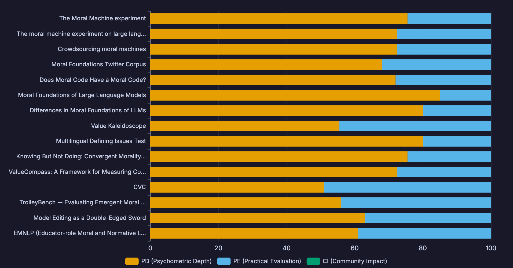
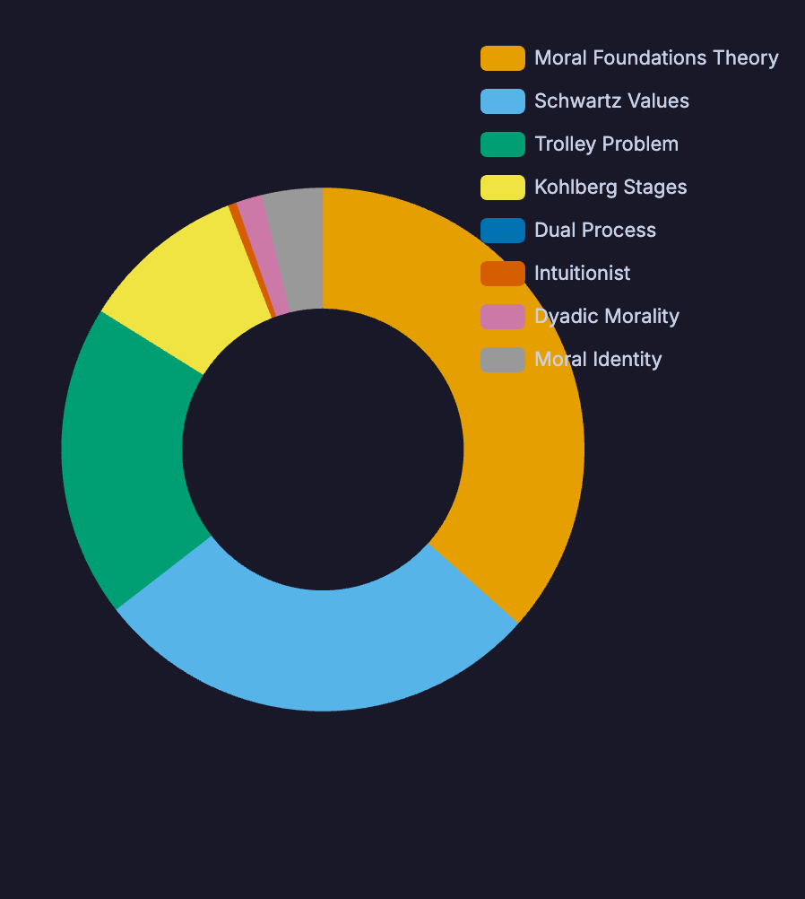
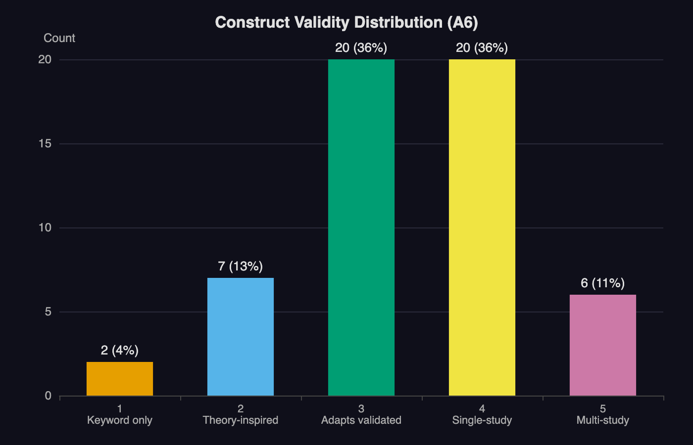
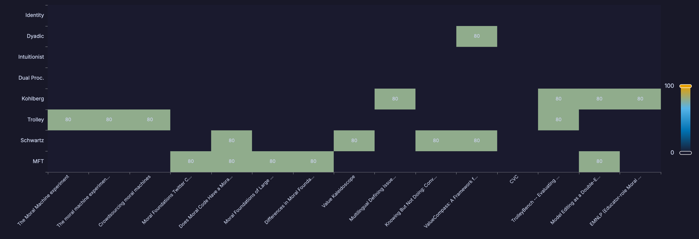
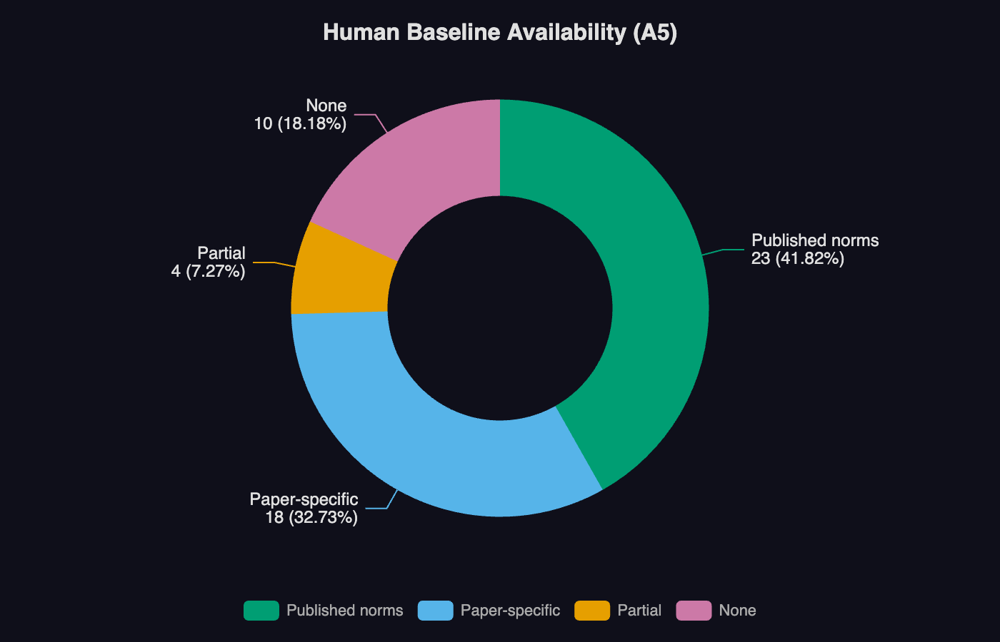
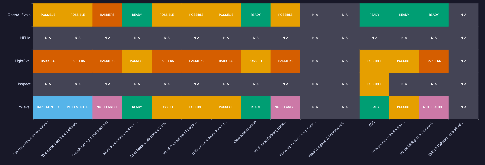

# 4. Results

## 4.1 MFT Dominance (Claim 1)

Moral Foundations Theory dominates the LLM moral evaluation landscape by every measure. After keyword scorer expansion, MFT-related papers account for 101 of 222 candidates (45%), nearly 50% more than the next most represented theory (Schwartz, 69 papers). In the top-15 selection, MFT occupies 5 slots despite a cap of 4 designed to limit over-representation (one benchmark, Fraser et al. [2022], engages both MFT and Schwartz and counts toward both).

**Table 2: Theory Representation Across the Pipeline**

| Theory | Vault Detection (mp_* >= 50) | Candidates (of 222) | Top-15 |
|--------|------------------------------|---------------------|--------|
| MFT | 101 | 28 (MFT-primary) | 5 |
| Schwartz | 69 | 11 | 4 |
| Trolley | 58 | 13 | 5 |
| Kohlberg | 35 | 11 | 4 |
| Social Intuitionism | 18 | 3 | 0 |
| Moral Identity | 12 | 1 | 0 |
| Dual Process | 9 | 3 | 0 |
| Dyadic Morality | 7 | 1 | 1 |

This dominance has two sources. First, MFT benefits from a well-defined psychometric instrument (MFQ-30) and a large annotated corpus (MFTC, 35,108 tweets), making it straightforward to operationalize computationally. Second, the NLP community has adopted MFT terminology ("moral foundations," "care/harm," "fairness/cheating") as a default vocabulary for discussing moral content in text, even when the work does not engage MFT as a psychological theory.

The consequences of this skew are significant. An LLM evaluation landscape dominated by MFT measures whether models can detect or reproduce the five moral foundations---but says nothing about whether models exhibit dual-process moral reasoning, intuitionist judgment patterns, or dyadic harm perception. A model that scores well on MFT benchmarks may still be fundamentally misaligned on dimensions that MFT does not capture.

## 4.2 Construct Validity Gap (Claim 2)

The median A6 (construct validity) score across 55 assessed benchmarks was **3 out of 5**, corresponding to "adapts validated instrument without revalidation for LLMs." The distribution was right-skewed:

**Table 3: Construct Validity Distribution (A6 Scores)**

| A6 Score | Interpretation | Count | Percentage |
|----------|---------------|-------|------------|
| 5 | Multi-study validated | 6 | 11% |
| 4 | Single-study validated | 20 | 36% |
| 3 | Adapts validated instrument | 20 | 36% |
| 2 | Theory-inspired, no validation | 7 | 13% |
| 1 | Keyword-level engagement only | 2 | 4% |

The six benchmarks achieving A6=5 were the Moral Machine [Awad et al., 2018], the MFQ-30 [Graham et al., 2011] as administered by Abdulhai et al. [2024], the Moral Foundations Vignettes [Clifford et al., 2015], the Defining Issues Test [Rest, 1979] in its multilingual adaptation [Khandelwal et al., 2024], the World Values Survey adaptation [Benkler et al., 2023], and one hidden gem (Bago et al., 2022, 45-country trolley replication). Notably, all six derive from instruments with decades of psychometric validation in human populations---they inherit validity from their source instruments rather than establishing it independently for LLM respondents.

The 20 benchmarks scoring A6=3 represent the modal case: researchers take a validated human instrument, administer it to an LLM with minimal adaptation, and report results without addressing whether the instrument measures the same construct in a non-human respondent. This is a fundamental threat to interpretability. When the MFQ-30 asks an LLM to rate "Whether or not someone showed a lack of respect for authority" on a 6-point Likert scale, the response may reflect training data statistics rather than anything analogous to the moral intuition the MFQ was designed to elicit.

## 4.3 Missing Theories (Claim 3)

The most striking finding of our meta-evaluation is the near-complete absence of dedicated benchmarks for three major moral psychology theories.

**Dual Process Theory** (Joshua Greene). Before keyword scorer expansion, the vault detected 0 papers engaging dual process theory at the threshold level. After expansion, 9 papers were detected---but examination revealed that none constitutes a dedicated benchmark. The closest are the Staircase of Ethics [Wu, 2025], which uses multi-step escalating dilemmas that could in principle differentiate System 1 from System 2 responses, and UniMoral [Kumar, 2025], which includes dual-process-inspired scenario contrasts across 6 languages. However, neither tests the signature prediction of dual process theory: that moral judgments should differ under conditions that differentially engage automatic versus deliberative processing.

**Social Intuitionism** (Jonathan Haidt). Detection increased from 1 to 18 papers after scorer expansion, but again none represents a dedicated benchmark. The Social Intuitionist Model makes specific predictions---moral judgments precede reasoning, and "moral dumbfounding" occurs when reasons are defeated but judgments persist [Haidt et al., 2000]---that require experimental designs involving sequential probing and reason-challenging. No existing LLM benchmark implements such a design.

**Dyadic Morality** (Kurt Gray). Detection increased from 3 to 7 papers. The ValueCompass framework [2025] touches on dyadic dimensions in cross-national value assessment, but no benchmark directly tests whether LLMs exhibit the dyadic template: systematically rating scenarios as more morally wrong when an intentional agent causes suffering to a patient.

**Table 4: Theory Gap Summary**

| Theory | Dedicated LLM Benchmarks | Papers Partially Engaging | Core Prediction Tested? |
|--------|-------------------------|--------------------------|------------------------|
| Dual Process | 0 | 9 | No --- no time-pressure or cognitive load manipulation |
| Social Intuitionism | 0 | 18 | No --- no moral dumbfounding protocol |
| Dyadic Morality | 0 | 7 | No --- no agent-patient manipulation |

These gaps are not merely academic. Dual process theory is arguably the most influential framework in modern moral psychology, with over 10,000 citations for Greene's key papers. Social intuitionism fundamentally challenges the assumption---implicit in many LLM evaluations---that moral reasoning drives moral judgment. Dyadic morality offers a parsimonious account of moral cognition that could serve as a powerful lens for analyzing LLM outputs. The absence of all three from the LLM evaluation landscape represents a significant blind spot.

## 4.4 Human Baseline Deficit (Claim 4)

Meaningful evaluation of LLM moral cognition requires comparison against human benchmarks. We assessed A5 (human baseline availability) across all 55 characterized benchmarks.

**Table 5: Human Baseline Availability (A5 Distribution)**

| Baseline Level | Count | Percentage |
|----------------|-------|------------|
| Published norms (population-level) | 23 | 42% |
| Paper-specific (study-level) | 18 | 33% |
| Partial (some dimensions only) | 4 | 7% |
| None | 10 | 18% |

Ten benchmarks (18%) provide no human comparison data whatsoever. These tend to be NLP-origin benchmarks that were designed as classification tasks rather than as instruments for measuring psychological constructs. Without human baselines, statements like "GPT-4 shows utilitarian moral reasoning" are uninterpretable---utilitarian relative to what?

Among the 23 benchmarks with published norms, the strongest baselines come from instruments with long psychometric histories: the MFQ-30 (norms from moralsoundations.org spanning dozens of countries), the DIT (40 years of developmental norms), the World Values Survey (100+ countries over 7 waves), and the Moral Machine (40 million decisions from 233 countries). These instruments enable principled cross-comparison between LLM and human moral profiles.

The paper-specific baselines (33%) are more limited: they report human comparison data from a single study, often with small and demographically homogeneous samples. While better than no baseline, these do not support the kind of cross-cultural or cross-demographic comparison that the strongest instruments enable.

## 4.5 Format Mismatch (Claim 5)

Psychological instruments designed for human participants employ a range of response formats, not all of which transfer naturally to LLM administration.

**Table 6: Task Format Distribution in Top 15**

| Format | Count | LLM Suitability | Key Challenge |
|--------|-------|-----------------|---------------|
| Forced-choice (binary) | 3 | Excellent | None --- trivially scorable |
| Multiple-choice (MCQ) | 2 | Excellent | Answer position bias |
| Multi-label classification | 1 | Good | Standard NLP task |
| Likert scale (rating) | 3 | Moderate | Scale compression; LLMs avoid extremes |
| Scenario rating + ranking | 3 | Difficult | Multi-step reasoning; ranking is hard |
| Free-text + MCQ | 2 | Moderate | Requires model-graded scoring |
| Behavioral task | 1 | Poor | Paradigm change needed |

Three specific format challenges emerged from our assessment and implementation trials:

**Likert compression.** When the MFQ-30 (a 6-point Likert instrument) was administered to LLMs, prior work [Abdulhai et al., 2024] found that models tend to avoid extreme responses (1 and 6), compressing the effective scale. This may reflect RLHF training that penalizes strong or controversial positions, but it also reduces the discriminative power of the instrument.

**Ranking difficulty.** The Defining Issues Test requires participants to rate 12 items on importance and then rank their top 4. Tanmay et al. [2023] found that LLMs struggle with the ranking component, sometimes producing inconsistent orderings (ranking items highly that they rated low). This disconnect between rating and ranking may reflect a fundamental limitation of autoregressive generation for tasks requiring simultaneous comparison.

**Behavioral measures.** One benchmark in our top 15 (Xu and Ma, 2016) includes a behavioral task component (a dictator game measuring moral behavior following moral judgment). Such paradigms require temporal sequencing and consequential choice that have no direct analog in text generation.

## 4.6 Implementation Trial Highlights

We conducted a detailed implementation trial on the highest-ranked benchmark (Moral Machine, Trial MP1). Key findings:

**Utilitarian amplification.** Both Claude Opus and Claude Sonnet showed markedly stronger preferences for sparing more lives (0.92--0.94) than the human global mean (0.81), with effect sizes exceeding Cohen's d = 0.9. The models similarly amplified preferences for sparing humans over animals (0.82--0.85 vs. 0.69) and the young over elderly (0.79--0.82 vs. 0.66).

**Egalitarian counter-bias.** Unlike human populations, which show moderate preferences for higher-status, female, and physically fit individuals, both Claude models showed near-chance performance on these dimensions (0.48--0.52). This pattern suggests that RLHF training has attenuated social hierarchy biases, producing a distinctive moral profile that diverges from human population means.

**High consistency.** Profile correlations between model and human global means exceeded r = 0.95 for both models. Test-retest consistency across 5 runs was 0.96 (Opus) and 0.91 (Sonnet), indicating stable moral preferences under repeated measurement.

**Low refusal rate.** Only 2--4% of scenarios elicited refusal responses, suggesting that forced-choice moral dilemmas are well-suited for LLM administration compared to open-ended moral reasoning tasks where refusal rates can exceed 20%.

These findings illustrate the value of administering psychometrically grounded instruments to LLMs: the Moral Machine's rich human baseline data makes each finding interpretable in a way that benchmarks without baselines cannot match. These trial findings should be interpreted in light of the self-administration confound discussed in Section 5.3.1.
