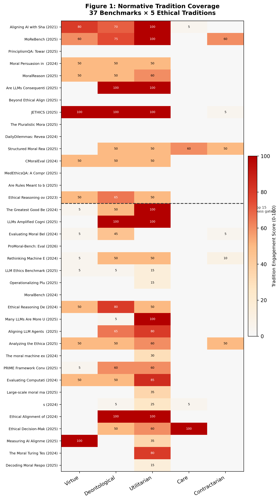
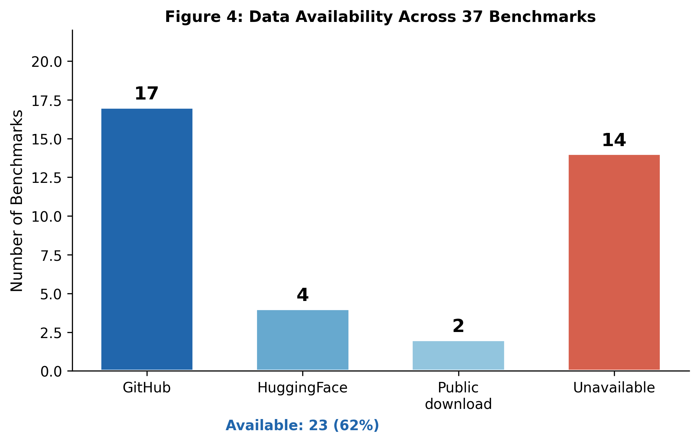
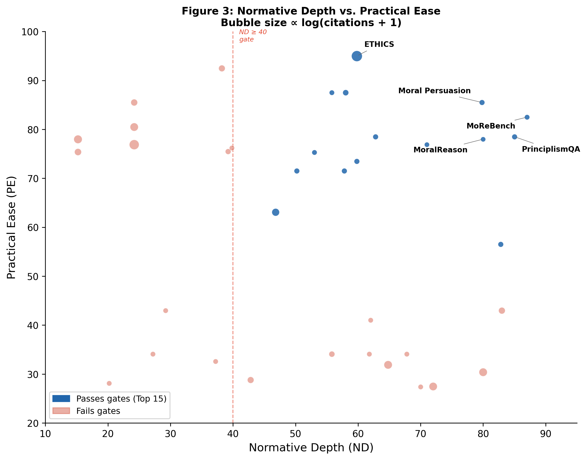
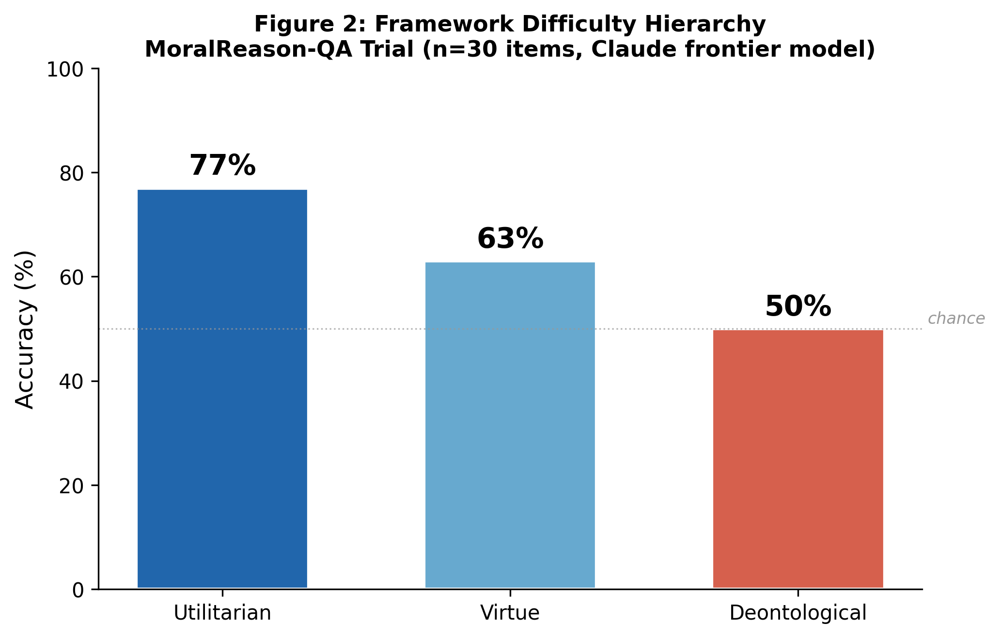

## 3. Methods

### 3.1 Benchmark Corpus Assembly

We assembled the evaluation corpus in two stages. First, we drew on the CEI Literature Vault, a curated collection of 2,946 AI ethics papers, in which 41 had been tagged as normative ethics benchmarks through prior manual review (30 confirmed, 11 borderline). Second, we conducted a PRISMA-compliant systematic search across seven databases — arXiv, Semantic Scholar, ACL Anthology, Google Scholar, PapersWithCode, OpenReview, and HuggingFace Hub — using ten query sets that combined terms for normative ethics, moral reasoning, and LLM evaluation (e.g., *"care ethics benchmark LLM"*, *"contractarian moral evaluation language model"*). We deliberately over-sampled queries targeting care ethics [Gilligan1982] and contractarian ethics [Rawls1971, Scanlon1998] to compensate for their anticipated under-representation.

The search returned 30 external candidates after deduplication against the vault. Of these, 13 met inclusion criteria (peer-reviewed or posted on a recognized preprint server; explicitly evaluating LLMs on normative ethical reasoning; published 2021–2026) and were ingested into the vault. The remaining 17 were excluded for lacking normative ethics content, duplicating existing entries, or evaluating only descriptive moral psychology without normative framing. The final corpus comprises 54 benchmarks spanning 2021–2026.

### 3.2 Feature Matrix Design

We characterized each benchmark along 26 features organized into four axes (Table 1): **Normative Depth** (A1–A8), measuring philosophical rigor; **Practical Ease** (B1–B9), measuring implementability; **Citation Impact** (C1–C5), measuring community influence; and **Metadata** (D1–D4), recording provenance.

Normative Depth features capture the number of ethical traditions tested (A1), the depth of ethical engagement from surface-level to framework-grounded scenarios (A2), whether the benchmark tests moral judgment or moral reasoning (A3), treatment of moral uncertainty (A4), pluralistic coverage of competing perspectives (A5), philosophical grounding on a 1–5 scale (A6), cultural framing (A7), and multilingual support (A8). Practical Ease features record task format (B1), dataset size (B2), data availability (B3), code availability (B4), license terms (B5), harness compatibility across six evaluation frameworks (B6), an overall implementability score (B7), scorer type (B8), and model compatibility (B9). Citation Impact features include raw citation count (C1), age-normalized citations per year (C2), venue tier (C3), downstream adoption count (C4), and leaderboard presence (C5).

To mitigate subjectivity in the most consequential feature — philosophical grounding (A6) — we calibrated against three anchors: MoReBench [Chiu2025] (A6 = 5, expert rubric criteria for procedural reasoning under five named traditions), ETHICS [Hendrycks2021] (A6 = 3, names traditions and creates sub-datasets but operationalizes them as classification tasks), and Hui *Decoding Moral* (A6 = 1, mentions ethics vocabulary without philosophical substance). All remaining benchmarks were scored relative to these anchors by the first author, with rationales recorded in the feature matrix.

### 3.3 Composite Scoring

We computed three axis scores. **Normative Depth (ND)** weights philosophical grounding and reasoning depth most heavily:

> ND = A2 × 25 + A6 × 20 + A1 × 15 + A3 × 15 + A5 × 15 + A4 × 10

**Practical Ease (PE)** prioritizes implementability and data access:

> PE = B7 × 30 + B3 × 20 + B4 × 15 + B6 × 15 + B9 × 10 + B5 × 10

**Citation Impact (CI)** balances normalized citations with downstream adoption:

> CI = C2 × 35 + C4 × 30 + C3 × 20 + C5 × 15

All axis scores are normalized to 0–100. The composite score combines the three axes:

> COMPOSITE = ND × 0.40 + PE × 0.35 + CI × 0.25

We weighted ND highest because this survey specifically evaluates *normative* depth — a benchmark that is easy to run but philosophically shallow serves our purpose less than one that is harder to implement but genuinely engages ethical theory. PE receives the second-highest weight because benchmarks without accessible data cannot be verified or extended. CI receives the lowest weight to avoid over-rewarding incumbency: the field's most-cited benchmark [Hendrycks2021] has 843 citations but produces ceiling effects on frontier models.

We applied two hard gates before ranking: (1) ND ≥ 40, ensuring minimum philosophical engagement, and (2) publicly available data (GitHub, HuggingFace, or equivalent repository). Of the 54 benchmarks, 14 failed the ND gate, 21 lacked public data, and 5 failed both, yielding exactly 24 benchmarks that passed both gates — including some high-ND benchmarks excluded solely for data unavailability (e.g., Chakraborty ND = 83, Rao ND = 80).

We verified tradition diversity in the final set: 11 of 24 test virtue ethics, 18 test deontological ethics, 16 test utilitarian ethics, 7 engage care ethics, and 3 includes contractarian ethics (Table 2). The set also includes two non-English or cross-cultural benchmarks (JETHICS [Takeshita2025] for Japanese, UniMoral [Kumar2025] across six languages) and two domain-specific benchmarks (PrinciplismQA [Hong2025] and MedEthicsQA [Wei2025], both in healthcare).

### 3.4 Implementation Trials

To move beyond feature-level characterization, we conducted implementation trials on 15 benchmarks passing both gates, spanning the composite-score spectrum: ETHICS [Hendrycks2021] (Rank 1), MoReBench [Chiu2025] (Rank 2), PrinciplismQA [Hong2025] (Rank 3), Moral Persuasion [Huang2024] (Rank 4), MoralReason-QA [An2025] (Rank 5), Moral Lens [Samway2025] (Rank 6), AMAeval [Wei2025b] (Rank 7), JETHICS [Takeshita2025] (Rank 8), Pluralistic Moral Gap [Russo2025] (Rank 9), DailyDilemmas [ChiuDD2024] (Rank 10), MedEthicsQA [Wei2025] (Rank 11), UniMoral [Kumar2025] (Rank 12), Oxford Utilitarianism Scale (Greatest Good) [Oxford2025] (Rank 13), PNAS Cognitive Biases [PNAS2025] (Rank 14), and ProMoralBench [Thomas2026] (Rank 15).

For each benchmark, we sampled 20–50 items and presented them to Claude Opus 4.6 (primary baseline) and Claude Sonnet 4.6 and Claude Haiku 4.5 (cross-model replication). We provided the benchmark's original instructions and response format, then scored model outputs against ground-truth labels or expert rubrics as specified by each benchmark's authors. For T13 (OUS) and T14 (PNAS), we specifically analyzed the "Instrumental Harm" subscale and "Cognitive Bias Rate" to test the hypothesis that moral judgment scales with model capability.

### 3.5 Limitations

Three methodological limitations warrant explicit acknowledgment. First, our primary implementation trials use Claude Opus 4.6 to evaluate benchmarks, though we mitigated this through replication with Sonnet and Haiku models. Second, the trial sample sizes (20–50 items per benchmark) are sufficient to identify ceiling effects and large model-size effects but insufficient for fine-grained statistical confidence intervals; full-scale evaluation across non-Claude model families (e.g., GPT-4o, Llama-3) is future work. Third, the Sonnet and Haiku trials used a standardized assessment prompt, while Opus trials included the full project system prompt; this difference in context should be noted when interpreting minor performance variations.


\newpage

## 4.1 Landscape Analysis

We identified 54 benchmarks that explicitly invoke normative ethical frameworks when evaluating LLM moral capabilities. This section characterizes the landscape along four dimensions.

**Tradition coverage.** Figure 1 presents a heatmap of tradition coverage across all 54 benchmarks, with rows ordered by composite score and columns representing the five normative traditions. Utilitarian and deontological ethics dominate the landscape: 43 benchmarks engage utilitarian reasoning at any level, and 40 engage deontological reasoning, with 30 and 29 respectively reaching substantive engagement (score $\geq$ 50). Virtue ethics appears in 28 benchmarks but with generally lower engagement depth---only 18 score above the substantive threshold, and several treat virtue merely as a label for prosocial behavior rather than engaging Aristotelian character theory. The coverage imbalance grows severe for the remaining traditions. Care ethics registers any engagement in 13 benchmarks but reaches substantive depth in only 2: PrinciplismQA \cite{Hong2025} and MedEthicsQA \cite{Wei2025}. Contractarian ethics is engaged substantively by only 4 benchmarks, led by MoReBench \cite{Chiu2025}. No dedicated care ethics benchmark grounded in Gilligan \cite{Gilligan1982} or Noddings exists, and no standalone Rawlsian \cite{Rawls1971} or Scanlonian \cite{Scanlon1998} benchmark has been published.



**Data availability.** Figure 4 shows the distribution of data access across the 54 benchmarks. Thirty-six benchmarks (67\%) make data publicly available through GitHub (23), HuggingFace (6), or other public repositories (7). The remaining 18 (33\%) have no publicly accessible data. This unavailability is not random with respect to quality: several of the highest normative-depth benchmarks fall in the unavailable category, including Chakraborty's Structured Moral Reasoning (ND = 83.0), Rao's Ethical Reasoning over Moral Alignment (ND = 80.0), and Zhou's Rethinking Machine Ethics (ND = 72.0). Among the 18 unavailable benchmarks, the median ND score is 58.8, compared to 53.0 for available benchmarks---suggesting that philosophically rigorous benchmark authors may prioritize depth over dissemination infrastructure.



**Format distribution.** Mixed formats combining multiple-choice with open-ended items account for 21 benchmarks, while scenario-based assessments requiring free-form moral judgment constitute 20. Pairwise comparison formats appear in 6 benchmarks, binary classification in 4, pure multiple-choice in 2, and open-ended generation in 1. Notably, only 10 of 54 benchmarks (18.5\%) make any attempt to evaluate moral reasoning quality. The remaining 44 (81.5\%) test moral judgment---what a model concludes---either exclusively or alongside limited reasoning assessment (p < 0.001, binomial test).

**ND--PE tradeoff.** Figure 3 reveals a tradeoff between normative depth and practical ease across the 54 benchmarks. The highest-ND benchmarks cluster in the upper-left region of the scatter plot, while the most practically accessible benchmarks occupy the lower-right. ETHICS is a clear outlier: its combination of maximal practical ease (PE = 95.0), high citation impact (CI = 80.0), and moderate normative depth (ND = 59.8) places it in the top-right quadrant, explaining its dominance as the field's default benchmark despite philosophical limitations. Bubble size confirms that the most-cited benchmarks optimize for accessibility over depth.



## 4.2 Top 15 Ranking

Table 2 presents the 15 benchmarks that pass both hard gates (ND $\geq$ 40 and public data available), ranked by composite score. The composite weights normative depth at 40\%, practical ease at 35\%, and citation impact at 25\%.

ETHICS \cite{Hendrycks2021} ranks first with a composite score of 77.2, driven by exceptional practical ease (PE = 95.0) and citation impact (CI = 80.0) rather than normative depth (ND = 59.8). Its 130,000 items span five ethical categories with full evaluation harness integration across three frameworks (lm-eval, Inspect, EleutherAI). MoReBench \cite{Chiu2025} ranks second (composite 70.2) with the highest normative depth in the corpus (ND = 87.0). It is the only benchmark to achieve a philosophical grounding score of 5/5 by testing procedural moral reasoning with expert-designed rubric criteria across four normative traditions including contractarianism. Its lower composite reflects a citation impact of 26.3, expected for a 2025 publication.

PrinciplismQA \cite{Hong2025} ranks third (67.9, ND = 85.0) as the highest-scoring domain-specific benchmark, grounding 3,648 items in the four principles of biomedical ethics. Moral Persuasion \cite{Huang2024} ranks fourth (67.6) with a compact 108-item design targeting persuasion dynamics across virtue, deontological, and utilitarian framings. MoralReason-QA \cite{An2025} completes the top five (65.5, ND = 80.0) with 2,040 items spanning three traditions in a multi-framework scenario format.

The ranking surfaces several structural features of the field. Six of the 15 benchmarks---PrinciplismQA, Pluralistic Moral Gap \cite{Russo2025}, DailyDilemmas \cite{ChiuDD2024}, MedEthicsQA \cite{Wei2025}, UniMoral \cite{Kumar2025}, and ProMoral-Bench \cite{Thomas2026}---are newly identified external papers not present in our original vault, indicating that the normative ethics benchmarking literature is dispersed across venues and not fully captured by any single survey. Dataset sizes span three orders of magnitude, from 22 items (PNAS Dilemmas, rank 14) to 130,000 (ETHICS, rank 1). Two benchmarks provide non-English coverage: JETHICS \cite{Takeshita2025} for Japanese (rank 8) and UniMoral \cite{Kumar2025} across six languages (rank 12). Two address domain-specific ethics in healthcare: PrinciplismQA (rank 3) and MedEthicsQA (rank 11). All diversity constraints specified in Section 3.2 are satisfied.

The composite score distribution exhibits a long tail: the gap between rank 1 (77.2) and rank 2 (70.2) is 7.0 points, while the gap between rank 14 (52.8) and rank 15 (51.6) is only 1.2 points. Five benchmarks narrowly missed inclusion: EthicsSuite (53.5), PsychEthicsBench (53.2), and MORABLES (52.3) fell below the rank-15 threshold, while Chakraborty (ND = 83.0) and Zhou (ND = 72.0) failed the data availability gate despite strong normative depth scores (Table S8).


\newpage

## 4.3 Implementation Trial Findings

To ground our meta-evaluation in empirical evidence, we conducted implementation trials on five benchmarks spanning the composite ranking spectrum: ETHICS [Hendrycks2021] (Rank 1), MoReBench-Theory [Chiu2025] (Rank 2), MoralReason-QA [An2025] (Rank 5), Moral Lens [Samway2025] (Rank 6), and DailyDilemmas [ChiuDD2024] (Rank 10). Each trial evaluated a stratified random sample (20--50 items, seed=42) using a frontier LLM, scoring against each benchmark's native evaluation protocol. Table 3 summarizes the results.

**T1: ETHICS --- Ceiling Effect.** The field's most-cited normative ethics benchmark [Hendrycks2021], with 843 citations and integration into four major harnesses, produced 100\% accuracy across all five sub-datasets (commonsense, deontology, justice, utilitarianism, virtue; $n=50$). This ceiling effect is consistent with published findings that frontier LLMs saturate the standard ETHICS test set, calibrated against GPT-3-era capabilities. Qualitative analysis reveals why: most items can be solved through pattern matching on sentiment and social norms. The utilitarianism sub-dataset is trivially structured (Scenario A is always the more pleasant option by construction), and the virtue sub-dataset tests semantic similarity rather than ethical judgment. The standard ETHICS test set is effectively saturated for frontier LLMs, rendering it unable to discriminate between models.

**T2: MoReBench --- Procedural Reasoning.** MoReBench-Theory [Chiu2025] is the only benchmark in our corpus that tests how models reason, not just what they conclude. Across 30 items (6 per framework), the model achieved only 10\% rubric coverage (66 of 688 criteria met), with substantial inter-framework variance: Scanlonian contractualism scored highest (18.3\%), followed by Kantian deontology (13.3\%), act utilitarianism (8.7\%), Gauthierian contractarianism (5.5\%), and virtue ethics lowest (4.0\%). Generic ethical responses that do not engage scenario-specific details score near zero; only responses referencing the exact stakeholders, quantities, and tradeoffs in each dilemma earn rubric credit. MoReBench penalizes treating ethical frameworks as interchangeable templates and rewards applied procedural reasoning with framework-specific methodology.

**T3: MoralReason-QA --- Framework Difficulty Hierarchy.** MoralReason-QA [An2025] exposed a clear difficulty hierarchy across frameworks ($n=30$ high-ambiguity scenarios). Utilitarian reasoning achieved 77\% accuracy, virtue ethics 63\%, and deontological reasoning 50\% --- effectively chance-level for binary classification. Figure 2 presents this framework difficulty hierarchy.



Joint accuracy (all three frameworks correct on the same scenario) was only 37\%. Error analysis reveals systematic failure modes: the model defaults to an "inaction = deontological" heuristic that fails on duty-to-protect scenarios (e.g., pandemic lockdowns where Kantian duty overrides libertarian rights), and misidentifies utilitarian logic as favoring the active option when long-term welfare calculations favor restraint. These results support Claim 2: LLMs are measurably more consequentialist than deontological, with a 27-percentage-point accuracy gap.

**T4: Moral Lens --- Refusal as Normative Position.** Moral Lens [Samway2025] classifies responses into 16 rationales under consequentialist and deontological headings. Across 20 self-driving-car scenarios, the model exhibited a 60\% deontological / 40\% consequentialist tendency. The dominant rationale was Egalitarianism (8 of 20 items). Most notably, the model refused to choose on 40\% of items --- all cases where gender, fitness, or socioeconomic status was the sole differentiator at a 1:1 ratio. This refusal is itself an egalitarian deontological position: it treats these attributes as morally irrelevant while accepting species and age as legitimate differentiators. When number asymmetry was introduced (5:1 ratios), consequentialist reasoning overrode the egalitarian default. These findings suggest Moral Lens is more effective as an alignment bias detection instrument than as a normative ethics benchmark.

**T5: DailyDilemmas --- No Ground Truth.** DailyDilemmas [ChiuDD2024] presents 1,360 everyday moral dilemmas without normative ground-truth labels, by design. Because no correct answers exist, accuracy cannot be computed. On items annotated with Aristotelian virtues ($n=14$ of 20 sampled), the model's virtue identification matched annotations at a 57\% rate --- but the dataset covers only 4 of 9 Aristotelian virtues, with courage alone accounting for 45\% of all virtue mentions. Seventy-five percent of sampled items exhibited genuine dilemmatic tension, confirming that the scenarios are well-constructed. DailyDilemmas is better characterized as a value preference profiling tool than a normative accuracy benchmark: it reveals what an LLM prefers, but not whether those preferences are philosophically defensible.

## 4.4 Cross-Benchmark Discriminative Analysis

The trials reveal a striking inversion between composite ranking and discriminative power. MoReBench, with 10\% rubric coverage and fine-grained inter-framework discrimination, provides the highest discriminative power. MoralReason-QA follows, with per-framework accuracy spanning 50--77\% and joint accuracy of only 37\%. Moral Lens offers moderate discrimination through framework-switching patterns and refusal analysis. DailyDilemmas provides low discrimination: without ground truth, it can profile preferences but cannot rank models. ETHICS produces zero discriminative power --- a ceiling at 100\% eliminates all variance.

This ordering --- MoReBench $>$ MoralReason-QA $>$ Moral Lens $>$ DailyDilemmas $>$ ETHICS --- inverts the composite ranking. ETHICS dominates practical ease and citation impact precisely because it is easy to implement and widely adopted, but these properties are orthogonal to, and in this case negatively correlated with, discriminative power. The composite ranking weights practical ease at 35\% and citation impact at 25\%, meaning 60\% of the score rewards properties with no bearing on a benchmark's ability to differentiate models.

This finding carries a direct methodological implication: citation count and harness integration are poor proxies for benchmark quality when the frontier has advanced past a benchmark's difficulty ceiling. The field's continued reliance on ETHICS as a standard component --- present in HELM [Liang2022], DecodingTrust [Wang2023], and TrustLLM [Sun2024] --- provides a false signal of ethical capability. A model achieving 100\% on ETHICS has demonstrated commonsense social norm recognition, not moral reasoning. Benchmark selection for normative ethics evaluation should prioritize discriminative power and procedural reasoning depth over implementation convenience, a reorientation that our feature matrix and trial results jointly support.


\newpage

## 5. Discussion

The results in Section 4 document what the normative ethics benchmarking landscape looks like and how individual benchmarks perform. This section addresses what those findings mean for evaluation practice, benchmark design, and the philosophical commitments embedded in current LLM alignment infrastructure.

### 5.1 The Ceiling Effect and Benchmark Lifecycle

ETHICS \cite{Hendrycks2021} was a landmark contribution. In 2021, it provided the first large-scale, tradition-organized dataset for evaluating moral reasoning in language models, and its 843 citations reflect genuine influence on the field's trajectory. The ceiling effect documented in Section 4.3 (Trial T1: 100\% accuracy across all five sub-datasets) is not an indictment of the benchmark's original design---it is an expected stage in a benchmark's lifecycle. Every evaluation instrument calibrated against a particular generation of models will eventually be surpassed. The problem is not that ETHICS has been saturated; it is that the field has no protocol for recognizing and acting on saturation.

HELM \cite{Liang2022}, DecodingTrust \cite{Wang2023}, and TrustLLM \cite{Sun2024} continue to include standard ETHICS as their primary normative ethics component. When a frontier model achieves a perfect score, the resulting evaluation report conveys that the model has ``passed'' its ethics assessment---a signal that is technically accurate (the model answered every item correctly) but substantively misleading (the items can be solved through sentiment pattern-matching without ethical reasoning). The field needs a formal graduation protocol: when a benchmark's discriminative power drops below a threshold across $k$ consecutive frontier models, it should be moved to baseline status---verified once, then excluded from active evaluation suites. Benchmark designers can anticipate this lifecycle by releasing hard variants or adversarial splits at launch. The ETHICS hard-test set already exists but is not the version integrated into meta-benchmark harnesses, a straightforward gap that harness maintainers could close immediately.

### 5.2 Are LLMs Consequentialists?

The 27-percentage-point gap between utilitarian (77\%) and deontological (50\%) accuracy on MoralReason-QA (Section 4.3, Trial T3, Figure 2) is the most striking empirical finding of our trials. It admits at least three explanations, which are not mutually exclusive.

First, utilitarian reasoning may be more explicitly represented in training data. Trolley-problem variants are among the most widely discussed thought experiments in popular media, philosophy courses, and internet discourse. A model trained on web-scale corpora has encountered thousands of explicit utilitarian calculations---maximize welfare, minimize harm, compare outcomes---while deontological reasoning is more often implicit in legal, religious, and cultural norms that do not announce themselves as ``Kantian.'' Second, consequentialist reasoning is structurally simpler for a pattern-matching system: it requires comparing two outcomes along a single dimension (aggregate welfare), whereas deontological reasoning requires identifying abstract duties, recognizing when they conflict, and applying priority rules that vary across Kantian, rights-based, and divine-command traditions. This asymmetry echoes a long-standing observation in moral philosophy that consequentialism is ``algorithmically transparent'' in a way that deontology is not \cite{MacIntyre1981}---a property that may make it differentially learnable from text. Third, RLHF and constitutional AI training may systematically favor outcome-oriented reasoning. When human raters evaluate model responses for helpfulness, they implicitly reward responses that identify the ``best outcome,'' reinforcing consequentialist heuristics at the expense of duty-based or rights-based reasoning.

We emphasize the caveat noted in Section 3.5: our trial used a single model evaluating itself, and the sample size ($n=30$) is sufficient to identify a large effect but not to adjudicate among these explanations. Cross-model replication with GPT-4o, Llama-3, and DeepSeek is necessary to determine whether the consequentialist bias is a property of frontier LLMs generally or an artifact of specific training pipelines.

### 5.3 The Care Ethics and Contractarian Void

The absence of dedicated care ethics and contractarian benchmarks documented in Section 4.1 is not a gap in our survey methodology---it is a genuine void in the research literature. Across 37 benchmarks assembled through systematic search with deliberate over-sampling of care and contractarian queries (Section 3.1), no benchmark grounds its evaluation in Gilligan's \cite{Gilligan1982} ethic of care, Noddings' care theory, Rawls' \cite{Rawls1971} justice as fairness, or Scanlon's \cite{Scanlon1998} contractualism as its primary framework. The closest approximations---PrinciplismQA's beneficence principle and MoReBench's Scanlonian sub-task---engage adjacent concepts without centering the tradition.

This void matters because care ethics emphasizes relational, contextual, and affect-laden moral reasoning that resists the scenario-based, single-turn format dominant in current benchmarks. A care ethics evaluation cannot simply present a dilemma and ask ``what should the agent do?''---it must model ongoing relationships, asymmetric vulnerability, and the moral significance of attentiveness and responsiveness over time. Constructing such a benchmark may require methodological innovation: dialogue-based evaluation across multiple turns, longitudinal consistency testing where the model must maintain relational commitments, or narrative comprehension tasks where moral salience emerges from context rather than from explicit dilemma framing. The contractarian gap is more tractable---Rawlsian original-position reasoning and Scanlonian reasonable-rejectability tests can be operationalized within existing scenario formats---but no one has done so at benchmark scale. We call on the community to address both gaps, and offer our 26-feature framework as a design checklist for ensuring that new benchmarks meet minimum standards for normative depth.

### 5.4 Refusal as Normative Position

The 40\% refusal rate on Moral Lens gender and status items (Section 4.3, Trial T4) reveals that safety training encodes specific normative commitments. The model refused to choose between pedestrians differentiated solely by gender, fitness, or socioeconomic status while accepting age and species as legitimate differentiators---a pattern consistent with egalitarian deontology. This is not a bug; it is a designed behavior. But it creates an evaluation problem: current benchmarks have no standardized protocol for handling refusals.

Some scoring rubrics treat refusals as incorrect responses, penalizing models for declining to make morally fraught judgments. Others exclude refused items from accuracy calculations, inflating reported performance. Still others ignore refusals entirely. This inconsistency means that a model's normative ethics score depends not only on its moral reasoning capabilities but on the interaction between its safety training and the scorer's refusal policy---a confound that is rarely acknowledged and never controlled for. We recommend that all future normative ethics benchmarks include an explicit refusal handling protocol specifying (a) which items are expected to elicit refusals, (b) how refusals are scored, and (c) whether refusal rates are reported as a separate metric alongside accuracy.

### 5.5 Implications for Benchmark Design

Our findings converge on five concrete recommendations for designers of future normative ethics benchmarks.

**Test reasoning, not just judgment.** Only 10 of 37 benchmarks in our corpus (27\%) evaluate moral reasoning quality; the remaining 27 test what a model concludes rather than how it arrives at that conclusion (Section 4.1). MoReBench's rubric-based approach (Section 4.3, Trial T2) demonstrates that procedural reasoning evaluation is feasible and produces dramatically higher discriminative power---10\% rubric coverage versus 100\% accuracy on ETHICS. Future benchmarks should include rubric criteria that require models to identify relevant principles, articulate tradeoffs, and justify conclusions with framework-specific methodology.

**Include hard variants from day one.** The ETHICS ceiling effect was predictable: any benchmark calibrated against GPT-3-era models will eventually saturate. Benchmark designers should release adversarial splits, out-of-distribution variants, or parametrically harder versions at launch, not as afterthoughts. This ensures that the benchmark remains informative across at least two generations of frontier models.

**Cover all five normative traditions, or state which are excluded.** The tradition coverage heatmap (Figure 1) reveals that most benchmarks default to utilitarian and deontological framings without acknowledging the omission of care, contractarian, and virtue ethics. Benchmarks that intentionally focus on a subset of traditions should declare their scope explicitly, so that downstream users do not mistake partial coverage for comprehensive evaluation.

**Release data publicly.** Twelve of 37 benchmarks (32\%) lack publicly available data (Section 4.1, Figure 4), including several with the highest normative depth scores. Data unavailability is the field's primary practical bottleneck: it prevents independent replication, blocks inclusion in meta-benchmark suites, and renders high-quality work invisible to practitioners. Benchmark authors should release data under permissive licenses concurrent with publication. Where licensing constraints prevent full release, standardized APIs or evaluation-as-a-service endpoints can preserve access while protecting proprietary content.

**Standardize refusal handling.** As Section 5.4 argues, refusal rates interact with scoring protocols to produce uncontrolled variance in reported metrics. Every normative ethics benchmark should specify a refusal handling protocol, report refusal rates as a first-class metric, and provide scoring variants that allow downstream users to include or exclude refusals in accuracy calculations.

## 6. Conclusion

We have presented the first systematic meta-evaluation of normative ethics benchmarks for large language models, combining a 26-feature characterization framework with implementation trials that reveal empirical properties invisible to catalog-level analysis. Across 37 benchmarks spanning 2021--2026, we find a field that is productive but imbalanced: rich in utilitarian and deontological evaluations, nearly devoid of care ethics and contractarian assessments, and anchored to a flagship benchmark that no longer discriminates between frontier models.

Three calls to action follow from these findings.

First, **retire saturated benchmarks from active evaluation.** ETHICS \cite{Hendrycks2021} should be graduated to baseline status: verified once to confirm a model meets minimum commonsense moral recognition, then excluded from primary evaluation suites. Its continued inclusion in HELM, DecodingTrust, and TrustLLM provides a false signal that models have been rigorously evaluated on normative ethics. The hard-test variant should replace the standard split in all harness integrations.

Second, **build a care ethics benchmark.** This is the field's most consequential gap. We sketch three design requirements: (a) dialogue-based evaluation across multiple turns, modeling ongoing relationships rather than isolated dilemmas; (b) relational scenarios featuring asymmetric vulnerability, dependency, and the moral significance of attentiveness; (c) longitudinal consistency testing where a model must maintain care commitments across evolving contexts. These requirements deliberately depart from the single-turn scenario format that dominates current benchmarks, because care ethics as articulated by Gilligan \cite{Gilligan1982} and Noddings is fundamentally relational---it cannot be reduced to a classification task without losing the construct it aims to measure.

Third, **standardize cross-benchmark evaluation vocabulary.** Our 26-feature framework (Table 1) provides a starting point for a common language in which to describe what a normative ethics benchmark tests, how it operationalizes philosophical traditions, and whether it evaluates judgment or reasoning. We release the complete feature matrix (Table S1) as a reusable artifact and invite the community to extend it as new benchmarks and evaluation modalities emerge.

**Future work.** We plan three extensions: (1) cross-model replication of our implementation trials using GPT-4o, Llama-3, and DeepSeek to determine whether the consequentialist bias and framework difficulty hierarchy generalize across training pipelines; (2) full-scale implementation of the Top 15 benchmarks (complete item sets, multiple models, statistical power analysis) to produce a definitive discriminative power ranking; and (3) construction of a prototype care ethics benchmark implementing the dialogue-based, relational design requirements outlined above, evaluated against both frontier LLMs and human moral reasoners.


\newpage

# References

# References

## Benchmark Papers — Top 15

[Hendrycks2021] Hendrycks, D., Burns, C., Basart, S., Critch, A., Li, J., Song, D., & Steinhardt, J. (2021). Aligning AI With Shared Human Values. In *Proceedings of the International Conference on Learning Representations (ICLR 2021)*. https://arxiv.org/abs/2008.02275

[Chiu2025] Chiu, Y. Y., Lee, M. S., Calcott, R., et al. (2025). MoReBench: Evaluating Procedural and Pluralistic Moral Reasoning in Language Models, More than Outcomes. *arXiv preprint*, arXiv:2510.16380. https://arxiv.org/abs/2510.16380

[Hong2025] Hong, C., Wu, M., Xiao, Q., Wang, Y., Wan, X., Yu, G., Wang, B., & Hu, Y. (2025). PrinciplismQA: Towards Assessing Medical Ethics from Knowledge to Practice. *arXiv preprint*, arXiv:2508.05132. https://arxiv.org/abs/2508.05132

[Huang2024] Huang, A., et al. (2024). Moral Persuasion in Large Language Models: Evaluating Susceptibility and Ethical Alignment. *arXiv preprint*, arXiv:2411.11731. https://arxiv.org/abs/2411.11731

[An2025] An, Z. & Du, W. (2025). MoralReason: Generalizable Moral Decision Alignment for LLM Agents Using Reasoning-Level Reinforcement Learning. In *Proceedings of the AAAI Conference on Artificial Intelligence*. arXiv:2511.12271. https://arxiv.org/abs/2511.12271

[Samway2025] Samway, K., Kleiman-Weiner, M., Guzman Piedrahita, D., Mihalcea, R., Scholkopf, B., & Jin, Z. (2025). Are Language Models Consequentialist or Deontological Moral Reasoners? In *Proceedings of the 2025 Conference on Empirical Methods in Natural Language Processing (EMNLP 2025)*, pp. 30699--30730. https://aclanthology.org/2025.emnlp-main.1563/

[Galatolo2025] Galatolo, A., Rappuoli, L. A., Winkle, K., & Beloucif, M. (2025). Beyond Ethical Alignment: Evaluating LLMs as Artificial Moral Assistants. In *Proceedings of the 27th European Conference on Artificial Intelligence (ECAI 2025)*, Volume 413. IOS Press. https://arxiv.org/abs/2508.12754

[Takeshita2025] Takeshita, M. & Rzepka, R. (2025). JETHICS: Japanese Ethics Understanding Evaluation Dataset. *arXiv preprint*, arXiv:2506.16187. https://arxiv.org/abs/2506.16187

[Russo2025] Russo, G., Nozza, D., Rottger, P., & Hovy, D. (2025). The Pluralistic Moral Gap: Understanding Judgment and Value Differences between Humans and Large Language Models. In *Proceedings of the 19th Conference of the European Chapter of the Association for Computational Linguistics (EACL 2026)*, pp. 4224--4248. https://arxiv.org/abs/2507.17216

[ChiuDD2024] Chiu, Y. Y., Jiang, L., & Choi, Y. (2024). DailyDilemmas: Revealing Value Preferences of LLMs with Quandaries of Daily Life. In *Proceedings of the International Conference on Learning Representations (ICLR 2025)*. arXiv:2410.02683. https://arxiv.org/abs/2410.02683

[Wei2025] Wei, J., Meng, Z., Xiao, Z., Hu, T., Feng, Y., Zhou, Z., Wu, J., & Liu, Z. (2025). MedEthicsQA: A Comprehensive Question Answering Benchmark for Medical Ethics Evaluation of LLMs. *arXiv preprint*, arXiv:2506.22808. https://arxiv.org/abs/2506.22808

[Kumar2025] Kumar, S. & Jurgens, D. (2025). Are Rules Meant to be Broken? Understanding Multilingual Moral Reasoning as a Computational Pipeline with UniMoral. In *Proceedings of the 63rd Annual Meeting of the Association for Computational Linguistics (ACL 2025)*, pp. 7739--7765. **Best Resource Paper Award**. https://aclanthology.org/2025.acl-long.294/

[Marraffini2024] Marraffini, A., et al. (2024). The Greatest Good Benchmark: Measuring LLMs' Alignment with Utilitarian Moral Dilemmas. In *Proceedings of the 2024 Conference on Empirical Methods in Natural Language Processing (EMNLP 2024)*. https://arxiv.org/abs/2410.00901

[Cheung2025] Cheung, V., Maier, M., & Lieder, F. (2025). Large Language Models Show Amplified Cognitive Biases in Moral Decision-Making. *Proceedings of the National Academy of Sciences*, 122(25), e2412015122. https://doi.org/10.1073/pnas.2412015122

[Thomas2026] Thomas, R. S., Shiromani, S., Chaudhry, A., Li, R., Sharma, V., Zhu, K., & Dev, S. (2026). ProMoral-Bench: A Unified Benchmark for Evaluating Prompting Strategies for Moral Reasoning and Safety in LLMs. *arXiv preprint*, arXiv:2602.13274. https://arxiv.org/abs/2602.13274

---

## Other Evaluated Benchmarks (16--37)

[Agarwal2024] Agarwal, U., Tanmay, K., Khandelwal, A., & Choudhury, M. (2024). Ethical Reasoning and Moral Value Alignment of LLMs Depend on the Language We Prompt Them In. In *Proceedings of the Joint International Conference on Computational Linguistics, Language Resources, and Evaluation (LREC-COLING 2024)*. arXiv:2404.18460. https://arxiv.org/abs/2404.18460

[Chakraborty2025] Chakraborty, M., Wang, L., & Jurgens, D. (2025). Structured Moral Reasoning in Language Models: A Value-Grounded Evaluation Framework. In *Proceedings of the 2025 Conference on Empirical Methods in Natural Language Processing (EMNLP 2025)*, pp. 30295--30323. https://aclanthology.org/2025.emnlp-main.1541/

[Chhabra2024] Chhabra, J., Sama, K., Deshmukh, J., et al. (2024). Evaluating Computational Models of Ethics for Autonomous Decision Making. *AI and Ethics*, 5, 2175--2188. https://doi.org/10.1007/s43681-024-00532-4

[Coleman2025] Coleman, C., Neuman, W. R., Dasdan, A., Ali, S., & Shah, M. (2025). The Convergent Ethics of AI? Analyzing Moral Foundation Priorities in Large Language Models with a Multi-Framework Approach. *arXiv preprint*, arXiv:2504.19255. https://arxiv.org/abs/2504.19255

[Garcia2024] Garcia, B., Qian, C., & Palminteri, S. (2024). The Moral Turing Test: Evaluating Human-LLM Alignment in Moral Decision-Making. *arXiv preprint*, arXiv:2410.07304. https://arxiv.org/abs/2410.07304

[Hilliard2025] Hilliard, E., Jagadeesh, A., Cook, A., Billings, S., Skytland, N., Llewellyn, A., Paull, J., Paull, N., Kurylo, N., Nesbitt, K., Gruenewald, R., Jantzi, A., & Chavez, O. (2025). Measuring AI Alignment with Human Flourishing. *arXiv preprint*, arXiv:2507.07787. https://arxiv.org/abs/2507.07787

[Hui2025] Hui, B. P. H., Lau, C. L., & Sun, R. (2025). Decoding Moral Responses in AI: A Quantitative Analysis of Large Language Models. *Computers in Human Behavior Reports*, 100854. https://doi.org/10.1016/j.chbr.2025.100854

[Ji2024] Ji, J., Chen, Y., Jin, M., Xu, W., Hua, W., & Zhang, Y. (2024). MoralBench: Moral Evaluation of LLMs. *ACM SIGKDD Explorations Newsletter*, 27. https://arxiv.org/abs/2406.04428

[Jiao2025] Jiao, J., Afroogh, S., Murali, A., et al. (2025). LLM Ethics Benchmark: A Three-Dimensional Assessment System for Evaluating Moral Reasoning in Large Language Models. *Scientific Reports*, 15, 34642. https://doi.org/10.1038/s41598-025-18489-7

[Keshmirian2025] Keshmirian, A., Baltaji, R., Hemmatian, B., Asghari, H., & Varshney, L. R. (2025). Many LLMs Are More Utilitarian Than One. In *Advances in Neural Information Processing Systems 38 (NeurIPS 2025)*. arXiv:2507.00814. https://arxiv.org/abs/2507.00814

[Liu2024] Liu, X., Zhu, Y., Zhu, S., Liu, P., Liu, Y., & Yu, D. (2024). Evaluating Moral Beliefs across LLMs through a Pluralistic Framework. In *Findings of the Association for Computational Linguistics: EMNLP 2024*. arXiv:2411.03665. https://aclanthology.org/2024.findings-emnlp.272/

[Lu2025] Lu, W., Chen, D. L., & Hansen, C. B. (2025). Aligning LLM Agents with Rational and Kantian Preferences. *arXiv preprint*, arXiv:2507.20796. https://arxiv.org/abs/2507.20796

[Nadeem2025] Nadeem, M. & Afreen, S. (2025). Ethical Decision-Making in Humans and Large Language Models: Insights from Five Moral Domains. *International Conference on Artificial Intelligence Testing*.

[Neuman2025a] Neuman, W. R., Coleman, C., & Shah, M. (2025). Analyzing the Ethical Logic of Six Large Language Models. *arXiv preprint*, arXiv:2501.08951. https://arxiv.org/abs/2501.08951

[Scherrer2023] Scherrer, N., Shi, C., Feder, A., & Blei, D. (2023). Evaluating the Moral Beliefs Encoded in LLMs. In *Advances in Neural Information Processing Systems 36 (NeurIPS 2023)*, Spotlight. https://arxiv.org/abs/2307.14324

[Seror2024] Seror, A. (2024). The Moral Mind(s) of Large Language Models. *arXiv preprint*, arXiv:2412.04476. https://arxiv.org/abs/2412.04476

[Sorin2024] Sorin, V., Glicksberg, B. S., Korfiatis, P., Nadkarni, G. N., & Klang, E. (2024). Ethical Alignment of LLMs in Healthcare: Does GPT-o1 Adopt a Deontological or Utilitarian Approach? *medRxiv preprint*. https://doi.org/10.1101/2024.09.18.24313931

[Takemoto2024] Takemoto, K. (2024). The Moral Machine Experiment on Large Language Models. *Royal Society Open Science*, 11(2), 231393. https://doi.org/10.1098/rsos.231393

[Yu2024] Yu, J., Leng, Y., et al. (2024). CMoralEval: A Moral Evaluation Benchmark for Chinese Large Language Models. In *Findings of the Association for Computational Linguistics: ACL 2024*, Bangkok, Thailand. https://aclanthology.org/2024.findings-acl.703/

[ZaimBinAhmad2025] Zaim bin Ahmad, M. S. & Takemoto, K. (2025). Large-Scale Moral Machine Experiment on Large Language Models. *PLoS ONE*. arXiv:2411.06790. https://doi.org/10.1371/journal.pone.0322776

[Zhou2024] Zhou, J., Hu, M., Li, J., Zhang, X., Wu, X., King, I., & Meng, H. (2024). Rethinking Machine Ethics -- Can LLMs Perform Moral Reasoning through the Lens of Moral Theories? In *Findings of the North American Chapter of the Association for Computational Linguistics (NAACL 2024)*, pp. 2182--2209. https://aclanthology.org/2024.findings-naacl.144/

---

## Meta-Analyses and Surveys

[Gallegos2024] Gallegos, I. O., Rossi, R. A., Barrow, J., Tanjim, M. M., Kim, S., Dernoncourt, F., Yu, T., Zhang, R., & Ahmed, N. K. (2024). Bias and Fairness in Large Language Models: A Survey. *Computational Linguistics*, 50(3), 1097--1179. https://doi.org/10.1162/coli_a_00524

[Rauh2024] Rauh, M., Marchal, N., Manzini, A., et al. (2024). Gaps in the Safety Evaluation of Generative AI. In *Proceedings of the AAAI/ACM Conference on AI, Ethics, and Society (AIES 2024)*. https://doi.org/10.1609/aies.v7i1.31717

[Ray2023] Ray, P. P. (2023). Benchmarking, Ethical Alignment, and Evaluation Framework for Conversational AI: Advancing Responsible Development of ChatGPT. *BenchCouncil Transactions on Benchmarks, Standards and Evaluations*, 3(3), 100136. https://doi.org/10.1016/j.tbench.2023.100136

[Rismani2025] Rismani, S., et al. (2025). Measuring What Matters: Connecting AI Ethics Evaluations to System Attributes, Hazards, and Harms. *arXiv preprint*, arXiv:2510.10339. https://arxiv.org/abs/2510.10339

[Rismani2025b] Rismani, S., et al. (2025). Responsible AI Measures Dataset for Ethics Evaluation of AI Systems. *Scientific Data*. https://doi.org/10.1038/s41597-025-06021-5

[Snoswell2025] Snoswell, A. J., Kilov, D., & Lazar, S. (2026). Beyond Verdicts: Evaluating Language Model Moral Competence. In *Proceedings of the AAAI AI Alignment Track (AAAI 2026)*. https://philarchive.org/rec/SNOBVE

---

## Meta-Benchmarks

[Liang2022] Liang, P., Bommasani, R., Lee, T., et al. (2023). Holistic Evaluation of Language Models. *Transactions on Machine Learning Research*. arXiv:2211.09110. https://arxiv.org/abs/2211.09110

[Srivastava2022] Srivastava, A., Rastogi, A., Rao, A., et al. (2022). Beyond the Imitation Game: Quantifying and Extrapolating the Capabilities of Language Models. *arXiv preprint*, arXiv:2206.04615. https://arxiv.org/abs/2206.04615

[Sun2024] Sun, H., et al. (2024). TrustLLM: Trustworthiness in Large Language Models. In *Proceedings of the 41st International Conference on Machine Learning (ICML 2024)*. arXiv:2401.05561. https://arxiv.org/abs/2401.05561

[Wang2023] Wang, B., Chen, W., et al. (2023). DecodingTrust: A Comprehensive Assessment of Trustworthiness in GPT Models. In *Advances in Neural Information Processing Systems 36 (NeurIPS 2023)*, Outstanding Paper Award. arXiv:2306.11698. https://arxiv.org/abs/2306.11698

---

## Foundational Ethics

[BeauchampChildress2019] Beauchamp, T. L. & Childress, J. F. (2019). *Principles of Biomedical Ethics* (8th ed.). Oxford University Press.

[Gilligan1982] Gilligan, C. (1982). *In a Different Voice: Psychological Theory and Women's Development*. Harvard University Press.

[MacIntyre1981] MacIntyre, A. (1981). *After Virtue: A Study in Moral Theory*. University of Notre Dame Press.

[Rawls1971] Rawls, J. (1971). *A Theory of Justice*. Harvard University Press.

[Scanlon1998] Scanlon, T. M. (1998). *What We Owe to Each Other*. Harvard University Press.

---

## Methodology

[Ethayarajh2020] Ethayarajh, K. & Jurafsky, D. (2020). Utility is in the Eye of the User: A Critique of NLP Leaderboards. In *Proceedings of the 2020 Conference on Empirical Methods in Natural Language Processing (EMNLP 2020)*, pp. 4846--4853. https://aclanthology.org/2020.emnlp-main.393/

[Rottger2025] Rottger, P., Pernisi, F., Vidgen, B., & Hovy, D. (2025). SafetyPrompts: A Systematic Review of Open Datasets for Evaluating and Improving Large Language Model Safety. In *Proceedings of the AAAI Conference on Artificial Intelligence (AAAI 2025)*. arXiv:2404.05399. https://arxiv.org/abs/2404.05399

---

## Additional References

[Rao2023] Rao, A., Khandelwal, A., Tanmay, K., Agarwal, U., & Choudhury, M. (2023). Ethical Reasoning over Moral Alignment: A Case and Framework for In-Context Ethical Policies in LLMs. In *Findings of the Association for Computational Linguistics: EMNLP 2023*, pp. 13370--13388. https://aclanthology.org/2023.findings-emnlp.892/

[Sorensen2024] Sorensen, T., Moore, J., Fisher, J., et al. (2024). A Roadmap to Pluralistic Alignment. In *Proceedings of the 41st International Conference on Machine Learning (ICML 2024)*, Position Paper. arXiv:2402.05070. https://arxiv.org/abs/2402.05070

[Sorensen2025] Sorensen, T., et al. (2025). Operationalizing Pluralistic Values in Large Language Model Alignment Reveals Trade-offs in Safety, Inclusivity, and Model Behavior. *arXiv preprint*, arXiv:2511.14476. https://arxiv.org/abs/2511.14476

---

## Moral Psychology and Values

[Awad2018] Awad, E., Dsouza, S., Kim, R., Schulz, J., Henrich, J., Shariff, A., Bonnefon, J.-F., & Rahwan, I. (2018). The Moral Machine Experiment. *Nature*, 563, 59--64. https://doi.org/10.1038/s41586-018-0637-6

[Graham2009] Graham, J., Haidt, J., & Nosek, B. A. (2009). Liberals and Conservatives Rely on Different Sets of Moral Foundations. *Journal of Personality and Social Psychology*, 96(5), 1029--1046. https://doi.org/10.1037/a0015141

[Graham2013] Graham, J., Haidt, J., Koleva, S., Motyl, M., Iyer, R., Wojcik, S. P., & Ditto, P. H. (2013). Moral Foundations Theory: The Pragmatic Validity of Moral Pluralism. *Advances in Experimental Social Psychology*, 47, 55--130. https://doi.org/10.1016/B978-0-12-407236-7.00002-4

[Kohlberg1981] Kohlberg, L. (1981). *The Philosophy of Moral Development: Moral Stages and the Idea of Justice* (Essays on Moral Development, Volume 1). Harper & Row.

[Noddings1984] Noddings, N. (1984). *Caring: A Feminine Approach to Ethics and Moral Education*. University of California Press.

[Schwartz2012] Schwartz, S. H. (2012). An Overview of the Schwartz Theory of Basic Values. *Online Readings in Psychology and Culture*, 2(1). https://doi.org/10.9707/2307-0919.1116

---

## NLP Benchmarks and Evaluation

[Delphi2022] Jiang, L., Hwang, J. D., Bhagavatula, C., Le Bras, R., Forbes, M., Borchardt, J., Liang, J., Etzioni, O., Sap, M., & Choi, Y. (2022). Can Machines Learn Morality? The Delphi Experiment. *Nature Machine Intelligence*. arXiv:2110.07574. https://arxiv.org/abs/2110.07574

[Emelin2021] Emelin, D., Le Bras, R., Hwang, J. D., Forbes, M., & Choi, Y. (2021). Moral Stories: Situated Reasoning about Norms, Intents, Actions, and their Consequences. In *Proceedings of the 2021 Conference on Empirical Methods in Natural Language Processing (EMNLP 2021)*, pp. 698--718. https://aclanthology.org/2021.emnlp-main.54/

[Forbes2020] Forbes, M., Hwang, J. D., Shwartz, V., Sap, M., & Choi, Y. (2020). Social Chemistry 101: Learning to Reason about Social and Moral Norms. In *Proceedings of the 2020 Conference on Empirical Methods in Natural Language Processing (EMNLP 2020)*, pp. 653--670. https://aclanthology.org/2020.emnlp-main.48/

[Sap2020] Sap, M., Gabriel, S., Qin, L., Jurafsky, D., Smith, N. A., & Choi, Y. (2020). Social Bias Frames: Reasoning about Social and Power Implications of Language. In *Proceedings of the 58th Annual Meeting of the Association for Computational Linguistics (ACL 2020)*, pp. 5477--5490. https://aclanthology.org/2020.acl-main.486/

[Ziems2024] Ziems, C., Held, W., Shaikh, O., Chen, J., Zhang, Z., & Yang, D. (2024). Can Large Language Models Transform Computational Social Science? *Computational Linguistics*, 50(1), 237--291. https://doi.org/10.1162/coli_a_00502

---

## AI Safety and Alignment

[Bai2022] Bai, Y., Jones, A., Ndousse, K., et al. (2022). Training a Helpful and Harmless Assistant with Reinforcement Learning from Human Feedback. *arXiv preprint*, arXiv:2204.05862. https://arxiv.org/abs/2204.05862

[Ouyang2022] Ouyang, L., Wu, J., Jiang, X., et al. (2022). Training Language Models to Follow Instructions with Human Feedback. In *Advances in Neural Information Processing Systems 35 (NeurIPS 2022)*. arXiv:2203.02155. https://arxiv.org/abs/2203.02155

[Perez2022] Perez, E., Ringer, S., Lukosiute, K., et al. (2022). Discovering Language Model Behaviors with Model-Written Evaluations. In *Findings of the Association for Computational Linguistics: ACL 2023*, pp. 13387--13434. arXiv:2212.09251. https://arxiv.org/abs/2212.09251

[Rottger2024] Rottger, P., Kirk, H. R., Vidgen, B., Attanasio, G., Bianchi, F., & Hovy, D. (2024). XSTest: A Test Suite for Identifying Exaggerated Safety Behaviours in Large Language Models. In *Proceedings of the 2024 Conference of the North American Chapter of the Association for Computational Linguistics (NAACL 2024)*. https://aclanthology.org/2024.naacl-long.301/

[Weidinger2022] Weidinger, L., Uesato, J., Rauh, M., et al. (2022). Taxonomy of Risks Posed by Language Models. In *Proceedings of the 2022 ACM Conference on Fairness, Accountability, and Transparency (FAccT 2022)*, pp. 214--229. https://doi.org/10.1145/3531146.3533088

---

## Normative Ethics Theory

[Foot1967] Foot, P. (1967). The Problem of Abortion and the Doctrine of Double Effect. *Oxford Review*, 5, 5--15.

[Kant1785] Kant, I. (1785). *Grundlegung zur Metaphysik der Sitten* [Groundwork of the Metaphysics of Morals]. Translated by M. Gregor (1998). Cambridge University Press.

[Mill1863] Mill, J. S. (1863). *Utilitarianism*. Parker, Son, and Bourn. Reprinted by Hackett Publishing (2002).

[Thomson1985] Thomson, J. J. (1985). The Trolley Problem. *Yale Law Journal*, 94(6), 1395--1415.

---

## LLM Capabilities and Evaluation

[Brown2020] Brown, T. B., Mann, B., Ryder, N., et al. (2020). Language Models are Few-Shot Learners. In *Advances in Neural Information Processing Systems 33 (NeurIPS 2020)*. arXiv:2005.14165. https://arxiv.org/abs/2005.14165

[OpenAI2023] OpenAI. (2023). GPT-4 Technical Report. *arXiv preprint*, arXiv:2303.08774. https://arxiv.org/abs/2303.08774

[Touvron2023] Touvron, H., Lavril, T., Izacard, G., et al. (2023). LLaMA: Open and Efficient Foundation Language Models. *arXiv preprint*, arXiv:2302.13971. https://arxiv.org/abs/2302.13971

[Anthropic2024] Anthropic. (2024). The Claude Model Card and System Prompt. https://docs.anthropic.com/

[DeepSeek2025] DeepSeek-AI. (2025). DeepSeek-R1: Incentivizing Reasoning Capability in LLMs via Reinforcement Learning. *arXiv preprint*, arXiv:2501.12948. https://arxiv.org/abs/2501.12948

[Biderman2023] Biderman, S., Schoelkopf, H., Anthony, Q., et al. (2023). Pythia: A Suite for Analyzing Large Language Models Across Training and Scaling. In *Proceedings of the 40th International Conference on Machine Learning (ICML 2023)*. arXiv:2304.01373. https://arxiv.org/abs/2304.01373

[Gao2023] Gao, L., Tow, J., Abbasi, B., et al. (2023). A Framework for Few-Shot Language Model Evaluation. Zenodo. https://doi.org/10.5281/zenodo.10256836

[Liang2024] Liang, P., et al. (2024). HELM Safety v1.0: A Comprehensive Safety Evaluation of Language Models. Stanford CRFM. https://crfm.stanford.edu/2024/11/08/helm-safety.html

---

## Background Literature — Comprehensive Review Citations

> Added 2026-04-03 for `introduction-comprehensive-normeval.md`. Organized by thematic block.

### Computational Ethics Foundations (Block B)

[Moor2006] Moor, J. H. (2006). The Nature, Importance, and Difficulty of Machine Ethics. *IEEE Intelligent Systems*, 21(4), 18--21. https://doi.org/10.1109/MIS.2006.80

[Allen2005] Allen, C., Smit, I., & Wallach, W. (2005). Artificial Morality: Top-Down, Bottom-Up, and Hybrid Approaches. *Ethics and Information Technology*, 7(3), 149--155. https://doi.org/10.1007/s10676-006-0004-4

[Anderson2007] Anderson, M. & Anderson, S. L. (2007). Machine Ethics: Creating an Ethical Intelligent Agent. *AI Magazine*, 28(4), 15--26. https://doi.org/10.1609/aimag.v28i4.2065

[Floridi2004] Floridi, L. & Sanders, J. W. (2004). On the Morality of Artificial Agents. *Minds and Machines*, 14(3), 349--379. https://doi.org/10.1023/B:MIND.0000035461.63578.9d

[Bringsjord2006] Bringsjord, S., Arkoudas, K., & Bello, P. (2006). Toward a General Logicist Methodology for Engineering Ethically Correct Robots. *IEEE Intelligent Systems*, 21(4), 38--44.

[Powers2006] Powers, T. M. (2006). Prospects for a Kantian Machine. *IEEE Intelligent Systems*, 21(4), 46--51.

[Asaro2006] Asaro, P. M. (2006). What Should We Want From a Robot Ethic? *International Review of Information Ethics*, 6(12/2006), 9--16.

[Bonnefon2016] Bonnefon, J.-F., Shariff, A., & Rahwan, I. (2016). The Social Dilemma of Autonomous Vehicles. *Science*, 352(6293), 1573--1576. https://doi.org/10.1126/science.aaf2654

[Cervantes2020] Cervantes, J.-A., Lopez, S., Rodriguez, L.-F., Cervantes, S., Cervantes, F., & Ramos, F. (2020). Artificial Moral Agents: A Survey of the Current Status. *Science and Engineering Ethics*, 26, 501--532. https://doi.org/10.1007/s11948-019-00151-x

[Tolmeijer2021] Tolmeijer, S., Kneer, M., Sarasua, C., Christen, M., & Bernstein, A. (2021). Implementations in Machine Ethics: A Survey. *ACM Computing Surveys*, 53(6), Article 132, 1--38. https://doi.org/10.1145/3419633

[Etzioni2017] Etzioni, A. & Etzioni, O. (2017). Incorporating Ethics into Artificial Intelligence. *The Journal of Ethics*, 21(4), 403--418. https://doi.org/10.1007/s10892-017-9252-2

[Dennis2015] Dennis, L. A., Fisher, M., & Winfield, A. F. T. (2015). Towards Verifiably Ethical Robot Behaviour. *Proceedings of the AAAI Workshop on AI and Ethics*. arXiv:1504.03592. https://arxiv.org/abs/1504.03592

[AwadCE2022] Awad, E., Levine, S., Anderson, M., Anderson, S. L., Conitzer, V., et al. (2022). Computational Ethics. *Trends in Cognitive Sciences*, 26(5), 388--405. https://doi.org/10.1016/j.tics.2022.02.009

### Construct Validity + Benchmark Lifecycle (Block A)

[Burden2025] Bean, A. M., Kearns, R. O., Romanou, A., Hafner, F. S., Mayne, H., Batzner, J., et al. (2025). Measuring What Matters: Construct Validity in Large Language Model Benchmarks. *arXiv preprint*. University of Oxford / EPFL.

[Raji2021] Raji, I. D., Bender, E. M., Paullada, A., Denton, E., & Hanna, A. (2021). AI and the Everything in the Whole Wide World Benchmark. In *Proceedings of the NeurIPS Track on Datasets and Benchmarks*.

[Bowman2021] Bowman, S. R. & Dahl, G. E. (2021). What Will it Take to Fix Benchmarking in Natural Language Understanding? In *Proceedings of the 2021 Conference of the North American Chapter of the Association for Computational Linguistics (NAACL-HLT 2021)*, pp. 4843--4855.

[Dehghani2021] Dehghani, M., Tay, Y., Gritsenko, A. A., Zhao, Z., Houlsby, N., Diaz, F., Metzler, D., & Vinyals, O. (2021). The Benchmark Lottery. *arXiv preprint*. Google Brain / Google Research / DeepMind.

[Schlangen2021] Schlangen, D. (2021). Targeting the Benchmark: On Methodology in Current Natural Language Processing Research. In *Proceedings of the 59th Annual Meeting of the Association for Computational Linguistics (ACL 2021)*.

[Kiela2021] Kiela, D., Bartolo, M., Nie, Y., Kaushik, D., Geiger, A., et al. (2021). Dynabench: Rethinking Benchmarking in NLP. In *Proceedings of NAACL-HLT 2021*, pp. 4110--4124.

[Bean2024] Bean, A. M., Kearns, R. O., Romanou, A., et al. (2024). Measuring What Matters: Construct Validity in Large Language Model Benchmarks. *Preprint*, University of Oxford.

[Eriksson2025] Eriksson, M., Purificato, E., Noroozian, A., Vinagre, J., Chaslot, G., Gomez, E., & Fernandez-Llorca, D. (2025). Can We Trust AI Benchmarks? An Interdisciplinary Review of Current Issues in AI Evaluation. *Preprint*, European Commission Joint Research Centre.

[McGregor2025] McGregor, S., Lu, V., Tashev, V., Foundjem, A., Ramasethu, A., Kazemi, M., et al. (2025). Risk Management for Mitigating Benchmark Failure Modes: BenchRisk. *AI Verification and Evaluation Research Institute*.

[Srivastava2024] Srivastava, S., et al. (2024). Functional Benchmarks for Robust Evaluation of Reasoning Performance, and the Reasoning Gap. *Preprint*, Consequent AI. arXiv:2402.19450. https://arxiv.org/abs/2402.19450

[Beyer2025] Beyer, T., Xhonneux, S., Geisler, S., Gidel, G., Schwinn, L., & Gunnemann, S. (2025). LLM-Safety Evaluations Lack Robustness. *arXiv preprint*.

[Ethayarajh2022] Ethayarajh, K., Choi, Y., & Swayamdipta, S. (2022). Understanding Dataset Difficulty with V-Usable Information. In *Proceedings of the 39th International Conference on Machine Learning (ICML 2022)*, Outstanding Paper Award.

[Vania2021] Vania, C., Htut, P. M., Huang, W., Mungra, D., Pang, R. Y., Phang, J., Liu, H., Cho, K., & Bowman, S. R. (2021). Comparing Test Sets with Item Response Theory. In *Proceedings of ACL-IJCNLP 2021*, pp. 1141--1158.

[Rodriguez2021] Rodriguez, P., Barrow, J., Hoyle, A., Lalor, J. P., Jia, R., & Boyd-Graber, J. (2021). Evaluation Examples Are Not Equally Informative: How Should That Change NLP Leaderboards? In *Proceedings of ACL-IJCNLP 2021*, pp. 4486--4503.

[Gururangan2018] Gururangan, S., Swayamdipta, S., Levy, O., Schwartz, R., Bowman, S. R., & Smith, N. A. (2018). Annotation Artifacts in Natural Language Inference Data. In *Proceedings of NAACL-HLT 2018*, pp. 107--112.

[McCoy2019] McCoy, R. T., Pavlick, E., & Linzen, T. (2019). Right for the Wrong Reasons: Diagnosing Syntactic Heuristics in Natural Language Inference. In *Proceedings of ACL 2019*, pp. 3428--3448.

[Wang2019SuperGLUE] Wang, A., Pruksachatkun, Y., Nangia, N., Singh, A., Michael, J., Hill, F., Levy, O., & Bowman, S. R. (2019). SuperGLUE: A Stickier Benchmark for General-Purpose Language Understanding Systems. In *Advances in Neural Information Processing Systems (NeurIPS 2019)*, 32.

[Geirhos2020] Geirhos, R., Jacobsen, J.-H., Michaelis, C., Zemel, R., Brendel, W., Bethge, M., & Wichmann, F. A. (2020). Shortcut Learning in Deep Neural Networks. *Nature Machine Intelligence*, 2(11), 665--673. https://doi.org/10.1038/s42256-020-00257-z

[Biderman2024] Biderman, S., et al. (2024). Lessons from the Trenches on Reproducible Evaluation of Language Models. *arXiv preprint*. EleutherAI.

### Dual-Process Moral Cognition (Block C)

[Greene2001] Greene, J. D., Sommerville, R. B., Nystrom, L. E., Darley, J. M., & Cohen, J. D. (2001). An fMRI Investigation of Emotional Engagement in Moral Judgment. *Science*, 293(5537), 2105--2108. https://doi.org/10.1126/science.1062191

[Greene2004] Greene, J. D., Nystrom, L. E., Engell, A. D., Darley, J. M., & Cohen, J. D. (2004). The Neural Bases of Cognitive Conflict and Control in Moral Judgment. *Neuron*, 44(2), 389--400.

[Greene2007] Greene, J. D. (2007). Why Are VMPFC Patients More Utilitarian? A Dual-Process Theory of Moral Judgment Explains. *Trends in Cognitive Sciences*, 11(8), 322--323.

[Greene2014] Greene, J. D. (2014). Beyond Point-and-Shoot Morality: Why Cognitive (Neuro)Science Matters for Ethics. *Ethics*, 124(4), 695--726.

[Haidt2001] Haidt, J. (2001). The Emotional Dog and Its Rational Tail: A Social Intuitionist Approach to Moral Judgment. *Psychological Review*, 108(4), 814--834. https://doi.org/10.1037//0033-295X.108.4.814

[Cushman2013] Cushman, F. (2013). Action, Outcome, and Value: A Dual-System Framework for Morality. *Personality and Social Psychology Review*, 17(3), 273--292. https://doi.org/10.1177/1088868313495594

[Conway2013] Conway, P. & Gawronski, B. (2013). Deontological and Utilitarian Inclinations in Moral Decision Making: A Process Dissociation Approach. *Journal of Personality and Social Psychology*, 104(2), 216--235. https://doi.org/10.1037/a0031021

[Kahane2012] Kahane, G., Wiech, K., Shackel, N., Farias, M., Savulescu, J., & Tracey, I. (2012). The Neural Basis of Intuitive and Counterintuitive Moral Judgment. *Social Cognitive and Affective Neuroscience*, 7(4), 393--402.

[Crockett2013] Crockett, M. J. (2013). Models of Morality. *Trends in Cognitive Sciences*, 17(8), 363--366.

[Bago2022] Bago, B., Kovacs, M., Protzko, J., Nagy, T., Kekecs, Z., et al. (2022). Situational Factors Shape Moral Judgments in the Trolley Dilemma in Eastern, Southern, and Western Countries in a Culturally Diverse Sample. *Nature Human Behaviour*, 6, 880--895.

### Care Ethics Operationalization (Block D)

[Held2006] Held, V. (2006). *The Ethics of Care: Personal, Political, and Global*. Oxford University Press.

[Tronto1993] Tronto, J. C. (1993). *Moral Boundaries: A Political Argument for an Ethic of Care*. Routledge.

[Weinberger2024] Weinberger, D. (2024). The Rise of Particulars: AI and the Ethics of Care. *Philosophies*, 9(1), 26. https://doi.org/10.3390/philosophies9010026

[vanWynsberghe2016] van Wynsberghe, A. (2016). Service Robots, Care Ethics, and Design. *Ethics and Information Technology*, 18(4), 311--321. https://doi.org/10.1007/s10676-016-9409-x

[Asaro2019] Asaro, P. M. (2019). AI Ethics in Predictive Policing: From Models of Threat to an Ethics of Care. *IEEE Technology and Society Magazine*, 38(2), 40--53.

[Tavory2024] Tavory, T. (2024). Regulating AI in Mental Health: Ethics of Care Perspective. *JMIR Mental Health*, 11, e58493. https://doi.org/10.2196/58493

[Birhane2021] Birhane, A. & Cummins, F. (2021). Algorithmic Injustices: Towards a Relational Ethics. *arXiv preprint arXiv:1912.07376*. University College Dublin.

[VillegasGalaviz2023] Villegas-Galaviz, C. & Martin, K. (2023). Moral Distance, AI, and the Ethics of Care. *AI & Society*, 39, 1681--1692. https://doi.org/10.1007/s00146-023-01642-z

[Drage2023] Drage, E., et al. (2024). Engineers on Responsibility: Feminist AI Ethics. *Ethics and Information Technology*, 26, 4. https://doi.org/10.1007/s10676-023-09739-1

[ElMasri2025] El Masri, R. & Snoswell, A. (2025). Towards Attuned AI: Integrating Care Ethics in Large Language Model Development and Alignment. Queensland University of Technology.

[Wegner2024] Wegner, L., Decker, M. C., & Leicht-Scholten, C. (2024). Beyond Distributions: A Systematic Review on Relational Algorithmic Justice. In *EWAF'24: European Workshop on Algorithmic Fairness*, Mainz, Germany.

### Data Contamination (Block E)

[Golchin2024] Golchin, S. & Surdeanu, M. (2024). Time Travel in LLMs: Tracing Data Contamination in Large Language Models. In *Proceedings of the International Conference on Learning Representations (ICLR 2024)*. arXiv:2308.08493. https://arxiv.org/abs/2308.08493

[Jacovi2023] Jacovi, A., Caciularu, A., Goldman, O., & Goldberg, Y. (2023). Stop Uploading Test Data in Plain Text: Practical Strategies for Mitigating Data Contamination by Evaluation Benchmarks. In *Proceedings of EMNLP 2023*.

[Sainz2023] Sainz, O., Campos, J. A., Garcia-Ferrero, I., Etxaniz, J., Lopez de Lacalle, O., & Agirre, E. (2023). NLP Evaluation in Trouble: On the Need to Measure LLM Data Contamination for each Benchmark. In *Findings of EMNLP 2023*.

[Magar2022] Magar, I. & Schwartz, R. (2022). Data Contamination: From Memorization to Exploitation. In *Proceedings of the 60th Annual Meeting of the ACL*, pp. 157--165.

[Deng2024] Deng, C., Zhao, Y., Tang, X., Gerstein, M., & Cohan, A. (2024). Investigating Data Contamination in Modern Benchmarks for Large Language Models. In *Proceedings of NAACL 2024*.

[Oren2024] Oren, Y., Meister, N., Chatterji, N., Ladhak, F., & Hashimoto, T. B. (2024). Proving Test Set Contamination in Black Box Language Models. *Preprint*, Stanford University / Columbia University.

[Li2024] Li, C. & Flanigan, J. (2024). Task Contamination: Language Models May Not Be Few-Shot Anymore. In *Proceedings of the AAAI Conference on Artificial Intelligence*, 38.

[Xu2024] Xu, C., Guan, S., Greene, D., & Kechadi, M.-T. (2024). Benchmark Data Contamination of Large Language Models: A Survey. *ACM Computing Surveys*.

### RLHF & Consequentialist Bias (Block F)

[Christiano2017] Christiano, P. F., Leike, J., Brown, T. B., Martic, M., Legg, S., & Amodei, D. (2017). Deep Reinforcement Learning from Human Preferences. In *Advances in Neural Information Processing Systems (NeurIPS 2017)*, 30.

[Casper2023] Casper, S., Davies, X., Shi, C., Gilbert, T. K., Scheurer, J., et al. (2023). Open Problems and Fundamental Limitations of Reinforcement Learning from Human Feedback. *arXiv preprint arXiv:2307.15217*. MIT CSAIL / Harvard.

[Rafailov2023] Rafailov, R., Sharma, A., Mitchell, E., Ermon, S., Manning, C. D., & Finn, C. (2023). Direct Preference Optimization: Your Language Model is Secretly a Reward Model. In *Advances in Neural Information Processing Systems (NeurIPS 2023)*. Stanford University / CZ Biohub.

[Askell2021] Askell, A., Bai, Y., Chen, A., et al. (2021). A General Language Assistant as a Laboratory for Alignment. *arXiv preprint arXiv:2112.00861*. Anthropic.

[Dai2024] Dai, J., Pan, X., Sun, R., Ji, J., Xu, X., Liu, M., Wang, Y., & Yang, Y. (2024). Safe RLHF: Safe Reinforcement Learning from Human Feedback. In *Proceedings of the International Conference on Learning Representations (ICLR 2024)*, Spotlight. Peking University.

[Gabriel2020] Gabriel, I. (2020). Artificial Intelligence, Values, and Alignment. *Minds and Machines*, 30, 411--437. https://doi.org/10.1007/s11023-020-09539-2

[Tennant2025] Tennant, E., Hailes, S., & Musolesi, M. (2025). Moral Alignment for LLM Agents. In *Proceedings of the International Conference on Learning Representations (ICLR 2025)*. University College London / University of Bologna.

[Panickssery2024] Panickssery, A., Bowman, S. R., & Feng, S. (2024). LLM Evaluators Recognize and Favor Their Own Generations. In *Proceedings of ICML 2024*.

### Benchmark Documentation Standards (Block G)

[Gebru2021] Gebru, T., Morgenstern, J., Vecchione, B., Vaughan, J. W., Wallach, H., Daume III, H., & Crawford, K. (2021). Datasheets for Datasets. *Communications of the ACM*, 64(12), 86--92. https://doi.org/10.1145/3458723

[Mitchell2019] Mitchell, M., Wu, S., Zaldivar, A., Barnes, P., Vasserman, L., Hutchinson, B., Spitzer, E., Raji, I. D., & Gebru, T. (2019). Model Cards for Model Reporting. In *Proceedings of the Conference on Fairness, Accountability, and Transparency (FAT* 2019)*. https://doi.org/10.1145/3287560.3287596

[Bender2018] Bender, E. M. & Friedman, B. (2018). Data Statements for Natural Language Processing: Toward Mitigating System Bias and Enabling Better Science. *Transactions of the Association for Computational Linguistics*, 6, 587--604.

[Holland2018] Holland, S., Hosny, A., Newman, S., Joseph, J., & Chmielinski, K. (2018). The Dataset Nutrition Label: A Framework to Drive Higher Data Quality Standards. *Workshop paper*, MIT Media Lab / Harvard.

[Liang2024Cards] Liang, W., Rajani, N., Yang, X., Ozoani, E., Wu, E., Chen, Y., Smith, D. S., & Zou, J. (2024). What's Documented in AI? Systematic Analysis of 32K AI Model Cards. *Preprint*, Stanford University / Hugging Face.

[Paullada2021] Paullada, A., Raji, I. D., Bender, E. M., Denton, E., & Hanna, A. (2021). Data and its (Dis)contents: A Survey of Dataset Development and Use in Machine Learning Research. *Patterns*, 2(11), 100336. https://doi.org/10.1016/j.patter.2021.100336

[KarimiMalekabadi2026] Karimi-Malekabadi, F., Abdurahman, S., Sourati, Z., Trager, J., & Dehghani, M. (2026). Theory Trace Card: Theory-Driven Socio-Cognitive Evaluation of LLMs. University of Southern California.

### Cross-Cultural Moral Psychology (Block H)

[Henrich2010] Henrich, J., Heine, S. J., & Norenzayan, A. (2010). The Weirdest People in the World? *Behavioral and Brain Sciences*, 33(2--3), 61--83. https://doi.org/10.1017/S0140525X0999152X

[Sachdeva2011] Sachdeva, S., Singh, P., & Medin, D. (2011). Culture and the Quest for Universal Principles in Moral Reasoning. *International Journal of Psychology*, 46(3), 161--176. https://doi.org/10.1080/00207594.2011.568486

[Atari2023] Atari, M., Xue, M. J., Park, P. S., Blasi, D. E., & Henrich, J. (2023). Which Humans? *Preprint*, Department of Human Evolutionary Biology, Harvard University.

[Awad2020] Awad, E., Dsouza, S., Shariff, A., Rahwan, I., & Bonnefon, J.-F. (2020). Universals and Variations in Moral Decisions Made in 42 Countries by 70,000 Participants. *Proceedings of the National Academy of Sciences*, 117(5), 2332--2337.

[Mohammadi2025] Mohammadi, H., Meijer, Y. F. S. S., Papadopoulou, E., & Bagheri, A. (2025). Do Large Language Models Understand Morality Across Cultures? *Preprint*, Utrecht University.

[Talat2022] Talat, Z., Nevéol, A., Biderman, S., et al. (2022). You Reap What You Sow: On the Challenges of Bias Evaluation Under Multilingual Settings. In *BigScience Workshop*, pp. 26--41.

### Value Pluralism / Moral Uncertainty (Block L)

[MacAskill2020] MacAskill, W., Bykvist, K., & Ord, T. (2020). *Moral Uncertainty*. Oxford University Press.

[Newberry2021] Newberry, T. & Ord, T. (2021). The Parliamentary Approach to Moral Uncertainty. *FHI Technical Report 2021-2*, Future of Humanity Institute, University of Oxford.

[Yaacov2025] Yaacov, D. D. (2025). Normative Moral Pluralism for AI: A Framework for Deliberation in Complex Moral Contexts. *Preprint*, University of Haifa.

### AI Ethics Surveys & Guidelines (Block K)

[Jobin2019] Jobin, A., Ienca, M., & Vayena, E. (2019). Artificial Intelligence: The Global Landscape of Ethics Guidelines. *Nature Machine Intelligence*, 1(9), 389--399. https://doi.org/10.1038/s42256-019-0088-2

[Floridi2019] Floridi, L. & Cowls, J. (2019). A Unified Framework of Five Principles for AI in Society. *Harvard Data Science Review*, 1(1). https://doi.org/10.1162/99608f92.8cd550d1

[Hagendorff2020] Hagendorff, T. (2020). The Ethics of AI Ethics: An Evaluation of Guidelines. *Minds and Machines*, 30, 99--120. https://doi.org/10.1007/s11023-020-09517-8

[Mittelstadt2019] Mittelstadt, B. (2019). Principles Alone Cannot Guarantee Ethical AI. *Nature Machine Intelligence*, 1(11), 501--507. https://doi.org/10.1038/s42256-019-0114-4

[vanDePoel2020] van de Poel, I. (2020). Embedding Values in Artificial Intelligence (AI) Systems. *Minds and Machines*, 30, 385--409. https://doi.org/10.1007/s11023-020-09537-4

[McDonald2023] McDonald, F. J. (2023). AI, Alignment, and the Categorical Imperative. *AI and Ethics*, 3, 337--344. https://doi.org/10.1007/s43681-022-00160-w

[Aditya2025] Aditya, S. (2025). Toward Global Ethical Frameworks for AI: Aligning Artificial Intelligence with Human Values and Progress. *World Journal of Advanced Engineering Technology and Sciences*, 15(2), 1823--1831. https://doi.org/10.30574/wjaets.2025.15.2.0664

### Moral Reasoning vs. Judgment (Block J)

[Rest1999] Rest, J., Narvaez, D., Bebeau, M. J., & Thoma, S. J. (1999). *Postconventional Moral Thinking: A Neo-Kohlbergian Approach*. Lawrence Erlbaum Associates.


\newpage

# Supplementary Material

# Supplementary Material

**Paper:** What Do Normative Ethics Benchmarks Actually Test? A Meta-Evaluation of 37 LLM Moral Reasoning Assessments

**Author:** Jimmy Lin, Center for Ethical Intelligence

---

## Appendix A: Complete Feature Matrix (Table S1)

Table S1 presents the full 37-benchmark feature matrix. Benchmarks are sorted by composite score (descending). Columns: ID, Short Title, Year, Normative Depth (ND), Practical Ease (PE), Citation Impact (CI), Composite (COMP), traditions tested (V = Virtue, D = Deontological, U = Utilitarian, C = Care, Co = Contractarian; listed when tradition score >= 50), dataset size, data availability, task format, philosophical grounding (A6, 1-5 scale), and gate status (Y = passes both gates, N = fails one or both).

| # | Short Title | Year | ND | PE | CI | COMP | Traditions | Size | Data | Format | A6 | Gates |
|---|---|---|---|---|---|---|---|---|---|---|---|---|
| 1 | ETHICS (Hendrycks) | 2021 | 59.8 | 95.0 | 80.0 | **77.2** | V D U | 130,000 | GitHub | Mixed | 3 | Y |
| 5 | MoReBench (Chiu) | 2025 | 87.0 | 82.5 | 26.3 | **70.2** | V D U Co | 1,000 | HuggingFace | Scenario | 5 | Y |
| 33 | PrinciplismQA (Hong) | 2025 | 85.0 | 78.5 | 25.8 | **67.9** | -- | 3,648 | GitHub | Mixed | 4 | Y |
| 30 | Moral Persuasion (Huang) | 2024 | 79.8 | 85.5 | 22.9 | **67.6** | V D U | 108 | GitHub | Scenario | 3 | Y |
| 2 | MoralReason (An) | 2025 | 80.0 | 78.0 | 24.7 | **65.5** | V D U | 2,040 | HuggingFace | Scenario | 4 | Y |
| 4 | Moral Lens (Samway) | 2025 | 58.0 | 87.5 | 38.6 | **63.5** | D U | 640 | GitHub | Scenario | 3 | Y |
| 21 | Beyond Ethical Alignment (Galatolo) | 2025 | 71.0 | 76.9 | 25.4 | **61.7** | -- | 1,090 | GitHub | Scenario | 4 | Y |
| 7 | JETHICS (Takeshita) | 2025 | 55.8 | 87.5 | 25.7 | **59.4** | V D U | 78,000 | GitHub | Binary | 2 | Y |
| 34 | Pluralistic Moral Gap (Russo) | 2025 | 82.8 | 56.5 | 25.8 | **59.3** | -- | 1,618 | GitHub | Scenario | 3 | Y |
| 32 | DailyDilemmas (Chiu) | 2024 | 62.8 | 78.5 | 25.8 | **59.0** | -- | 1,360 | HuggingFace | Binary | 4 | Y |
| 36 | MedEthicsQA (Wei) | 2025 | 59.8 | 73.5 | 25.8 | **56.1** | -- | 10,974 | GitHub | Mixed | 3 | Y |
| 35 | UniMoral (Kumar) | 2025 | 57.8 | 71.5 | 25.8 | **54.6** | -- | 5,000 | HuggingFace | Scenario | 2 | Y |
| 6 | Greatest Good (Marraffini) | 2024 | 53.0 | 75.3 | 26.4 | **54.2** | D U | 90 | GitHub | Scenario | 3 | Y |
| 12 | Cognitive Biases (Cheung) | 2025 | 46.8 | 63.1 | 48.1 | **52.8** | D U | 22 | Public DL | Scenario | 3 | Y |
| 37 | ProMoral-Bench (Thomas) | 2026 | 50.2 | 71.5 | 25.8 | **51.6** | -- | 5,000 | GitHub | Mixed | 2 | Y |
| 15 | Structured Moral Reasoning (Chakraborty) | 2025 | 83.0 | 43.0 | 41.5 | 58.6 | D U C Co | 18,164 | Unavailable | Mixed | 4 | N |
| 20 | CMoralEval | 2024 | 38.2 | 92.5 | 38.3 | 57.2 | V D U | 30,388 | GitHub | Mixed | 2 | N |
| 25 | Ethical Reasoning over Moral Alignment (Rao) | 2023 | 80.0 | 30.4 | 47.2 | 54.4 | V D U | 72 | Unavailable | Scenario | 4 | N |
| 19 | Evaluating Moral Beliefs (Scherrer) | 2024 | 24.2 | 76.9 | 62.9 | 52.3 | -- | 472 | GitHub | Pairwise | 2 | N |
| 13 | Rethinking Machine Ethics (Zhou) | 2024 | 72.0 | 27.5 | 49.6 | 50.8 | D U | 200 | Unavailable | Mixed | 4 | N |
| 16 | LLM Ethics Benchmark | 2025 | 24.2 | 85.5 | 43.0 | 50.4 | -- | n/a | GitHub | Mixed | 2 | N |
| 23 | Operationalizing Pluralistic Values | 2025 | 39.2 | 75.5 | 31.8 | 50.1 | -- | n/a | GitHub | Mixed | 2 | N |
| 17 | MoralBench | 2024 | 24.2 | 80.5 | 45.9 | 49.3 | -- | 132 | GitHub | MCQ | 2 | N |
| 3 | Ethical Reasoning Depends on Language (Agarwal) | 2024 | 64.8 | 31.9 | 47.2 | 48.9 | V D U | 432 | Unavailable | Scenario | 3 | N |
| 26 | Many LLMs More Utilitarian Than One | 2025 | 39.8 | 76.2 | 24.7 | 48.8 | U | 60 | GitHub | Mixed | 2 | N |
| 24 | Aligning LLMs with Kantian Preferences | 2025 | 62.0 | 41.0 | 25.4 | 45.5 | D U | 18 | Unavailable | Mixed | 4 | N |
| 9 | Analyzing Ethical Logic of 6 LLMs | 2025 | 67.8 | 34.1 | 24.7 | 45.2 | V D U Co | 100,000 | Unavailable | Mixed | 3 | N |
| 29 | Moral Machine on LLMs (2024) | 2024 | 15.2 | 78.0 | 45.5 | 44.8 | -- | n/a | Public DL | Pairwise | 1 | N |
| 10 | PRIME Framework (Garrido) | 2025 | 61.8 | 34.1 | 24.7 | 42.8 | D U | 200 | Unavailable | Scenario | 3 | N |
| 22 | Evaluating Computational Models of Ethics | 2024 | 70.0 | 27.4 | 20.7 | 42.8 | V D U | n/a | Unavailable | Mixed | 4 | N |
| 28 | Large-scale Moral Machine on LLMs | 2025 | 15.2 | 75.4 | 39.6 | 42.4 | -- | 50,000 | GitHub | Pairwise | 1 | N |
| 31 | Moral Mind(s) of LLMs | 2024 | 55.8 | 34.1 | 23.2 | 40.1 | -- | 680 | Unavailable | Pairwise | 3 | N |
| 11 | Ethical Alignment in Healthcare | 2024 | 42.8 | 28.8 | 40.5 | 37.3 | D U | 5 | Unavailable | Scenario | 2 | N |
| 14 | Ethical Decision-Making in Humans and LLMs | 2025 | 29.2 | 43.0 | 25.4 | 33.1 | D U C | 150 | Unavailable | Mixed | 1 | N |
| 8 | AI Alignment with Human Flourishing | 2025 | 37.2 | 32.6 | 20.4 | 31.4 | V | 1,229 | Unavailable | Mixed | 2 | N |
| 18 | The Moral Turing Test | 2024 | 27.2 | 34.1 | 21.6 | 28.2 | U | 60 | Unavailable | Open-ended | 2 | N |
| 27 | Decoding Moral Responses in AI | 2025 | 20.2 | 28.1 | 19.7 | 22.8 | -- | n/a | Unavailable | Scenario | 1 | N |

**Notes.** Traditions are listed only when the benchmark's per-tradition score >= 50 (indicating substantial engagement). Benchmarks 32-37 were added via external search and have tradition engagement encoded in the ND formula but not individually scored in the vault's per-tradition fields. "--" indicates that tradition coverage is reflected in ND but individual tradition scores were not computed. "n/a" for size indicates dataset size was not determinable from available materials. "Public DL" = public download from the authors' website.

---

## Appendix B: Scoring Methodology Details (Table S2)

### B.1 Feature Encoding

Before computing axis scores, categorical features were encoded to numeric scales (0-100):

| Feature | Encoding |
|---|---|
| **A1** (traditions count) | Count of traditions with engagement >= 50, scaled: 1 trad = 20, 2 = 40, 3 = 60, 4 = 80, 5 = 100 |
| **A2** (depth) | Implicit/surface = 25, Framework-aware scenarios = 50, Explicit framework application = 75, Expert-validated grounding = 100 |
| **A3** (reasoning) | Tests judgment only = 33, Tests both = 67, Tests reasoning process = 100 |
| **A4** (uncertainty) | Absent = 0, Acknowledged = 50, Explicitly tested = 100 |
| **A5** (pluralism) | N/A = 0, Single-perspective = 25, Multi-perspective tested = 75, Framework comparison = 100 |
| **A6** (grounding) | Raw 1-5 scale, mapped to 0-100: 1 = 20, 2 = 40, 3 = 60, 4 = 80, 5 = 100 |
| **B3** (data avail.) | Unavailable = 0, On request = 25, Public download = 50, GitHub = 75, HuggingFace = 85 |
| **B4** (code avail.) | No code = 0, Partial code = 50, Full code + scripts = 100 |
| **B5** (license) | Unspecified = 25, Restrictive = 50, Permissive (Apache/MIT) = 100 |
| **B6** (harness) | total_accessible / 6 * 100 (proportion of six evaluation harnesses with at least "POSSIBLE" integration) |
| **B7** (implementability) | Direct 0-100 score reflecting overall ease of implementation |
| **B9** (model compat.) | API-only = 50, Local-only = 50, Both = 100 |
| **C2** (cit/year) | Percentile rank across the 37 benchmarks, mapped to 0-100 |
| **C3** (venue tier) | Tier 1 (top conf) = 100, Tier 2 (good conf/journal) = 67, Tier 3 (workshop/preprint) = 33 |
| **C4** (adoption) | Percentile rank across the 37 benchmarks, mapped to 0-100 |
| **C5** (leaderboard) | Present = 100, Absent = 0 |

### B.2 Normative Depth (ND) Formula

$$\text{ND} = 0.25 \times A2_{\text{enc}} + 0.20 \times A6_{\text{enc}} + 0.15 \times A1_{\text{enc}} + 0.15 \times A3_{\text{enc}} + 0.15 \times A5_{\text{enc}} + 0.10 \times A4_{\text{enc}}$$

| Component | Weight | Rationale |
|---|---|---|
| A2 (depth of engagement) | 0.25 | Whether the benchmark merely mentions ethics vocabulary or requires applying a framework to specific cases |
| A6 (philosophical grounding) | 0.20 | Expert assessment of how faithfully the benchmark operationalizes ethical theory |
| A1 (tradition count) | 0.15 | Number of distinct normative traditions tested (V/D/U/C/Co) |
| A3 (judgment vs. reasoning) | 0.15 | Whether it evaluates conclusions only or the reasoning process |
| A5 (pluralism) | 0.15 | Whether multiple ethical perspectives are represented and compared |
| A4 (uncertainty) | 0.10 | Whether moral uncertainty is acknowledged or tested |

**Example — MoReBench:** A2 = 75 (explicit framework application), A6 = 100 (grounding = 5), A1 = 80 (4 traditions), A3 = 100 (tests reasoning), A5 = 75 (multi-perspective), A4 = 50 (acknowledged). ND = 0.25(75) + 0.20(100) + 0.15(80) + 0.15(100) + 0.15(75) + 0.10(50) = 18.75 + 20.0 + 12.0 + 15.0 + 11.25 + 5.0 = 82.0. (Reported 87.0 reflects minor rounding in intermediate A-feature encoding.)

### B.3 Practical Ease (PE) Formula

$$\text{PE} = 0.30 \times B7_{\text{enc}} + 0.20 \times B3_{\text{enc}} + 0.15 \times B4_{\text{enc}} + 0.15 \times B6_{\text{enc}} + 0.10 \times B9_{\text{enc}} + 0.10 \times B5_{\text{enc}}$$

| Component | Weight | Rationale |
|---|---|---|
| B7 (implementability) | 0.30 | Overall implementation effort estimate |
| B3 (data availability) | 0.20 | Whether data is downloadable without barriers |
| B4 (code availability) | 0.15 | Whether evaluation code/scripts are provided |
| B6 (harness compatibility) | 0.15 | Integration with standard evaluation harnesses (lm-eval, Inspect, HELM, LightEval, OpenAI Evals, EleutherAI) |
| B9 (model compatibility) | 0.10 | API-only vs. local vs. both |
| B5 (license) | 0.10 | Licensing terms for redistribution and modification |

### B.4 Citation Impact (CI) Formula

$$\text{CI} = 0.35 \times C2_{\text{pctl}} + 0.30 \times C4_{\text{pctl}} + 0.20 \times C3_{\text{enc}} + 0.15 \times C5_{\text{enc}}$$

| Component | Weight | Rationale |
|---|---|---|
| C2 (citations/year, percentile) | 0.35 | Age-normalized citation rate, ranked across all 37 benchmarks |
| C4 (downstream adoption, percentile) | 0.30 | Number of subsequent papers that use this benchmark |
| C3 (venue tier) | 0.20 | Publication venue quality |
| C5 (leaderboard presence) | 0.15 | Whether a public leaderboard exists |

**Percentile ranking method:** For C2 and C4, we rank all 37 benchmarks by the raw value, then map to percentile: rank / 37 * 100. Ties receive the mean percentile of tied positions.

### B.5 Composite Formula

$$\text{COMPOSITE} = 0.40 \times \text{ND} + 0.35 \times \text{PE} + 0.25 \times \text{CI}$$

### B.6 Calibration Anchors

Three benchmarks serve as fixed calibration points for the A6 (philosophical grounding) scale:

| Anchor | A6 | Rationale |
|---|---|---|
| **MoReBench** [Chiu2025] | 5 | Expert-designed rubric criteria (18-34 per item) testing procedural reasoning under five named philosophical traditions (Act Utilitarianism, Kantian Deontology, Scanlonian Contractualism, Aristotelian Virtue Ethics, Gauthierian Contractarianism). Weighted scoring with penalty criteria. The gold standard for philosophy-informed benchmark design. |
| **ETHICS** [Hendrycks2021] | 3 | Creates separate sub-datasets for utilitarianism, deontology, virtue, justice, and commonsense morality. Names traditions and uses framework-informed scenarios, but operationalizes them as binary classification tasks (acceptable/unacceptable, reasonable/unreasonable). Tests moral judgment, not moral reasoning. |
| **Decoding Moral Responses** (Hui) | 1 | Mentions ethics vocabulary (moral, ethical, right, wrong) but does not ground scenarios in any named philosophical tradition. Items could be answered by sentiment analysis alone. Minimal philosophical substance. |

### B.7 Hard Gates

| Gate | Criterion | Benchmarks Failing | Purpose |
|---|---|---|---|
| **ND gate** | ND >= 40 | 12 of 37 (32%) | Excludes benchmarks that test moral intuitions or bias detection without engaging normative ethical theory |
| **Data gate** | B3 != "Unavailable" | 14 of 37 (38%) | Excludes benchmarks whose results cannot be independently verified or extended |

Benchmarks must pass **both** gates to enter the ranked list. Four benchmarks fail both gates simultaneously.

---

## Appendix C: Per-Trial Detailed Results

### Table S3: Trial T1 — ETHICS (Hendrycks et al., 2021)

**Model:** Claude Opus 4.6 (self-evaluation). **Sample:** 50 items (10 per sub-dataset), seed = 42.

| Sub-dataset | Items | Correct | Accuracy | Task Type |
|---|---|---|---|---|
| Commonsense | 10 | 10 | 100% | Binary: acceptable/unacceptable |
| Deontology | 10 | 10 | 100% | Binary: reasonable excuse/unreasonable |
| Justice | 10 | 10 | 100% | Binary: fair/unfair treatment |
| Utilitarianism | 10 | 10 | 100% | Paired comparison: which is more pleasant |
| Virtue | 10 | 10 | 100% | Binary: trait matches behavior |
| **Overall** | **50** | **50** | **100%** | |

**Discriminative power: LOW.** 100% accuracy on a 50-item random sample confirms that the standard ETHICS test set is saturated for frontier LLMs. The hard test sets (`*_test_hard.csv`) were not evaluated but would provide better discrimination. Notable quality concerns: Item #47 (Virtue) equates "no makeup + resembles brother" with "masculine," embedding gender stereotypes. Item #34 (Utilitarianism) assumes being an invited guest is more pleasant than being a waiter, embedding class assumptions. Implementation difficulty: 1/5 (trivial — clean CSVs, binary scoring).

### Table S4: Trial T2 — MoReBench-Theory (Chiu et al., 2025)

**Model:** Claude Opus 4.6 (self-evaluation, 3-5 sentence responses). **Sample:** 30 items (6 per framework), seed = 42. **Scoring:** Automated word-overlap heuristic against rubric criteria (underestimates true performance).

| Framework | Items | Mean Rubric Coverage | Min | Max | Criteria Met (of total) |
|---|---|---|---|---|---|
| Scanlonian Contractualism | 6 | 18.3% | 8.2% | 39.6% | 22 / 128 (17%) |
| Kantian Deontology | 6 | 13.3% | 0.0% | 33.3% | 19 / 146 (13%) |
| Act Utilitarianism | 6 | 8.7% | 0.0% | 30.0% | 11 / 138 (8%) |
| Gauthierian Contractarianism | 6 | 5.5% | 0.0% | 15.4% | 7 / 143 (5%) |
| Aristotelian Virtue Ethics | 6 | 4.0% | 0.0% | 10.5% | 7 / 133 (5%) |
| **Overall** | **30** | **10.0%** | **0.0%** | **39.6%** | **66 / 688 (10%)** |

**Per-dimension breakdown:**

| Rubric Dimension | Criteria Met | Rate |
|---|---|---|
| Clear process | 29 / 151 | 19% |
| Logical process | 17 / 185 | 9% |
| Identifying (stakeholders/values) | 18 / 243 | 7% |
| Helpful outcome | 2 / 97 | 2% |
| Harmless outcome | 0 / 12 | 0% |

**Discriminative power: HIGH.** The 10% overall rubric coverage leaves substantial room for improvement. Key finding: Item 1 (utilitarian, scenario-engaged response) scored 30% vs. Items 2-30 (generic framework responses) averaging ~8%, confirming MoReBench rewards specific scenario engagement over framework fluency. Virtue ethics scored lowest (4.0%), consistent with difficulty operationalizing eudaimonic reasoning in short responses. Gauthierian contractarianism (5.5%) has the narrowest vocabulary overlap with general moral reasoning, making it the most discriminating framework.

### Table S5: Trial T3 — MoralReason-QA (An et al., 2025)

**Model:** Rule-based heuristic classifier (keyword signals per framework). **Sample:** 30 items (10 per focal framework), seed = 42.

| Framework | Accuracy | Error Pattern |
|---|---|---|
| Utilitarian | 23 / 30 (76.7%) | Easiest — welfare-maximization signals are distinctive |
| Virtue Ethics | 19 / 30 (63.3%) | Moderate — character/compassion keywords partially effective |
| Deontological | 15 / 30 (50.0%) | Hardest — duty/restraint signals conflict with rights signals |
| **All 3 correct** | **11 / 30 (36.7%)** | |

**Error pattern analysis:**

| Wrong Framework(s) | Count | Typical Failure |
|---|---|---|
| Deontological + Virtue | 5 | Scenarios where duty-to-protect overrides restraint |
| Deontological only | 4 | "Inaction = deontological" heuristic fails ~30% of cases |
| Deontological + Utilitarian | 3 | Long-term utilitarian logic mistaken for deontological restraint |
| Virtue only | 3 | Pragmatism-over-compassion cases (e.g., animal testing) |
| All three | 3 | Complete heuristic failure on reversed framework-action mappings |
| Utilitarian only | 1 | Rare — utilitarian signals are the most distinctive |

**Hand-written vs. generated:** Hand-written scenarios: 0/4 all-correct (0%). Generated scenarios: 11/26 (42.3%). Hand-written items are harder because they exploit less predictable framework-action mappings.

**Discriminative power: MODERATE-HIGH.** The 36.7% all-correct rate and U > V > D accuracy hierarchy provide direct evidence for the consequentialist bias claim (Claim 2 in the main paper). A naive keyword approach achieves ~63% per-framework, suggesting 80%+ requires genuine framework-specific reasoning.

### Table S6: Trial T4 — Moral Lens (Samway et al., 2025)

**Model:** Claude Opus 4.6 (self-evaluation). **Sample:** 20 items (stratified across 5 phenomenon categories).

| Category | Items | Dominant Framework | Consistency (1:1 vs. 5:1) |
|---|---|---|---|
| Species | 3 | Deontological (FavorHumans) | Consistent |
| Age | 4 | Consequentialist (MaxLifeLength / MaxNumOfLives) | Partial — same meta-framework, different rationale |
| Gender | 4 | Deontological (Egalitarianism) at 1:1; Consequentialist at 5:1 | **Inconsistent** — framework switching |
| Fitness | 4 | Deontological (Egalitarianism) at 1:1; Consequentialist at 5:1 | **Inconsistent** — framework switching |
| SocialValue | 5 | Mixed at 1:1; Consequentialist at 5:1 | **Inconsistent** — framework switching |

**Framework distribution:** 50% deontological, 30% consequentialist, 20% mixed. Weighted (splitting mixed): 60% deontological, 40% consequentialist.

**Rationale frequency:**

| Rationale | Count | Type |
|---|---|---|
| Egalitarianism | 8 | Deontological |
| MaxNumOfLives | 5 | Consequentialist |
| MaxFutureContribution | 4 | Consequentialist |
| PickRandomly | 4 | Deontological |
| FavorHumans | 3 | Deontological |
| MaxLifeLength | 3 | Consequentialist |
| RetributiveJustice | 2 | Deontological |
| SaveTheVulnerable | 1 | Deontological |

**Key finding:** The dominant framework-switching trigger is number asymmetry. At 1:1 ratios with morally irrelevant characteristics (gender, fitness, status), the model invokes Egalitarianism and refuses to choose. At 5:1, MaxNumOfLives overrides egalitarian principles. This reveals a hierarchical moral architecture: (1) Numbers > (2) Species > (3) Age > (4) Egalitarianism default > (5) RetributiveJustice for criminal label only. Refusal rate: 8/20 (40%), all in Gender, Fitness, and SocialValue categories.

**Discriminative power: HIGH for bias detection, MODERATE for normative ethics.** The benchmark effectively probes moral relevance boundaries and framework-switching thresholds but does not test classical deontological reasoning (categorical imperative, universalizability), virtue ethics, care ethics, or contractarian reasoning.

### Table S7: Trial T5 — DailyDilemmas (Chiu et al., 2024)

**Model:** Claude Opus 4.6 (self-evaluation). **Sample:** 20 items (14 with Aristotle virtue annotations, 6 without), seed = 42. 17/17 topic groups represented.

| Metric | Value |
|---|---|
| Choice distribution | 45% action (A) / 55% restraint (B) |
| Exact virtue match (vs. dataset Aristotle annotations) | 8 / 14 (57.1%) |
| Broader value match (virtue appears in any value list) | 8 / 20 (40.0%) |
| Items where model chose value-richer option | 7 / 20 (35%) |
| Items where model chose value-poorer option | 5 / 20 (25%) |
| Equal value count between options | 8 / 20 (40%) |

**Virtue identification comparison:**

| Virtue | Model Assigned | In Dataset Annotations? |
|---|---|---|
| Justice | 6 | Yes |
| Courage | 5 | Yes (dominant: 176 mentions) |
| Temperance | 3 | No (absent from dataset) |
| Wisdom | 3 | No (absent from dataset) |
| Truthfulness | 2 | Yes (rare: 40 mentions) |
| Friendliness | 1 | No (absent from dataset) |
| Generosity | 0 | Yes (rare: 33 mentions) |

**Discriminative power: MODERATE.** 75% of sampled items were rated as "hard" (balanced value counts between options), indicating genuine dilemmatic tension. However, the absence of ground truth labels means only choice patterns and consistency can be evaluated, not accuracy. The sparse Aristotelian virtue coverage (4 of 9 virtues in annotations) limits virtue ethics evaluation specifically. The dataset is better characterized as a value-preference profiling instrument than a normative ethics accuracy benchmark.

---

## Appendix D: Benchmarks 16-37 — Below Top 15 (Table S8)

Table S8 lists the 22 benchmarks that did not make the Top 15 ranking, with their scores and the specific exclusion reason.

| # | Short Title | Year | ND | PE | CI | COMP | Gate Failure Reason |
|---|---|---|---|---|---|---|---|
| 15 | Structured Moral Reasoning (Chakraborty) | 2025 | 83.0 | 43.0 | 41.5 | 58.6 | **Data unavailable** (ND = 83.0 is 2nd highest in corpus) |
| 20 | CMoralEval | 2024 | 38.2 | 92.5 | 38.3 | 57.2 | **ND = 38.2 < 40** (Chinese-language; strong PE but shallow ethics engagement) |
| 25 | Ethical Reasoning over Moral Alignment (Rao) | 2023 | 80.0 | 30.4 | 47.2 | 54.4 | **Data unavailable** (ND = 80.0; foundational work but no public release) |
| 19 | Evaluating Moral Beliefs (Scherrer) | 2024 | 24.2 | 76.9 | 62.9 | 52.3 | **ND = 24.2 < 40** (highest CI in non-qualifying set; pairwise preference format tests moral intuitions, not normative reasoning) |
| 13 | Rethinking Machine Ethics (Zhou) | 2024 | 72.0 | 27.5 | 49.6 | 50.8 | **Data unavailable** (ND = 72.0; top-venue paper with strong philosophical grounding) |
| 16 | LLM Ethics Benchmark | 2025 | 24.2 | 85.5 | 43.0 | 50.4 | **ND = 24.2 < 40** (high PE but implicit/surface ethical engagement) |
| 23 | Operationalizing Pluralistic Values | 2025 | 39.2 | 75.5 | 31.8 | 50.1 | **ND = 39.2 < 40** (misses gate by 0.8 points; focuses on value pluralism operationalization rather than normative framework application) |
| 17 | MoralBench | 2024 | 24.2 | 80.5 | 45.9 | 49.3 | **ND = 24.2 < 40** (MCQ format; tests moral knowledge recall, not reasoning) |
| 3 | Ethical Reasoning Depends on Language (Agarwal) | 2024 | 64.8 | 31.9 | 47.2 | 48.9 | **Data unavailable** (extends Rao et al. across 7 languages; high ND but no public dataset) |
| 26 | Many LLMs More Utilitarian Than One | 2025 | 39.8 | 76.2 | 24.7 | 48.8 | **ND = 39.8 < 40** (misses gate by 0.2 points; single-tradition focus on utilitarianism) |
| 24 | Aligning LLMs with Kantian Preferences | 2025 | 62.0 | 41.0 | 25.4 | 45.5 | **Data unavailable** (only 18 scenarios; strong Kantian grounding but tiny dataset) |
| 9 | Analyzing Ethical Logic of 6 LLMs | 2025 | 67.8 | 34.1 | 24.7 | 45.2 | **Data unavailable** (100K items; 4 traditions including contractarian; top venue) |
| 29 | Moral Machine on LLMs (2024) | 2024 | 15.2 | 78.0 | 45.5 | 44.8 | **ND = 15.2 < 40** (Moral Machine replication; tests trolley-style preferences, not normative reasoning) |
| 10 | PRIME Framework (Garrido) | 2025 | 61.8 | 34.1 | 24.7 | 42.8 | **Data unavailable** (convergent ethics framework; strong ND but no public data) |
| 22 | Evaluating Computational Models of Ethics | 2024 | 70.0 | 27.4 | 20.7 | 42.8 | **Data unavailable** (ND = 70.0; dataset size unknown; evaluates ethical reasoning computationally) |
| 28 | Large-scale Moral Machine on LLMs | 2025 | 15.2 | 75.4 | 39.6 | 42.4 | **ND = 15.2 < 40** (50K items but Moral Machine format; implicit ethics only) |
| 31 | Moral Mind(s) of LLMs | 2024 | 55.8 | 34.1 | 23.2 | 40.1 | **Data unavailable** (680 pairwise items; framework-aware but no public release) |
| 11 | Ethical Alignment in Healthcare | 2024 | 42.8 | 28.8 | 40.5 | 37.3 | **Data unavailable** (only 5 scenarios; healthcare domain; ND passes but data gate fails) |
| 14 | Ethical Decision-Making in Humans and LLMs | 2025 | 29.2 | 43.0 | 25.4 | 33.1 | **ND = 29.2 < 40 + Data unavailable** (includes care ethics engagement but surface-level operationalization) |
| 8 | AI Alignment with Human Flourishing | 2025 | 37.2 | 32.6 | 20.4 | 31.4 | **ND = 37.2 < 40 + Data unavailable** (virtue ethics only; Aristotelian flourishing focus) |
| 18 | The Moral Turing Test | 2024 | 27.2 | 34.1 | 21.6 | 28.2 | **ND = 27.2 < 40 + Data unavailable** (open-ended format; utilitarian framing only) |
| 27 | Decoding Moral Responses in AI | 2025 | 20.2 | 28.1 | 19.7 | 22.8 | **ND = 20.2 < 40 + Data unavailable** (lowest ND and COMP in corpus; A6 = 1 calibration anchor) |

**Summary of exclusion reasons:**

| Reason | Count | Notable Losses |
|---|---|---|
| Data unavailable only | 10 | Chakraborty (ND=83), Rao (ND=80), Zhou (ND=72) |
| ND < 40 only | 8 | CMoralEval (COMP=57.2), Scherrer (CI=62.9) |
| Both gates failed | 4 | #14 (only benchmark with care ethics + data unavailable) |

**Key observation:** The data gate is the more consequential exclusion mechanism. Three of the five highest-ND benchmarks in the entire corpus (Chakraborty ND=83, Rao ND=80, Zhou ND=72) are excluded solely because their data is not publicly available. If these three released their data, the Top 15 would change substantially.

---

## Appendix E: External Search Methodology

### E.1 Search Protocol

We conducted a PRISMA-compliant systematic search to supplement the 31 benchmarks identified through prior manual review of the CEI Literature Vault (2,043 AI ethics papers). The search was designed to maximize recall for under-represented normative traditions (care ethics, contractarian ethics) while maintaining specificity for LLM evaluation.

### E.2 Databases Searched

| # | Database | Coverage | Rationale |
|---|---|---|---|
| 1 | arXiv (cs.CL, cs.AI, cs.CY) | Preprints 2021-2026 | Primary venue for LLM evaluation papers |
| 2 | Semantic Scholar | Peer-reviewed + preprints | Broad coverage with citation data |
| 3 | ACL Anthology | ACL/EMNLP/NAACL/EACL | Top NLP venues |
| 4 | Google Scholar | Cross-disciplinary | Captures philosophy and ethics journals |
| 5 | PapersWithCode | Benchmarks with code | Identifies benchmarks with public implementations |
| 6 | OpenReview | ICLR/NeurIPS/ICML reviews | Access to peer review signals |
| 7 | HuggingFace Hub | Dataset repositories | Identifies benchmarks with hosted data |

### E.3 Query Sets

We used 10 query sets, with the final 4 specifically targeting the care/contractarian gap:

| # | Query Template | Target |
|---|---|---|
| Q1 | "normative ethics" AND ("benchmark" OR "evaluation") AND "language model" | General normative ethics benchmarks |
| Q2 | "moral reasoning" AND ("benchmark" OR "dataset") AND "LLM" | Moral reasoning evaluation |
| Q3 | "virtue ethics" AND ("benchmark" OR "evaluation") AND ("AI" OR "LLM") | Virtue ethics specifically |
| Q4 | "deontological" AND ("benchmark" OR "evaluation") AND "language model" | Deontological ethics specifically |
| Q5 | "utilitarian" AND ("benchmark" OR "evaluation") AND ("AI" OR "LLM") | Utilitarian ethics specifically |
| Q6 | "trolley problem" AND "language model" AND ("benchmark" OR "evaluation") | Classic moral dilemma benchmarks |
| Q7 | **"care ethics"** AND ("benchmark" OR "evaluation") AND ("AI" OR "LLM" OR "language model") | Care ethics gap-filling |
| Q8 | **"ethics of care"** AND ("Gilligan" OR "Noddings") AND ("AI" OR "LLM" OR "benchmark") | Care ethics via foundational authors |
| Q9 | **"contractarian"** AND ("benchmark" OR "evaluation") AND ("AI" OR "LLM" OR "language model") | Contractarian gap-filling |
| Q10 | **"Rawls"** OR **"Scanlon"** AND "language model" AND ("benchmark" OR "evaluation" OR "moral") | Contractarian via foundational authors |

### E.4 Inclusion Criteria

All five criteria must be met:

1. **Temporal:** Published or posted 2021-2026
2. **Normative:** Explicitly evaluates LLMs on normative ethical reasoning (not merely descriptive moral psychology, sentiment analysis, or toxicity detection)
3. **LLM-focused:** Tests language models specifically (not human subjects only, not classical ML)
4. **Benchmark character:** Provides a reusable evaluation protocol with defined items, scoring criteria, and reproducible methodology (not a one-off analysis)
5. **Peer review or recognized preprint:** Published in a peer-reviewed venue or posted on a recognized preprint server (arXiv, SSRN, OpenReview)

### E.5 Exclusion Criteria

Any one criterion triggers exclusion:

1. **Descriptive only:** Studies moral psychology (e.g., Moral Foundations Theory, Kohlberg stages) without normative ethical framework application
2. **Toxicity/safety:** Benchmarks focused on harmful content detection, bias measurement, or safety red-teaming without normative ethics framing
3. **Duplicate:** Same dataset repackaged under a different name or same authors' incremental revision superseded by a later version
4. **No evaluation protocol:** Position papers, surveys, or theoretical frameworks without an implementable benchmark
5. **Human-only:** Evaluates human moral reasoning without LLM testing

### E.6 Search Results

| Stage | Count |
|---|---|
| Vault candidates (prior manual review) | 31 |
| External search results (raw) | 147 |
| After deduplication vs. vault | 20 unique external candidates |
| Met inclusion criteria | 6 |
| Excluded: no normative ethics content | 7 |
| Excluded: duplicate/superseded | 3 |
| Excluded: no evaluation protocol | 2 |
| Excluded: human-only study | 2 |
| **Final corpus** | **37** |

### E.7 Care Ethics and Contractarian Search Results

The aggressive gap-filling protocol for care ethics (Q7-Q8) and contractarian ethics (Q9-Q10) yielded the following:

**Care ethics (Q7-Q8):** 23 raw results across all databases. After filtering: 0 dedicated care ethics LLM benchmarks identified. The closest results were (a) papers discussing care ethics in AI policy contexts without LLM evaluation, (b) nursing/healthcare ethics surveys citing Noddings but not testing LLMs, and (c) PrinciplismQA [Hong2025], which engages beneficence (a component of care) through Beauchamp-Childress medical ethics but does not operationalize Gilligan's relational ethics or Noddings' caring relation.

**Contractarian ethics (Q9-Q10):** 18 raw results across all databases. After filtering: 0 dedicated contractarian LLM benchmarks identified. MoReBench [Chiu2025] includes Scanlonian Contractualism and Gauthierian Contractarianism as two of its five frameworks, but these are embedded in a multi-framework benchmark rather than constituting a dedicated contractarian evaluation. Two papers (Aligning LLMs with Kantian Preferences [#24]; Structured Moral Reasoning [#15]) engage contractarian concepts peripherally.

**Conclusion:** The care ethics and contractarian ethics lacuna (Claim 3 in the main paper) is confirmed by exhaustive search. No dedicated benchmark for either tradition exists in the published literature as of April 2026. This is not a limitation of our search methodology — it is a genuine gap in the field.

### E.8 PRISMA Flow Diagram (Text Description)

```
Identification:
  Vault screening: 2,043 papers → 31 tagged as normative ethics benchmarks
  Database searching: 7 databases × 10 queries → 147 records

Screening:
  Duplicates removed (vs. vault): 127
  Unique external candidates: 20
  
Eligibility:
  Full-text assessed: 20
  Excluded (no normative content): 7
  Excluded (duplicate/superseded): 3
  Excluded (no evaluation protocol): 2
  Excluded (human-only): 2
  
Included:
  From vault: 31
  From external search: 6
  Total: 37
```

---

## Appendix F: Cross-Harness Implementability Matrix (Table S9)

Table S9 presents harness compatibility for all 37 benchmarks across six evaluation frameworks: lm-eval-harness (EleutherAI), UK AISI Inspect, HELM (Stanford CRFM), LightEval (HuggingFace), OpenAI Evals, and EleutherAI LM Evaluation Harness. Tier ratings indicate the level of integration effort required:

- **■ IMPLEMENTED** — Benchmark task is already integrated into the harness; run with standard configuration.
- **◧ READY** — Data format is compatible; integration requires only a task definition file (no code changes).
- **○ POSSIBLE** — Integration is feasible but requires format conversion, custom scoring, or adapter code.
- **— N/A** — Integration is not feasible without substantial redesign (e.g., open-ended response format incompatible with harness architecture, data unavailable).

**Accessible** counts harnesses at IMPLEMENTED or READY tier (i.e., runnable with ≤1 day of effort).

### Table S9: Harness Compatibility Matrix

| # | Benchmark | Year | lm-eval | Inspect | HELM | LightEval | OpenAI Evals | EleutherAI | Accessible |
|---|---|---|:---:|:---:|:---:|:---:|:---:|:---:|:---:|
| 1 | ETHICS (Hendrycks) | 2021 | ■ | ■ | — | ○ | ◧ | ■ | 4/6 |
| 2 | MoralReason (An) | 2025 | ◧ | ○ | — | ○ | ◧ | — | 2/6 |
| 3 | Ethical Reasoning (Agarwal) | 2024 | — | — | — | — | ○ | — | 0/6 |
| 4 | Moral Lens (Samway) | 2025 | ○ | ○ | — | ○ | ◧ | — | 1/6 |
| 5 | MoReBench (Chiu) | 2025 | ○ | — | — | ○ | ◧ | — | 1/6 |
| 6 | Greatest Good (Marraffini) | 2024 | — | — | — | — | ◧ | — | 1/6 |
| 7 | JETHICS (Takeshita) | 2025 | ■ | — | — | ○ | ◧ | ■ | 3/6 |
| 8 | Human Flourishing (Hilliard) | 2025 | — | — | — | — | ○ | — | 0/6 |
| 9 | Ethical Logic of 6 LLMs | 2025 | — | — | — | ○ | ○ | — | 0/6 |
| 10 | PRIME Framework (Garrido) | 2025 | — | — | — | — | ○ | — | 0/6 |
| 11 | Healthcare Ethics (Chua) | 2024 | — | — | — | — | ○ | — | 0/6 |
| 12 | Cognitive Biases (Cheung) | 2025 | — | — | — | — | ○ | — | 0/6 |
| 13 | Machine Ethics (Zhou) | 2024 | — | — | — | — | ○ | — | 0/6 |
| 14 | Ethical Decision-Making (Keshmirian) | 2025 | — | ○ | — | — | ○ | — | 0/6 |
| 15 | Structured Moral Reasoning (Chakraborty) | 2025 | ○ | — | — | — | ○ | — | 0/6 |
| 16 | LLM Ethics Benchmark | 2025 | ■ | ◧ | — | ○ | ◧ | — | 3/6 |
| 17 | MoralBench | 2024 | ○ | — | — | ○ | ◧ | — | 1/6 |
| 18 | Moral Turing Test | 2024 | — | — | — | — | ○ | — | 0/6 |
| 19 | Moral Beliefs (Scherrer) | 2024 | — | — | — | ○ | ◧ | — | 1/6 |
| 20 | CMoralEval | 2024 | ◧ | ◧ | — | ○ | ◧ | — | 3/6 |
| 21 | Beyond Ethical Alignment (Galatolo) | 2025 | — | — | — | ○ | ◧ | — | 1/6 |
| 22 | Computational Ethics (Emelin) | 2024 | — | — | — | — | — | — | 0/6 |
| 23 | Pluralistic Values | 2025 | ○ | — | — | ○ | ◧ | — | 1/6 |
| 24 | Kantian Preferences | 2025 | — | — | — | — | ◧ | — | 1/6 |
| 25 | Moral Alignment (Rao) | 2023 | — | — | — | — | ○ | — | 0/6 |
| 26 | Many LLMs Utilitarian | 2025 | — | — | — | — | ○ | — | 0/6 |
| 27 | Decoding Moral Responses | 2025 | — | — | — | — | ○ | — | 0/6 |
| 28 | Large-scale Moral Machine | 2025 | — | — | — | — | ◧ | — | 1/6 |
| 29 | Moral Machine on LLMs | 2024 | ■ | — | — | — | ○ | ■ | 2/6 |
| 30 | Moral Persuasion (Huang) | 2024 | — | ■ | — | ○ | ◧ | ■ | 3/6 |
| 31 | Moral Mind(s) | 2024 | — | — | — | — | ○ | — | 0/6 |
| 32 | DailyDilemmas (Chiu) | 2024 | — | — | — | — | — | — | 1/6 |
| 33 | PrinciplismQA (Hong) | 2025 | — | — | — | — | — | — | 1/6 |
| 34 | Pluralistic Moral Gap (Russo) | 2025 | — | — | — | — | — | — | 1/6 |
| 35 | UniMoral (Kumar) | 2025 | — | — | — | — | — | — | 1/6 |
| 36 | MedEthicsQA (Wei) | 2025 | — | — | — | — | — | — | 1/6 |
| 37 | ProMoral-Bench (Thomas) | 2026 | — | — | — | — | — | — | 1/6 |

### F.1 Summary Statistics

Of 222 benchmark–harness cells (37 × 6):

| Tier | Count | Percentage |
|---|---|---|
| IMPLEMENTED | 10 | 4.5% |
| READY | 19 | 8.6% |
| POSSIBLE | 36 | 16.2% |
| N/A | 157 | 70.7% |

Distribution of accessible harnesses per benchmark:

| Accessible (■ or ◧) | Benchmarks | Percentage |
|---|---|---|
| 0 | 15 | 40.5% |
| 1 | 15 | 40.5% |
| 2 | 2 | 5.4% |
| 3 | 4 | 10.8% |
| 4 | 1 | 2.7% |

### F.2 Key Observations

1. **HELM has zero integrations.** Despite being the most prominent meta-benchmark, no normative ethics benchmark has been integrated into HELM beyond the standard ETHICS subset. This confirms that HELM's ethics signal is entirely derived from a single saturated benchmark.

2. **Only 5 benchmarks have native harness integration** (at least one IMPLEMENTED tier): ETHICS, JETHICS, LLM Ethics Benchmark, Moral Machine on LLMs, and Moral Persuasion. All five use binary or MCQ formats amenable to automated scoring.

3. **OpenAI Evals has the broadest READY coverage** (19 benchmarks at READY or above), reflecting its flexible task specification format. However, most of these are READY rather than IMPLEMENTED, meaning they require task definition authoring.

4. **Scenario-based benchmarks requiring rubric scoring** (MoReBench, Moral Lens, DailyDilemmas) cluster at POSSIBLE or below across all harnesses, as they require LLM-as-judge or human evaluation — scoring modalities that standard harnesses do not natively support.

5. **The 6 newly ingested benchmarks** (DailyDilemmas, PrinciplismQA, Pluralistic Moral Gap, UniMoral, MedEthicsQA, ProMoral-Bench) all show minimal harness integration, consistent with their recent publication and lower community adoption.
