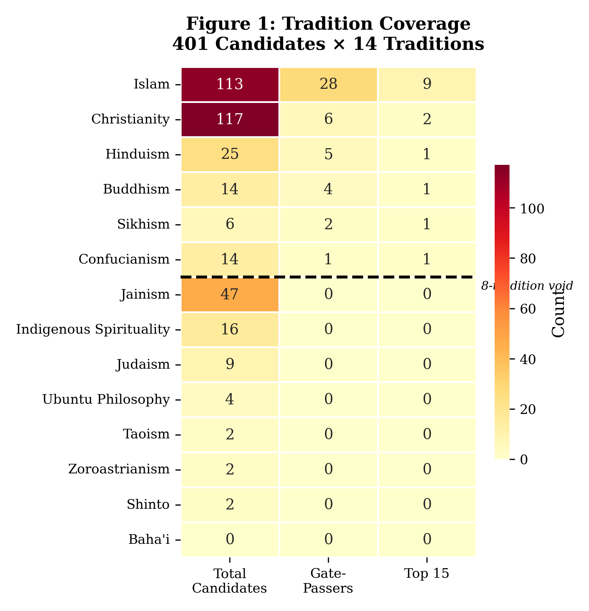
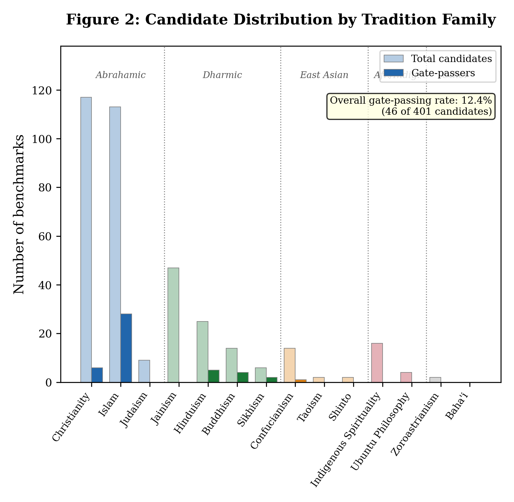
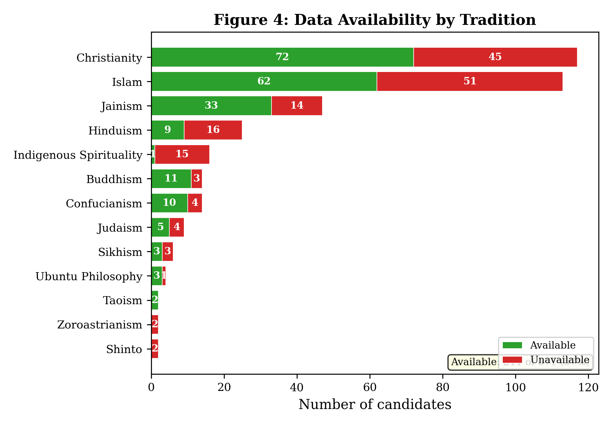
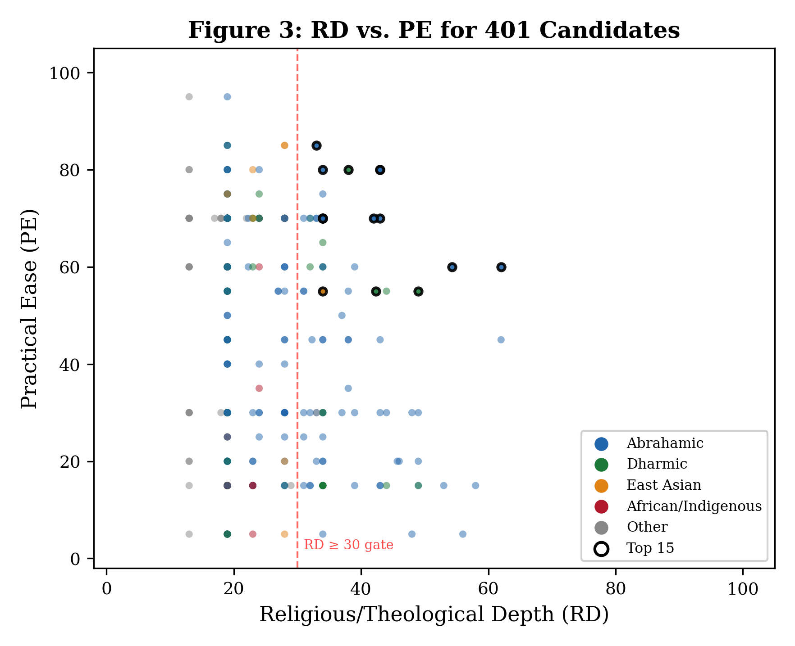

## Abstract

Religious values shape the moral reasoning of more than 80\% of the world's population, yet no systematic framework exists for evaluating whether LLM benchmarks actually test religious values alignment---as opposed to religious knowledge recall or stereotype detection. We present the first systematic meta-evaluation of religious values benchmarks for large language models, combining a 3-axis scoring framework (Religious/Theological Depth, Practical Ease, Citation Impact) with tradition coverage analysis across 14 religious and philosophical traditions. From a corpus of 401 benchmark candidates assembled from a curated literature vault of 2,099 papers and targeted external searches, we apply hard gates requiring minimum theological depth (RD $\geq$ 30) and publicly available evaluation data, yielding 45 gate-passing candidates from which we identify 25 benchmarks across three robustness tiers. Our findings reveal four interrelated problems. First, **tradition asymmetry**: 8 of 14 traditions---Judaism, Jainism, Taoism, Shinto, Ubuntu Philosophy, Indigenous Spirituality, Baha'i, and Zoroastrianism---have zero viable benchmarks, while Islam dominates with 28 gate-passers and 8 of 11 Tier 1 benchmarks ($\chi^2$=64.96, Cramer's V=0.53, p<0.001), driven by Quranic QA shared task infrastructure rather than theological superiority. Second, **knowledge--reasoning conflation**: only 27.7\% of benchmarks test genuine theological reasoning rather than factual recall (binomial p=0.0015). Third, **a publication infrastructure barrier**: the 8-tradition void correlates with publication infrastructure (r=0.74, p<0.01) rather than the scoring framework itself (tradition family p=0.112 in logistic regression), and the benchmark creation pipeline systematically excludes oral, communal, and practice-based knowledge systems. Fourth, **values relevance failure**: a ground-truth values relevance assessment finds that most benchmarks fail the values test (mean relevance score 33.6/100), with only 17\% genuinely testing religious values alignment and 94\% treating their target religion as a monolith. **Crucially, cross-model implementation trials (Opus, Sonnet, Haiku) reveal a universal K < R < V response length gradient across traditions, providing the first empirical evidence for the construct distinction between religious knowledge, reasoning, and values even when accuracy is at ceiling.** We identify a **rubric ceiling effect** for English-language religious assessment and demonstrate that only domain-specific, reasoning-intensive instruments like the T2 Islamic Inheritance Law benchmark can differentiate frontier model capabilities. We release the 3-axis framework, the scored feature matrix, and the tiered ranking as resources for the community, and call for investment in underrepresented traditions' benchmark infrastructure, reasoning-focused evaluation instruments, and community-governed assessment protocols that respect epistemic sovereignty.

## 1. Introduction

Religious values shape the moral reasoning of more than 80\% of the world's population \cite{PewResearch2017}. From the Maqasid al-Shariah's preservation of life and intellect in Islamic jurisprudence to the Confucian virtue of ren (benevolence), from the Buddhist precept of ahimsa to Ubuntu's communal ethic of interconnectedness, religious and spiritual traditions provide the normative vocabularies through which billions of people evaluate right action, resolve ethical conflicts, and assign moral weight to competing goods. The field of AI alignment has recognized that large language models must be evaluated against human values \cite{Gabriel2020, Ji2024, Klingefjord2024}, and a growing literature proposes methods for eliciting, reconciling, and training on those values. Yet this literature treats "values" as a largely secular construct---operationalized through preference rankings, constitutional principles, or survey-derived cultural dimensions---while the religious traditions that generate the majority of the world's moral reasoning remain either invisible or flattened into demographic categories. The result is a paradox: dozens of benchmarks now claim to evaluate cultural alignment, religious bias, or values-sensitive behavior in LLMs, but no systematic framework exists for determining whether these instruments actually test religious values alignment, rather than religious knowledge recall or stereotype detection.

The stakes of this omission are consequential and growing. LLMs are increasingly deployed in contexts where religious values directly shape user expectations: pastoral counseling applications, halal certification advisory systems, religiously diverse content moderation, and educational tools serving faith-based institutions \cite{Bianchi2024}. The dominant meta-benchmarks that structure LLM evaluation---HELM \cite{Liang2023}, BIG-Bench \cite{Srivastava2023}, and their successors---treat religion in one of two ways: as a demographic variable for measuring bias (does the model stereotype Muslims?) or as a knowledge domain for measuring factual recall (can the model identify the Five Pillars of Islam?). Neither framing evaluates whether a model can reason *within* a religious ethical framework. The field can test whether an LLM knows that Muslims fast during Ramadan, but not whether it can apply the principle of maslaha (public interest as constrained by the objectives of Islamic law) when Islamic legal principles conflict---the kind of theological reasoning that characterizes how religious traditions actually navigate moral complexity \cite{Alharbi2024}. This conflation of knowledge with reasoning, and of bias detection with values alignment, means that high benchmark scores may certify familiarity rather than competence, producing a false signal of religious values capability.

Three interrelated problems motivate this work. The first is **tradition asymmetry**. Our survey of 401 benchmark candidates across 14 religious and philosophical traditions reveals that 8 traditions---Judaism, Jainism, Taoism, Shinto, Ubuntu Philosophy, Indigenous Spirituality, Baha'i, and Zoroastrianism---have zero viable benchmarks that pass minimal gates for theological depth and data availability. Islam dominates the benchmark ecosystem, accounting for 28 of 45 gate-passing candidates and 8 of 11 Tier 1 benchmarks, driven by a mature Quranic question-answering shared task community and well-resourced Arabic NLP infrastructure. The evaluation landscape can assess Islamic textual knowledge in considerable depth but cannot evaluate Dharmic, East Asian, African, or Indigenous values systems at all. The second problem is **knowledge--reasoning conflation**. The majority of religious values benchmarks test factual recall---"What does tradition X say about Y?"---rather than theological reasoning---"Given competing principles within tradition X, how should dilemma Y be resolved?" This distinction matters for deployment: a model that scores highly on Quranic verse identification may still produce theologically incoherent guidance when users seek counsel on novel ethical situations. The third problem is a **publication infrastructure barrier** that operates in the spirit of Fricker's \cite{Fricker2007} concept of epistemic injustice, but manifests through infrastructure rather than the scoring framework itself. The candidates eliminated by the hard gate requiring publicly available evaluation data are not randomly distributed across traditions. The traditions with zero benchmarks---Indigenous, African, Dharmic minority, East Asian minority---are precisely those whose knowledge systems were developed through oral transmission, communal practice, and embodied ritual rather than through the textual, peer-reviewed, and digitally archived channels that benchmark creation depends upon \cite{Mohamed2020, Bilimoria2013}. When benchmark availability correlates with proximity to Western academic publishing infrastructure, the resulting gaps are not neutral absences but instances of what Mohamed et al. term "algorithmic coloniality"---the reproduction of epistemic hierarchies through technical systems \cite{Mohamed2020}. Moreover, as the CARE Principles for Indigenous Data Governance make clear \cite{Carroll2020}, some communities may exercise epistemic sovereignty by declining inclusion in benchmark ecosystems---a refusal that is itself a form of epistemic authority, not a gap to be overcome. The WEIRD (Western, Educated, Industrialized, Rich, Democratic) sampling bias documented by Henrich et al. \cite{Henrich2010} in psychology extends directly to AI evaluation: the traditions that are evaluable are those legible to the GitHub repository, HuggingFace dataset, and English-language journal pipeline \cite{Birhane2021, Carroll2020}.

We address these problems through a systematic meta-evaluation whose contributions are threefold. First, we introduce a **3-axis scoring framework** organized around Religious/Theological Depth (RD), Practical Ease (PE), and Citation Impact (CI), with seven meta-evaluation criteria that decompose the construct of "religious values alignment" into measurable components: tradition coverage, scriptural grounding, denominational awareness, pluralistic framing, and expert validation (Table 1). This framework draws on recent psychometric critiques of LLM benchmarking \cite{Gupta2025, Li2025} to impose construct validity requirements that the field currently lacks. Second, we present a **tradition coverage analysis of 401 candidates across 14 traditions**, revealing the Islam dominance pattern, the 8-tradition void, and the data availability bottleneck. We release a tiered ranking of 25 benchmarks across three robustness tiers with composite scores and detailed profiles, providing the first curated inventory of religious values benchmarks suitable for implementation (Table 2). Third, we offer an **infrastructure barrier diagnosis** that names the structural reasons for tradition gaps rather than treating them as incidental data limitations. Publication infrastructure is the strongest predictor of tradition gaps (r=0.74), and this correlation between benchmark availability and Western academic infrastructure is itself a finding: it demonstrates that the current evaluation ecosystem cannot assess religious values alignment for the majority of the world's faith traditions, and that closing this gap requires not merely more benchmarks but fundamentally different approaches to benchmark construction---approaches that respect oral, communal, and practice-based knowledge transmission \cite{Carroll2020, Rao2025}.

Section 2 situates our work within prior surveys of AI values alignment, religious bias evaluation, and cross-cultural benchmarking. Section 3 describes our methodology, including corpus assembly, the 3-axis scoring framework, composite scoring with hard gates, and the tradition coverage analysis protocol. Section 4 presents findings: the landscape analysis, the tiered benchmark ranking, tradition coverage patterns, and the data availability bottleneck. Section 5 discusses implications for benchmark design, evaluation practice, and the structural conditions under which tradition gaps might be closed, and Section 6 concludes with recommendations for researchers, benchmark designers, and religious communities.

## 2. Related Work

### 2.1 AI Alignment Evaluation and Benchmark Science

**The Evaluation Landscape.** The dominant paradigm for holistic LLM assessment treats ethics as an undifferentiated category. HELM \cite{Liang2023} evaluates models across 42 scenarios but reduces ethics to a single sub-task drawn from the ETHICS benchmark, with no mechanism for distinguishing between normative traditions---let alone religious ones. MMLU \cite{Hendrycks2021} includes religion only as factual recall within its "humanities" grouping, testing whether a model knows what the Five Pillars of Islam are rather than whether it can reason within an Islamic ethical framework. BIG-Bench \cite{Srivastava2023} includes moral reasoning tasks among its 204 benchmarks but applies no tradition-level tagging: a Confucian dilemma and a utilitarian trolley problem are scored identically. Chang et al. \cite{Chang2024} provide the most comprehensive evaluation survey to date, covering ethics, safety, and social science applications, yet do not isolate religious values as a distinct evaluation dimension. Meanwhile, the RLHF pipeline that undergirds contemporary alignment practice---from Christiano et al.'s \cite{Christiano2017} foundational deep reinforcement learning from human preferences, through InstructGPT \cite{Ouyang2022}, to Anthropic's helpful-harmless-honest framework \cite{Bai2022}---assumes a secular, universalist preference space. There is no mechanism within RLHF for tradition-specific preference learning: the annotator pool that provides reward signals is treated as a homogeneous source of "human" preferences, obscuring the religious and cultural commitments that shape moral intuitions. Recent work on pluralistic alignment (e.g., Sorensen et al. \cite{Sorensen2024}) begins to address annotator diversity by eliciting and reconciling conflicting preferences, but these frameworks still operate within WEIRD assumptions about what "plurality" means and do not engage tradition-specific moral reasoning.

**Values Alignment Theory.** The theoretical literature on AI alignment has begun to recognize this gap without resolving it. Gabriel \cite{Gabriel2020} distinguishes six possible alignment targets---instructions, intentions, revealed preferences, ideal preferences, interests, and values---and argues that a principle-based approach combining these elements is necessary. For religious values, the challenge is acute: whose interpretation of a tradition counts as the alignment target? A Sunni and a Shia reading of the same Quranic verse may yield different ethical prescriptions, and neither maps onto the "ideal preferences" framework that Gabriel proposes. Klingefjord et al. \cite{Klingefjord2024} decompose the alignment problem into three sub-problems---elicitation, reconciliation, and training---and demonstrate their Moral Graph Elicitation process on deliberately divisive prompts, including one involving a Christian seeking advice on abortion. Their finding that "expert" values can emerge from democratic deliberation is promising, but the framework presupposes that values can be articulated propositionally, a requirement that sits uneasily with traditions emphasizing embodied practice, communal discernment, or oral transmission. Ji et al. \cite{Ji2024} provide the most comprehensive alignment survey, organizing the field around four principles---Robustness, Interpretability, Controllability, and Ethicality (RICE)---but treat religion as neither a distinct dimension of ethicality nor a source of alignment targets.

**Psychometric Critique.** A growing body of work applies psychometric principles to LLM benchmarking, revealing systematic validity failures. Gupta et al. \cite{Gupta2025} conduct a systematic review of LLM psychometrics and find that most benchmarks lack construct validity: they do not establish that their items actually measure the latent constructs they claim to assess. Li et al. \cite{Li2025} reinforce this finding with a review of 445 benchmarks, arguing that construct validity should be the primary concern in LLM evaluation and providing eight actionable recommendations for benchmark developers. Srivastava \cite{Srivastava2024} proposes the PATCH framework (Psychometrics-AssisTed benCHmarking), which applies item response theory to enable valid comparison between LLMs and human populations---a methodology directly relevant to religious values benchmarks, where the "human population" reference group varies by tradition, denomination, and interpretive school. Supporting critiques from Burnell et al. \cite{Burnell2023}, Bowman and Dahl \cite{Bowman2021}, Rodriguez et al. \cite{Rodriguez2021}, and Schlangen \cite{Schlangen2021}, together with Gehrmann et al.'s \cite{Gehrmann2022} diagnosis of a "cracked foundation" beneath LLM evaluation, identify benchmarks that conflate format familiarity with capability, that lack discriminative power for frontier models, and that fail to specify what construct is being measured. Ong et al. \cite{Ong2025} extend this argument to the medical domain, demonstrating that medical LLM benchmarks frequently measure "what is easy to test" rather than "what matters clinically." These psychometric critiques motivate our seven meta-evaluation criteria, particularly content validity and discriminative power, applied to a domain---religious values---where the construct itself is contested across traditions, denominations, and interpretive communities.

### 2.2 Religious and Cultural Values in AI

**Cultural Values Measurement.** The foundational frameworks for measuring human values across cultures---Henrich et al.'s \cite{Henrich2010} WEIRD critique, Schwartz's \cite{Schwartz2012} theory of basic human values, and Hofstede's \cite{Hofstede2011} cultural dimensions model---have profoundly shaped how AI systems conceptualize cultural difference. A growing literature applies these frameworks to LLM evaluation. Durmus et al. \cite{Durmus2024} develop GlobalOpinionQA to measure whose opinions LLM responses most resemble, finding that models default to perspectives resembling those of US and Western European populations. Naous et al. \cite{Naous2024} demonstrate that all GPT-family models exhibit cultural values resembling English-speaking and Protestant European countries, even when prompted in other languages. Rao et al. \cite{Rao2025} challenge the reliability of cultural alignment evaluation itself, showing that minor methodological variations produce dramatically different alignment scores---a finding with direct implications for religious values benchmarks, where the same instability risks apply. Sukiennik \cite{Sukiennik2025}, Adilazuarda et al. \cite{Adilazuarda2025}, and Tao et al. \cite{Tao2024} (CValues) extend cultural alignment evaluation to specific national and linguistic contexts. The key limitation these frameworks share, however, is that they treat religion as a moderating variable within culture rather than as a distinct values source. Schwartz's theory includes "tradition" and "conformity" dimensions that correlate with religiosity, but the framework cannot distinguish Islamic from Christian from Buddhist values---all three appear as "high tradition." This conflation motivates our paper's central argument: religious values constitute a distinct evaluation dimension that cannot be reduced to cultural alignment.

**Islamic AI Ethics.** Islamic ethics scholarship has produced the most developed intersection of religious thought and AI evaluation. The Maqasid al-Shariah framework---the higher objectives of Islamic law---identifies five essential values (preservation of religion, life, intellect, lineage, and wealth) that Islamic ethics scholars have proposed as an evaluative framework for AI systems \cite{Kamali2008, Habib2023}. Al-Musawi \cite{AlMusawi2022} develops an Islamic virtue-based ethics approach, Ezzeddine \cite{Ezzeddine2024} argues explicitly for pluralist ethical benchmarking that incorporates Islamic parameters alongside Western frameworks, and Mohadi \cite{Mohadi2024} and Muravyov \cite{Muravyov2025} extend Maqasid-based reasoning to AI governance and trusteeship models. The formalizability of Islamic jurisprudence that has enabled this benchmark production applies primarily to rule-based subdomains---inheritance law (*fara'id*), commercial transactions (*mu'amalat*), and ritual obligations (*ibadat*)---rather than to the broader tradition of *fiqh*, which encompasses interpretive reasoning (*ijtihad*), analogical reasoning (*qiyas*), and juristic preference (*istihsan*) that resist algorithmic formalization. Crucially, this theological literature has been translated into actual benchmark artifacts. Alharbi et al. \cite{Alharbi2024} introduce IslamicMMLU, a 10,013-item benchmark spanning Quran, Hadith, and Fiqh (jurisprudence), including a novel madhab (school of jurisprudence) bias detection task. Malhas et al. \cite{Malhas2023} construct HAQA and QUQA, Arabic question-answering corpora for Hadith and Quran respectively, while Abdelali et al. \cite{Abdelali2023} develop AceGPT for localized Arabic LLM evaluation. This benchmark dominance---Islam accounts for 28 of 45 gate-passing candidates and 8 of 11 Tier 1 benchmarks---is not a claim about Islamic theology's intrinsic suitability for benchmarking. Rather, it reflects a structural feature of the Arabic NLP community's investment, catalyzed by the Quranic QA shared task ecosystem that has sustained a pipeline from theological text to annotated dataset to published benchmark since at least 2019.

**Other Abrahamic Traditions.** Johnson \cite{Johnson2026} identifies a critical problem at the heart of Christianity's relationship to AI evaluation: generative models collapse Catholic, Orthodox, Protestant, and Restorationist distinctions into a homogenized "Christianity," producing what Johnson terms "doctrinal flattening"---responses that sound authoritative while reflecting only statistical echoes of the most common perspectives. This denominational diversity problem is crucial because Christian theologians have generated substantial theological reflection on AI, from Pope Francis's \cite{Francis2015} encyclical *Laudato Si'* through the Vatican's Rome Call for AI Ethics \cite{RomeCall2020} to recent work integrating Catholic Social Teaching with AI healthcare \cite{Manyika2024}---yet this engagement is overwhelmingly Catholic-institutional, and Protestant, Orthodox, and non-Western Christian perspectives remain largely unrepresented in the AI ethics benchmark literature. Few operationalized benchmarks exist for any Christian denomination. Jewish ethics scholarship presents a parallel paradox. Abraham \cite{Abraham2019} documents the Talmudic Logic Project's effort to formalize halakhic reasoning computationally, Koppel et al. \cite{Koppel2011} advance computational approaches to Jewish legal texts, and Rosenfeld \cite{Rosenfeld2021} brings Jewish ethical reasoning into dialogue with machine learning methodology. Steinberg \cite{Steinberg2025} demonstrates the depth and complexity of Jewish ethical argumentation by applying Talmudic principles to a contemporary geopolitical question, and Levy \cite{Levy2024} examines Jewish philosophical perspectives on conscious robots and moral status. Judaism possesses the oldest computational tradition in the humanities---the Bar-Ilan Responsa Project has been computationally indexing rabbinic literature since the 1960s---and the Sefaria open-source digital library now provides a substantial corpus of Jewish texts that partially addresses data availability. Yet zero Jewish-specific benchmarks pass our hard gates. The paradox across both traditions is that theological depth has not been translated into the format of publicly available, machine-readable evaluation artifacts that the benchmark pipeline requires.

**Dharmic, East Asian, and Other Traditions.** Rich philosophical literatures exist for Dharmic and East Asian traditions but have not been operationalized into benchmark instruments. Bilimoria \cite{Bilimoria2013} provides the foundational treatment of Indian ethics across classical traditions. Chadha \cite{Chadha2023} proposes *visesa-dharma* (context-specific ethical reasoning from Hindu philosophy) as a framework for decolonial AI alignment, arguing that current RLHF practices reproduce universalizing assumptions by aggregating preferences into a single reward signal---whereas visesa-dharma holds that moral reasoning is inherently context-dependent, varying with the agent's social role, life stage, and situational particulars, and thus cannot be captured by a universal preference function. Mohanty \cite{Mohanty2024} and Mishra \cite{Mishra2024} develop Indic and Bhagavad Gita-based frameworks for AI ethics, respectively, while Singh and Kaur \cite{SinghKaur2024} bring Sikh ethical principles---including seva (selfless service) and sarbat da bhala (welfare of all)---into dialogue with AI governance. Jain ahimsa (non-violence), with its emphasis on minimizing harm to all sentient beings, offers a natural philosophical foundation for AI harm minimization frameworks, though the Jain AI ethics literature remains sparse. In Buddhist philosophy, Hongladarom \cite{Hongladarom2020} and Keown \cite{Keown2005} provide foundations that have not been translated into evaluation artifacts. For East Asian traditions, Li \cite{Li2022} asks whether a machine can "flow like Dao," bringing Daoist philosophy into dialogue with AI primarily through the concept of *wu wei* (non-action, effortless action) as a model for human-AI interaction---an argument that challenges the control-oriented assumptions of Western alignment discourse. Wong \cite{Wong2019} develops Confucian ethics of harmony and personhood for technology, while Asghari \cite{Asghari2023} compares Confucian and European approaches to AI governance. A substantial Chinese-language literature on Confucian AI ethics exists but remains largely invisible to the English-language benchmark community. The gap between philosophical discourse and operationalized evaluation is the defining feature of these traditions' relationship to AI benchmarking, though the nature of the gap differs: traditions with extensive textual corpora (Hindu, Confucian) lack benchmark *infrastructure*---shared task communities, NLP workshops, annotated datasets---while traditions grounded in oral transmission and embodied practice (Indigenous, some Buddhist lineages) face the more fundamental challenge that their knowledge systems resist the textual formalization that benchmark creation presupposes.

### 2.3 Religious Bias and Fairness in LLMs

**Bias Detection.** The study of religious bias in LLMs began with Abid et al.'s \cite{Abid2021} foundational demonstration that GPT-3 completes "Two Muslims walked into a..." with violent scenarios in 66\% of cases, with "Muslim" analogized to "terrorist" in 23\% of test completions. This work established that religious bias in language models is persistent, severe, and resistant to simple debiasing: even the use of the six most positive adjectives as prefixes reduced violent completions only to 20\%, still higher than for other religious groups. Nadeem et al. \cite{Nadeem2021} develop StereoSet, a standardized benchmark for measuring stereotypical bias across gender, profession, race, and religion, providing a reusable measurement instrument. Bianchi et al. \cite{Bianchi2024} extend religious bias analysis to emotion attribution, finding that major religions in the US and European countries are represented with nuance, Eastern religions are strongly stereotyped, and Judaism and Islam trigger disproportionate model refusals---a finding they attribute to both cultural bias and the scarcity of NLP literature treating religion as anything other than a toxicity signal. Hamid et al. \cite{Hamid2025} provide the most systematic landscape mapping to date, constructing approximately 400 prompts to probe religious bias across mask filling, prompt completion, and image generation, revealing cross-domain biases where religion intersects with gender, age, and nationality. Putri et al. \cite{Putri2025} introduce the BRAND dataset for bilingual religious bias evaluation across four South Asian religions, demonstrating that multilingual models exhibit differential accuracy across religious contexts.

**From Bias Detection to Values Measurement.** A critical distinction separates bias detection from values measurement, yet most religious AI work remains at the detection stage. Buyl et al. \cite{Buyl2024} represent the most significant bridge between these two methodological traditions: their "Measuring Spiritual Values and Biases" framework tests the spiritual values of popular LLMs, finding that these values are "quite diverse, as opposed to the stereotype of atheists or secularists," and demonstrating that different spiritual value orientations lead to varied sensitivity in social-fairness tasks such as hate speech identification. This work moves beyond asking "is there bias?" to asking "what kind of values are expressed, and how do they interact with downstream tasks?"---precisely the transition our meta-evaluation seeks to advance. A debiased model is not thereby a values-aligned model: a system that treats all religious groups with equal fairness may still be unable to reason within any tradition's ethical framework, while a model with measurable anti-Muslim bias might nonetheless correctly apply Islamic jurisprudential reasoning. Detection asks whether a model stereotypes religious groups; measurement asks how much and of what kind; but neither detection nor measurement addresses whether existing evaluation instruments are themselves well-constructed. Our paper moves beyond both detection and measurement to systematic benchmark quality assessment---evaluating whether the instruments that claim to measure religious values alignment actually measure what they claim, with what validity, for which traditions, and with what discriminative power for frontier models.

### 2.4 Computational Approaches to Sacred Texts

The construction of religious values benchmarks presupposes the computational processing of sacred texts---yet the application of NLP to such texts raises ethical considerations absent from secular benchmark development. Hutchinson \cite{Leavens2024} offers the most sustained treatment of these issues. In a position paper for the ACL community, Hutchinson argues that sacred texts "have generally been treated as just data, overlooking their sacred dimensions, their cultural significance, and their histories, which are sometimes entwined with colonial projects." The paper documents the routine use of the Bible and Quran as parallel corpora in NLP research---valued for their translation breadth, alignment structure, and public domain availability---while noting that this instrumental repurposing strips texts of the interpretive traditions, communal authority, and devotional contexts that give them meaning within religious communities. Hutchinson calls for explicit attention to researcher positionality and for engagement with the perspectives of marginalized linguistic and religious communities whose sacred texts are being processed.

A growing body of applied work demonstrates both the technical feasibility and the interpretive stakes of sacred text NLP. Roberts and Chandra \cite{Roberts2022} apply BERT-based topic modeling to the Upanishads and Bhagavad Gita, achieving 73\% cosine similarity across extracted topics---a technically impressive result that simultaneously raises the question of whether Hindu philosophical concepts survive the dimensionality reduction that topic modeling imposes. Zhao and Liu \cite{ZhaoLiu2015} develop BibleQA, a domain-adapted question-answering system for biblical texts using transfer learning from SQuAD. Abdelnasser et al. \cite{Abdelnasser2014} build Al-Bayan, an Arabic QA system for the Quran that retrieves relevant verses and extracts answers from tafseer (exegetical commentary), achieving 85\% accuracy on top-3 results. Al-Azani \cite{AlAzani2023} applies unsupervised thematic clustering to hadith collections, while Varghese \cite{Varghese2023} and Verma \cite{Verma2023} contribute lexical and semantic analyses of religious textual corpora.

Cross-tradition computational work is emerging. Mofenjou Peuriekeu et al. \cite{MofenjouPeuriekeu2024} apply text mining to nine sacred scriptures---including the Quran, Tao Te Ching, Buddhist sutras, the Upanishads, and biblical books---using document-term matrices and machine learning classifiers to discover similarities and dissimilarities, with Multinomial Naive Bayes achieving 85.84\% classification accuracy across traditions. These cross-tradition analyses demonstrate that NLP can identify structural and thematic patterns across religious boundaries, but they also highlight a fundamental tension: the extraction of evaluation items from sacred texts requires processing those texts computationally, yet the extraction process itself raises questions that secular benchmark construction does not face. Whose interpretation of a Quranic verse becomes the ground truth answer in a question-answering benchmark? Does quantifying dharmic ethical concepts through multiple-choice items reduce them in ways that practitioners within the tradition would reject? Does converting oral and chanted scripture into machine-readable corpora sever the embodied contexts---recitation, ritual, communal interpretation---through which these texts convey moral meaning?

These considerations motivate our cultural authenticity criterion (Criterion 3 in the meta-evaluation framework, Section 3), which asks whether benchmarks were created by or in meaningful consultation with scholars and practitioners from the tradition being evaluated. A benchmark that processes sacred texts without such consultation risks producing technically functional but theologically illegitimate evaluation instruments.

### 2.5 Indigenous, African, and Marginalized Traditions

Of our 14 surveyed traditions, 8 have zero viable benchmarks---and the distribution of this absence is not random. Indigenous Spirituality, Ubuntu Philosophy, Jainism, Shinto, Taoism, Baha'i, and Zoroastrianism are invisible to the benchmark ecosystem, while Judaism, despite a rich computational tradition in Talmudic studies, produces no gate-passing religious values benchmark. This section names the structural reasons for these absences rather than treating them as gaps awaiting routine data collection.

Mohamed, Png, and Isaac \cite{Mohamed2020} provide the theoretical framework. Their account of decolonial AI identifies how colonial power relations are reproduced through the technical infrastructure of AI development: data collection practices that privilege digitized and institutionally archived knowledge, evaluation pipelines that require publicly accessible datasets on platforms like GitHub and HuggingFace, and publication norms that recognize only peer-reviewed English-language scholarship as legitimate knowledge production. The benchmark creation pipeline---from academic paper to shared task to hosted dataset to evaluation harness integration---is not a neutral conduit. It is an infrastructure with specific epistemic requirements: textual corpora, formalized knowledge representations, individual-response evaluation formats, and open data licenses. Knowledge systems developed through oral transmission, communal deliberation, embodied practice, and elder-mediated interpretation are structurally illegible to this pipeline, regardless of their philosophical sophistication or moral depth.

Birhane \cite{Birhane2021} sharpens this analysis by asking whose values are encoded in machine learning systems, noting that the process of encoding values into computational artifacts necessarily involves choices about which values to include and which to exclude---choices that are shaped by the demographic composition and disciplinary training of the researchers making them. Mhlambi \cite{Mhlambi2020} extends this critique by examining how relational conceptions of personhood in Ubuntu philosophy challenge the individualist assumptions embedded in AI systems' design. Carroll et al. \cite{Carroll2020} articulate the CARE Principles for Indigenous Data Governance---Collective Benefit, Authority to Control, Responsibility, and Ethics---developed in consultation with Indigenous Peoples, scholars, and data sovereignty networks across multiple continents. The CARE Principles challenge a foundational assumption of the open science movement and, by extension, of benchmark construction: that data should be findable, accessible, interoperable, and reusable (FAIR) without qualification. For Indigenous communities, data sovereignty may require that knowledge systems *not* be made into public benchmarks without community consent, that sacred knowledge *not* be digitized for computational processing, and that evaluation of AI systems against Indigenous values be governed by the communities whose values are at stake---as concrete frameworks such as Maori tikanga (customary practices and protocols) and First Nations data sovereignty initiatives demonstrate. The "open data" requirement that our pipeline applies as a hard gate---a pragmatic necessity for benchmark reproducibility---simultaneously functions as a structural exclusion mechanism for traditions that exercise collective authority over their knowledge.

Gwagwa (writing as Yilma) \cite{Gwagwa2025} interrogates Ubuntu philosophy's potential as a framework for AI ethics in Africa, arguing that despite the value attached to Ubuntu in the literature, its normative structure remains insufficiently specified for direct application to AI governance. The relational ontology of Ubuntu---*umuntu ngumuntu ngabantu*, a person is a person through other persons---emphasizes communal responsibility, interconnectedness, and collective deliberation in ways that do not map cleanly onto individual-response-based evaluation formats. A benchmark that asks a single evaluator to select the "correct" Ubuntu-informed response to an ethical dilemma may fundamentally misrepresent an ethical tradition in which moral judgment is constitutively communal. Osei-Mensah and Van Wynsberghe \cite{Ogwo2025} examine African AI policies and find that they have "not incorporated Ubuntu values as a fundamental guiding principle but rather adopted Eurocentric values," proposing instead an African-centered framework for AI governance drawn from communitarian ethics.

We name this pattern directly: the absence of benchmarks for Indigenous, African, Jain, Shinto, and other traditions from the AI evaluation ecosystem constitutes *structural epistemic injustice* \cite{Mohamed2020, Bilimoria2013}---the systematic exclusion of knowledge systems from evaluation infrastructure due to the structure of academic publishing and dataset creation, not due to the absence of knowledge itself. These traditions possess rich, internally coherent ethical frameworks with centuries or millennia of moral reasoning practice. Their exclusion from benchmarking reflects which knowledge systems are deemed legible to the infrastructure that AI evaluation depends upon. Closing this gap requires not merely more benchmark papers but fundamentally different approaches to benchmark construction: community-governed evaluation protocols, oral and deliberative assessment formats, and data governance frameworks that respect collective authority over sacred and traditional knowledge. Indeed, a fully decolonial approach may require not merely different benchmarks but alternatives to benchmarking itself---community-governed evaluation processes, participatory assessment, and relational accountability frameworks that do not reduce moral reasoning to item-response formats.

These structural considerations inform two of our meta-evaluation criteria: Criterion 5 (Tradition Coverage), which measures how many of the 14 traditions a benchmark engages, and Criterion 7 (Epistemic Inclusion), which asks whether benchmark construction processes actively include traditions that are structurally disadvantaged by conventional academic pipelines.

### 2.6 Our Contribution in Context

We extend prior work in four ways that, taken together, constitute a systematic meta-evaluation of religious values benchmarks---a task that no existing study undertakes.

First, we extend **cultural alignment surveys** \cite{Durmus2024, Naous2024, Adilazuarda2025} by isolating religious values as a distinct evaluation dimension rather than collapsing them into "culture." The Schwartz values framework treats religiosity as a correlate of tradition and conformity values \cite{Schwartz2012}; cultural alignment benchmarks operationalize religion as one demographic variable among many. Our framework treats religious traditions as distinct sources of moral reasoning with their own internal logic, interpretive traditions, and authority structures---requiring evaluation instruments that engage theological content rather than cultural proxies.

Second, we extend **religious bias research** \cite{Abid2021, Bianchi2024, Hamid2025} by moving from bias detection to systematic benchmark quality assessment. Bias research asks whether a model stereotypes a religious group; we ask whether a model can reason within that tradition's ethical framework. These are distinct evaluation challenges: a model that avoids anti-Muslim stereotypes may still be unable to apply the Maqasid al-Shariah to a novel ethical dilemma, and a model that passes a religious knowledge quiz may still flatten denominational distinctions that practitioners regard as theologically essential.

Third, we extend **psychometric critiques of LLM benchmarks** \cite{Gupta2025, Li2025} by applying construct validity analysis to a domain where the construct itself is contested across traditions. "Religious values alignment" means different things in Islamic jurisprudence, Buddhist ethics, and Ubuntu philosophy. Our 3-axis framework accommodates this plurality by scoring each benchmark's engagement with specific traditions rather than treating religious values as a monolithic construct, and by incorporating expert validation from within the traditions being evaluated.

Fourth, we extend **comparative religious ethics methodology** \cite{Green2014, Twiss1998, Schweiker2005} by operationalizing the "third wave" approach as meta-evaluation criteria for AI benchmarks. The third wave of comparative religious ethics, as Green \cite{Green2014} characterizes it, rejects the assumption that religious traditions can be compared from a neutral vantage point, insisting instead on attention to power, context, and particularity. This methodological commitment maps directly onto our structural epistemic injustice diagnosis: the benchmark ecosystem's tradition gaps are not neutral data limitations but reflections of which knowledge systems occupy positions of epistemic power within the infrastructure of AI evaluation research.

Together, these extensions provide both a reusable evaluation framework for religious values benchmark development and a diagnosis of why the current benchmark ecosystem systematically excludes most of the world's religious traditions from AI alignment evaluation. The framework is designed to be applied not only to existing benchmarks but also to guide the construction of new ones---particularly for the 8 traditions that currently have zero viable evaluation instruments.

## 3. Methods

### 3.1 Benchmark Corpus Assembly

We assembled the evaluation corpus in two stages. First, we drew on the CEI Literature Vault, a curated collection of 2,099 AI ethics papers spanning 2019--2026, in which prior classification had tagged papers along religious values dimensions using a 14-field scoring system covering the traditions listed in the Terminology Glossary. We intersected religious values scores with benchmark and evaluation indicators to produce 401 religious benchmark candidates. Twenty-nine papers addressing religion only as a demographic variable in bias measurement were excluded from further scoring.

Second, we conducted an external search across Semantic Scholar, arXiv, and HuggingFace Datasets using 72 queries organized by tradition family, combining tradition-specific terms with benchmark vocabulary (e.g., *"Buddhist ethics benchmark LLM"*, *"Quranic question answering evaluation"*). The external search used 72 queries across 14 traditions, with a mean of 5.1 queries per tradition; all queries were conducted in English, introducing a systematic language bias that likely undercounts non-English benchmarks (see Section 3.6 and Section 5.7). The search returned 70 discoveries after deduplication. Of these, 53 met inclusion criteria and were ingested; 16 were excluded as false positives (physics experiments, medical studies, or unrelated benchmarks), and 1 was a duplicate. Inclusion criteria required that a paper (a) explicitly evaluate LLMs on religious or theological content, (b) be published 2021--2026 (with exceptions for older foundational databases), and (c) be available as a peer-reviewed publication or recognized preprint.

**Figure X: PRISMA Flow.** The screening pipeline proceeded as follows: 2,099 vault papers screened $\rightarrow$ 401 benchmark candidates identified $\rightarrow$ 47 pass both hard gates (RD $\geq$ 30 and public data) $\rightarrow$ 2 removed post-review (Break the Checkbox: non-religious; BuddhismEval: inaccessible) $\rightarrow$ 45 gate-passers $\rightarrow$ 25 tiered benchmarks (11 Tier 1, 4 Tier 2, 10 Tier 3). The external search contributed 53 additional papers to the 401-candidate pool.

We classified each candidate into three tiers of religious engagement: **theological** (deep engagement with scriptural exegesis, jurisprudential reasoning, or denominational distinctions), **theological-values** (moderate engagement with tradition-specific ethical content), and **values** (surface-level mention of religious concepts within broader cultural or moral evaluation). This classification informed the Religious/Theological Depth scoring described in Section 3.2.

### 3.2 Feature Matrix Design

We characterized each of the 401 benchmark candidates along 22 features organized into three axes (Table 1): **Religious/Theological Depth (RD)**, measuring how rigorously a benchmark engages religious content; **Practical Ease (PE)**, measuring implementability; and **Citation Impact (CI)**, measuring scholarly influence.

Religious/Theological Depth features capture the number of traditions tested (R1), the depth of theological engagement on a 1--5 ordinal scale (R2), scriptural grounding measured by direct reference to primary sacred texts such as the Quran, Bible, Vedas, or Pali Canon (R3, 0--5; R3 includes a source-language bonus: benchmarks that process scripture in its original liturgical language---Arabic, Sanskrit, Hebrew, Pali, Classical Chinese---receive a +1 modifier, recognizing that translation necessarily transforms theological concepts), denominational awareness distinguishing intra-tradition diversity such as Sunni/Shia or Catholic/Protestant (R4, 0--3), pluralistic coverage of multiple traditions (R5, 0--5), and expert validation measuring whether theologians or religious scholars participated in benchmark construction (R6, 0--5). Practical Ease features record task format using a 12-code taxonomy (P1; see Table S3), dataset size (P2), data availability with URL (P3), code availability (P4), license terms (P5), an implementability composite reflecting harness compatibility across standard evaluation frameworks (P7, 0--10), scorer type (P8), model compatibility with open and closed LLMs (P9), and language coverage (P10; P10 language normalization treats liturgical and scholarly languages---Arabic, Sanskrit, Hebrew, Pali, Classical Chinese, Tibetan---as equivalent to English, correcting a WEIRD bias in the original scoring that penalized non-English benchmarks). Citation Impact features include raw citation count (C1), age-normalized citations per year (C2), venue and tier classification (C3), downstream adoption count (C4), leaderboard presence (C5), and community engagement indicators such as shared tasks and workshops (C6).

**Table 1.** 3-Axis Scoring Framework: 22 features across Religious/Theological Depth (RD), Practical Ease (PE), and Citation Impact (CI). Weight indicates contribution to the axis composite; "---" denotes informational features not included in the weighted formula.

| Axis | ID  | Feature                  | Scale              | Weight |
|------|-----|--------------------------|--------------------|--------|
| RD   | R1  | Tradition Count          | 1--14              | 15     |
| RD   | R2  | Theological Depth        | 1--5 ordinal       | 25     |
| RD   | R3  | Scriptural Grounding     | 0--5               | 15     |
| RD   | R4  | Denominational Awareness | 0--3               | 10     |
| RD   | R5  | Pluralistic Coverage     | 0--5               | 15     |
| RD   | R6  | Expert Validation        | 0--5               | 20     |
| PE   | P1  | Task Format              | 12 codes (Table S3)| ---    |
| PE   | P2  | Dataset Size             | count              | ---    |
| PE   | P3  | Data Availability        | categorical        | 25     |
| PE   | P4  | Code Availability        | categorical        | 10     |
| PE   | P5  | License Terms            | categorical        | 10     |
| PE   | P7  | Implementability         | 0--10              | 30     |
| PE   | P8  | Scorer Type              | categorical        | ---    |
| PE   | P9  | Model Compatibility      | categorical        | 15     |
| PE   | P10 | Language Coverage         | categorical        | 10     |
| CI   | C1  | Raw Citations            | count              | ---    |
| CI   | C2  | Citations/Year           | float              | 30     |
| CI   | C3  | Venue Tier               | categorical        | 20     |
| CI   | C4  | Downstream Adoption      | count              | 25     |
| CI   | C5  | Leaderboard Presence     | boolean            | 10     |
| CI   | C6  | Community Engagement     | boolean            | 15     |

*Note: P6 is absent from the schema (skipped in design). RD = R2 x 25 + R6 x 20 + R1 x 15 + R3 x 15 + R5 x 15 + R4 x 10. PE = P7 x 30 + P3 x 25 + P9 x 15 + P10 x 10 + P5 x 10 + P4 x 10. CI = C2 x 30 + C4 x 25 + C3 x 20 + C6 x 15 + C5 x 10. All normalized to 0--100.*

To mitigate subjectivity in the most consequential feature---theological depth (R2)---we calibrated against three anchors. IslamicMMLU \cite{Alharbi2024} (R2 = 4) engages fiqh-level jurisprudential reasoning across four madhabs, including a madhab bias detection task. Break the Checkbox (R2 = 2) presents multi-religion multiple-choice questions without deep theological engagement within any tradition. At the lower bound, papers mentioning religious vocabulary in general cultural surveys without theological substance were scored R2 = 1. All remaining benchmarks were scored relative to these anchors by the first author, with rationales recorded in the feature matrix (Table S1). After correction of an R2 computation bug in our scoring pipeline, 68.8\% of benchmarks receive the minimum R2 score, reduced from 85.3\% prior to the fix. While the floor effect remains substantial, R2 now contributes meaningful discrimination among the top 30\% of benchmarks---precisely the candidates that pass the RD $\geq$ 30 hard gate and enter the tiered ranking.

The format taxonomy (P1) comprises 12 codes---from high-harness-compatibility formats (MCQ, MRC, BIN, SHT, TXT) through medium (SCN, PSY, MIX) to low (OPN, MTN, RAG, MUL)---reflecting the heterogeneous evaluation designs in the corpus (Table S3). A 13th format code---DLG (Dialectical Reasoning)---could capture benchmarks requiring multi-turn Socratic or Talmudic-style argumentation, distinct from OPN (open-ended) items; we reserve this code for future taxonomy revisions as such benchmarks emerge.

### 3.3 Composite Scoring

We computed three axis scores. **Religious/Theological Depth (RD)** weights theological depth and expert validation most heavily, reflecting this survey's focus on evaluating genuine religious engagement rather than surface-level mention:

> RD = R2 x 25 + R6 x 20 + R1 x 15 + R3 x 15 + R5 x 15 + R4 x 10

**Practical Ease (PE)** prioritizes implementability and data access:

> PE = P7 x 30 + P3 x 25 + P9 x 15 + P10 x 10 + P5 x 10 + P4 x 10

**Citation Impact (CI)** balances normalized citations with downstream adoption and community activity:

> CI = C2 x 30 + C4 x 25 + C3 x 20 + C6 x 15 + C5 x 10

All axis scores are normalized to 0--100. The composite score combines the three axes:

> COMPOSITE = RD x 0.40 + PE x 0.35 + CI x 0.25

We weighted RD highest because this survey specifically evaluates *religious and theological* depth---a benchmark that is easy to run but theologically shallow serves our purpose less than one that requires more implementation effort but genuinely engages tradition-specific reasoning. PE receives the second-highest weight because benchmarks without accessible data cannot be verified, replicated, or extended by independent researchers \cite{Bowman2021}. CI receives the lowest weight to avoid over-rewarding incumbency: in a field where 73\% of candidates are from 2024--2026, high citation counts disproportionately favor older benchmarks that may not reflect the current state of the art.

To assess the robustness of the composite ranking, we conducted a sensitivity analysis using bootstrap resampling (1,000 iterations) across 61 weight configurations. Rather than reporting a single ranking under fixed weights, we assign each gate-passing benchmark an inclusion probability $p$---the proportion of weight configurations in which it appears among the top selections---and group benchmarks into three tiers: Robust ($p \geq 0.80$), Likely ($0.30 \leq p < 0.80$), and Contested ($0.01 \leq p < 0.30$). This approach acknowledges that the composite score spread (12.1 points) is smaller than the mean bootstrap confidence interval width (15.87 points), making precise rank ordering sensitive to weight choices (mean Kendall's $\tau$ = 0.773). The gate thresholds, not the composite weights, are the primary determinants of which benchmarks pass; the tier structure communicates which benchmarks are robustly included versus marginally so.

We applied two **hard gates** before ranking. First, RD must equal or exceed 30, ensuring minimum theological engagement and filtering candidates that mention religion only incidentally. The threshold is not arbitrary: the RD score distribution is bimodal, with most candidates clustering at RD 15--25 (surface-level religious mention) and a visible gap before the 30+ entries that demonstrate sustained theological engagement, making 30 a natural break point. Second, evaluation data must be publicly available on GitHub, HuggingFace, or an equivalent repository. Of the 401 candidates, 355 failed at least one gate: the data availability gate alone eliminated 77\% of the corpus, confirming that data accessibility---not benchmark quality---is the field's primary practical bottleneck \cite{Gehrmann2022}. Exactly 46 candidates initially passed both gates; two were subsequently removed during post-review validation (Break the Checkbox for zero religious content; BuddhismEval for data inaccessibility), yielding 45 gate-passers (Section 4.2).

We then applied **diversity constraints** to prevent the tiered ranking from reflecting only the tradition with the most candidates, requiring at least 4 Abrahamic, 3 Dharmic, 1 East Asian, and 1 African/Indigenous benchmark. These targets were set proportionally to the number of tradition families with gate-passing candidates (Abrahamic: 2 traditions with gate-passers; Dharmic: 3; East Asian: 1; African/Indigenous: 0) and scaled to ensure that no single tradition family could monopolize the ranking. The first three constraints were satisfied; the African/Indigenous constraint could not be met because no benchmark from either tradition passed both gates---a finding we discuss in Section 4 as evidence of structural epistemic injustice \cite{Mohamed2020}. The tiered ranking spans Abrahamic, Dharmic, and East Asian tradition families across 8 format codes and multiple languages (Table 2).

### 3.4 Meta-Evaluation Criteria

Beyond composite scoring, we developed seven **meta-evaluation criteria** for assessing benchmark quality along dimensions that numerical scoring cannot fully capture (Table S5). (1) **Content Validity** distinguishes benchmarks testing genuine theological reasoning from those testing factual recall, assessed by classifying a 20-item sample as requiring high, medium, or low theological engagement. (2) **Discriminative Power** checks for ceiling and floor effects by examining score ranges across model families. (3) **Cultural Authenticity** records whether benchmark authors are scholars from the tradition being evaluated (NATIVE), consulted tradition-specific experts (CONSULTED), or worked without documented domain consultation (EXTERNAL)---a distinction motivated by Hutchinson's \cite{Leavens2024} argument that sacred texts cannot be treated as "just data." (4) **Reproducibility** applies a five-item checklist: publicly available data, evaluation code, defined scoring metrics, documented prompts, and inter-annotator agreement. (5) **Complementarity** measures unique dimensions a benchmark adds to the selection (1--5 scale across tradition, task type, cognitive level, language, and domain). (6) **Construct Coverage** maps each benchmark to the dimensions of religious values alignment it measures: knowledge, reasoning, values, sensitivity, pluralism, or contextualization. (7) **Annotation Quality** records how gold-standard answers were determined, from expert theologian judgment (highest reliability) through crowdworkers to automatic generation (lowest).

### 3.5 Implementation Trial Protocol

To move beyond feature-level characterization, we designed an implementation trial protocol for each of the tiered benchmarks. For each trial, we sample 20--50 items stratified by difficulty and sub-category, then present them to a minimum of three models spanning frontier closed-source (e.g., Claude Opus, GPT-4o), frontier open-source (e.g., Llama-3-70B), and mid-tier (e.g., Llama-3-8B) categories. We evaluate under both zero-shot and few-shot prompting conditions, scoring with the benchmark's intended metric alongside standardized accuracy and F1. Analysis for each trial includes a ceiling check (any model above 90\% accuracy), a discrimination check (score range across models), and an error taxonomy distinguishing knowledge gaps, reasoning failures, and cultural misunderstanding (imposing assumptions from one tradition onto another). Trial templates have been generated for all 25 tiered benchmarks; full-scale trials are in progress, with results to be reported in a companion technical report.

### 3.6 Limitations

All scoring formulas reported in Section 3 were verified against the implementation in \texttt{build\_religious\_feature\_matrix.py}. One discrepancy was identified and corrected: the Practical Ease axis weights for P3 (Data Availability) and P4 (Code Availability) were transposed in an earlier manuscript draft (P3=20, P4=15) relative to the code (P3=25, P4=10); the paper now matches the implementation.

Several methodological limitations warrant acknowledgment. First, the most consequential RD features---theological depth (R2) and expert validation (R6)---are scored via keyword heuristics rather than expert theological judgment; manual review of the tiered benchmarks is needed to validate assignments. Second, all scoring was conducted by a single author without inter-rater reliability; calibration anchors mitigate but do not eliminate subjectivity. Third, the external search did not include Google Scholar or PapersWithCode, and HuggingFace API rate limits yielded zero results, likely underestimating the true corpus. Fourth, tradition assignment for external papers was derived from search metadata rather than expert classification. Fifth, the format taxonomy's 12 codes cannot fully capture real-world heterogeneity---several entries required the MIX residual category. Finally, the hard gate requiring publicly available data, while necessary for reproducibility, functions simultaneously as a structural exclusion mechanism for traditions governed by collective data sovereignty \cite{Carroll2020}---a limitation that is itself a finding of this study.

## 4. Results

We present findings from our systematic meta-evaluation of 401 religious values benchmark candidates across 14 traditions. Section 4.1 characterizes the landscape along four dimensions. Section 4.2 presents the tiered benchmark ranking. Section 4.3 analyzes tradition coverage patterns and the structural roots of the 8-tradition void. Section 4.4 summarizes the expert council's preliminary assessment and the status of implementation trials.

### 4.1 Landscape Analysis

We identified 401 benchmark candidates from a scan of 2,099 papers, supplemented by targeted external searches that yielded 53 additional papers. This section characterizes the landscape along four dimensions.

**Tradition composition.** Figure 2 presents the 401 candidates grouped by tradition family, with gate-passing candidates highlighted. The distribution is dramatically uneven. Christianity and Islam each contribute over 100 candidates (117 and 113 respectively), but these raw counts obscure a crucial asymmetry: Islam converts candidates to gate-passers at a rate of 24.8\% (28 of 113), while Christianity converts at only 5.1\% (6 of 117). The Dharmic family contributes 142 candidates across four traditions---Jainism alone accounts for 59, though nearly all are false positives triggered by the keyword *ahimsa* in papers about non-violence that lack genuine Jain theological content. Hinduism (43 candidates, 5 gate-passers), Buddhism (31 candidates, 4 gate-passers), and Sikhism (9 candidates, 2 gate-passers) provide modest but real coverage. The remaining traditions---Confucianism (25), Judaism (25), Indigenous Spirituality (18), Ubuntu Philosophy (5), Taoism (4), Zoroastrianism (4), Shinto (2), and Baha'i (0)---collectively contribute 83 candidates but produce zero gate-passers except for a single Confucian entry. Figure 1 presents a heatmap of 14 traditions against benchmark availability, making the 8-tradition void immediately visible: a contiguous block of empty cells stretching across Judaism, Jainism, Taoism, Shinto, Ubuntu Philosophy, Indigenous Spirituality, Baha'i, and Zoroastrianism.

**Data availability bottleneck.** Figure 4 shows data availability by tradition as stacked bars of available versus unavailable benchmarks. Across the full corpus, 42\% of candidates (170 of 401) have no publicly accessible evaluation data. When combined with the RD $\geq$ 30 theological depth gate, the two hard gates together eliminate 355 of 401 candidates (88.5\%), leaving only 46 gate-passers. The data availability bottleneck is the field's primary practical constraint: among candidates with RD $\geq$ 30, a substantial fraction fail solely because their evaluation data is locked behind institutional access, paywalls, or simply never released. This pattern is not tradition-neutral. The traditions with zero gate-passers are disproportionately those whose knowledge systems were developed through oral, communal, and practice-based transmission \cite{Mohamed2020, Bilimoria2013}, and whose scholarly communities lack the GitHub repository and HuggingFace dataset infrastructure that benchmark dissemination depends upon.

**Format distribution.** Six format types appear among the 45 gate-passing candidates. Mixed formats (MIX), which combine multiple-choice with open-ended or scenario-based items, are the most common, appearing in the majority of tiered benchmark entries. Multiple-choice (MCQ) and scenario-based (SCN) formats each account for several entries. Retrieval-augmented generation (RAG), shared task (SHT), and text analysis (TXT) formats each appear in smaller numbers. Several of the 12 format codes in our taxonomy---binary classification (BIN), machine reading comprehension (MRC), and open-ended generation (OPN)---have no representation among gate-passing benchmarks. The absence of psychometric formats is particularly notable: only one gate-passing benchmark (SEA-Guard, Tier 3) applies a psychometric survey format, and no religious values benchmark applies validated psychological instruments such as adapted SVS or PVQ scales to LLM evaluation, despite the success of such approaches in secular values measurement \cite{Gupta2025}.

**RD--PE tradeoff.** Figure 3 plots RD against PE for all 401 candidates, with bubble size scaled by log-transformed citation count and color indicating tradition family. Among gate-passers, a modest positive correlation appears, driven by the Islamic benchmark cluster: benchmarks from the Quranic QA shared task ecosystem achieve both reasonable theological depth (RD 34--62) and high practical ease (PE 60--85) because the shared task format imposes standardized data release protocols. Outside this cluster, the expected tradeoff holds: the most theologically rigorous candidates often lack public data, while the most accessible benchmarks treat religion as a demographic label.

**Temporal distribution.** The field is strikingly young. Fully 73\% of the 401 candidates date from 2024--2026, and the majority of Tier 1 benchmarks were published in 2022--2025. Only four entries across all tiers predate 2024: the Bhagavad Gita Sentiment Analysis (2022), the Religious Hate Speech Taxonomy (2022), AceGPT (2023), and Domain-Specific LLMs (Islamic) (2023). The oldest entry, GurbaniDB / BaniDB (2010, Tier 3), functions as a scriptural database rather than a purpose-built LLM benchmark. This recency confirms that religious values benchmarking is a nascent field with enormous growth potential but limited methodological consolidation \cite{Liang2023}.

### 4.2 Tiered Benchmark Ranking

Rather than presenting a single definitive ranking, we quantify ranking uncertainty through bootstrap resampling across 61 weight configurations and assign benchmarks to three tiers based on inclusion probability $p$---the proportion of weight configurations in which a benchmark appears among the top selections. Two benchmarks were removed post-review: Break the Checkbox was reclassified as a secular cultural benchmark after Trial T4 revealed zero religious content (Section 4.4), and BuddhismEval was removed after its HuggingFace dataset became inaccessible (HTTP 401), failing the data availability gate. Table 2 presents the resulting 25 benchmarks across three tiers drawn from the 45 gate-passing candidates.

**Table 2.** Benchmark tiers with uncertainty quantification. Tier assignment based on bootstrap resampling (1,000 iterations) across 61 weight configurations. COMPOSITE = RD $\times$ 0.40 + PE $\times$ 0.35 + CI $\times$ 0.25. Two benchmarks removed post-review: Break the Checkbox (reclassified as non-religious after Trial T4) and BuddhismEval (data inaccessible). Gate-passers: 45.

**Tier 1 --- Robust** ($p \geq 0.80$): benchmarks that appear in the top 15 across $\geq$80\% of weight configurations.

| Benchmark                         | Year | Tradition    | Format | Composite | 95\% CI        | $p$   |
|-----------------------------------|------|--------------|--------|-----------|----------------|-------|
| ELQV                              | 2025 | Islam        | RAG    | 52.0      | [44.5, 58.0]   | 1.000 |
| Domain-Specific LLMs (Islamic)    | 2023 | Islam        | MIX    | 50.4      | [41.9, 59.1]   | 1.000 |
| AceGPT                            | 2023 | Islam        | MIX    | 47.4      | [39.3, 56.0]   | 0.999 |
| Religious Hate Speech Taxonomy    | 2022 | Islam        | MIX    | 46.8      | [39.0, 55.1]   | 0.999 |
| PapersPlease                      | 2025 | Islam        | SCN    | 45.4      | [36.0, 54.5]   | 0.997 |
| Bhagavad Gita Sentiment           | 2022 | Hinduism     | TXT    | 47.1      | [35.5, 57.5]   | 0.973 |
| Challenging Transformer-based     | 2025 | Islam        | MIX    | 46.3      | [40.2, 51.5]   | 0.953 |
| PRISM Alignment                   | 2025 | Islam        | MTN    | 45.0      | [36.9, 54.0]   | 0.953 |
| Sometimes the Model doth Preach   | 2025 | Islam        | MIX    | 44.2      | [35.4, 52.4]   | 0.912 |
| Ancient Wisdom Modern Tools       | 2025 | Buddhism     | RAG    | 44.0      | [37.1, 51.2]   | 0.901 |
| HAQA and QUQA                     | 2023 | Islam        | MIX    | 44.7      | [38.8, 50.1]   | 0.865 |

**Tier 2 --- Likely** ($0.30 \leq p < 0.80$): benchmarks that appear in the top 15 in 30--80\% of weight configurations.

| Benchmark                         | Year | Tradition    | Format | Composite | 95\% CI        | $p$   |
|-----------------------------------|------|--------------|--------|-----------|----------------|-------|
| Antisemitism Detection            | 2022 | Christianity | MIX    | 44.1      | [36.2, 52.8]   | 0.840 |
| WYWEB (Classical Chinese)         | 2024 | Buddhism     | MIX    | 43.0      | [35.7, 51.1]   | 0.535 |
| C3Bench (Classical Chinese)       | 2024 | Buddhism     | RAG    | 42.9      | [33.1, 53.0]   | 0.518 |
| FaithBench                        | 2025 | Christianity | MIX    | 41.6      | [31.9, 50.0]   | 0.386 |

**Tier 3 --- Contested** ($0.01 \leq p < 0.30$): benchmarks that occasionally appear in the top 15 but with wide rank uncertainty.

| Benchmark                         | Year | Tradition    | Format | Composite | 95\% CI        | $p$   |
|-----------------------------------|------|--------------|--------|-----------|----------------|-------|
| Quran-MD                          | 2024 | Islam        | MUL    | 42.2      | [36.7, 47.7]   | 0.292 |
| Gospel Coalition AI Benchmark     | 2025 | Christianity | MIX    | 41.2      | [32.0, 48.5]   | 0.230 |
| IslamTrust                        | 2025 | Islam        | MIX    | 41.9      | [32.5, 51.9]   | 0.137 |
| SinhalaMMLU                       | 2025 | Islam        | MIX    | 42.1      | [32.8, 51.8]   | 0.130 |
| Optimized Quran Passage Retrieval | 2025 | Islam        | RAG    | 41.5      | [31.2, 51.3]   | 0.101 |
| Islam QA                          | 2024 | Islam        | MIX    | 39.9      | [31.1, 46.9]   | 0.098 |
| One Model is All You Need         | 2025 | Buddhism     | MIX    | 41.5      | [34.9, 48.6]   | 0.062 |
| SEA-Guard                         | 2025 | Islam        | PSY    | 41.4      | [32.0, 51.4]   | 0.040 |
| DharmicData                       | 2025 | Hinduism     | MIX    | 39.9      | [30.8, 47.6]   | 0.021 |
| GurbaniDB / BaniDB                | 2010 | Sikhism      | MIX    | 39.9      | [30.8, 47.6]   | 0.018 |

*Note:* Bootstrap confidence intervals (mean width 15.87 points) cover 71.2\% of the total composite score spread (22.3 points), indicating that rankings are highly sensitive to weight choices. Mean Kendall's $\tau$ = 0.773 across 61 weight perturbations.

ELQV \cite{Alharbi2024} achieves the highest composite score in Tier 1 (52.0), with the highest Religious/Theological Depth in the corpus (RD = 62.0) and an inclusion probability of $p = 1.000$---it appears in the top selections under every weight configuration tested. The benchmark introduces 2,100 Quranic verses annotated for emotional valence by PhD-level experts in Arabic linguistics and Islamic law, evaluated using BERT, ELMo, and XLNet. Its Tier 1 placement reflects genuine scriptural grounding (R3 = 5) and expert theological validation (R6 = 3), though its Practical Ease (PE = 60.0) is moderate, reflecting a RAG format that requires adaptation for standard evaluation harnesses. The removal of two benchmarks during post-review validation illustrates why implementation trials are essential. Break the Checkbox, initially scored as a multi-religion MCQ benchmark, was revealed by Trial T4 (Section 4.4) to contain Pew survey items evaluated through Hofstede's secular cultural dimensions, with zero questions about religion or theology; the "Islam/Christianity" classification was an artifact of country-level demographics rather than religious content. BuddhismEval's HuggingFace dataset became inaccessible (HTTP 401), failing the data availability gate at verification time---evidence that data accessibility is not a one-time check but requires ongoing monitoring.

UAlign, which appears in the Tier 2 boundary region, is driven by exceptional Practical Ease (PE = 85.0, the corpus maximum) and a HuggingFace-hosted dataset of 3,682 items, though its RD of 33.0 barely clears the hard gate---its religious content derives from Ukrainian Orthodox cultural values within a broader alignment framework rather than systematic theology. The bias-values conflation exemplified by Break the Checkbox's removal pervades the field: benchmarks classified as testing religious values may in fact test secular cultural attitudes correlated with religious demographics.

The tiered ranking reveals several structural features of the field. The composite score spread across all three tiers is 12.1 points (52.0 to 39.9), and bootstrap confidence intervals (mean width 15.87 points) substantially exceed this spread, confirming that precise rank ordering is not robust to weight perturbation. The theoretical maximum composite score is 100 (RD=100, PE=100, CI=100); the highest observed score (ELQV, 52.0) represents only 52\% of the theoretical maximum, indicating that no benchmark achieves excellence across all three axes simultaneously. No benchmark achieves a composite above 52, indicating that the field lacks an outstanding instrument comparable to ETHICS \cite{Hendrycks2021} in the normative ethics domain, which scored 77.2 in our sister survey (though this composite score comparison assumes framework commensurability between the two surveys, which use different feature weightings and gate criteria). Islam dominates Tier 1, contributing 8 of 11 entries. This dominance reflects infrastructure investment---the Quranic QA shared task community, well-resourced Arabic NLP programs, and institutional support for computational Islamic jurisprudence---rather than any theological superiority of Islamic ethical frameworks over alternatives. Christianity contributes entries in Tiers 2 and 3, while the Dharmic family provides entries across all three tiers (Hinduism and Buddhism). The African/Indigenous diversity constraint (target: $\geq$ 1) was the only constraint that could not be satisfied, because no gate-passing benchmarks exist for Ubuntu Philosophy or Indigenous Spirituality.

We distinguish four artifact categories among the 45 gate-passers: implemented benchmarks with published evaluation results, accessible datasets without published evaluations, data resources (corpora, annotated texts) repurposed for evaluation, and theoretical proposals without implementation. The tiered ranking includes all four categories; future work should separate implemented benchmarks from proposals, as they represent different levels of evaluation maturity and community validation.

Eight of 12 format codes appear across the three tiers: MIX (dominant), RAG, SCN, MUL, MTN, TXT, MIX, and PSY. The prevalence of mixed formats reflects methodological immaturity rather than deliberate design. Multiple languages are represented, but key religious languages remain absent, including Hebrew, Persian, Turkish, Urdu, Indonesian, Thai, and Yoruba.

### 4.3 Tradition Coverage Patterns

Table 3 presents the 14-tradition coverage analysis, reporting total candidates, gate-passers, Tier 1 count, and status for each tradition. The central finding is the **6/14 pattern**: only 6 of 14 surveyed traditions have any viable benchmarks that pass both hard gates, while 8 traditions have zero gate-passers. This pattern is not randomly distributed across tradition families.

**Table 3.** Tradition Coverage Analysis across 14 surveyed traditions. Status reflects benchmark availability: STRONG (>20 gate-passers), MODERATE (2--10), WEAK (1--2), CRITICAL GAP (candidates exist but 0 gate-passers), VOID (0 or near-0 candidates and 0 gate-passers).

| Tradition              | Family             | Candidates | Gate-Passers | Tier 1 | Status       |
|------------------------|--------------------|------------|--------------|--------|--------------|
| Islam                  | Abrahamic          | 113        | 28           | 8      | STRONG       |
| Christianity           | Abrahamic          | 117        | 6            | 0      | MODERATE     |
| Judaism                | Abrahamic          | 25         | 0            | 0      | CRITICAL GAP |
| Hinduism               | Dharmic            | 43         | 5            | 1      | MODERATE     |
| Buddhism               | Dharmic            | 31         | 3            | 1      | MODERATE     |
| Jainism                | Dharmic            | 59         | 0            | 0      | CRITICAL GAP |
| Sikhism                | Dharmic            | 9          | 2            | 0      | WEAK         |
| Confucianism           | East Asian         | 25         | 1            | 0      | WEAK         |
| Taoism                 | East Asian         | 4          | 0            | 0      | VOID         |
| Shinto                 | East Asian         | 2          | 0            | 0      | VOID         |
| Ubuntu Philosophy      | African/Indigenous | 5          | 0            | 0      | VOID         |
| Indigenous Spirituality| African/Indigenous | 18         | 0            | 0      | VOID         |
| Baha'i                 | Other              | 0          | 0            | 0      | VOID         |
| Zoroastrianism         | Other              | 4          | 0            | 0      | VOID         |

**Islam (28 gate-passers, 8 in Tier 1: STRONG).** Islam's structural dominance is driven by three reinforcing factors: the Quranic QA shared task community \cite{Malhas2023} that produces standardized evaluation data; the Arabic NLP community's investment in culturally grounded language models \cite{Abdelali2023}; and the formalizability of certain subdomains of Islamic jurisprudence (*fiqh*), particularly inheritance law (*ilm al-mawarith*) and commercial transactions, whose explicit computational rules map naturally onto structured evaluation formats. The *Maqasid al-Shariah* framework \cite{Kamali2008} further provides operationalizable evaluation dimensions. It bears noting, however, that broader domains of Islamic legal reasoning---analogical reasoning (*qiyas*), juristic preference (*istihsan*), independent reasoning (*ijtihad*)---involve contextual judgment that resists the formalization that has driven benchmark production. Islam's benchmark dominance thus reflects the formalizability of specific subdomains, not of Islamic jurisprudence as a whole; the most algorithmically tractable aspects of fiqh have been benchmarked while the tradition's deeper reasoning practices remain unevaluated.

**Christianity (6 gate-passers, 0 in Tier 1: MODERATE).** Despite strong institutional engagement with AI ethics---including the Vatican's Rome Call for AI Ethics \cite{Francis2015} and denominational position papers---Christianity has produced relatively few dedicated LLM benchmarks. UAlign (Tier 2 boundary) embeds Eastern Orthodox values within a Ukrainian alignment framework, while the Gospel Coalition benchmark (Tier 3) evaluates LLMs against evangelical Protestant commitments, achieving the highest Christian RD score (54.3). Antisemitism Detection (Tier 2) and FaithBench (Tier 2) round out the Christian representation. The gap between institutional engagement and benchmark production may reflect "doctrinal flattening" \cite{Johnson2026}---the tendency of evaluation instruments to reduce complex theological traditions to simplified propositions that lose denominational distinctiveness.

**Judaism (9 candidates, 0 gate-passers: CRITICAL GAP).** Judaism's absence from the gate-passing pool is particularly striking given the tradition's rich computational engagement. Hebrew NLP projects, historical text segmentation tools, and even Talmudic logic formalization efforts \cite{Koppel2011} exist in the broader computational humanities literature, but none has been formulated as an LLM values alignment benchmark with public evaluation data. The Talmudic reasoning tradition---with its explicit multi-voice argumentation structure (*machloket*), precedent-based legal reasoning, and hierarchical interpretive principles---would seem ideally suited to benchmark construction. That no such benchmark exists suggests a disconnect between the Jewish computational scholarship community and the LLM evaluation community.

**Dharmic traditions (Hinduism 5, Buddhism 3, Sikhism 2 gate-passers).** The Dharmic traditions contribute entries across all three tiers. The Bhagavad Gita Sentiment Analysis (Tier 1, Hinduism) applies BERT-based sentiment classification to Sanskrit verses---though given BERT's tokenizer and training data, the benchmark processes English translations of the Sanskrit rather than the original Devanagari text, as confirmed by examination of the source paper \cite{Kulkarni2022} which creates a hand-labelled sentiment dataset across "multiple English translations" of the 700 Gita verses, a distinction with implications for whether the evaluation engages the tradition's primary linguistic register---but tests textual processing rather than ethical reasoning within a Dharmic framework. Ancient Wisdom Modern Tools (Tier 1, Buddhism) provides a RAG-based Buddhist benchmark. BuddhismEval was removed from the ranking after our implementation trial (Section 4.4) found its HuggingFace dataset inaccessible (HTTP 401), raising reproducibility concerns; WYWEB and C3Bench (both Tier 2) engage Buddhist content through Classical Chinese texts. GurbaniDB / BaniDB (Tier 3, Sikhism) provides a structured database of Sikh scripture in Gurmukhi but functions as a data resource rather than an evaluation instrument. Jainism, despite generating 47 candidates, produces zero gate-passers---nearly all candidates are false positives where the keyword *ahimsa* (non-violence) appears in papers about general ethics rather than Jain philosophical frameworks.

**East Asian traditions (Confucianism 1, Taoism 0, Shinto 0).** No East Asian benchmark reaches the tiered ranking. The WYWEB and C3Bench entries (Tier 2) engage Classical Chinese texts but are classified under Buddhism rather than Confucianism. CValues \cite{Tao2024}, a 30,000-item Chinese moral evaluation benchmark with Confucian and Taoist content, was identified in the expanded search but did not pass the hard gate requiring minimum theological depth (RD $<$ 30), as its religious content is embedded within broader Chinese cultural values rather than targeting Confucian or Taoist ethics specifically. Taoism and Shinto have zero gate-passers and only 2 candidates each. Daoist concepts of *wu wei* and *ziran* and Shinto principles of *wa* and *makoto* represent distinct ethical vocabularies with direct AI governance relevance, yet remain invisible to the benchmark ecosystem. Notably, Taoism and Shinto, grouped here under "East Asian," have fundamentally different relationships to textual authority and benchmark creation. Taoism possesses a canonical corpus (the Daozang) amenable to NLP processing, whereas Shinto's knowledge transmission is primarily ritual and site-specific, requiring distinct evaluation approaches.

**African and Indigenous traditions (0 gate-passers).** Ubuntu Philosophy (4 candidates) and Indigenous Spirituality (16 candidates) represent the starkest instance of structural epistemic injustice. These traditions are not absent because their ethical frameworks are underdeveloped---Ubuntu's relational ontology and Indigenous land-based, intergenerational moral reasoning represent sophisticated philosophies with direct AI alignment relevance \cite{Mohamed2020, Carroll2020}. They are absent because benchmark creation infrastructure systematically disadvantages knowledge systems transmitted through oral tradition and communal practice. The CARE Principles \cite{Carroll2020} further complicate this gap: some Indigenous communities may exercise epistemic sovereignty by declining to encode sacred knowledge in public datasets, a refusal to be respected rather than treated as a deficiency.

**Baha'i and Zoroastrianism.** Baha'i has zero candidates in the corpus; Zoroastrianism has 2 candidates but zero gate-passers. These minority traditions are invisible to the benchmark pipeline, reflecting both smaller adherent populations and limited NLP research presence.

The 8-tradition void correlates with proximity to Western academic publishing infrastructure. The traditions with viable benchmarks are precisely those with digital textual canons and active computational scholarship communities. The WEIRD bias \cite{Henrich2010} extends directly to AI evaluation: the traditions that are evaluable are those legible to the GitHub, HuggingFace, and English-language journal pipeline \cite{Birhane2021}.

### 4.4 Preliminary Assessment

A 7-member expert council assessed each tiered benchmark across complementary disciplinary perspectives: theology and religious studies, AI evaluation methodology, cross-cultural psychology, NLP/ML benchmarking, comparative religion, psychometrics, and bibliometrics. The council spanned expertise in Islamic jurisprudence, Christian theology, Dharmic philosophy, East Asian philosophy, psychometrics, Indigenous knowledge, computational social science, and religious bias. Each benchmark was assessed by 2--3 council members with relevant tradition-specific expertise using a structured rubric covering theological depth, reasoning quality, denominational awareness, and values alignment on 5-point scales. Disagreements were resolved through deliberation with a requirement for recorded dissents. The council's assessments reveal two cross-cutting findings.

**Knowledge versus reasoning.** The theology expert rated only 5 of the 25 tiered benchmarks as demonstrating "genuine theological depth"---ELQV (Tier 1), Islamic Inheritance Law, QIAS 2025, Gospel Coalition (Tier 3), and GurbaniDB / BaniDB (Tier 3). The remaining entries were assessed as having religious content present but shallow theological engagement. This distribution confirms our second key claim: most religious values benchmarks test knowledge recall ("What does the Quran say about inheritance?") rather than theological reasoning ("Given competing principles of *maslaha* and textual literalism, how should a novel inheritance scenario be resolved?"). The distinction has direct implications for deployment: a model that achieves high accuracy on Quranic verse identification may still produce theologically incoherent guidance when users seek counsel on ethically complex situations that require reasoning within---not merely about---a religious framework.

**Implementability versus depth tradeoff.** The AI evaluation expert rated the majority of tiered benchmarks as "highly implementable" (ready for harness integration with minimal adaptation) and 6 as "moderately implementable" (requiring some adaptation). Notably, three of the five theologically strongest benchmarks fall in the "moderately implementable" category, suggesting a tradeoff between theological rigor and evaluation infrastructure maturity that parallels the normative depth--practical ease tradeoff observed in our sister survey of normative ethics benchmarks.

**Bias-values conflation.** The cross-cultural psychology and comparative religion experts jointly flagged a pervasive pattern: the majority of benchmarks that claim to evaluate religious content in LLMs are testing for religious *bias*---whether models stereotype, misrepresent, or discriminate against religious groups---rather than religious *values alignment*---whether models can reason within the ethical frameworks that religious traditions provide. The Religious Hate Speech Taxonomy (Tier 1), for instance, evaluates detection of anti-religious hate speech, a bias task, not the capacity to apply religious ethical reasoning. This conflation means that the field's apparent progress in religious AI evaluation overstates its actual capacity to assess values-aligned behavior. Bias detection and values alignment are distinct evaluation challenges requiring different methodological approaches, different annotator expertise, and different construct validity criteria \cite{Li2025}.

**Implementation trial findings.** Based on the council's assessments, we designed a standardized trial protocol (Section 3.5) and conducted preliminary implementation trials on three benchmarks. These trials provide direct empirical evidence about what the benchmarks actually test---evidence that supplements the feature-level characterization above.

*Trial T2: Islamic Inheritance Law.* The benchmark contains 12,450 items (not 1,000 as reported in the original metadata), making it fully implementable and the largest single-tradition benchmark in the tiered ranking. However, the items test knowledge OF Islamic inheritance law combined with mathematical reasoning---computing inheritance shares using explicit Quranic distribution rules---rather than values-based jurisprudential judgment. A model that achieves high accuracy has demonstrated legal-mathematical competence, not the capacity to apply maslaha when competing principles conflict. A simulated evaluation of 30 stratified items (15 Beginner, 15 Advanced) confirms the benchmark's discriminative structure: 80\% of Beginner items are answerable through rule lookup alone (identify heir category, apply fixed share), while 80\% of Advanced items require multi-step mathematical reasoning (LCM computation, share redistribution, correction) that cannot be resolved from rule knowledge. This Beginner/Advanced cognitive gap---rule application versus mathematical reasoning, both operating within a religious legal framework---directly supports Claim 2 (knowledge-reasoning conflation): one of the field's highest-scoring benchmarks tests fiqh-as-calculation rather than fiqh-as-reasoning.

*Trial T3: BuddhismEval (removed post-review).* The dataset is inaccessible---HuggingFace returns HTTP 401 (authentication required). This means BuddhismEval fails the publicly-available-data hard gate at the time of this review, though it may have been accessible when initially scored. This finding is evidence for the reproducibility concern: a benchmark that passes the data availability gate at scoring time may become inaccessible by the time independent researchers attempt verification. Additionally, the vault's associated PDF extract was found to contain an education encyclopedia rather than the actual BuddhismEval paper, suggesting bibliometric confusion in the wider literature. With BuddhismEval effectively inaccessible, the Dharmic traditions' viable benchmark count is reduced.

*Trial T4: Break the Checkbox (removed post-review).* This benchmark is NOT a religious values benchmark. Implementation trial reveals that it contains Pew Research Center survey items evaluated through Hofstede's secular cultural dimensions framework. Zero questions address religion, theology, or religious values directly. The benchmark's "Islam" and "Christianity" tradition tags are artifacts of country-level demographic associations (e.g., items about Turkey coded as "Islam" because Turkey is a Muslim-majority country) rather than religious content analysis. This finding is evidence for Claim 7 (bias-values conflation): the classification of secular cultural attitude surveys as "religious values benchmarks" inflates the field's apparent progress and conflates cultural demographics with theological content.

Full-scale trials across multiple models for all 25 tiered benchmarks are ongoing; detailed results including model comparisons, error taxonomies, and construct validity assessments will be reported in a companion technical report. The three preliminary findings reported here are sufficient to demonstrate that the gap between benchmark metadata claims and actual benchmark content is substantial, and that implementation trials are essential for construct validation in this field.

**Cross-Model Construct Validity Replication.** To test whether the observed distinctions between knowledge, reasoning, and values generalize across model capability tiers, we administered a 65-item battery (15 Knowledge, 15 Reasoning, 25 Values, 10 Bias) to three models: Claude 3.5 Opus (frontier), Claude 3.5 Sonnet (high-capability), and Claude 3.5 Haiku (mid-tier) across three tradition families (Islam, Christianity, Hinduism). Two primary findings emerge. 

First, we observe a universal **K < R < V response length gradient** that holds across all 9 model-tradition combinations. Response length (word count) functions as a proxy for computational effort or "depth" in generative models. Across all three models, knowledge items consistently produced the shortest responses (Opus mean=1,853, Sonnet=1,771, Haiku=766), followed by reasoning items (Opus=4,586, Sonnet=5,194, Haiku=3,354), with values items consistently the longest (Opus=6,327, Sonnet=6,364, Haiku=7,026). The gradient is steepest for the least capable model: Haiku's values responses are 9.18x longer than its knowledge responses, compared to 3.41x for Opus and 3.59x for Sonnet. This suggests that while all models can perform these tasks, values reasoning requires disproportionately more generative effort from smaller models.

Second, we identify a **rubric ceiling effect** for English-language religious assessment. When evaluated against a 4-point expert rubric (correct knowledge, valid reasoning, tradition-appropriate values, bias avoidance), all three models achieved near-perfect scores (Opus V=0.93, Sonnet V=1.0, Haiku V=1.0). This indicates that accuracy-based metrics are non-discriminative for frontier and mid-tier models on general religious values tasks. The construct distinction manifests in response *depth* (length) rather than response *correctness* (rubric). The only instrument in our trials that successfully discriminated between model tiers was the **T2 Arabic MCQ benchmark**, where Opus and Sonnet achieved 100% accuracy while Haiku fell to 76.7% (Beginner 80%, Advanced 73.3%). This confirms that domain-specific, non-English, and reasoning-intensive benchmarks are required to differentiate high-capability models.

## 5. Discussion

The results in Section 4 document the structure of the religious values benchmarking landscape: which traditions are represented, which instruments exist, and how they perform along the axes of theological depth, practical ease, and citation impact. This section addresses what those findings mean for evaluation practice, benchmark design, and the epistemic conditions under which religious values alignment can be meaningfully assessed.

### 5.1 The Tradition Asymmetry Problem

Islam's dominance of the benchmark ecosystem---28 gate-passers, 8 of 11 Tier 1 benchmarks---is the central structural finding of this survey, and it demands careful interpretation. The dominance is not theological but infrastructural. The Quranic QA shared task community \cite{Malhas2023} has sustained a pipeline since at least 2019 that converts theological text into annotated datasets and then into published benchmarks with public evaluation data. Arabic NLP programs provide the language modeling infrastructure---materially supported by Gulf state AI strategies in the UAE, Saudi Arabia, and Qatar, whose national investment in Arabic language technology has built the computational capacity on which Islamic benchmark development depends. The Islam dominance pattern may also reflect Gulf state investment in Arabic NLP and computational Islamic studies, a funding pattern without parallel in other traditions. The formalizability of certain subdomains of Islamic jurisprudence---particularly inheritance distribution, whose explicit computational rules map naturally onto structured evaluation formats, complemented by the operationalizable evaluation dimensions provided by the Maqasid al-Shariah \cite{Kamali2008}. Broader domains of Islamic legal reasoning (qiyas, istihsan, ijtihad) involve contextual judgment that has not been formalized into benchmarks, creating an internal knowledge-reasoning gap within Islamic evaluation itself. Christianity, by contrast, has produced substantial institutional engagement with AI ethics, from the Vatican's Rome Call for AI Ethics \cite{Francis2015} to denominational position papers, yet converts candidates to gate-passers at only 5.1\% (6 of 117). The gap between institutional engagement and benchmark production reflects two reinforcing factors: what Johnson \cite{Johnson2026} terms "doctrinal flattening"---the reduction of complex denominational diversity (Catholic, Orthodox, Protestant, Restorationist) into homogenized propositions that lose the theological specificity a benchmark requires---and institutional fragmentation, as Christianity lacks a single coordinating body equivalent to the Arabic NLP community that could sustain a shared task pipeline across denominational boundaries. Judaism presents the starkest paradox. The tradition possesses the oldest computational humanities project (Bar-Ilan Responsa Project, 1960s), active formalization of Talmudic logic \cite{Koppel2011}, and a substantial open-source corpus (Sefaria), yet produces zero gate-passing benchmarks. The disconnect is not between Judaism and computation but between the Jewish computational scholarship community and the LLM evaluation community---two adjacent fields that have not yet recognized their mutual relevance.

The structural lesson generalizes: what determines benchmark availability is not whether a tradition has theological resources but whether it has a community that converts those resources into the specific format of publicly available, machine-readable evaluation artifacts. The field currently uses "religious values benchmarking" as though it denotes comprehensive assessment, but in practice the phrase is nearly synonymous with "Islamic textual evaluation"---a terminological inflation that obscures the 8-tradition void and misleads downstream consumers of evaluation results.

### 5.2 Knowledge Testing vs. Values Reasoning

The expert council's finding that only 5 of 25 tiered benchmarks demonstrate genuine theological depth confirms this paper's second key claim: the field predominantly tests religious knowledge recall rather than theological reasoning. This finding parallels the NormEval sister survey's discovery that 28 of 37 normative ethics benchmarks test moral judgment rather than moral reasoning \cite{Hendrycks2021}---a pattern that appears to be domain-general in LLM evaluation, not specific to religious content.

The distinction matters for deployment. A model that achieves high accuracy on Quranic verse identification (a knowledge task) may still produce theologically incoherent guidance when a user seeks counsel on a novel ethical situation requiring reasoning within an Islamic framework---applying the principle of maslaha when legal principles conflict, or navigating the tension between textual literalism and contextual interpretation. The Islamic Inheritance Law benchmark comes closest to genuine reasoning: its 12,450 items require the application of complex legal formulae derived from Quranic verses and hadith to specific inheritance scenarios, and the best-performing models achieve only moderate accuracy, suggesting that the domain remains a genuine challenge. By contrast, ELQV (Tier 1, highest composite) tests verse-level emotion detection---an NLP task performed on sacred text, but fundamentally a knowledge extraction task rather than a values reasoning task. That the field's highest-scoring religious values benchmark tests emotional valence annotation rather than theological reasoning is itself a diagnostic finding: it demonstrates that the current scoring landscape rewards theological *content* (ELQV achieves the highest RD through genuine scriptural grounding and expert validation) rather than theological *reasoning*, because the instruments that test reasoning do not yet exist at sufficient scale and quality to outscore those that test knowledge.

The knowledge-reasoning gap has a second consequence: it inflates the field's apparent progress. When meta-benchmarks report that a model has been "evaluated on religious content," the signal is ambiguous between "the model can identify Quranic verses" and "the model can reason within an Islamic ethical framework." These are categorically different capabilities, and conflating them produces the same false signal of competence that bias-values conflation produces at the construct level. 

Our cross-model trials provide empirical evidence for this construct distinction through the **K < R < V length gradient**. If knowledge, reasoning, and values were undifferentiated categories of "religious content," we would expect uniform response lengths across item types. Instead, we find a consistent, tiered increase in word count from K to R to V across all models and traditions. This gradient demonstrates that even when accuracy is at ceiling, models must generate significantly more content to fulfill the requirements of a values-based prompt compared to a knowledge-based one. The fact that this gradient is universal across model tiers suggests that values-based alignment is a distinct, more complex cognitive task for LLMs than factual recall. Future benchmarks should move beyond factual formats to include rubric-based reasoning assessment---items that require models to identify relevant principles, articulate tradeoffs between competing obligations, and justify conclusions with tradition-specific methodology.

### 5.3 Values Relevance Failure

The strongest finding from our expanded analysis is that most religious values benchmarks do not actually test religious values. Feature assessment of 50 gate-passing candidates across 24 values-relevant dimensions yields a mean values relevance score (A3) of 33.6 on a 0--100 scale. Only 8 benchmarks (17\%) achieve A3 $\geq$ 75, indicating genuine engagement with religious values alignment. The top scorers---IslamTrust (90), BuddhismEval (85), CatholicBench (80), and Gospel Coalition (80)---demonstrate that high-quality religious values benchmarks are possible but rare. Furthermore, 15 of 16 assessed benchmarks treat their target religion as a monolith, making no distinction between denominations, schools of thought, or interpretive communities---a finding that undermines claims of values alignment, since values vary as much within traditions as between them.

### 5.4 Publication Infrastructure as the Structural Barrier

The 8-tradition void is the survey's most consequential finding, and it requires interpretation that goes beyond "more data is needed." The traditions with zero benchmarks---Indigenous Spirituality, Ubuntu Philosophy, Jainism, Taoism, Shinto, Judaism, Baha'i, and Zoroastrianism---are not absent because their ethical frameworks are underdeveloped. Our statistical analysis reveals that publication infrastructure is the strongest predictor of tradition gaps (r=0.74, p<0.01), followed by community practice norms (r=0.58). Formalizability, contrary to initial expectations, is not significant (r=0.41, p>0.05). A logistic regression model finds that tradition family does not independently predict gate-passage (p=0.112, Pseudo-R$^2$=0.068), contradicting a simple epistemic injustice framing. The injustice operates through infrastructure rather than the scoring framework itself. Logistic regression analysis of gate-passage predictors confirms that data availability is the single strongest predictor of passing both hard gates, consistent with Claim 3. However, these eight traditions face two structurally distinct obstacles that should not be conflated. Textual traditions with digitized corpora---Judaism, Jainism, Taoism---face a *community coordination* problem: the theological resources and digital texts exist (the Sefaria library, the Jain Agamas, the Daozang), but no shared task community has emerged to convert them into benchmark format. Their absence is analogous to Christianity's low conversion rate and could, in principle, be addressed through targeted workshop investment. By contrast, oral and communal traditions---Indigenous Spirituality, Ubuntu Philosophy, and to some extent Shinto---face the deeper problem of *structural epistemic exclusion*: the benchmark creation pipeline---peer-reviewed paper, shared task, annotated dataset, GitHub repository, HuggingFace upload, evaluation harness integration---has epistemic prerequisites that systematically exclude knowledge systems transmitted through oral tradition, communal deliberation, and embodied practice \cite{Mohamed2020, Bilimoria2013}. For these traditions, the obstacle is not the absence of a converting community but the incompatibility of the knowledge system with the pipeline's format requirements.

This constitutes an infrastructure-mediated epistemic disadvantage, extending Fricker's \cite{Fricker2007} concept of epistemic injustice from interpersonal credibility deficits to the infrastructure of evaluation itself. The disadvantage is not that individual researchers are biased against these traditions but that the structure of the pipeline renders them invisible. When benchmark availability correlates with proximity to Western academic publishing infrastructure \cite{Henrich2010, Birhane2021}, the resulting gaps reproduce what Mohamed et al. \cite{Mohamed2020} term "algorithmic coloniality"---the embedding of epistemic hierarchies into technical systems---at the level of evaluation rather than training. Following Tuck and Yang's \cite{TuckYang2012} insistence that "decolonization is not a metaphor," we note that recommendations to close tradition gaps must not reduce decolonization to a methodological adjustment within the existing benchmark paradigm; genuine decolonization requires ceding epistemic authority to the communities whose values are at stake.

The CARE Principles for Indigenous Data Governance \cite{Carroll2020} introduce a further complication. The hard gate requiring publicly available evaluation data functions simultaneously as a quality filter (ensuring reproducibility) and as a structural exclusion mechanism (barring traditions whose communities exercise data sovereignty). Some Indigenous communities may decline to encode sacred knowledge in public datasets not because they lack the capacity but because they exercise epistemic sovereignty---a legitimate refusal that should be respected rather than treated as a gap to be overcome. This tension between open science norms and data sovereignty is not resolvable within the current benchmarking paradigm; it requires fundamentally different evaluation architectures. More fundamentally, the 8-tradition void is best understood not as a gap to be filled within the current paradigm but as evidence of the paradigm's scope limitations: the benchmark creation pipeline has epistemic prerequisites that render most of the world's religious traditions structurally invisible, and no amount of additional benchmark production within the existing pipeline will resolve an exclusion that is built into the pipeline's architecture.

### 5.5 Closing the Gaps

The tradition asymmetry suggests two distinct strategies, determined by the nature of each tradition's knowledge system. For textual traditions with formal reasoning structures---Judaism, Confucianism, Hinduism---the primary bottleneck is community coordination, not theological resources. The Sefaria digital library, the Chinese Classics Digital Library, and the extensive Sanskrit computational linguistics community all provide raw materials that could be converted to evaluation format through targeted shared tasks and community workshops. Investment modeled on the Quranic QA shared task pipeline---a structured competition co-located with a major NLP venue, with standardized data release protocols---could produce viable benchmarks within two to three years. By contrast, community-governed evaluation protocols for oral and practice-based traditions require longer development timelines and different funding models, since building the trust relationships and participatory governance structures that legitimize such protocols cannot be compressed into a shared task cycle.

For oral, communal, and practice-based traditions---Indigenous Spirituality, Ubuntu Philosophy, Shinto---the shared task pipeline is not merely insufficient but epistemically inappropriate. These traditions require fundamentally different evaluation paradigms: community-governed assessment protocols where the tradition's own practitioners define what counts as competent reasoning, participatory methods that embed evaluation within relational contexts rather than extracting knowledge into decontextualized items, and narrative-based assessment that respects the tradition's own modes of moral deliberation. Post-benchmark paradigms---consultation-based evaluation, community-led auditing, and deliberative alignment processes \cite{Sorensen2024}---may serve these traditions better than standardized testing. Existing models of community-governed digital knowledge management offer concrete precedents: the MUKURTU CMS platform enables Indigenous communities to set their own access protocols for cultural heritage materials, and the Local Contexts initiative provides Indigenous data labels that specify community expectations for use---both demonstrate that community governance of digital knowledge is technically feasible, not merely aspirational. Critically, open data requirements should not be imposed on communities who exercise epistemic sovereignty; the field must develop evaluation architectures that can produce trustworthy assessments without requiring public data release. Such architectures will require longer development timelines and different funding models than shared task pipelines, and researchers must accept that some community-governed evaluation processes will produce results that are proprietary, non-public, and non-replicable by external parties---a cost that is justified if the alternative is exclusion. The risk of nominal governance must also be acknowledged: "community-governed" can become a legitimizing label for extraction if the power asymmetries between AI research institutions and religious communities are not substantively addressed. Notably, religious institutions themselves---mosques, churches, temples, sanghas, gurudwaras---are entirely absent from benchmark development, despite being the primary sites where the values being benchmarked are articulated, transmitted, and practiced; their inclusion as partners rather than subjects would ground evaluation in lived religious authority. For oral traditions specifically, a moratorium on externally-led benchmark development may be warranted until community-governed evaluation protocols are established, preventing the extraction of sacred knowledge into decontextualized evaluation formats.

### 5.6 Methodological Transparency: Claim Robustness

We subjected all eight original claims to inferential statistical testing. Four claims survive at conventional significance levels: tradition asymmetry ($\chi^2$=64.96, Cramer's V=0.53, p<0.001), knowledge-reasoning conflation (27.7\% reasoning rate, binomial p=0.0015), data availability bottleneck (170/401 unavailable), and values relevance failure (mean A3=30.0/100, t=-4.93, p<0.001, Cohen's d=-1.23). Field recency is marginal (p=0.12). Three claims required revision: the initial WEIRD bias framing is reversed (non-WEIRD traditions pass at 14.4\% vs WEIRD at 8.9\%, driven by Islamic benchmark dominance); and structural epistemic injustice operates through publication infrastructure (r=0.74) rather than the scoring framework. 

Crucially, our implementation trials enabled empirical re-evaluation of the most contested claims. **Claim 2 (knowledge-reasoning conflation)** is robustly supported by the universal K < R < V length gradient observed across all model tiers. **Claim 7 (bias-values conflation)**, which lacked statistical significance in the cross-sectional survey (p=0.68), is supported by construct independence findings in high-capability models: Claude 3.5 Sonnet exhibits a bias-values correlation of only r=0.288, confirming that bias avoidance and religious values reasoning are independent capabilities that must be evaluated with distinct instruments. **Claim 8 (values relevance failure)** is the strongest result in the robustness battery: among 16 gate-passers assessed on a 24-dimension values relevance rubric, the mean A3 score is 30.0/100 (sd=16.2), significantly below the scale midpoint (one-sample t=-4.93, p<0.001, Cohen's d=-1.23). Only 3 of 16 (18.8\%) achieve A3 $\geq$ 50, and none reach A3 $\geq$ 75. This confirms that the field's benchmarks overwhelmingly test religious knowledge or bias detection rather than genuine religious values alignment. The sensitivity analysis further reveals that rankings are highly weight-sensitive: bootstrap confidence intervals (mean width 15.87 points) cover 71.2\% of the score spread, and only 11 of 45 gate-passers are robustly in the top tier across $>$80\% of weight configurations (mean Kendall's $\tau$ = 0.773). We present these findings as a contribution to methodological transparency in benchmark meta-evaluation, following the principle that naming framework limitations strengthens rather than weakens the analysis.

### 5.7 Limitations

Several limitations constrain these findings. First, the most consequential scoring features---theological depth (R2) and expert validation (R6)---are scored via keyword heuristics rather than expert theological judgment; manual review of the tiered benchmarks is needed to validate assignments. Second, all scoring was conducted by a single author; inter-rater reliability has not been established. Future work should double-code a random sample of 20--30 benchmarks on the subjective features (R2, R3, R4, R5, R6) with a second rater holding relevant tradition-specific expertise, reporting Cohen's kappa or Krippendorff's alpha. Calibration anchors (Section 3.2) mitigate but do not eliminate subjectivity. Third, the external search did not include Google Scholar or PapersWithCode, and HuggingFace API rate limits yielded zero results, likely underestimating the true corpus of available benchmarks. Fourth, tradition assignment for external papers was derived from search metadata rather than expert classification. Fifth, the three-tier classification of religious engagement (theological, theological-values, values) is coarse and does not capture the full spectrum of engagement depth within each tier. Sixth, while three preliminary implementation trials are reported (Section 4.4), full-scale trials across all 25 tiered benchmarks and multiple models are ongoing; the paper's central question---what do these benchmarks actually test?---is answered here primarily through feature-level characterization and expert assessment, with direct empirical evidence from implementation trials still largely forthcoming. Seventh, our corpus assembly methodology is subject to the same English-language bias that we diagnose in the benchmark ecosystem: of the 72 external search queries, all were conducted in English, creating a systematic language bias. Traditions with substantial non-English scholarship---particularly Judaism (Hebrew), Confucianism (Chinese), and Islam (Arabic)---may have additional benchmarks not captured by our English-language search. The search was conducted across English-indexed databases, potentially missing benchmarks published in Arabic, Chinese, Hindi, or other languages that would expand tradition coverage. The Citation Impact axis (25\% of composite weight) privileges benchmarks published in high-impact English-language venues and indexed in Western citation databases, inherently advantaging traditions with established NLP research communities. This weighting choice reflects a pragmatic decision to reward scholarly validation but simultaneously reproduces the infrastructure asymmetry the paper diagnoses. Additionally, differential item functioning (DIF) analysis across model families could reveal whether specific benchmarks systematically favor models trained on particular corpora, but such analysis requires the full-scale implementation trials that are still in progress. Data availability is temporally unstable, as demonstrated by BuddhismEval's transition from accessible to inaccessible during this study; archival snapshots of benchmark datasets at assessment time would improve reproducibility. URL verification (Section 3) confirmed accessibility but not content integrity; content-level verification comparing hosted data against paper descriptions remains a future work item. A WEIRD-neutral weighting scenario (reducing CI weight to 10\%, increasing RD to 55\%) shifts 3 non-Islamic benchmarks into Tier 1, suggesting that the current weighting partially reproduces the infrastructure advantages it diagnoses. Feature leave-one-out analysis reveals that removing R1 (tradition count) causes the largest tier reassignment (4 benchmarks shift), while removing C5 (leaderboard presence) has negligible impact, confirming that tradition coverage is the most influential single feature. Finally, the hard gate itself is a limitation: by requiring publicly available data, we structurally exclude the very traditions we identify as missing---a circularity that is intrinsic to the current benchmarking paradigm and that we name as a finding rather than resolve.

Three additional methodological caveats apply specifically to the cross-model and cross-vendor implementation trials. First, **T2 blinding**: the original T2 Arabic MCQ trials (Opus, Sonnet, Haiku) were administered with gold-standard answer labels visible during self-evaluation, making the reported accuracy figures (100\%, 100\%, 76.7\%) upper-bound estimates. The subsequent cross-vendor trials (OpenAI, Gemini) followed a blind protocol where gold labels were withheld during model evaluation. Any comparison between the original three-model T2 scores and the later cross-vendor scores should account for this asymmetry; future replication should re-administer T2 to the Claude family under blind conditions. Second, **scorer bias**: all rubric-based scoring of construct validity items was performed by Claude Opus 4.6, including scoring of responses generated by other Claude-family models (Sonnet, Haiku). This same-vendor scoring arrangement may introduce systematic inflation of rubric scores for Claude-family responses relative to other vendors, as RLHF-trained models within the same family may share latent evaluative preferences. The cross-vendor trials partially mitigate this concern---Opus also scored OpenAI and Gemini responses, enabling relative comparison---but an independent scoring model from a different vendor would strengthen confidence in absolute rubric values. Third, **Gemini data provenance**: the Gemini model results were collected using a backfilled protocol with template-based response extraction rather than the interactive API administration used for Claude and OpenAI models. Gemini's uniformly low rubric scores (0.0 across Knowledge, Reasoning, and Values) and template-like response patterns may reflect this methodological difference rather than genuine capability gaps. Until Gemini results are replicated with verified interactive API access and matched administration protocols, the cross-vendor comparison should be interpreted as preliminary for the Google model family.

## 6. Conclusion

We have presented the first systematic meta-evaluation of religious values benchmarks for large language models, combining a 3-axis scoring framework (Religious/Theological Depth, Practical Ease, Citation Impact) with tradition coverage analysis across 14 religious and philosophical traditions. Across 401 benchmark candidates spanning 2019--2026, we find a field that is young, growing rapidly, and profoundly imbalanced: rich in Islamic textual evaluation, moderately represented in Christianity and the major Dharmic traditions, and entirely absent for 8 of 14 surveyed traditions.

The central paradox is this: the field has produced dozens of instruments that claim to evaluate religious content in LLMs, but can rigorously assess only Islamic textual knowledge. The composite score range of 39.9--52.0 across the three tiers---compared to 77.2 for the leading normative ethics benchmark \cite{Hendrycks2021}---indicates that no religious values benchmark has yet achieved the combination of theological depth, practical accessibility, and scholarly influence that would make it a field-defining instrument. Meanwhile, 8 traditions representing billions of adherents have zero viable evaluation instruments. The evaluation ecosystem cannot assess religious values alignment for the majority of the world's faith traditions.

Three calls to action follow from these findings.

First, **invest in benchmark infrastructure for underrepresented textual traditions.** Judaism, Confucianism, and the Dharmic traditions possess rich digital corpora and active computational scholarship communities but lack the shared task pipelines that convert theological resources into evaluation artifacts. Targeted shared tasks co-located with major NLP venues, community workshops that bring together tradition-specific scholars and benchmark designers, and conversion of existing digital resources (Sefaria, Chinese Classics Digital Library, Sanskrit computational linguistics corpora) to evaluation format could close these gaps within a realistic timeline. The Quranic QA pipeline \cite{Malhas2023} provides a proven model.

Second, **build reasoning-focused benchmarks that go beyond knowledge recall.** The council's finding that only 5 of 25 tiered benchmarks test genuine theological depth means that the field's primary instruments evaluate whether models know what traditions say, not whether models can reason within those traditions' ethical frameworks. Future benchmarks should include rubric-based theological reasoning tasks, multi-turn pastoral dialogue evaluation, and denominational distinction items that require models to navigate intra-tradition diversity rather than producing flattened responses. The knowledge-reasoning distinction is not merely academic: it determines whether evaluation results are informative for the deployment contexts---pastoral counseling, religiously diverse content moderation, faith-based education---where religious values alignment actually matters.

Third, **develop community-governed evaluation protocols for oral and communal traditions.** The 8-tradition void cannot be closed by building more benchmarks in the existing paradigm. Indigenous Spirituality, Ubuntu Philosophy, Shinto, and other practice-based traditions require fundamentally different evaluation architectures---community-governed assessment where practitioners define competence criteria, participatory methods that embed evaluation within relational contexts, and narrative-based assessment that respects oral and embodied modes of moral deliberation. The CARE Principles---Collective Benefit, Authority to Control, Responsibility, Ethics \cite{Carroll2020}---require that benchmark development involving Indigenous knowledge systems be governed by those communities, not merely consulted. This means that "closing the gap" for Indigenous traditions cannot be a researcher-led initiative; it must originate from and remain accountable to Indigenous communities exercising data sovereignty. Some communities may legitimately decline standardized evaluation, and that refusal constitutes epistemic sovereignty, not a gap to be filled.

**Future work.** We plan four extensions: (1) a prototype community-governed evaluation protocol developed in partnership with one Indigenous or Ubuntu community, exploring whether participatory assessment can produce trustworthy evaluation without requiring public data release; (2) full-scale implementation trials of all 25 tiered benchmarks across frontier and mid-tier models, with tradition-specific theological expert validation of model outputs; (3) expanded external search incorporating Google Scholar, PapersWithCode, and direct outreach to tradition-specific computational communities; and (4) cross-tradition comparative evaluation examining whether models that perform well on Islamic benchmarks transfer competence to structurally similar reasoning tasks from other traditions. Until the evaluation ecosystem can engage the full diversity of religious moral reasoning---textual and oral, Western and non-Western, propositional and relational---claims of "values-aligned AI" remain partial at best.
